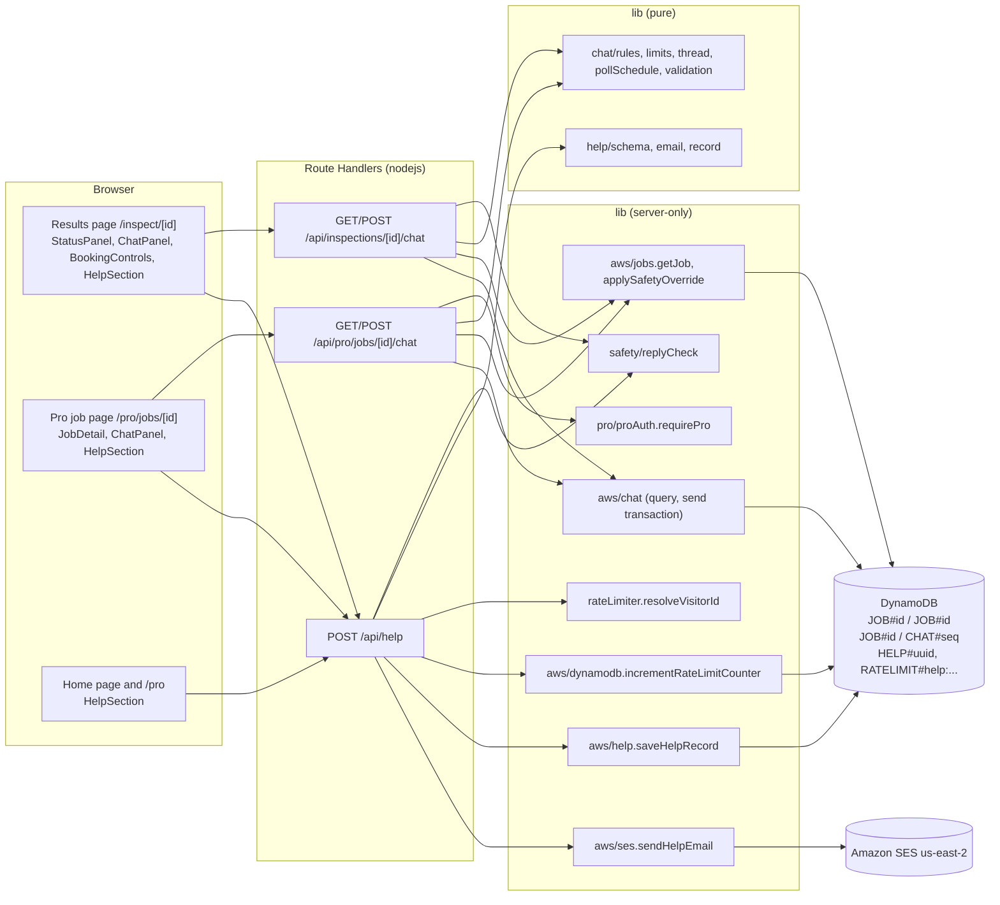
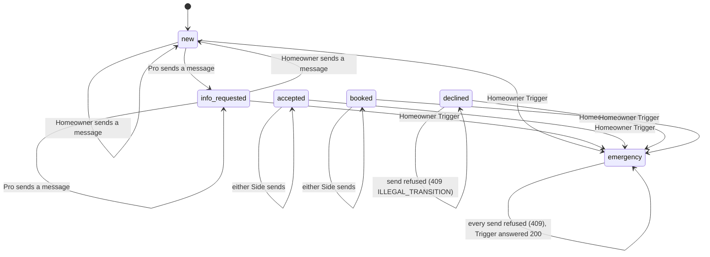
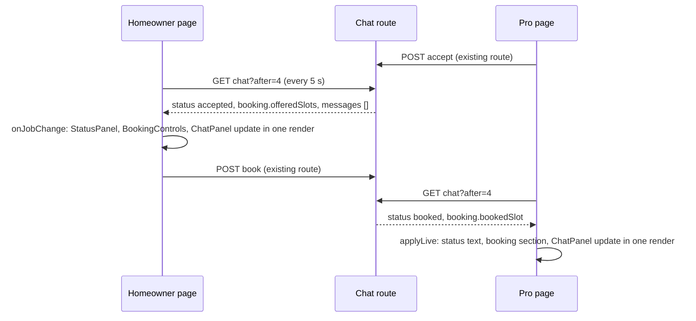

# Design Document: Chat and Help

## Overview

This design adds three things to Haunted House Inspector without changing the rules in `safety.md`:

1. **Chat.** One Chat_Thread per Job, shared by the Homeowner and the Pro_User. Messages are stored as separate DynamoDB items next to the Job item. The chat is polled (5 s, then 30 s after 2 quiet minutes). Every chat response also carries the Job_Status and the Booking_Data, so the chat, the status text and the booking controls on a page always show one status.
2. **Help form.** A "Need help? Contact us" section on every page except Emergency_Views. A Help_Message is checked by the Safety_Layer first, then saved as a Help_Record and emailed through Amazon SES.
3. **Page order.** Booking controls move below the chat on both job pages.

The design extends code that exists today. It reuses `getJob`, the transition table, `applySafetyOverride`, `conflictResponse`, `requirePro`, `readJsonBody`, `noStoreJson`, `incrementRateLimitCounter`, `useStatusPolling`, `EmergencyBanner` and the `src/components/ui/` primitives. Nothing in `src/lib/safety/`, `src/lib/emergency/messages.ts` or `src/components/sourceScan.test.ts` changes.

### Design decisions

| # | Decision | Reason |
|---|---|---|
| D1 | A chat message is its own item: `PK = JOB#<id>`, `SK = CHAT#<6-digit seq>`, with no `GSI1PK`/`GSI1SK`. | One `Query` on the main table reads a thread. Items without GSI1 attributes never enter the sparse Job_Index, so no message can appear in the Pro_User's job list (Req 7.11). |
| D2 | Counters live on the Job item: `chatSeq`, `chatLastAt`, `chatSentHomeowner`, `chatSentTradesperson`. | `chatSeq` is the thread size, the message key and the optimistic version in one number. The two arrays (last 10 send times per Side) make the per-minute limit a pure function. |
| D3 | A send is one `TransactWriteItems`: `Put` the message and `Update` the Job. | Req 2.1 asks for "one conditional write". The transaction needs no new IAM action (permissions follow `PutItem` and `UpdateItem`), and a failed condition leaves no orphan message. |
| D4 | The Safety_Layer runs on Homeowner text right after the body is parsed, before the Job id check. The Pro_User route never imports it. | Same order as the reply route today (Req 4.1, 4.7). |
| D5 | Chat state is derived from the status by one pure function, `chatAccess(status)`. The panel is controlled by the page's status, not by its own copy. | One status per page (Req 6.14, 6.15). |
| D6 | The Pro chat routes live under `/api/pro/jobs/[id]/chat`. | The `hhi_pro` cookie has `Path=/api/pro`; a route elsewhere would never receive it. |
| D7 | `Chat_Panel` and the Help components live in `src/components/ui/chat/` and `src/components/ui/help/`. | The Source_Scan_Test walks `src/components/ui/` recursively, so the new files are scanned without editing the test (Req 18.7). |
| D8 | The Help counter reuses `incrementRateLimitCounter` with the visitor id prefixed `help:`. | A separate `RATELIMIT#help:<id>` item gives a counter independent of the inspection counter (Req 14.1, 14.3) with no new table code. |
| D9 | A Trigger Help_Message always gets the Emergency_Message with HTTP 200, even when saving, counting or sending fails. | A safety response must not depend on storage (Req 12.2, 14.10, 14.11). This also resolves the overlap with Req 13.7: the 500 applies to non-Trigger messages only. |
| D10 | A Trigger Help_Message that also fails strict validation (for example no email) gets the Emergency_Message and nothing is counted, saved or sent. | A Help_Record needs a valid email to send a reply to. The Visitor is still told to get to safety. |
| D11 | The `info_requested` consistency rule in `storedJobSchema` (needs at least one `infoRequests` entry) applies only while `chatSeq` is 0 or absent. | A Pro_User's first chat message sets `info_requested` without an `infoRequests` entry. The existing test "fails info_requested without a question" keeps passing because its fixture has no chat. |

### Existing code this design touches

| File | Change |
|---|---|
| `src/lib/aws/dynamodb.ts` | Add the four chat attribute names to `STORAGE_ONLY_ATTRIBUTES` so `getInspection` does not return them. |
| `src/lib/rateLimiter.ts` | Export `resolveVisitorId(request)`, extracted from `checkRateLimit` with identical behaviour. |
| `src/lib/validation/jobSchema.ts`, `src/types/job.ts` | Optional chat attributes on the stored Job; relaxed rule D11; new `ApiErrorCode` values. |
| `src/lib/jobs/copy.ts` | New texts for the three new error codes. |
| `src/lib/jobs/views.ts` | Add `toBookingData`, `toProEmergencyDetail`. |
| `src/test/fakeDynamoTable.ts` | Support `TransactWriteCommand` and `QueryCommand` on the main table. |
| `StatusPanel`, `ResultsView`, `JobDetail`, `ActionPanel`, `useProJob` | Switch-over and page order (see Switch-over and Page order). |
| `amplify.yml`, `.env.example`, `package.json` | `CONTACT_FROM_EMAIL`, `CONTACT_TO_EMAIL`, `@aws-sdk/client-sesv2`. |

---

## Architecture



The chat routes never import `@/lib/rateLimiter` or `@/lib/aws/bedrock`. Only the Help route imports `rateLimiter` (for `resolveVisitorId`), and it never calls `checkRateLimit`, so a Help_Message cannot change the inspection counter (Req 14.3).

### Status rules for chat



The two status changes reuse `transition()`: `transition(status, 'ask_info')` for a Pro message on `new` and `transition(status, 'reply')` for a Homeowner message on `info_requested`. Every other Open_Status keeps its status.

### Request pipelines

Each step stops at the first failure.

**Homeowner send** `POST /api/inspections/[id]/chat`

1. Read the body with `readJsonBody(request, 4096)`: 413 `PAYLOAD_TOO_LARGE`, 400 `INVALID_REQUEST` for bad JSON or `text` not a string. This is the only work before the Safety_Layer. A body over 4 KB cannot be checked, as with the reply route today.
2. **Safety_Layer** `replyTriggersEmergency(text)` on the full untrimmed text. If it triggers, go to step E.
3. The id is a UUID, otherwise 404 `NOT_FOUND`.
4. Trimmed text is 1 to 500 characters, otherwise 400 `INVALID_REQUEST` with `REPLY_EMPTY_MESSAGE` or `REPLY_TOO_LONG_MESSAGE`.
5. `getJob(id)`: missing or legacy gives 404; invalid gives 500 `RESULT_INVALID`; a read error gives 500 `ACTION_FAILED`.
6. `chatAccess(job.status)`: `closed` gives 409 `JOB_IS_EMERGENCY` with `EMERGENCY_MESSAGE`; `read_only` gives 409 `ILLEGAL_TRANSITION` with the existing message and the current `status`.
7. `checkSendLimits(job, side, nowMs)`: the Thread_Limit is checked first (429 `THREAD_LIMIT_REACHED`), then the Message_Rate_Limit (429 `MESSAGE_RATE_LIMITED` with `Retry-After`).
8. `sendChatMessage(...)`: one transaction (see Data Models). On success, build the response from the read Job and the computed next status.
9. If the transaction is cancelled by a failed condition: re-read the Job once and repeat steps 6 to 8 once. If the second attempt is also cancelled, return `conflictResponse(id, 'homeowner')` (Req 2.6).

Step E (emergency): if the id is a UUID, call `applySafetyOverride(id, '', nowIso)` and swallow any error (log the error name only). Respond 200 `{ status: 'emergency', message: EMERGENCY_MESSAGE }`. Steps 3 to 9 never run, so no limit or status can block the answer. The override is called with an empty reply text on purpose: the function then skips straight to the override without storing the text, so the Trigger message is stored nowhere (Req 4.6). The stored fields are the same as the reply route's override (urgency `emergency`, cost 0, empty brief, no DIY steps, no slots).

**Pro send** `POST /api/pro/jobs/[id]/chat`

1. `requirePro(request, now)`: 401 `UNAUTHORIZED` before anything else (Req 8.1).
2. `readJsonBody`, then `{ text: string }`.
3. UUID, then trim and length (same 400 messages).
4. `getJob`, then steps 6 to 9 above, with `side = 'tradesperson'` and the Pro wording in `conflictResponse(id, 'pro')`.

There is no Safety_Layer step. The route file does not import `replyCheck` or `safetyLayer` (Req 4.7).

**Read** `GET /api/inspections/[id]/chat?after=<n>` and `GET /api/pro/jobs/[id]/chat?after=<n>`

1. (Pro) `requirePro`.
2. Parse `after` as an integer 0 to 100 (default 0 and "first load"), otherwise 400.
3. UUID (404), `getJob` (404, 500), `chatAccess`: `closed` gives 409 `JOB_IS_EMERGENCY` and no message (Req 3.6).
4. If `after` is absent, build the Legacy_Messages from the Job. If `(job.chatSeq ?? 0) > after` or `after` is absent, `queryChatMessages(id, after)` (consistent read). Otherwise skip the query.
5. Respond 200 with the `ChatReadResponse`.

### Polling and live status



---

## Components and Interfaces

### New and changed modules

| Path | Kind | Exports |
|---|---|---|
| `src/types/chat.ts` | types | `CHAT_SIDES`, `ChatSide`, `ChatMessage`, `BookingData`, `ChatAccess`, `ChatReadResponse`, `ChatSendResponse`, `ChatEmergencyResponse` |
| `src/lib/chat/rules.ts` | pure | `chatAccess`, `statusAfterSend` |
| `src/lib/chat/limits.ts` | pure | `THREAD_LIMIT`, `MESSAGE_RATE_MAX`, `MESSAGE_RATE_WINDOW_MS`, `checkSendLimits` |
| `src/lib/chat/thread.ts` | pure | `legacyToMessages`, `mergeThread`, `chatSortKey` |
| `src/lib/chat/pollSchedule.ts` | pure | `FAST_INTERVAL_MS`, `SLOW_INTERVAL_MS`, `QUIET_PERIOD_MS`, `pollDelayMs` |
| `src/lib/chat/validation.ts` | pure | `chatSendBodySchema`, `chatAfterSchema`, `chatReadResponseSchema`, `chatSendResponseSchema`, `chatEmergencyResponseSchema` |
| `src/lib/chat/chatKeys.ts` | pure | `chatSk`, `CHAT_SK_PREFIX`, `CHAT_SK_MAX` |
| `src/lib/chat/chatRoute.ts` | server-only | `runChatSend`, `runChatRead` (the shared pipelines of both Sides) |
| `src/lib/aws/chat.ts` | server-only | `queryChatMessages`, `sendChatMessage`, `SendResult` |
| `src/lib/aws/ttl.ts` | pure | `THIRTY_DAYS_SECONDS`, `ttlForJob(createdAt)`, `ttlFromNow(nowMs)` |
| `src/app/api/inspections/[id]/chat/route.ts` | route | `GET`, `POST` |
| `src/app/api/pro/jobs/[id]/chat/route.ts` | route | `GET`, `POST` |
| `src/hooks/useChatThread.ts` | client hook | `useChatThread` |
| `src/components/ui/chat/ChatPanel.tsx`, `ChatMessageList.tsx`, `ChatBubble.tsx`, `ChatComposer.tsx` | client | `ChatPanel` and parts |
| `src/lib/help/schema.ts` | pure | `HELP_PAGES`, `HelpPage`, `helpLooseBodySchema`, `helpBodySchema`, `HELP_FIELD_MESSAGES` |
| `src/lib/help/email.ts` | pure | `buildHelpEmail`, `stripLineBreaks`, `HELP_SUBJECT`, `HELP_SUBJECT_EMERGENCY` |
| `src/lib/help/record.ts` | pure | `toHelpRecord`, `helpKey`, `HelpRecord` |
| `src/lib/help/copy.ts` | pure | `HELP_CONFIRMATION`, `HELP_PRIVACY_LINE`, `HELP_HEADING`, field labels |
| `src/lib/help/handleHelp.ts` | server-only | `handleHelp` (the pipeline) |
| `src/lib/aws/help.ts` | server-only | `saveHelpRecord` |
| `src/lib/aws/ses.ts` | server-only | `getSesClient`, `sendHelpEmail` |
| `src/app/api/help/route.ts` | route | `POST` |
| `src/hooks/useHelpForm.ts` | client hook | `useHelpForm` |
| `src/components/ui/help/HelpSection.tsx`, `HelpForm.tsx` | client | `HelpSection`, `HelpForm` |
| `src/components/results/BookingControls.tsx` | client | `BookingControls` (extracted from `StatusPanel` in the page order task) |
| `src/hooks/useProActions.ts` | client hook | `useProActions` (extracted from `ActionPanel`) |

Naming and imports follow `structure.md`: named exports in lib files, `@/` alias, `server-only` on every module that touches AWS.

### Types (`src/types/chat.ts`)

```typescript
export const CHAT_SIDES = ['homeowner', 'tradesperson'] as const;
export type ChatSide = (typeof CHAT_SIDES)[number];

export interface ChatMessage {
  /** `c-<seq>` for a stored message, `q-<i>` / `r-<i>` for a Legacy_Message. */
  id: string;
  side: ChatSide;
  text: string;
  /** ISO 8601 UTC with Z. */
  sentAt: string;
  legacy: boolean;
}

/** Only the booking facts that exist for the status (Req 6.13). */
export interface BookingData {
  offeredSlots?: TimeSlot[];   // status accepted, ascending
  bookedSlot?: TimeSlot;       // status booked
  declineReason?: string;      // status declined, when given
}

export type ChatAccess = 'open' | 'read_only' | 'closed';

interface ChatJobState {
  status: Exclude<JobStatus, 'emergency'>;
  booking: BookingData;
  chatState: 'open' | 'read_only';
}

/** GET. `messages` holds the messages after the cursor; `lastSeq` is the new cursor. */
export interface ChatReadResponse extends ChatJobState {
  messages: ChatMessage[];
  lastSeq: number;
}

/** POST success. The saved message only; the client re-polls to get the rest. */
export interface ChatSendResponse extends ChatJobState {
  message: ChatMessage;
}

/** POST 200 for a Homeowner Trigger. Same shape as the reply route. */
export interface ChatEmergencyResponse {
  status: 'emergency';
  message: string;
}
```

`ApiErrorCode` in `src/types/job.ts` gains `'THREAD_LIMIT_REACHED' | 'MESSAGE_RATE_LIMITED' | 'HELP_LIMIT_REACHED'`. `ERROR_MESSAGES` in `copy.ts` is typed `satisfies Record<ApiErrorCode, ...>`, so the compiler forces the three texts. `ApiErrorBody` gains an optional `fields?: Partial<Record<'name' | 'email' | 'message', string>>` for Help validation errors.

### Pure chat rules (`src/lib/chat/rules.ts`)

```typescript
/** open for new, info_requested, accepted, booked; read_only for declined; closed for emergency. */
export function chatAccess(status: JobStatus): ChatAccess;

export type SendStatusResult =
  | { ok: true; next: JobStatus; changed: boolean }
  | { ok: false; reason: 'ILLEGAL_TRANSITION' | 'JOB_IS_EMERGENCY' };

/** Pseudocode:
 *  access = chatAccess(status)
 *  if access == closed    -> { ok:false, reason:'JOB_IS_EMERGENCY' }
 *  if access == read_only -> { ok:false, reason:'ILLEGAL_TRANSITION' }
 *  if side == tradesperson and status == new          -> t = transition(status,'ask_info'); next = t.next
 *  if side == homeowner    and status == info_requested -> t = transition(status,'reply');   next = t.next
 *  otherwise next = status
 *  return { ok:true, next, changed: next != status }
 */
export function statusAfterSend(status: JobStatus, side: ChatSide): SendStatusResult;
```

### Limits (`src/lib/chat/limits.ts`)

```typescript
export const THREAD_LIMIT = 100;
export const MESSAGE_RATE_MAX = 10;
export const MESSAGE_RATE_WINDOW_MS = 60_000;

export type LimitResult =
  | { ok: true; nextSent: number[] }                                   // epoch ms, at most 10, ascending
  | { ok: false; reason: 'THREAD_LIMIT_REACHED' }
  | { ok: false; reason: 'MESSAGE_RATE_LIMITED'; retryAfterSeconds: number };

/** Pseudocode:
 *  if (chatSeq ?? 0) >= THREAD_LIMIT           -> THREAD_LIMIT_REACHED          (checked first, Req 7.9)
 *  recent = sent.filter(t => t > nowMs - 60000)
 *  if recent.length >= 10                      -> MESSAGE_RATE_LIMITED,
 *                                                 retryAfterSeconds = ceil((recent[0] + 60000 - nowMs) / 1000)
 *  nextSent = [...recent, nowMs]               (length <= 10)
 */
export function checkSendLimits(
  state: { chatSeq?: number; sent?: readonly number[] },
  nowMs: number,
): LimitResult;
```

`retryAfterSeconds` is at least 1: `recent[0] > nowMs - 60000`, so the product is positive.

### Thread merge (`src/lib/chat/thread.ts`)

```typescript
/** infoRequests -> `q-<i>` (side tradesperson, sentAt = askedAt); replies -> `r-<i>` (side homeowner, sentAt = at). */
export function legacyToMessages(job: Pick<JobRecord, 'infoRequests' | 'replies'>): ChatMessage[];

/** Sort key: (sentAt, group, index) with group 0 = legacy question, 1 = legacy reply, 2 = chat message.
 *  index is the array index, or the seq for a chat message. */
export function chatSortKey(m: ChatMessage): [string, number, number];

/** Merges by id (a later copy of the same id is ignored) and sorts by chatSortKey. Stable. */
export function mergeThread(existing: readonly ChatMessage[], incoming: readonly ChatMessage[]): ChatMessage[];
```

Chat messages from the server have a non-decreasing `sentAt`: the send path sets `sentAt = max(nowIso, job.chatLastAt)` (ISO strings of the same format compare as text). That keeps the client's incremental merge equal to the server's full order.

### Poll schedule (`src/lib/chat/pollSchedule.ts`)

```typescript
export const FAST_INTERVAL_MS = 5_000;
export const SLOW_INTERVAL_MS = 30_000;
export const QUIET_PERIOD_MS = 120_000;

/** null = do not poll. Pure (Req 6.12).
 *  access != 'open' -> null; !visible -> null;
 *  msSinceActivity >= QUIET_PERIOD_MS -> 30000; otherwise 5000. */
export function pollDelayMs(input: {
  access: ChatAccess;
  visible: boolean;
  msSinceActivity: number;
}): number | null;
```

"Activity" is the arrival of a new message from a poll or a send by the viewer. A response that changes only the status or booking does not reset it (Req 6.18).

### Chat hook (`src/hooks/useChatThread.ts`)

```typescript
export interface UseChatThreadOptions {
  side: ChatSide;                       // the viewer
  jobId: string;
  /** The page's current status; null until the page knows it. Drives chatAccess. */
  status: JobStatus | null;
  /** Called only when the status or the booking data differs from the previous response. */
  onJobChange: (next: { status: Exclude<JobStatus, 'emergency'>; booking: BookingData }) => void;
  /** Called once on a 409 JOB_IS_EMERGENCY or a 200 emergency response. */
  onEmergency: () => void;
  /** Pro side only: 401. */
  onUnauthorized?: () => void;
}

export interface UseChatThreadReturn {
  messages: ChatMessage[];              // merged and sorted
  loaded: boolean;
  checkFailed: boolean;                 // the last poll failed; messages are kept
  sending: boolean;
  sendError: string | null;             // limit and failure texts; role="alert" in the panel
  /** The text to keep in the box after a refusal is owned by the panel, not the hook. */
  send: (text: string) => Promise<'sent' | 'refused' | 'emergency'>;
}
```

Behaviour (modelled on `useStatusPolling`):

- One initial `GET` without `after`, even when the access is `read_only`, to load history. No request at all when the access is `closed`.
- Then a timer chain: after each completed check, `setTimeout(poll, pollDelayMs(...))`. The delay is recomputed on every schedule and on every visibility change.
- An in-flight guard: no new check starts while one is running (Req 6.9). A `visibilitychange` to visible runs one check at once (Req 6.7).
- The cursor is the highest `lastSeq` returned by a GET. A POST response never moves the cursor. After a successful POST the hook merges `message` into the list (dedupe by id) and runs one poll at once, which returns the saved message again and any message from the other Side with a lower `seq` (Req 6.3).
- Every successful response with a new `(status, booking)` calls `onJobChange` in the same tick as the hook's own state update, so React batches both into one render (Req 6.14, 6.15).
- Every timer and request is cancelled on unmount (Req 6.11). A late response after unmount or after `access` became `closed` is ignored.
- A response of `409 JOB_IS_EMERGENCY` or `200 { status: 'emergency' }` stops all work, clears the messages from state and calls `onEmergency` once (Req 6.19).
- A `409 ILLEGAL_TRANSITION` on send carries the current `status`; the hook calls `onJobChange` with it when it is not `emergency`, so the panel flips to read-only without a reload (Req 3.7).

### Chat_Panel (`src/components/ui/chat/`)

```typescript
export interface ChatPanelProps {
  side: ChatSide;
  jobId: string;
  status: JobStatus | null;
  onJobChange: UseChatThreadOptions['onJobChange'];
  onEmergency: () => void;
  onUnauthorized?: () => void;
}
```

Structure and rules:

- Container: `<section aria-labelledby="chat-heading">` with heading "Messages". The list is `<ol aria-label="Conversation">`; each item names its sender and time in text (Req 19.5).
- While `status` is `null` or the first load is running: a `role="status"` loading line, no box.
- `chatAccess(status) === 'closed'` renders `null`. The page also removes the component, so no markup survives (Req 3.3).
- `read_only` renders the history and one line of text saying the job is closed to new messages. No box, no button (Req 3.2).
- Bubble: `side === viewer side` gives "You"; otherwise "Homeowner" or "Tradesperson" (Req 5.5). The text is a single `<p className="whitespace-pre-wrap break-words">{text}</p>` child, so `textContent` equals the stored string (Req 5.10, 20.3). The time uses the existing `TimeText` (a `<time>` with `dateTime` in UTC and the zone name).
- Live region: a visually hidden `<div aria-live="polite">` that receives the text of messages from the other Side that arrive through a poll. It stays empty after the first load (Req 5.8).
- Composer: its own `<textarea>` built from the `FIELD` class constant, a visible `<label>`, a character count and a "Send" button with `min-h-11`. The textarea is never disabled while sending (focus must stay, Req 19.3); the button is disabled instead and a second click is ignored. On success the text is cleared and focus is set back to the textarea; on a refusal the text and focus stay (Req 7.4, 19.3). Errors render in `role="alert"` as text.
- Colours come only from `styles.ts` constants. The bubble for the viewer uses the field surface, the other Side uses the card surface. All text and border pairs used are already in the Contrast_Registry (text on field and card, muted on card, error on card, border on card, accent focus ring), so no new pair is needed; a registry test lists the pairs the chat and help components use and asserts each row exists (Req 18.3). If implementation needs a new pair, it adds a registry row first.
- No `transition`, `animate` or `duration` classes.

### Shared status wiring on the Results page

`StatusPanel` calls `useStatusPolling` itself today. For one shared status, the hook call moves up:

```typescript
// ResultsView (client)
const polling = useStatusPolling(id, { onEmergency: markEmergency });
const status = polling.view?.status ?? null;

<StatusPanel id={id} polling={polling} />            // status text only
<ChatPanel side="homeowner" jobId={id} status={status}
  onJobChange={({ status, booking }) => polling.applyView(viewFromChat(status, booking))}
  onEmergency={() => polling.applyView({ status: 'emergency', message: EMERGENCY_MESSAGE })} />
<BookingControls id={id} polling={polling} />
```

- `viewFromChat(status, booking): HomeownerStatusView` is a pure helper in `src/lib/jobs/views.ts`: `accepted` uses `booking.offeredSlots`, `booked` uses `booking.bookedSlot`, `declined` uses `booking.declineReason`, `info_requested` uses `question: ''`.
- `applyView` already runs the stop rules, dispatches once and calls `onEmergency` once, so the status text, the booking controls and the chat panel read the same `polling.view` in one render (Req 6.14, 6.16).
- `StatusPanel` keeps accepting `{ id, onEmergency }` and calls the hook itself when no `polling` prop is given, so its existing tests are unchanged. It becomes `StatusPanelBody` (props: `polling`) plus a thin wrapper.

### Shared status wiring on the Pro job page

`useProJob` gains `applyLive(next)`:

```typescript
/** One setState. Patches status and booking on a ready, non-emergency job.
 *  status 'emergency' replaces the job with toProEmergencyDetail(job) in the same update. */
applyLive: (next: { status: JobStatus; booking: BookingData }) => void;
```

`toProEmergencyDetail(job)` is a pure function in `views.ts` (id, createdAt, likelyIssue, answers, `PRO_EMERGENCY_NOTE`). `JobDetail` passes `applyLive` to the panel as `onJobChange` and `() => applyLive({ status: 'emergency', booking: {} })` as `onEmergency`. A 401 calls the existing `handleUnauthorized`.

### Help form

```typescript
// src/lib/help/schema.ts
export const HELP_PAGES = ['/', '/inspect', '/pro', '/pro/jobs'] as const;   // route path with the Job id removed
export type HelpPage = (typeof HELP_PAGES)[number];

/** Type-only parse used before the Safety_Layer: every field is `unknown` except `message`. */
export const helpLooseBodySchema: z.ZodType<{
  message: string; name?: string; email?: string; website?: string; page?: unknown; side?: unknown; jobId?: unknown;
}>;

/** Strict parse after the Safety_Layer and the Honeypot check. Trims. */
export const helpBodySchema: z.ZodType<{
  name?: string;               // 1..100 after trim, absent when empty
  email: string;               // z.email(), max 254
  message: string;             // 1..1000 after trim
  page: HelpPage;
  side: ChatSide;
  jobId?: string;              // UUID when present
}>;

export const HELP_FIELD_MESSAGES: Record<'name' | 'email' | 'message', string>;
```

`helpBodySchema` is shared by the form (client-side check before sending, focus on the first invalid field, `aria-describedby` to the error) and the route (Req 11.6, 19.8). The Honeypot field is sent as `website`.

```typescript
// src/lib/help/email.ts (pure)
export interface HelpEmail {
  subject: string;           // HELP_SUBJECT or HELP_SUBJECT_EMERGENCY, never Visitor text
  replyTo: string;           // the Visitor's email with CR and LF removed
  text: string;              // Message, Name, Email, Side, page, Job id, emergency mark
}
export function stripLineBreaks(value: string): string;   // removes \r and \n
export function buildHelpEmail(input: HelpRecordInput): HelpEmail;
```

`sendHelpEmail(email)` in `src/lib/aws/ses.ts` builds one `SendEmailCommand` (`@aws-sdk/client-sesv2`): `FromEmailAddress = CONTACT_FROM_EMAIL`, `Destination.ToAddresses = [CONTACT_TO_EMAIL]`, `ReplyToAddresses = [email.replyTo]`, `Content.Simple` with the fixed subject and a text body. The client is a singleton created with `region: process.env.APP_AWS_REGION` and the default credential chain. If either address variable is unset it throws an error named `MissingConfigError`.

### Help pipeline (`handleHelp`, server-only)

1. `readJsonBody(request, 8192)`: 413 or 400.
2. `helpLooseBodySchema`: 400 when `message` is not a string.
3. **Safety_Layer**: `trigger = replyTriggersEmergency(message) || replyTriggersEmergency(name ?? '')`. The two texts are checked separately, never joined.
4. Honeypot: if `website` is a non-empty string, respond with the Trigger answer (when `trigger`) or the success answer, and save, send and count nothing (Req 12.5, 14.4).
5. `helpBodySchema`. On failure: when `trigger`, respond with the Emergency_Message and nothing else (D10); otherwise 400 `INVALID_REQUEST` with `fields`.
6. Visitor: `resolveVisitorId(request)`, then `incrementRateLimitCounter('help:' + id, now, 5, 24 h)`.
   - Counter error: when `trigger`, log the error name and respond with the Emergency_Message; otherwise 500 `ACTION_FAILED` (Req 14.6, 14.10).
   - Not allowed: when `trigger`, respond with the Emergency_Message; otherwise 429 `HELP_LIMIT_REACHED` with `Retry-After = ceil((windowStart + 24 h - now) / 1000)`.
7. `saveHelpRecord(record)` in a try block, then `sendHelpEmail(buildHelpEmail(record))` in its own try block. Each failure logs the error name only. Both are attempted even if the first fails (Req 13.7).
8. Respond: when `trigger`, 200 `{ status: 'emergency', message }`. Otherwise, if at least one of save and send worked, 200 `{ status: 'sent' }`; if both failed, 500 `ACTION_FAILED`.

The success body is the same for a saved message, a message whose email failed, and a Honeypot-filled one (Req 15.3).

### Help components

```typescript
export interface HelpSectionProps {
  page: HelpPage;
  jobId?: string;       // present on the Results page and the Pro job page
}
```

`HelpSection` renders the heading "Need help? Contact us", `HelpForm` and the line "We use your email only to reply to you." directly under the form. The Side is derived from `page`: `homeowner` for `/` and `/inspect`, `tradesperson` for `/pro` and `/pro/jobs`. `useHelpForm` owns values, field errors, the phase (`idle`, `sending`, `sent`, `emergency`, `error`) and the first-invalid-field focus.

- On `emergency`, the form shows `<EmergencyBanner urgency="emergency" />` (fixed red style, no `haunted:` classes), no confirmation and no `EmergencyScope`, because the Help_Form is not an Emergency_View.
- On `sent`, it shows "Thanks, we got your message. We'll reply by email." in `role="status"` and clears the fields.
- While sending, the submit button is disabled and a text status says so (Req 15.4).
- The Honeypot is an `<input name="website" tabIndex={-1} autoComplete="off" aria-label="Leave this field empty">` inside a wrapper with `aria-hidden="true"` and classes that move it off screen (`absolute left-[-9999px] h-0 w-0 overflow-hidden`). It carries a `focus-visible:` class so the Source_Scan_Test accepts it.
- Reuse `TextField`, `TextAreaField` and `Button` from `src/components/ui/`.

Source-scan caution: the scan flags a string literal that is exactly a CSS colour name (for example `'tan'`, `'gold'`, `'plum'`). New code in `src/components/ui/` must avoid such literals.

---

## Data Models

### DynamoDB items (single table)

| Item | PK | SK | Attributes | GSI1 | ttl |
|---|---|---|---|---|---|
| Job (existing) | `JOB#<id>` | `JOB#<id>` | existing attributes plus the four chat attributes below | yes | `createdAt + 30 d` |
| Chat message (new) | `JOB#<id>` | `CHAT#<seq, 6 digits>` | `side`, `text`, `sentAt`, `seq`, `ttl` | **none** | same as the Job |
| Help record (new) | `HELP#<uuid>` | `HELP#<uuid>` | `name?`, `email`, `message`, `side`, `page`, `jobId?`, `emergency`, `createdAt`, `ttl` | **none** | `createdAt + 30 d` |
| Help counter (reused code) | `RATELIMIT#help:<visitorId>` | same | `count`, `windowStart`, `ttl` | none | window end |

New attributes on the Job item (all optional; absent means 0 or empty, so existing Jobs and tests are untouched):

| Attribute | Type | Meaning |
|---|---|---|
| `chatSeq` | number 0..100 | Number of chat messages sent; the last used `seq`. Thread_Limit and optimistic version. |
| `chatLastAt` | ISO string | `sentAt` of the last chat message. |
| `chatSentHomeowner` | number[] (max 10) | Epoch ms of the most recent Homeowner sends within the last minute. |
| `chatSentTradesperson` | number[] (max 10) | Same for the Pro_User. |

Key helpers (`chatKeys.ts`):

```typescript
export const CHAT_SK_PREFIX = 'CHAT#';
export const CHAT_SK_MAX = 'CHAT#999999';
export function chatSk(seq: number): string;   // 'CHAT#' + String(seq).padStart(6, '0')
```

Legacy Jobs and `getInspection`: the four attribute names are added to `STORAGE_ONLY_ATTRIBUTES` in `dynamodb.ts`; otherwise `GET /api/inspections/[id]` would return them.

`storedJobSchema` additions (`.optional()`, no defaults, so parsed output of existing Jobs is unchanged):

```typescript
chatSeq: z.number().int().min(0).max(100).optional(),
chatLastAt: isoUtc.optional(),
chatSentHomeowner: z.array(z.number().int()).max(10).optional(),
chatSentTradesperson: z.array(z.number().int()).max(10).optional(),
// superRefine: the info_requested rule applies only when (j.chatSeq ?? 0) === 0
```

`JobRecord` gets the same optional fields.

### TTL

`src/lib/aws/ttl.ts` exports `ttlForJob(createdAt)` = `floor(Date.parse(createdAt) / 1000) + 30 d` (same formula as `persistInspection`) and `ttlFromNow(nowMs)` for Help_Records. A test asserts `ttlForJob(createdAt)` equals the `ttl` that `persistInspection` writes for the same `createdAt` (Req 7.5). `persistInspection` itself is not changed.

### Send transaction (`src/lib/aws/chat.ts`)

```typescript
export type SendResult =
  | { ok: true; message: ChatMessage }
  | { ok: false; reason: 'CONDITION_FAILED' };

export interface SendInput {
  jobId: string;
  side: ChatSide;
  text: string;                       // already trimmed and validated
  expectedStatus: JobStatus;          // status the caller read
  nextStatus: JobStatus;
  readSeq: number | undefined;        // chatSeq the caller read
  nextSent: number[];                 // from checkSendLimits
  createdAt: string;                  // Job createdAt, for the ttl
  sentAt: string;                     // max(now, chatLastAt)
  nowIso: string;
}

export function sendChatMessage(input: SendInput): Promise<SendResult>;
export function queryChatMessages(jobId: string, after: number): Promise<ChatMessage[]>;
```

`sendChatMessage` pseudocode:

```
seq = (readSeq ?? 0) + 1
TransactWriteCommand([
  Put   { Item: { PK: JOB#id, SK: chatSk(seq), side, text, sentAt, seq, ttl: ttlForJob(createdAt) },
          Condition: attribute_not_exists(PK) },
  Update{ Key: { PK: JOB#id, SK: JOB#id },
          Update: SET chatSeq = :seq, chatLastAt = :sentAt, chatSent<Side> = :nextSent
                  [, #status = :next, statusUpdatedAt = :now  when nextStatus != expectedStatus],
          Condition: attribute_exists(PK) AND #status = :expected
                     AND (readSeq is undefined ? attribute_not_exists(chatSeq) : chatSeq = :readSeq) }
])
catch TransactionCanceledException whose reasons include ConditionalCheckFailed or TransactionConflict
   -> { ok:false, reason:'CONDITION_FAILED' }
any other error -> rethrow
```

Why this is safe:

- The Job update never touches `GSI1PK` or `GSI1SK`, and the message item has no GSI1 attributes (Req 7.11).
- `#status = :expected` makes a send fail after the safety override, after a decline and after any other status change. The route then re-reads once (Req 2.6).
- `chatSeq = :readSeq` serialises concurrent sends from both Sides, so the thread never exceeds 100 and no seq is used twice. The second sender's re-read sees the new `chatSeq` and tries again once.

`queryChatMessages`:

```
QueryCommand { KeyConditionExpression: 'PK = :pk AND SK BETWEEN :lo AND :hi',
               ExpressionAttributeValues: { :pk: JOB#id, :lo: chatSk(after + 1), :hi: CHAT_SK_MAX },
               ConsistentRead: true, ScanIndexForward: true, Limit: 100 }
-> map to ChatMessage { id: 'c-' + seq, side, text, sentAt, legacy: false }
```

The `BETWEEN` range (not `SK > ...`) keeps the Job item `JOB#<id>` out of the result, because `'J'` sorts after `'C'`.

### Booking data (`views.ts`)

```typescript
/** accepted -> { offeredSlots ascending }; booked -> { bookedSlot }; declined -> { declineReason? }; others -> {}. */
export function toBookingData(job: JobRecord): BookingData;
export function viewFromChat(status: Exclude<JobStatus,'emergency'>, booking: BookingData): HomeownerStatusView;
export function toProEmergencyDetail(job: ProJobDetailActive): ProJobDetailEmergency;
```

### Responses

| Route and outcome | Status | Body |
|---|---|---|
| GET success | 200 | `ChatReadResponse` |
| POST success | 200 | `ChatSendResponse` |
| Homeowner POST Trigger | 200 | `ChatEmergencyResponse` |
| Send or read on an Emergency_Job | 409 | `{ error: 'JOB_IS_EMERGENCY', message, status: 'emergency' }` (`EMERGENCY_MESSAGE` for the Homeowner, `PRO_EMERGENCY_NOTE` for the Pro_User) |
| Send to a declined Job | 409 | `{ error: 'ILLEGAL_TRANSITION', message, status: 'declined' }` |
| Thread full | 429 | `{ error: 'THREAD_LIMIT_REACHED', message }` |
| Rate limited | 429 + `Retry-After` | `{ error: 'MESSAGE_RATE_LIMITED', message }` |
| Help success | 200 | `{ status: 'sent' }` |
| Help Trigger | 200 | `{ status: 'emergency', message }` |
| Help limit | 429 + `Retry-After` | `{ error: 'HELP_LIMIT_REACHED', message }` |
| Help invalid | 400 | `{ error: 'INVALID_REQUEST', message, fields }` |

Every response uses `noStoreJson` (`Cache-Control: no-store`).

### IAM and infrastructure

Add to the Amplify compute role (the existing policy keeps its statements):

```json
{
  "Sid": "JobsTableQuery",
  "Effect": "Allow",
  "Action": "dynamodb:Query",
  "Resource": "arn:aws:dynamodb:us-east-2:<ACCOUNT_ID>:table/<TABLE_NAME>"
},
{
  "Sid": "HelpEmail",
  "Effect": "Allow",
  "Action": "ses:SendEmail",
  "Resource": "arn:aws:ses:us-east-2:<ACCOUNT_ID>:identity/<VERIFIED_IDENTITY>"
}
```

- `TransactWriteItems` is authorised through `PutItem` and `UpdateItem`, which the role already has ([IAM for DynamoDB transactions](https://docs.aws.amazon.com/amazondynamodb/latest/developerguide/transaction-apis-iam.html)). No `ConditionCheckItem` is used.
- The SES identity for `CONTACT_FROM_EMAIL` must be verified in `us-east-2`. While the account is in the SES sandbox, the `CONTACT_TO_EMAIL` address must be verified too, and its identity ARN added to the statement.
- `amplify.yml`: append `-e CONTACT_FROM_EMAIL -e CONTACT_TO_EMAIL` to the existing `env | grep` line. `.env.example`: two lines, `CONTACT_FROM_EMAIL=` and `CONTACT_TO_EMAIL=`, each with a one-line comment and no value.
- `package.json`: `"@aws-sdk/client-sesv2": "3.1163.0"` (exact, same as the other `@aws-sdk` packages).

Cost note: with two open pages, chat polling costs about 24 strongly consistent `GetItem` calls per minute per Job at 5 s, and drops to 4 per minute after two quiet minutes. A poll with nothing new skips the `Query`.

### Switch-over and page order

**Switch-over (task 4).** The final screen change:

- `ResultsView` mounts `ChatPanel` and drops the `ReplyBox` block, its state and the "unsent reply" notice from `StatusPanel`.
- `JobDetail` mounts `ChatPanel`; `AskInfoForm`, `JobHistory` and the `info_requested` case of `StatusBlock` are removed, because the thread now shows those entries as Legacy_Messages.
- `DATA_SHARING_NOTICE_TEXT` becomes the text of Req 9.5. The Results_Page_Notice becomes the text of Req 9.8.
- The ask-info and reply routes, `applyReply`, `applyTransition` for `ask_info`, and all their tests stay.
- Tests replaced: those of `ReplyBox`, `AskInfoForm` and `JobHistory`, and the assertions on the two notice texts. These are the only existing assertions that change; each is replaced by the equivalent Chat_Panel or notice test.

**Page order (task 6).**

Results page, top to bottom: heading and urgency, issue, cost, job brief, `StatusPanel` (status text), `ChatPanel`, `BookingControls`, the two notes, "Start a new inspection", `HelpSection`. `BookingControls` (new file) holds the slot picker, the booking request and the confirmation moved out of `StatusPanel`; `StatusPanel` renders it itself unless `hideBooking` is set, so its existing tests keep passing, and `ResultsView` sets `hideBooking`.

Pro job page, top to bottom: job facts, photos, `ChatPanel`, decline control (or the decline reason when declined), booking controls (the accept form for `new` and `info_requested`; offered or booked slots for `accepted` and `booked`; nothing for `declined`), `HelpSection`. `ActionPanel`'s request logic moves into `useProActions(id, handlers)` returning `{ pending, message, send }`. JobDetail renders the decline form and the accept form in their own positions; `ActionPanel` stays as a thin wrapper until the page order task, so its tests keep passing.

Emergency views on both pages render only what they render today.

**Help placement.** `app/page.tsx` renders `<HelpSection page="/" />` after `UploadFlow`. `ResultsView` renders `<HelpSection page="/inspect" jobId={id} />` in the normal, not-found and error branches, and in neither the loading branch (the status is unknown) nor the emergency branch. `ProDashboard` renders `<HelpSection page="/pro" />` at the bottom of every view, including the access code form. `JobDetail` renders `<HelpSection page="/pro/jobs" jobId={id} />` in every phase except `loading` and the emergency view.

---

## Correctness Properties

*A property is a characteristic or behavior that should hold true across all valid executions of a system, essentially, a formal statement about what the system should do. Properties serve as the bridge between human-readable specifications and machine-verifiable correctness guarantees.*

Reflection on the prework: it found about 25 testable criteria for chat and 15 for help. These were merged where one property implies another: 3.4 to 3.6 and 4.4 into Property 5; 7.1 to 7.3, 7.9 and 7.10 into Property 7; 6.1 to 6.6 and 6.12 into Property 11; 11.2, 11.3, 11.6 and 11.8 into Property 13; 12.x, 14.10 and 14.11 into Property 2. UI rendering, copy, headers on single outcomes, layout, and configuration criteria are covered by example and smoke tests (see Testing Strategy).

Design properties 1 and 2 extend the safety-first property (number 3) of `pro-dashboard-and-booking` for Homeowner free text. Design property 3 extends that spec's Pro_User text property (number 5).

### Property 1: Homeowner chat is safety first (extends Property 3)

*For any* text that contains a Trigger, *for any* target (existing Job in any Job_Status, unknown UUID, legacy Job, non-UUID id), *for any* thread size from 0 to 100, *for any* Message_Rate_Limit state and *for any* injected DynamoDB failure, `POST /api/inspections/[id]/chat` responds with HTTP 200, status `emergency` and exactly `EMERGENCY_MESSAGE`; the Safety_Layer check is recorded before any DynamoDB command; no `CHAT#` item is written; the trigger text appears in no stored attribute; and when the Job exists and was not an emergency, it ends with status `emergency`, urgency `emergency`, cost range 0, an empty job brief, no DIY steps and no offered or booked slot.

**Validates: Requirements 4.1, 4.2, 4.3, 4.6, 4.8, 21.1**

### Property 2: Help messages are safety first (extends Property 3)

*For any* Help_Message whose Message or Name contains a Trigger, *for any* Honeypot value, *for any* Help_Limit state, *for any* failure of the counter, the table or SES, and *for any* strict-validity of the other fields, `POST /api/help` responds with HTTP 200, status `emergency` and exactly `EMERGENCY_MESSAGE`; the Safety_Layer check is recorded before any DynamoDB or SES call; no Job_Status changes; when the Honeypot is filled or the limit is reached or the counter fails or the fields are invalid, nothing is saved or sent; and when the Honeypot is empty, the limit is open and the fields are valid, one Help_Record and one Help_Email are made, both marked as an emergency, and the counter is incremented once.

**Validates: Requirements 12.1, 12.2, 12.4, 12.5, 12.6, 12.7, 12.8, 14.10, 14.11, 21.1, 21.7**

### Property 3: Pro chat messages never touch safety state (extends Property 5)

*For any* text, including text with Triggers, and *for any* Job_Status, a Pro_User chat message never calls the Safety_Layer, never changes a Job to `emergency`, and results in one of: a saved message with the status given by the status rules, or a 409 for `declined` and `emergency` Jobs.

**Validates: Requirements 4.7, 21.2**

### Property 4: Status rules for chat

*For any* sequence of chat messages from either Side sent to an Open_Status Job, the Job_Status after the sequence equals the status obtained by applying one rule per message in order: a Pro_User message on `new` gives `info_requested`; a Homeowner message on `info_requested` gives `new`; any other message leaves the status unchanged. The status and the message are written in one transaction, so the stored thread length always equals the number of accepted messages.

**Validates: Requirements 2.1, 2.2, 2.3, 2.7, 21.3**

### Property 5: A closed chat stays closed

*For any* Job_Status in {`declined`, `emergency`}, *for any* Side and *for any* non-Trigger text, a send is refused (409 `ILLEGAL_TRANSITION` for `declined`, 409 `JOB_IS_EMERGENCY` for `emergency`) and nothing is saved. *For any* emergency Job, a read returns 409 `JOB_IS_EMERGENCY` and no message. *For any* sequence of chat sends, Trigger sends and Pro actions applied to an emergency Job, the Job_Status stays `emergency` and `chatAccess` stays `closed`.

**Validates: Requirements 3.1, 3.2, 3.4, 3.5, 3.6, 4.4, 21.6**

### Property 6: Thread order is by time, stable, and includes legacy entries

*For any* Job with any `infoRequests`, `replies` and chat messages (including equal `sentAt` values), `mergeThread` returns a list that is sorted by `sentAt` ascending, is a permutation of the input with no entry changed or dropped, keeps the stored order for equal times (legacy questions, then legacy replies, then chat messages by `seq`), and merging the messages in any batch order with the cursor rule gives the same list as merging them all at once. Building the thread never modifies the stored `infoRequests` and `replies`.

**Validates: Requirements 1.3, 1.4, 1.6, 9.4, 21.4**

### Property 7: Chat limits hold for every sequence

*For any* sequence of sends from either Side with any timestamps in the same Job, the thread never holds more than 100 chat messages, one Side never has more than 10 saved messages in any 60-second window, the limit counts are separate per Side and per Job, a full thread gives `THREAD_LIMIT_REACHED` even when the rate limit also applies, and a rate-limited send returns `Retry-After` equal to the whole seconds until the oldest counted send leaves the window (at least 1).

**Validates: Requirements 7.1, 7.2, 7.3, 7.9, 7.10, 21.5**

### Property 8: Chat text is trimmed, bounded, and round-trips

*For any* string whose trimmed length is 1 to 500, the saved text equals the trimmed string and the rendered bubble's `textContent` equals it unchanged, including strings with markup characters and line breaks. *For any* string that is empty after trimming, or longer than 500 characters after trimming, the route responds 400 `INVALID_REQUEST` and saves nothing.

**Validates: Requirements 5.1, 5.2, 5.3, 5.4, 5.10**

### Property 9: Stored messages stay out of the Job_Index and expire with the Job

*For any* Job and *for any* sequence of accepted sends, every stored chat item has `PK = JOB#<id>`, `SK = CHAT#<6 digits>`, no `GSI1PK` and no `GSI1SK`; a `GSI1` query returns only Job items; and each chat item's `ttl` equals `ttlForJob(createdAt)`, which equals the `ttl` that `persistInspection` writes for the same `createdAt`.

**Validates: Requirements 7.5, 7.11, 21.18**

### Property 10: The Side comes from the route, and the Pro routes need the cookie

*For any* request body, including bodies with extra fields such as `side`, and *for any* cookie on a Homeowner route, the stored Side is `homeowner` on the Homeowner route and `tradesperson` on the Pro route. *For any* missing or invalid `hhi_pro` cookie value, a Pro chat route responds 401 `UNAUTHORIZED` and makes no DynamoDB call.

**Validates: Requirements 8.1, 8.2, 8.3, 8.4**

### Property 11: The poll schedule is a function of time, visibility and state

*For any* access state, visibility and time since the last activity, `pollDelayMs` returns `null` when access is not `open` or the tab is hidden, 30000 when the time since activity is at least 120000 ms, and 5000 otherwise.

**Validates: Requirements 6.1, 6.2, 6.4, 6.5, 6.6, 6.12, 21.8**

### Property 12: Every successful chat response carries status and booking data

*For any* stored Job in an Open_Status or `declined`, and for either Side, every 200 response from a chat GET or POST has a `status` equal to the Job's status after the request, and a `booking` equal to `toBookingData` of that Job: offered slots in ascending order for `accepted`, the booked slot for `booked`, the decline reason for `declined`, and nothing else.

**Validates: Requirements 6.13, 21.17**

### Property 13: Help input validation and round trip

*For any* input, the Help_API accepts it exactly when the email is syntactically valid and at most 254 characters, the trimmed Message is 1 to 1000 characters, the trimmed Name is empty or 1 to 100 characters, the page is one of `HELP_PAGES`, the Side is `homeowner` or `tradesperson`, and the Job id is absent or a UUID. *For any* accepted input, the stored Help_Record contains the same trimmed Name, Email, Message, page, Side and Job id. *For any* rejected input that is not a Trigger, the response is 400 `INVALID_REQUEST` with the failing field names, and nothing is saved, sent or counted.

**Validates: Requirements 11.2, 11.3, 11.6, 11.7, 11.8, 11.10, 13.1, 13.2**

### Property 14: The Help_Limit counts every saved message and ignores bots

*For any* sequence of N valid Help_Messages from one Visitor in one 24-hour window, with or without Triggers, exactly min(N, 5) Help_Records are saved and exactly min(N, 5) Help_Emails are sent; blocked non-Trigger messages get 429 with `Retry-After`; the inspection counter is never changed; and *for any* non-empty Honeypot value the response equals the normal success response (or the Emergency_Message for a Trigger) while nothing is saved, sent or counted.

**Validates: Requirements 14.1, 14.2, 14.4, 14.8, 14.9, 15.3**

### Property 15: Help emails hold the facts and no injected headers

*For any* valid Help_Message and *for any* request headers (including an IP address and cookies), the Help_Email body contains the Message, Name, Email, Side, page and Job id (when present) and the emergency mark when set, and contains no IP address, Hashed_IP or cookie value. The subject is exactly `HELP_SUBJECT` or `HELP_SUBJECT_EMERGENCY`. No value placed in a header (subject, reply-to) contains a CR or LF, whatever the Visitor typed.

**Validates: Requirements 13.3, 13.4, 13.5, 21.10**

### Property 16: Visitor text is never logged

*For any* chat text, help message, name or email, and *for any* injected failure in the routes, `console.log`, `console.warn` and `console.error` calls contain none of those values and none of `CONTACT_FROM_EMAIL` or `CONTACT_TO_EMAIL`; only error names are logged.

**Validates: Requirements 7.6, 13.8, 21.9**

---

## Error Handling

| Situation | Response | Notes |
|---|---|---|
| Body over 4 KB (chat) or 8 KB (help) | 413 `PAYLOAD_TOO_LARGE` | Cannot be safety-checked; same as the reply route. UI keeps the text and shows "Please shorten your message." |
| Invalid JSON or wrong types | 400 `INVALID_REQUEST` | |
| Empty or too long chat text | 400 `INVALID_REQUEST` | Existing reply messages. |
| Missing or invalid Pro cookie | 401 `UNAUTHORIZED` | Before any other work. The Pro panel calls `onUnauthorized`. |
| Bad id, missing Job, legacy Job | 404 `NOT_FOUND` | |
| Stored Job fails validation | 500 `RESULT_INVALID` | |
| DynamoDB error on read or write | 500 `ACTION_FAILED` | Error name logged only. The panel keeps the typed text. |
| Condition failed twice | `conflictResponse` (409 or 500) | One re-read per attempt. |
| Thread full | 429 `THREAD_LIMIT_REACHED` | |
| Rate limited | 429 `MESSAGE_RATE_LIMITED` + `Retry-After` | |
| Safety override write fails | 200 emergency | Error name logged. |
| Help counter fails, non-Trigger | 500 `ACTION_FAILED` | Nothing saved or sent. |
| Help limit reached, non-Trigger | 429 `HELP_LIMIT_REACHED` + `Retry-After` | |
| SES fails or addresses unset | 200 success | Record kept; error name logged. |
| Save fails, send works | 200 success | |
| Save and send both fail, non-Trigger | 500 `ACTION_FAILED` | The form keeps its values. |

Client behaviour:

- A failed poll keeps the messages, shows a short text error (`role="alert"`) and tries again at the current interval.
- A send refusal (limit, conflict, failure) keeps the typed text and the focus in the box.
- A 409 `JOB_IS_EMERGENCY` from any chat request is treated as a change to `emergency`: the panel is removed, polling stops, and the page shows its emergency view in the same render.
- Logging: server code logs only `error.name`, never message text, names, emails or addresses.

---

## Testing Strategy

Property-based testing applies here: the chat rules, limits, thread merge, poll schedule, email builder and validation are pure functions, and the route behaviour is checked against the in-memory fake DynamoDB table with mocked SES. UI rendering, copy, layout, headers on single outcomes and configuration are tested with example and smoke tests instead.

### Tools and conventions

- Vitest, Testing Library, `fast-check` (already dependencies). Each property test runs at least 100 iterations (`{ numRuns: 100 }` or more) and is one `fc.assert` per property.
- Each property test carries a comment: `Feature: chat-and-help, Property <n>: <title>`.
- AWS is always mocked. DynamoDB uses `src/test/fakeDynamoTable.ts`; SES is mocked with `vi.mock('@aws-sdk/client-sesv2')`. No test makes a real AWS call.
- Ordering evidence (Properties 1 and 2): a shared log array records `'check'` (a spy around `checkEmergency`, as in `reply.safety.property.test.ts`), DynamoDB command names (from `fake.calls`) and `'ses'`; the test asserts `'check'` precedes every other entry.

### Test infrastructure changes

`src/test/fakeDynamoTable.ts` is extended (it is test code, not product code):

- `TransactWriteCommand` with `Put`, `Update` and `ConditionCheck` items, all-or-nothing, throwing `TransactionCanceledException` with `CancellationReasons` when a condition fails.
- `QueryCommand` on the main table with `PK = :pk AND SK BETWEEN :lo AND :hi`, `ConsistentRead`, `Limit`, and ascending order.
- The existing guard that throws on unsupported commands stays for every other command.
- `src/test/jobFixtures.ts` gains `makeChatItem` and options for the chat attributes.
- `allowRateLimitWrites: true` is used in Help tests (the counter is a `RATELIMIT#` item).

### Property tests (one test per property)

| File | Properties |
|---|---|
| `src/app/api/inspections/[id]/chat/chat.safety.property.test.ts` | 1 |
| `src/app/api/help/help.safety.property.test.ts` | 2 |
| `src/app/api/pro/jobs/[id]/chat/proChat.property.test.ts` | 3, 10 (cookie part) |
| `src/lib/chat/rules.property.test.ts` and `chatStatus.route.property.test.ts` | 4 (pure model and route) |
| `src/app/api/chat.closed.property.test.ts` | 5 |
| `src/lib/chat/thread.property.test.ts` | 6 |
| `src/lib/chat/limits.property.test.ts` and `chatLimits.route.property.test.ts` | 7 |
| `src/lib/chat/chatText.property.test.ts` | 8 (route boundary and render round trip) |
| `src/lib/aws/chat.storage.property.test.ts` | 9 |
| `src/app/api/chat.side.property.test.ts` | 10 (side part) |
| `src/lib/chat/pollSchedule.property.test.ts` | 11 |
| `src/app/api/chat.response.property.test.ts` | 12 |
| `src/lib/help/schema.property.test.ts` and `help.roundtrip.property.test.ts` | 13 |
| `src/app/api/help/help.limit.property.test.ts` | 14 |
| `src/lib/help/email.property.test.ts` | 15 |
| `src/app/api/chat.logging.property.test.ts` | 16 (chat and help) |

Generators: trigger phrases reuse the four groups from `replyCheck.test.ts` and `proText.property.test.ts`, embedded in random padding. Job fixtures cover all six statuses. Text generators include whitespace padding, markup characters, newlines, 500 and 501 character boundaries, and CR and LF inside names and emails (for Property 15).

### Example and unit tests

- **Routes**: status rules per status and Side (Req 21.3); first-message status change in one transaction; one re-read and then conflict; 404 cases; 413 at the boundary; `Retry-After` header; `Cache-Control: no-store` on every outcome; the chat routes never write `RATELIMIT#` items and never import the rate limiter (a new `chatNoRateLimiter.test.ts`, modelled on `noRateLimiter.test.ts`).
- **Help**: Honeypot with and without a Trigger (same confirmation, nothing stored); counter independent of the inspection counter; SES failure still confirms; both failing gives 500; missing env gives success with the record kept; Region and addresses in the SES command; no IP or cookie in the record or email.
- **Hooks** (fake timers): 5 s polling; 30 s after 2 minutes; back to 5 s on a new message or send; stop for a hidden tab, `read_only` and `emergency`; one immediate check on visible; no overlapping checks; failed check keeps messages; unmount cancels timers and requests; status-only change keeps the interval.
- **Components**: Chat_Panel states (loading, open, read only, empty, error, limit message), labels, `<time>`, live region silent on first load, focus kept after a send and after a refusal, text cleared only after success. HelpForm: labels, validation errors with focus on the first invalid field, `aria-describedby`, disabled while sending, confirmation with `role="status"`, Emergency_Banner on a Trigger with no confirmation, values kept on failure.
- **Pages**: Results page order for each of the six statuses (Req 17), Pro page order for each status (Req 16), one `Help_Section` per page and none in emergency views, the Help_Section disappearing in the same render as an emergency, the Chat_Panel disappearing in the same render, accept shows "Pick a time" within one poll, booking shows on the Pro page within one poll.
- **Texts**: Privacy_Notice and Results_Page_Notice equal the exact strings of Req 9.5 and 9.8 (and each appears only where specified).
- **Contrast**: a registry test lists the colour pairs the new components use and asserts each exists and passes.

### Smoke tests

- `amplify.yml` and `.env.example` name `CONTACT_FROM_EMAIL` and `CONTACT_TO_EMAIL`, and `.env.example` holds no value for them.
- `@aws-sdk/client-sesv2` in `package.json` has the same exact version as the other `@aws-sdk` packages.
- Until the Switch_Over task, no non-test file imports `ChatPanel`.
- `useChatThread` source contains no `WebSocket` or `EventSource`.
- The existing `src/lib/safety/` tests and `sourceScan.test.ts` pass unchanged and the scan covers the new files in `src/components/ui/`.
- At every task, the full existing suite passes (the old ask-info and reply routes, their tests and, until the Switch_Over, their screens).

### Manual checks

Playwright screenshots at 390 px and 1280 px (no horizontal scroll) for both job pages and the Help_Section in both themes, one keyboard-only pass over the chat and the form, and one screen reader pass for the live region. In the deployed app: verify the SES identities in `us-east-2`, send one real Help_Message, and confirm the email arrives with the Visitor as Reply-To.

### Traceability for Requirement 21

| 21.x | Covered by |
|---|---|
| 21.1 | Properties 1, 2 |
| 21.2 | Property 3 |
| 21.3 | Property 4 and route examples |
| 21.4 | Property 6 |
| 21.5 | Property 7 |
| 21.6 | Property 5 and component tests |
| 21.7 | Properties 2, 14 |
| 21.8 | Property 11 and hook tests |
| 21.9 | Property 16 |
| 21.10 | Property 15 and Help examples |
| 21.11, 21.16 | Text tests |
| 21.12 | Page order tests |
| 21.13 | Smoke tests |
| 21.14 | Tools and conventions |
| 21.15 | Smoke tests |
| 21.17 | Property 12 and page tests |
| 21.18 | Property 9 |
| 21.19 | Full existing suite at every task |

### Task order (for the tasks phase)

(1) Data and safety: types, schema change (D11), pure rules, limits, thread, keys, ttl, `aws/chat.ts`, fake table extension, `resolveVisitorId`. (2) Routes: both chat routes, the shared pipeline, route and property tests, IAM note. (3) Chat screens: hook, `ChatPanel`, tests; not mounted. (4) Switch-over. (5) Help form: schema, email, SES client, route, components, mounting, env and `amplify.yml`, package pin. (6) Page order: `BookingControls`, `useProActions`, reorder both pages. (7) Final checkpoint. Each task leaves the app working and shippable.
