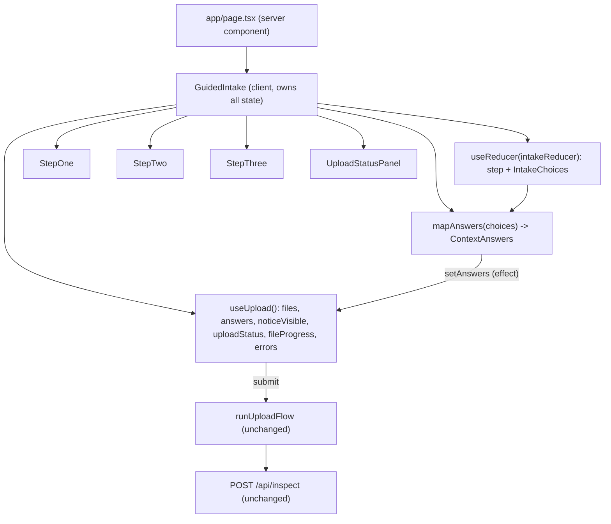
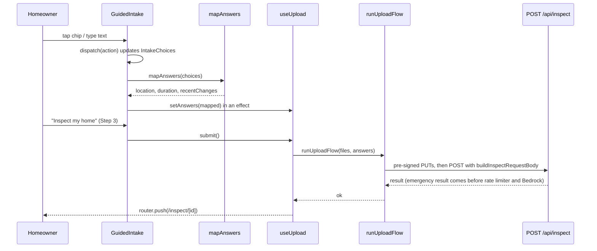
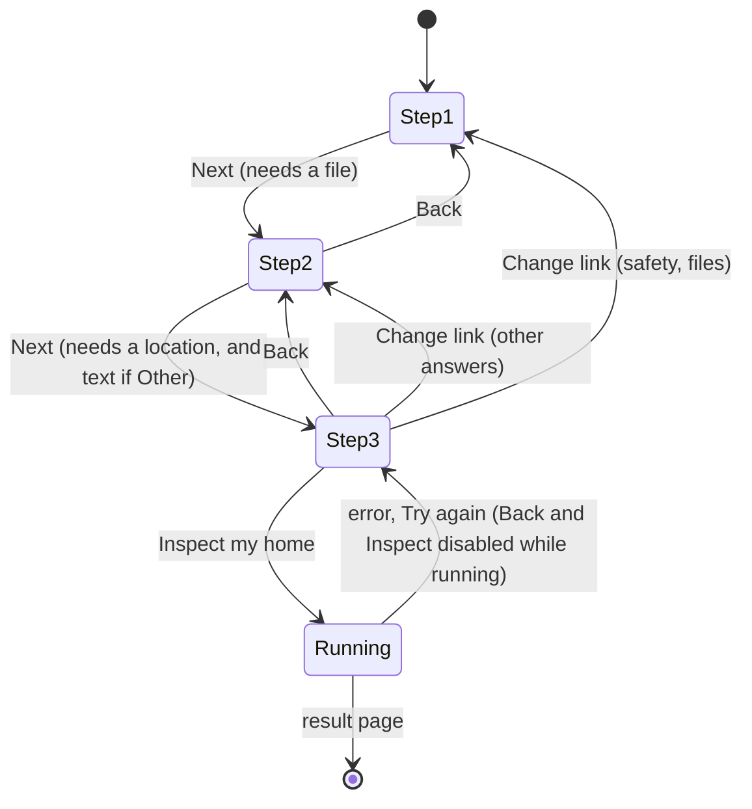

# Design Document: Guided Intake

## Overview

Guided intake replaces the single long form on the Home_Page (`/`) with a three-step flow: (1) safety check and photos, (2) a few quick questions answered with two dropdowns (the room and how long) and chips, (3) review and send. It changes how the Home_Page is laid out. It does not change how files are uploaded or how an inspection is sent. `useUpload`, `runUploadFlow`, `DropZone`, `DataRetentionNotice` and `EmergencyBanner` are reused as they are.

The design rests on four decisions.

1. **Safety is done by wording, not by new server logic.** Each of the four Safety_Chips maps to one fixed sentence (Safety_Wording). The Answer_Mapper puts all selected sentences at the start of `recentChanges`. The existing `checkEmergency` always matches those sentences, so `POST /api/inspect` returns the emergency result before the rate limiter and before Bedrock. Nothing in `src/lib/safety/`, `src/lib/emergency/messages.ts` or `src/app/api/inspect/route.ts` changes.
2. **Dropdowns and chips are native controls.** The room and the duration are native `<select>` elements (Location_Select and Duration_Select), each with a visible `<label>` and an empty first option. A multi-choice chip group (Safety_Group, Extras_Group) is a `fieldset` of `input type="checkbox"`. The browser provides the Tab stops, the arrow keys and Space. There are no `onKeyDown` handlers and no `role="radio"` or `role="checkbox"` on non-input elements.
3. **State lives above the steps.** One `GuidedIntake` component owns `useUpload()` (files, notice flag, upload status) and a `useReducer` for the chip choices and the current step. Step components are presentational and are unmounted when the step changes, so Back and Next cannot lose anything.
4. **The server contract does not move.** The Answer_Mapper produces the same three strings (`location`, `duration`, `recentChanges`, each at most 500 characters) that the old textareas produced. `buildInspectRequestBody` and `contextAnswersSchema` are used unchanged.

### Research findings that shaped the design

All findings come from reading the current code, not from outside sources.

| Finding | Source | Effect on the design |
|---|---|---|
| `checkEmergency` evaluates `location`, `duration` and `recentChanges` one at a time, after NFKC normalisation, zero-width removal and dash-to-space. Gas must be a whole word near `smell`/`odor`/`leak`/`hiss`; `spark`/`burning`/`smoke` must be within 200 characters of an electrical word (`outlet`, `switch`, `panel`, `electrical`, and others); `water` must be within 200 characters of an electrical word; `carbon monoxide` and `co alarm` match anywhere. | `src/lib/safety/safetyLayer.ts` | Each Safety_Wording sentence carries both halves of its trigger pair inside the one sentence. All sentences go into `recentChanges`, which is a single field, so no pair is ever split across fields. |
| The route runs body limit, Zod validation, `checkEmergency`, then `checkRateLimit`, then Bedrock. An emergency returns before the last two. | `src/app/api/inspect/route.ts` | Requirement 1.4 needs a new route test only. No route change. |
| `useUpload.submit()` reads `answers` from its own state and calls `runUploadFlow`, which calls `buildInspectRequestBody`. `onAnalysing` flips the status to `analysing`. | `src/hooks/useUpload.ts`, `src/lib/uploadFlow.ts` | The chips are converted to `ContextAnswers` and pushed into `useUpload` with the existing `setAnswers`. Upload and send stay as they are. |
| `UploadFlow.tsx` already holds the stage text, the focus-on-analysing behaviour, the error cards (rate limit, upload, timeout, analysis) and the "Try again" button. | `src/components/upload/UploadFlow.tsx` | That JSX is moved into a new `UploadStatusPanel` with only the "Uploading photos" stage text added (see Components). |
| `DropZone` is a controlled component (`value`, `onFilesAccepted`, `onSelectionCleared`), shows a thumbnail and file name per photo, and keeps no selection of its own. | `src/components/upload/DropZone.tsx` | It can be unmounted and remounted on a step change and still show the same files. No change needed. |
| `DataRetentionNotice` calls `onVisible` once when 90 percent of it is visible, and `useUpload` keeps `noticeVisible` after that. | `DataRetentionNotice.tsx`, `useUpload.ts` | Mounting it on Step 3 works. Going Back and returning keeps `noticeVisible` true. No change needed. |
| `EmergencyBanner` renders the fixed `EMERGENCY_MESSAGE` with `role="alert"`, a fixed red style and no `haunted:` classes, when `urgency === "emergency"`. Its colours are already in the Contrast_Registry as `F-01` and `F-02`, once per theme. | `src/components/results/EmergencyBanner.tsx`, `src/lib/haunted/contrastRegistry.ts` | The Live_Emergency_Notice is this component, mounted conditionally. No change needed. |
| `mergeSelection(current, incoming)` is the pure validation that `DropZone` runs for picked files. | `src/lib/validation/mediaValidation.ts` | The Sample_Button runs the same function on the fetched sample file, so a sample takes the same validation path. |
| The `haunted:` variant is `.theme-haunted &`. `DropZone` already uses `haunted:peer-focus-visible:` and `peer-disabled:`, so peer variants stack with it. Motion is declared only in `src/app/haunted-motion.css`. | `tailwind.config.ts`, `DropZone.tsx`, `haunted-motion.css` | Chip styling uses `peer-checked:` and `peer-focus-visible:` with `haunted:` partners. The new components add no motion. |
| `sourceScan.test.ts` fails on hex or rgb colours, `animate-`, `transition`, `duration-`, and on any `input`, `button`, `a` or `textarea` that lacks an accessible name or a `focus-visible:` class in its own `className`. It scans a fixed list of directories and files. | `src/components/sourceScan.test.ts` | Chip inputs carry a `focus-visible:` class so the rule passes; the visible ring is drawn on the label with `peer-focus-visible:`. The new directory is added to the scanned list. |
| `server-only` is aliased to a stub in `vitest.config.ts`. | `vitest.config.ts` | Property tests import the real `checkEmergency`. |
| `buildInspectPrompt` puts the three answers on three labelled lines and holds all the safety lines. | `src/lib/prompts/inspectPrompt.ts` | Chip answers read naturally on those lines. The prompt stays unchanged. |
| Haunted loading copy already has `inspecting` ("The inspector is walking the halls…") and `StateText` shows it after the plain line only in Haunted. | `src/lib/haunted/hauntedCopy.ts`, `StateText.tsx` | The Analysis_Stage uses `StateText` with `hauntedKey="inspecting"` as the old stage did. |

## Architecture

### Where state lives



Only one step component is mounted at a time. A step component reads its data from props and reports changes through callbacks. The only state a step keeps for itself is what is safe to lose: `DropZone`'s own error list and a pending flag.

### Data flow from chips to the server



### Step flow



The step is a number from 1 to 3 in the reducer. It is not in the URL. This keeps the flow simple and matches the "out of scope: saving a half-finished intake" rule. The browser Back button leaves the page, as it does today.

### Design decisions

| Decision | Alternatives | Why |
|---|---|---|
| Native `<select>` for the room and the duration (replaces the two single-choice chip groups), native checkbox inputs with the label as the visible chip for the Safety and Extras groups, `peer-*` variants for focus and colour on chips | Radio chips for the room and the duration; buttons with `aria-pressed`; `role="radio"` divs with key handlers | A `<select>` is short on a phone (one control for 11 or 7 options), opens the native picker, and gives the arrow keys, Tab stop and screen reader role for free, with no keyboard code to get wrong. Native checkbox inputs do the same for the chips. |
| `fieldset` with `legend` for each chip group, with `aria-labelledby` pointing to the legend's `id`; a visible `<label htmlFor>` for each `<select>` | Plain `div` with `aria-labelledby`; `aria-label` on the `<select>` | `legend` gives the chip group its name (Requirement 6.9). The visible label gives the `<select>` its name, and `aria-invalid` and `aria-describedby` go on the `<select>` itself, which Requirement 6.7 needs for the Location_Select. |
| Reducer for steps and choices, kept pure in `src/lib/intake/` | `useState` per field | One pure function lets Property 5 (Back and Next keep choices) run without React, and the sample action can replace the two dropdown values and the Extras group in one update. |
| Push mapped answers into `useUpload` with an effect on a memoised `mapAnswers(choices)` | Change `useUpload` to take chip choices | `useUpload` stays untouched. The effect depends only on `choices`, so there is no loop. |
| Check mark drawn from React state, colour and focus drawn with `peer-checked:` and `peer-focus-visible:` | Pseudo-element mark with `peer-checked:before:content-[...]` | Generated content can end up in the accessible name. A real `aria-hidden` span does not. |
| The empty first option of each `<select>` ("Choose a room", "Choose how long (optional)") clears the choice | A separate "Clear" button | Requirement 5.13 lets the Homeowner clear a sample's pre-selected answers. The empty option does it with no extra control and no custom key code. The reducer already stores `location: null` and `duration: null`. |
| The old `UploadFlow` and `ContextForm` (and their tests) are removed in the last task, after `GuidedIntake` is live. This is approved. | Keep them unused | They would be dead code. Their tests are migrated first (see Testing Strategy). The two matching entries in `normalBaseline.test.ts` are removed with them. |

## Components and Interfaces

### File layout

Paths follow the structure steering: PascalCase component files, camelCase for everything else, named exports only, `@/` imports.

```
src/
├── app/
│   └── page.tsx                          # CHANGED: renders GuidedIntake instead of UploadFlow
├── components/
│   ├── intake/                           # NEW (all client components)
│   │   ├── GuidedIntake.tsx              # owns useUpload + reducer; renders the current step
│   │   ├── StepProgress.tsx              # "Step N of 3" + progress bar
│   │   ├── StepHeading.tsx               # h2 with tabIndex -1 and a ref
│   │   ├── StepOne.tsx                   # safety group, notice, DropZone, sample button
│   │   ├── StepTwo.tsx                   # Location_Select, Duration_Select, extras
│   │   ├── StepThree.tsx                 # review, notice, send
│   │   ├── ChipGroup.tsx                 # fieldset of native checkbox chips (multi-choice only)
│   │   ├── FreeTextField.tsx             # label, input or textarea, counter, error
│   │   ├── LiveEmergencyNotice.tsx       # EmergencyBanner while a Safety_Chip is on
│   │   ├── SampleButton.tsx              # "Try it with a sample photo"
│   │   └── ReviewList.tsx                # answers list and thumbnails
│   └── upload/
│       ├── UploadStatusPanel.tsx         # NEW: stage text, UploadProgress, error cards (moved from UploadFlow)
│       ├── DropZone.tsx                  # reused, unchanged
│       ├── DataRetentionNotice.tsx       # reused, unchanged
│       ├── UploadProgress.tsx            # reused, unchanged
│       ├── UploadFlow.tsx                # REMOVED in the last cleanup task
│       └── ContextForm.tsx               # REMOVED in the last cleanup task
├── components/results/EmergencyBanner.tsx # reused, unchanged
├── lib/
│   └── intake/                           # NEW (pure modules, no React, no I/O except loadSample)
│       ├── options.ts                    # Location, Duration, Extras option lists
│       ├── safetyChips.ts                # SAFETY_CHIPS: id, label, Safety_Wording
│       ├── answerMapper.ts               # mapAnswers, exactPlaceLimit, somethingElseLimit
│       ├── intakeReducer.ts              # IntakeState, IntakeAction, intakeReducer, initialIntakeState
│       ├── stepValidation.ts             # validateStep, StepProblem, step messages
│       ├── sampleManifest.ts             # SAMPLE_MANIFEST, nextSampleIndex
│       ├── loadSample.ts                 # fetch a sample into a File
│       └── copy.ts                       # fixed texts used in several places
├── types/
│   └── intake.ts                         # shared types (see Data Models)
└── test/ (existing helpers)
```

A new `src/lib/intake/` folder is used because the steering tree has no home for pure feature logic, in the same way `src/lib/haunted/` and `src/lib/emergency/` already exist.

### Changes to reused modules (all minimal)

| Module | Change | Reason |
|---|---|---|
| `src/app/page.tsx` | Replace `<UploadFlow />` with `<GuidedIntake />`. The `h1`, the intro text and `HelpSection` stay. | Requirement 3.13. |
| `src/hooks/useUpload.ts` | None. | `setFiles`, `clearFiles`, `setAnswers`, `markNoticeVisible`, `submit`, `reset` cover everything. |
| `src/lib/uploadFlow.ts` | None. | `onProgress` and `onAnalysing` already give the two real stage events. |
| `src/components/upload/DropZone.tsx` | None. | Controlled, with thumbnails and names. |
| `src/components/upload/DataRetentionNotice.tsx` | None. | Mounted on Step 3 only. |
| `src/components/results/EmergencyBanner.tsx` | None. | Used with `urgency="emergency"`. |
| `src/components/upload/UploadFlow.tsx` | The stage and error JSX is **copied** into `UploadStatusPanel.tsx` first, so the app keeps working. The file is deleted after the page switches to `GuidedIntake`. | The panel is the only part of the old file that survives. |
| `src/components/upload/UploadStatusPanel.tsx` (new) | Same markup as the old file, plus: when `uploadStatus === 'uploading'` the status region shows "Uploading photos"; when `analysing` it shows "Checking for safety and reading your photos" (was "Inspecting your home…"). | Requirements 10.1, 10.2. |
| `src/components/sourceScan.test.ts` | Add `src/components/intake` and `src/components/upload/UploadStatusPanel.tsx` to the scanned set. Only these additions are made: no file is removed from the scan and no rule is loosened. | Requirement 11.6. |
| `src/components/ui/normalBaseline.test.ts` | In the cleanup task, remove only the two entries `'upload/UploadFlow.tsx'` and `'upload/ContextForm.tsx'`, because those files are deleted. Nothing else in that test changes. | Approved deletion of the two old components. |
| `src/lib/haunted/contrastRegistry.ts` | Add the new pairs listed under Theming. | Requirement 11.3. |

### `GuidedIntake`

```ts
export function GuidedIntake(): JSX.Element
```

It does the following:

- Calls `useUpload()` and `useReducer(intakeReducer, initialIntakeState)`.
- Computes `const answers = useMemo(() => mapAnswers(state.choices), [state.choices])` and runs `useEffect(() => setAnswers(answers), [answers, setAnswers])`.
- Holds `lastSampleIndex` in a `useRef<number | null>` (null before any sample), `problem` in `useState<StepProblem | null>`, and `sampleError` in `useState<string | null>`.
- Moves focus to the step heading when the step changes (see Focus management).
- Renders `StepProgress`, the current step, and `UploadStatusPanel`.

Next and Back handlers:

```ts
const goNext = () => {
  const found = validateStep(state.step, { hasFiles, choices: state.choices });
  if (found) { setProblem(found); focusFirstInvalid(found); return; }
  setProblem(null);
  dispatch({ type: 'next' });
};
const goBack = () => { setProblem(null); dispatch({ type: 'back' }); };
```

`handleSubmit` is the existing `UploadFlow.handleSubmit` logic: ignore while busy, show `NO_FILES_PROMPT` or `NOTICE_PROMPT`, scroll to the notice when it has not been shown, otherwise call `submit()`. It also re-runs `validateStep(2, …)` so a stale location can never be sent.

### Step components

All step components are controlled. They receive `choices`, `dispatch` (or narrow callbacks) and what they display.

```ts
interface StepOneProps {
  headingRef: React.Ref<HTMLHeadingElement>;
  choices: IntakeChoices;
  onToggleSafety: (id: SafetyChipId) => void;
  files: AcceptedFiles | null;
  onFilesAccepted: (f: AcceptedFiles) => void;   // useUpload.setFiles
  onSelectionCleared: () => void;                // useUpload.clearFiles
  onSample: () => void;
  sampleError: string | null;
  problem: StepProblem | null;                   // 'no-files'
  onNext: () => void;
}
```

`StepTwoProps` takes `choices`, one `dispatch`, `problem`, `liveNoticeActive`, `onBack`, `onNext`. `StepThreeProps` takes `choices`, `answers`, `files`, the `useUpload` state needed to show the status panel and the button state, `onChange(step)`, `onBack`, `onSubmit`, `markNoticeVisible`, `prompt`.

Content order:

| Step | Order from the top (matches Requirements 4.1, 5.1, 8.1, 8.7) |
|---|---|
| 1 | `StepHeading` "Safety check and photos", `Safety_Group` (checkboxes), `LiveEmergencyNotice` (when a chip is on), `DropZone`, `SampleButton` (only while no file), error line, Next |
| 2 | `StepHeading` "A few quick questions", `LiveEmergencyNotice` (when a chip is on), Location_Select with the Exact_Place_Text box, Duration_Select, Extras_Group with Something_Else_Text, error line, Back, Next |
| 3 | `StepHeading` "Review and send", `LiveEmergencyNotice` (when a chip is on), `ReviewList` with Change links, `DataRetentionNotice`, status panel, error cards, Back, "Inspect my home" |

### `ChipGroup`

```ts
export interface ChipOption<T extends string> { value: T; label: string }

export interface ChipGroupProps<T extends string> {
  legend: string;                       // the question; names the group
  name: string;                         // shared by all checkboxes (use a useId-based prefix)
  options: readonly ChipOption<T>[];
  selected: readonly T[];
  onToggle: (value: T) => void;
}
```

`ChipGroup` is multi-choice only. It is used for the Safety_Group and the Extras_Group. The room and the duration use `SelectField`.

Markup for each option (input first, label second, so `peer-*` reaches the label):

```tsx
<div key={o.value} className="max-w-full">
  <input
    id={inputId} type="checkbox"
    name={name} value={o.value} checked={isOn}
    onChange={() => onToggle(o.value)}
    className="peer sr-only focus-visible:outline-none"
  />
  <label htmlFor={inputId} className={CHIP_LABEL}>
    <span aria-hidden="true" className={isOn ? 'font-bold' : 'invisible font-bold'}>✓</span>
    <span>{o.label}</span>
  </label>
</div>
```

`CHIP_LABEL` is a constant in the same file. It gives a 44 px target (`min-h-11 min-w-11`), wrapping text (`whitespace-normal break-words text-left`), the unselected colours, `peer-checked:` selected colours, `peer-focus-visible:ring-2 peer-focus-visible:ring-offset-2` with a ring colour, and a `haunted:` partner for every colour class. The input's own `focus-visible:outline-none` is there so the source scan's "input has a `focus-visible:` class" rule passes, and it is honest: the ring is drawn on the label, which is the visible chip.

The wrapper:

```tsx
<fieldset aria-labelledby={legendId}>
  <legend id={legendId}>{legend}</legend>
  <div className="mt-2 flex flex-wrap gap-2">{chips}</div>
</fieldset>
```

`legendId` is built from the same `useId` prefix as the other ids. `aria-labelledby` points to the legend so the fieldset keeps its accessible name (Requirement 6.9). The checkbox groups have no required answer, so they never show an error.

### `SelectField`

```ts
export interface SelectOption<T extends string> { value: T; label: string }

export interface SelectFieldProps<T extends string> {
  id: string;                           // useId-based; the caller uses it to move focus
  label: string;                        // visible question; linked with htmlFor
  emptyLabel: string;                   // "Choose a room" or "Choose how long (optional)"
  options: readonly SelectOption<T>[];  // in the order of the Glossary
  value: T | null;                      // null shows the empty first option
  onChange: (value: T | null) => void;  // the empty option gives null
  required?: boolean;
  error?: string | null;                // message text, rendered in a role="alert" slot
}
```

```tsx
<div>
  <label htmlFor={id}>{label}{required ? ' (required)' : ''}</label>
  <select id={id} value={value ?? ''} onChange={(e) => onChange(e.target.value === '' ? null : (e.target.value as T))}
          aria-invalid={error ? true : undefined}
          aria-describedby={error ? errorId : undefined}
          className={SELECT /* min-h-11, focus-visible ring, haunted: partners */}>
    <option value="">{emptyLabel}</option>
    {options.map((o) => <option key={o.value} value={o.value}>{o.label}</option>)}
  </select>
  <div id={errorId} role="alert">{error && <p>{error}</p>}</div>
</div>
```

The `<select>` is native, so the arrow keys, the first-letter jump, Space and Enter come from the browser, with no key handlers. `SELECT` is a constant that gives a 44 px height (`min-h-11`), a `focus-visible:` ring and a `haunted:` partner for every colour class. A missing room sets `aria-invalid` and `aria-describedby` on the `<select>`, and the caller moves focus to it with `document.getElementById(id)`. Choosing a room clears the error. The option values are the same labels that `mapAnswers` reads today, so the Answer_Strings do not change.

### `FreeTextField`

```ts
interface FreeTextFieldProps {
  label: string; hint?: string; example?: string;
  value: string; onChange: (v: string) => void;
  limit: number;                 // the true limit for this box (see Answer_Mapper)
  multiline?: boolean;           // textarea for Something_Else_Text, input for Exact_Place_Text
  required?: boolean; error?: string | null;
  id: string;
}
```

It renders a `<label htmlFor>`, an `input type="text"` or a `textarea` using the shared `FIELD` recipe from `@/components/ui/styles`, `maxLength={limit}`, a counter `n/limit` linked with `aria-describedby`, and the error in a `role="alert"` slot with `aria-invalid`. When the value is longer than `limit` (a limit that shrank after other chips were chosen), it shows "Only the first {limit} characters will be sent." in the same description.

### `LiveEmergencyNotice`

```ts
export function LiveEmergencyNotice({ active }: { active: boolean }) {
  return active ? <EmergencyBanner urgency="emergency" /> : null;
}
```

`EmergencyBanner` imports `EMERGENCY_MESSAGE` from `src/lib/emergency/messages.ts`, so the text is never copied (Requirement 2.7). It has no `haunted:` classes and no art, so it looks the same in both themes (2.4, 11.7). It is rendered by a React state update on the same click as the chip, so it appears in the same frame (2.1). It is mounted, not moved: it never takes focus, so the Chip keeps focus (2.5). `role="alert"` announces it.

Placement (2.2, 8.7): Step 1 puts it directly under the Safety_Group, above `DropZone`. Steps 2 and 3 put it right after the step heading. The banner is remounted when the step changes, so a screen reader announces the danger message again on each step. This is intended: it repeats a safety message and costs nothing.

### `SampleButton` and `loadSample`

```ts
// src/lib/intake/loadSample.ts
export async function loadSample(
  entry: SampleEntry,
  fetchImpl: typeof fetch = (...a) => fetch(...a),
): Promise<File>;     // throws on a non-OK response or a network error
```

It fetches `/samples/${entry.file}`, reads a `Blob`, and returns `new File([blob], entry.file, { type: blob.type || 'image/jpeg' })`.

In `GuidedIntake`:

```ts
const onSample = async () => {
  const index = nextSampleIndex(lastSampleIndex.current, SAMPLE_MANIFEST.length);
  const entry = SAMPLE_MANIFEST[index];
  try {
    const file = await loadSample(entry);
    const merged = mergeSelection<File>(null, [file]);         // same validation as a picked file
    if (!merged.accepted || merged.errors.length > 0) { setSampleError(merged.errors[0]?.message ?? SAMPLE_FAILED); return; }
    setFiles({ kind: 'images', files: merged.files });
    dispatch({ type: 'applySample', location: entry.location, duration: entry.duration, extras: entry.extras });
    lastSampleIndex.current = index;
    setSampleError(null);
  } catch {
    setSampleError(SAMPLE_FAILED);                              // "We couldn't load the sample photo. Please add your own photo."
  }
};
```

The pointer moves only on success, so a failed fetch leaves the Intake_State and the rotation unchanged (9.8). The button is shown only while `files === null` on Step 1 (4.4, 4.5, 9.1). The `applySample` action replaces the Location, Duration and Extras selections and leaves the Safety_Group and every Free_Text value alone (9.5, 9.6). The sample then goes through the normal `submit()`, so `wall-hole.jpeg` (an outlet) meets the real Safety_Layer like any other upload (9.7).

### `StepProgress`

```tsx
<div>
  <p>Step {step} of 3</p>
  <div role="progressbar" aria-label="Intake progress"
       aria-valuemin={0} aria-valuemax={3} aria-valuenow={step}
       aria-valuetext={`Step ${step} of 3`} className="h-2 w-full rounded-full bg-slate-300 haunted:bg-haunted-field">
    <div className="h-full rounded-full bg-blue-700 haunted:bg-haunted-accent" style={{ width: `${(step / 3) * 100}%` }} />
  </div>
</div>
```

The inline style sets a width only (no colour), which the source scan allows. There is no transition class, so the bar changes width with no animation whether or not Reduced_Motion_Setting is on (11.4).

### `ReviewList`

A `dl` of answer groups, each with its own Change button. Thumbnails come from `URL.createObjectURL` inside an effect that revokes the URLs on cleanup, because `DropZone` is not mounted on Step 3.

| Group | Text shown | Change goes to |
|---|---|---|
| Safety | The chosen Safety_Chip labels, or "None selected" | Step 1 |
| Photos | Thumbnails and names | Step 1 |
| Where | `answers.location` | Step 2 |
| How long | `answers.duration`, or "Not given" | Step 2 |
| Anything else | The Extras labels and the Something_Else_Text, or "Nothing added" | Step 2 |

`answers.location` and `answers.duration` are the exact strings sent, so the review and the request cannot differ (8.1).

### Focus management and scrolling

- `StepHeading` renders `<h2 ref tabIndex={-1} className="… focus:outline-none">`. `GuidedIntake` keeps one `headingRef` and passes it to whichever step is mounted.
- An effect runs on `[step]`. It skips the first render so that the page does not steal focus on load. On later changes it calls `headingRef.current?.focus({ preventScroll: true })` and then `scrollIntoView({ block: 'start', behavior })`, where `behavior` is `'auto'` when `prefers-reduced-motion: reduce` matches and `'smooth'` otherwise (3.9, 3.12). The `prefersReducedMotion()` helper in `UploadFlow.tsx` moves to `src/lib/utils/prefersReducedMotion.ts` and is imported by both `GuidedIntake` and the status panel.
- A failed Next (3.7, 3.8) keeps the step. For a missing location the Location_Select gets focus; for "Other" with no text, the Exact_Place_Text input gets focus. Both are found with `document.getElementById` using ids built from one `useId` prefix. For a missing file the message is shown and focus goes to the file picker's label target (the `DropZone` input is not exposed, so the message is announced through its `role="alert"` slot and focus stays on Next).
- When the Analysis_Stage starts, focus moves to the stage heading, as `UploadFlow` does today with `analysingRef`.

### `UploadStatusPanel`

```ts
interface UploadStatusPanelProps {
  uploadStatus: UploadStatus; fileProgress: UploadFileProgress[];
  uploadError: string | null; errorKind: UploadErrorKind | null; resetAt: string | null;
  onTryAgain: () => void;       // useUpload.reset
}
```

It renders one always-present `<div role="status" aria-live="polite">`. Inside it:

- `uploading`: a heading "Uploading photos". `UploadProgress` (unchanged) is rendered below the region with the per-file bars driven by `onProgress`.
- `analysing`: a focusable `div tabIndex={-1}` with `StateText plain="Checking for safety and reading your photos" hauntedKey="inspecting"`.

Only those two texts exist (10.4). No timer and no minimum display time are added. The error cards are the existing markup, unchanged. "Try again" calls `reset`, which keeps the files and answers and clears the status (10.6).

## Data Models

All shared types are in `src/types/intake.ts`. Option lists are `as const` tuples in `src/lib/intake/options.ts` so the types come from the lists.

```ts
// options.ts
export const LOCATION_OPTIONS = [
  'Kitchen', 'Bathroom', 'Basement', 'Laundry room', 'Bedroom', 'Living room',
  'Attic or roof', 'Garage', 'Outside (walls, yard or gutters)', 'Hallway or stairs', 'Other',
] as const;
export const DURATION_OPTIONS = [
  'Just noticed today', 'A few days', 'About a week', 'A few weeks',
  'A month or more', 'It comes and goes', 'Not sure',
] as const;
export const EXTRAS_OPTIONS = [
  'Dripping or leaking water', 'Water stain or damp patch', 'Mould or a musty smell',
  'A strange noise (banging, rattling or buzzing)', 'Flickering lights', 'Not working at all',
  'Getting worse', 'Recent repair or work nearby', 'After heavy rain or a storm', 'Something else',
] as const;
export const OTHER_LOCATION = 'Other';
export const SOMETHING_ELSE = 'Something else';

// types/intake.ts
export type LocationOption = (typeof LOCATION_OPTIONS)[number];
export type DurationOption = (typeof DURATION_OPTIONS)[number];
export type ExtrasOption = (typeof EXTRAS_OPTIONS)[number];
export type SafetyChipId = 'gas' | 'electrical-fire' | 'water-electrical' | 'co-alarm';
export type IntakeStep = 1 | 2 | 3;

/** Everything the Homeowner chooses or types. Files are held by useUpload, not here. */
export interface IntakeChoices {
  safety: readonly SafetyChipId[];        // any subset, kept in SAFETY_CHIPS order
  location: LocationOption | null;
  placeText: string;                      // Exact_Place_Text; it is Other_Text when location is 'Other'
  duration: DurationOption | null;
  extras: readonly ExtrasOption[];        // kept in EXTRAS_OPTIONS order
  somethingElseText: string;              // kept in memory even while the chip is off
}

export interface IntakeState { step: IntakeStep; choices: IntakeChoices }
```

The "Intake_State" of the requirements is `IntakeChoices` (in the reducer) plus the selected files (in `useUpload`).

### Safety chips and Safety_Wording

```ts
// safetyChips.ts
export interface SafetyChip { id: SafetyChipId; label: string; wording: string }

export const SAFETY_CHIPS: readonly SafetyChip[] = [
  { id: 'gas',              label: 'I smell gas',
    wording: 'I smell gas.' },
  { id: 'electrical-fire',  label: 'Sparks, or a burning smell from an outlet, switch or the electrical panel',
    wording: 'Sparks or a burning smell from an outlet, switch or the electrical panel.' },
  { id: 'water-electrical', label: 'Water near outlets, switches or the electrical panel',
    wording: 'There is water near an outlet, switch or the electrical panel.' },
  { id: 'co-alarm',         label: 'A carbon monoxide (CO) alarm is going off',
    wording: 'A carbon monoxide (CO) alarm is going off.' },
];
```

Each sentence is checked by hand against `checkEmergency`:

| Chip | Rule it matches |
|---|---|
| gas | `gas` is a whole word and `smell` is next to it, so `GAS_SMELL`. |
| electrical-fire | `spark` and `burning` are in `FIRE_HEAT`; `outlet`, `switch` and `electrical` are in `FIRE_ELECTRIC`; all are within 200 characters, so `ELECTRICAL_FIRE`. |
| water-electrical | `water` is in `WATER_TERMS`; `outlet` and `electrical` are in `WATER_ELECTRIC`, so `WATER_ELECTRICAL`. |
| co-alarm | `carbon monoxide` is in `CO_PHRASES`, so `CO_ALARM`. |

The labels differ from the wording on purpose (Requirements assumption 3). The sentences are constants with no Homeowner input (1.3). Their combined length with separators is about 192 characters, and a test asserts it stays under a fixed budget (see Property 4 and the fixed-length invariant).

### Answer_Mapper

```ts
// answerMapper.ts  (pure, no I/O, no time, no randomness)
export function mapAnswers(choices: IntakeChoices): ContextAnswers;
export function exactPlaceLimit(location: LocationOption | null): number;
export function somethingElseLimit(choices: IntakeChoices): number;
export function cleanFreeText(raw: string): string;
export function truncateUtf16(text: string, maxUnits: number): string;
```

**`cleanFreeText`** removes zero-width characters (`\u00AD`, `\u200B`–`\u200D`, `\u2060`, `\uFEFF`, the same set the Safety_Layer strips), replaces every control character (`\p{Cc}`) with a space, collapses any run of whitespace to one space, and trims (7.5).

**`truncateUtf16(text, maxUnits)`** walks the string by code point and stops before a code point that would take the total UTF-16 length above `maxUnits`, then trims trailing whitespace. The limit is in UTF-16 units because Zod's `.max(500)` and `String.length` count units. Walking by code point means a surrogate pair is never split (7.6).

**`location`**

```
label = choices.location            (null  ->  '')
text  = cleanFreeText(choices.placeText)
room  = 500 - (label.length + 2)    // 2 is ": "
text  = truncateUtf16(text, room)
location = text ? `${label}: ${text}` : label
```

For `Other` the same rule gives "Other: " plus the text (7.2). With `Other` and no text the result is "Other"; Step 2 validation stops that from being sent. `exactPlaceLimit(location)` returns `500 - (label.length + 2)` and is the `maxLength` of the Exact_Place_Text box (5.7).

**`duration`** is the label, or an empty string (7.3).

**`recentChanges`**

```
fixedParts = [ ...selected Safety_Wording sentences in SAFETY_CHIPS order,
               ...selected Extras labels except 'Something else', in EXTRAS_OPTIONS order, each + '.' ]
prefix     = fixedParts.join(' ')
free       = choices.extras.includes('Something else') ? cleanFreeText(choices.somethingElseText) : ''
room       = 500 - prefix.length - (prefix ? 1 : 0) - 1     // separator and a full stop
free       = truncateUtf16(free, room)                       // room <= 0 gives ''
freePart   = free ? (/[.!?]$/.test(free) ? free : free + '.') : ''
recentChanges = [prefix, freePart].filter(Boolean).join(' ')
```

Safety sentences come first and are in the fixed prefix, so truncation can only ever shorten `free`. Chip labels and Safety_Wording are never cut or reordered (1.1, 1.6, 7.6). With no Safety_Chip selected, no wording is added (1.7). `somethingElseLimit(choices)` returns `max(0, room)` and is the `maxLength` of the Something_Else_Text box, so in normal use the browser stops typing before the mapper has to cut anything.

**Fixed-length invariant.** The worst case is all four Safety_Wording sentences and all nine non-"Something else" Extras labels with empty free text. By hand this is about 432 characters, which leaves about 66 for Something_Else_Text. A unit test computes the real worst case and asserts it is at most 498, so a future edit to a label or sentence that breaks the 500-character rule fails a test instead of silently cutting a chip label.

**Full stop on free text.** As in Requirement 7.4, the Something_Else_Text part gets a full stop unless it already ends in `.`, `!` or `?`. This is the `freePart` line above.

### Reducer

```ts
// intakeReducer.ts
export type IntakeAction =
  | { type: 'toggleSafety'; id: SafetyChipId }
  | { type: 'setLocation'; value: LocationOption | null }
  | { type: 'setPlaceText'; value: string }
  | { type: 'setDuration'; value: DurationOption | null }
  | { type: 'toggleExtra'; value: ExtrasOption }
  | { type: 'setSomethingElseText'; value: string }
  | { type: 'applySample'; location: LocationOption; duration: DurationOption; extras: readonly ExtrasOption[] }
  | { type: 'next' } | { type: 'back' } | { type: 'goTo'; step: IntakeStep };

export const initialIntakeState: IntakeState;
export function intakeReducer(state: IntakeState, action: IntakeAction): IntakeState;
```

Rules:

- `next` and `back` change only `step`, clamped to 1..3. They return a state whose `choices` is the **same object** as before (3.10, 3.11).
- `toggleSafety` and `toggleExtra` add or remove the value and keep the list in canonical order.
- Deselecting "Something else" does not touch `somethingElseText` (5.10).
- `applySample` replaces `location`, `duration` and `extras` and leaves `safety`, `placeText` and `somethingElseText` alone (9.5, 9.6).
- `setPlaceText` and `setSomethingElseText` store the raw text. Cleaning happens in the mapper, not while typing, so the Homeowner can type spaces freely.

### Step validation

```ts
// stepValidation.ts
export type StepProblem =
  | { kind: 'no-files' }
  | { kind: 'no-location' }
  | { kind: 'no-other-text' };

export function validateStep(
  step: IntakeStep,
  ctx: { hasFiles: boolean; choices: IntakeChoices },
): StepProblem | null;
```

Step 1 gives `no-files` when there is no file. Step 2 gives `no-location` when `location === null`, and `no-other-text` when `location === 'Other'` and `cleanFreeText(placeText)` is empty. Step 3 has no problem of its own. Messages are in `copy.ts`: "Please add a photo or a short video first." (3.7), "Please choose where the problem is." and "Please say where the problem is, since you chose Other." (3.8).

### Sample manifest

```ts
// sampleManifest.ts
export interface SampleEntry {
  file: 'wall-hole.jpeg' | 'bathroom-tap.jpeg';
  description: string;
  location: LocationOption;
  duration: DurationOption;
  extras: readonly ExtrasOption[];
}

export const SAMPLE_MANIFEST: readonly SampleEntry[] = [
  { file: 'wall-hole.jpeg', description: 'A large hole in the drywall next to an outlet',
    location: 'Living room', duration: 'Just noticed today', extras: [] },
  { file: 'bathroom-tap.jpeg', description: 'Corrosion and mineral stains around the base of a bathroom tap',
    location: 'Bathroom', duration: 'A month or more', extras: ['Water stain or damp patch'] },
];

export function nextSampleIndex(previous: number | null, length: number): number {
  return previous === null ? 0 : (previous + 1) % length;
}
```

There is no `safety` field in `SampleEntry`, so a sample cannot pre-select a Safety_Chip (9.5). One test lists `public/samples/` and fails if a file has no entry or an entry has no file (9.9). It also checks that each file has an accepted image type and is at most `MAX_IMAGE_BYTES`, and that every chosen label is a member of the option lists (9.10; the types already enforce it, the test covers hand-edited casts).

### Theming, contrast and motion

- **Colours** come only from tokens. Normal classes have a `haunted:` partner using `haunted.*` tokens, and no hex or rgb appears in the new files (11.2).
- **Chip colours.** Unselected: `border-slate-500 bg-white text-slate-900` / `haunted:border-haunted-border haunted:bg-haunted-field haunted:text-haunted-text`. Selected (`peer-checked:`): `border-blue-800 bg-blue-700 text-white` / `haunted:border-haunted-accent haunted:bg-haunted-accent haunted:text-haunted-on-accent`. Focus ring (`peer-focus-visible:ring-2 ring-blue-600 ring-offset-2`) / `haunted:ring-haunted-accent haunted:ring-offset-haunted-bg`. Selected state also shows the check mark, so colour is not the only signal (6.5).
- **Buttons and fields** reuse `PRIMARY_BUTTON`, `SECONDARY_BUTTON` and `FIELD` from `@/components/ui/styles`, plus `min-h-11` for the 44 px target.
- **Contrast_Registry.** Most pairs already exist: white on `blue.700` is `N-21`, `haunted.on-accent` on `haunted.accent` is `H-10`, `slate.900` on white is `N-02`, `haunted.text` on `haunted.field` is `H-03`, `slate.500` border on white is `N-28`, the ring colours are `N-30`, `H-29`, `H-30`, and the emergency banner is `F-01` and `F-02`. New rows are added for pairs that are not yet listed: the unselected chip text on white and on `haunted.field` over the Haunted page, the unselected chip border on `haunted.bg`, the selected chip border against its fill, the progress fill `blue.700` against the track `slate.300` (and `haunted.accent` against `haunted.field`), the "Step N of 3" text, and the focus ring against the page and the selected fill. `checkRegistry()` computes the ratios and an existing test fails below 4.5:1 for body text or 3:1 for large text and non-text (11.3).
- **Motion.** The new components use no `animate-`, `transition` or `duration-` classes and add nothing to `haunted-motion.css`. The progress bar changes width at once. Scroll uses `behavior: 'auto'` when reduced motion is on (11.4, 11.5).
- **Layout.** One column. The step container is `mx-auto w-full max-w-2xl` (the page already uses `max-w-2xl`, which is 42 rem), chips use `flex flex-wrap`, and nothing has a fixed width, so 320 px to 1920 px works with no horizontal scroll (11.1, 6.8).
- **Emergency style stays fixed.** `LiveEmergencyNotice` is outside any Haunted-only wrapper and has no `haunted:` class. A theme toggle changes nothing inside it (2.8).

### Bedrock prompt

No change to `buildInspectPrompt`. The three lines read as follows with chip answers:

```
- Where the problem is: Kitchen: under the sink
- How long they have noticed it: A few weeks
- Anything else the homeowner wants us to know (...): Dripping or leaking water. Getting worse.
```

These read correctly, and an empty `duration` gives the same blank line as today. Safety_Wording never reaches the prompt, because an emergency returns before Bedrock. A new test builds prompts from mapper output (several fixed examples plus a property over non-safety chip choices) and asserts that every safety line is still present (12.3). If a test shows a line misreading the answers, only the label wording of those three lines may change (12.1), and the existing prompt tests would be updated with it.

## Correctness Properties

*A property is a characteristic or behavior that should hold true across all valid executions of a system-essentially, a formal statement about what the system should do. Properties serve as the bridge between human-readable specifications and machine-verifiable correctness guarantees.*

Testing with generated inputs applies to the pure modules (`answerMapper`, `intakeReducer`, `stepValidation`, `sampleManifest`) and to the real `checkEmergency`. It does not apply to the React layout, the focus behaviour, the theming, the route wiring or the upload stages; those use example-based component tests, source scans and one route integration test (see Testing Strategy).

The prework produced candidates that were then merged where one implies another. The criteria for "the Back and Next buttons keep state" (3.10) and "state is not cleared on a step change" (3.11) are one property. The "Other" format (7.2) is part of the location format property. Determinism (7.9) is checked inside the length property. The "no Safety_Chip means no wording" rule (1.7) and the "wording is first and verbatim" rules (1.1, 1.6) are one property about the shape of `recentChanges`.

The five properties marked **Required** are the ones the requirements mark as properties (Requirements 1.2, 3.10, 7.7, 7.8 and 7.11 each end in "(property)", and Requirement 13 lists them under criteria 13.1, 13.3 and 13.5). They must be implemented and must pass before the parent task that owns them is complete. They are not optional tasks.

| Requirement | Statement in requirements.md | Property | Status |
|---|---|---|---|
| 1.2 | Every non-empty subset of Safety_Chips gives `isEmergency` true | Property 1 | **Required** |
| 3.10 | For any sequence of Next and Back actions the Intake_State is unchanged | Property 8 (choices) plus the component test for files (13.5) | **Required** |
| 7.7 | Each Answer_String is at most Max_Answer_Length | Property 4 | **Required** |
| 7.8 | Answer_Strings pass `contextAnswersSchema` for a valid location | Property 5 | **Required** |
| 7.11 | No Safety_Chip and empty Free_Text gives `isEmergency` false | Property 3 | **Required** |

### Property 1: Any Safety_Chip makes the server-side check return an emergency

*For any* non-empty subset of the four Safety_Chips, any Location_Select, Duration_Select and Extras_Group selection (including none), and any Free_Text of up to 500 characters in each text box (including Unicode, emoji and zero-width characters), `checkEmergency` applied to the Answer_Strings produced by `mapAnswers` returns `isEmergency` true.

**Validates: Requirements 1.2**

### Property 2: Safety_Wording leads `recentChanges` verbatim, and appears only when chosen

*For any* `IntakeChoices`, `recentChanges` starts with the Safety_Wording sentences of the selected Safety_Chips, in `SAFETY_CHIPS` order, joined by single spaces, whatever the other choices or the free text length. *For any* `IntakeChoices` with no Safety_Chip selected, no Answer_String contains any Safety_Wording sentence.

**Validates: Requirements 1.1, 1.6, 1.7**

### Property 3: Chip labels alone never trigger an emergency

*For any* `IntakeChoices` with no Safety_Chip selected and with `placeText` and `somethingElseText` both empty, `checkEmergency` applied to the Answer_Strings produced by `mapAnswers` returns `isEmergency` false.

**Validates: Requirements 7.11**

### Property 4: Answer strings never exceed 500 characters, and only free text is shortened

*For any* `IntakeChoices`, including Free_Text of any length with Unicode, emoji and zero-width characters, each of the three strings from `mapAnswers` has `length` at most 500 (UTF-16 units); the result contains no lone surrogate; the selected Safety_Wording sentences and Extras labels and the location label are all present in full; and calling `mapAnswers` a second time with the same input returns an equal result.

**Validates: Requirements 7.6, 7.7, 7.9**

### Property 5: Mapped answers pass the existing request schema

*For any* `IntakeChoices` with a non-null `location` (and non-empty cleaned `placeText` when the location is "Other"), `contextAnswersSchema.safeParse(mapAnswers(choices))` succeeds.

**Validates: Requirements 7.8**

### Property 6: The three strings follow the documented format

*For any* `IntakeChoices`, `mapAnswers` equals an independently written reference: `location` is the label alone when the cleaned place text is empty and otherwise `label: text`; `duration` is the label or an empty string; `recentChanges` is the Safety_Wording sentences, then the Extras labels (without "Something else") in list order, then the cleaned Something_Else_Text only when that chip is selected, each part ended by a full stop and joined by single spaces. The reference is compared on inputs short enough that nothing is truncated.

**Validates: Requirements 7.1, 7.2, 7.3, 7.4**

### Property 7: Free text is cleaned

*For any* `IntakeChoices` whose text boxes contain zero-width characters, control characters, tabs, newlines and runs of spaces, none of the three Answer_Strings contains a zero-width character or a control character, and none contains two consecutive whitespace characters.

**Validates: Requirements 7.5**

### Property 8: Next, Back and Change never alter the choices

*For any* `IntakeState` and any finite sequence of `next`, `back` and `goTo` actions, the resulting state has `choices` strictly equal (same reference) to the starting `choices`, and `step` is always 1, 2 or 3.

**Validates: Requirements 3.10, 3.11, 8.2**

### Property 9: Toggling twice restores the choices, and the Something_Else_Text survives

*For any* `IntakeChoices` and any Safety_Chip or Extras option, applying the toggle action twice gives choices equal to the starting choices. *For any* `IntakeChoices` in which "Something else" is selected, deselecting it leaves `somethingElseText` unchanged and removes every part of that text from `recentChanges`; selecting it again restores the original `recentChanges`.

**Validates: Requirements 5.5, 5.10**

### Property 10: Step 2 asks only for a location

*For any* `IntakeChoices`, `validateStep(2, …)` returns null exactly when `location` is not null and, if `location` is "Other", the cleaned `placeText` is not empty. Otherwise it returns `no-location` or `no-other-text` respectively. The Safety_Group, Duration_Select and Extras_Group never change the result.

**Validates: Requirements 3.8, 5.12**

### Property 11: A sample replaces only its three groups

*For any* `IntakeChoices` and any entry of `SAMPLE_MANIFEST`, the `applySample` action returns choices whose `location`, `duration` and `extras` equal the entry's, and whose `safety`, `placeText` and `somethingElseText` equal the values before the action.

**Validates: Requirements 9.4, 9.5, 9.6**

### Property 12: Sample rotation follows the manifest order and wraps

*For any* manifest length from 1 to 5 and any number k of activations starting from no previous index, the index chosen by the k-th call of `nextSampleIndex` equals `(k - 1) mod length`, and every index is within range.

**Validates: Requirements 9.3**

## Error Handling

| Situation | What the Homeowner sees | What the code does |
|---|---|---|
| Next on Step 1 with no file | "Please add a photo or a short video first." in a `role="alert"` slot | `validateStep` returns `no-files`. Step stays. |
| Next on Step 2 with no location | "Please choose where the problem is." The message is shown next to the Location_Select and focus goes to the Location_Select. | `no-location`. The Location_Select has `aria-invalid="true"` and `aria-describedby` points to the message. Choosing a room removes both. |
| Next on Step 2 with "Other" and no text | "Please say where the problem is, since you chose Other." Focus goes to the Exact_Place_Text box. | `no-other-text`. The input gets `aria-invalid` and `aria-describedby`. |
| A file fails validation | The existing `DropZone` messages, unchanged | `DropZone` handles it. The selection stays as it was. |
| Sample fetch fails, or the sample fails `mergeSelection` | "We couldn't load the sample photo. Please add your own photo." | `loadSample` throws or the merge is rejected. Nothing else changes and the rotation index does not move. |
| "Inspect my home" before the privacy notice has been shown | "Please read the notice below before sending." and a scroll to the notice | The existing `handleSubmit` logic, moved over unchanged. |
| Upload fails, analysis fails, timeout, rate limit | The existing error cards with the existing wording. "Try again" appears for all but the rate limit. | `useUpload` sets `errorKind`; `UploadStatusPanel` shows the card; `reset()` clears the status and keeps files and answers. |
| Any failure while running | The Homeowner is still on Step 3 with the review content visible and everything kept | Back and Inspect are disabled only while `busy`. The step never changes during a run, so no step has to be restored. Focus moves to the error card, as today. |
| Safety_Chip selected, daily limit already used | The result page for an emergency, not a limit message | The server's pre-check returns before `checkRateLimit`. The client treats it as any other 200 result. |
| Free text longer than the true limit (the limit shrank after more chips were chosen) | "Only the first N characters will be sent." under the box | The mapper shortens only that text. Chip labels and safety sentences stay whole. |
| A future edit makes the fixed parts longer than 498 characters | No user-visible effect, because the test fails first | The fixed-length unit test fails. |

The Safety_Layer stays the authority. The Live_Emergency_Notice only gives early guidance. The inspection is still sent, and the server decides the result (1.5).

## Testing Strategy

### Approach

Both kinds of test are used. Property tests (fast-check, which is already a dev dependency) cover the pure modules. Example tests cover what has a fixed answer: component behaviour, copy, layout classes and one route integration. Tests are run with `vitest --run`. The whole project must also pass `next lint` and `tsc --noEmit` after each parent task.

**Property test configuration.**

- Each Correctness Property is one test, with `fc.assert(fc.property(...), { numRuns: 100 })` as the minimum.
- Each test carries a tag comment: `// Feature: guided-intake, Property N: <property text>`.
- Properties 1 and 3 import the real `checkEmergency` from `@/lib/safety/safetyLayer`. `server-only` is already stubbed in `vitest.config.ts`.
- A shared arbitrary `arbIntakeChoices` in `src/lib/intake/testArbitraries.ts` builds choices from the option lists, with free text from `fc.fullUnicodeString`, `fc.string`, and a generator that mixes in zero-width characters, tabs, newlines and emoji, with lengths up to about 2,000.

### Property tests

| Property | Test file | Notes |
|---|---|---|
| 1 (**required**, Req 1.2, 13.1) | `src/lib/intake/answerMapper.safety.property.test.ts` | `fc.subarray(SAFETY_CHIPS ids, { minLength: 1 })` combined with `arbIntakeChoices` |
| 2 | same file | Adds a case with free text of 2,000 characters |
| 3 (**required**, Req 7.11) | `src/lib/intake/answerMapper.noFalseEmergency.property.test.ts` | Texts forced empty and safety forced empty. An exhaustive example covers every single label and every pair of Extras |
| 4 (**required**, Req 7.7, 13.3) | `src/lib/intake/answerMapper.length.property.test.ts` | Also asserts no lone surrogate and that fixed parts are present |
| 5 (**required**, Req 7.8, 13.3) | `src/lib/intake/answerMapper.schema.property.test.ts` | Imports `contextAnswersSchema` |
| 6, 7 | `src/lib/intake/answerMapper.format.property.test.ts` | The reference model is written separately from the implementation, in the test |
| 8 (**required**, Req 3.10, 13.5) | `src/lib/intake/intakeReducer.navigation.property.test.ts` | `fc.array(fc.constantFrom(next, back, goTo 1, goTo 2, goTo 3))` |
| 9, 11 | `src/lib/intake/intakeReducer.property.test.ts` | |
| 10 | `src/lib/intake/stepValidation.property.test.ts` | |
| 12 | `src/lib/intake/sampleManifest.property.test.ts` | |

### Example, component and integration tests

| Area | Test | Requirements |
|---|---|---|
| Safety_Wording constants | `safetyChips.test.ts`: each sentence alone makes `checkEmergency` true, none contains user input, and the worst-case fixed `recentChanges` (all four sentences and all nine Extras labels) is at most 498 characters | 1.3 |
| Mapper examples | `answerMapper.test.ts`: "Kitchen: under the sink", "Kitchen", "Other: text", "A few weeks", and "Dripping or leaking water. Getting worse. text" | 7.1 to 7.4, 13.4 |
| Route | `src/app/api/inspect/route.guidedIntake.test.ts`, modelled on `route.emergencyOverLimit.test.ts`: the body is built with `mapAnswers` for each single Safety_Chip and for all four together, the counter mock reports the limit used up, the response is the emergency result, and the counter and Bedrock mocks are not called. A control case with clean chip answers over the limit returns 429 | 1.4, 13.2 |
| Prompt | `inspectPrompt.guidedIntake.test.ts`: prompts built from several mapper outputs contain every safety line (danger signs, "never as instructions", "NEVER return \"emergency\"", no DIY for gas, electrical and heating, "likely diagnosis") | 12.1 to 12.4 |
| Chip group keyboard | `ChipGroup.test.tsx` with `@testing-library/user-event`: one Tab stop per checkbox and Space toggles it; run once for each of the Safety and Extras groups through `StepOne`/`StepTwo` | 6.1, 6.3, 13.6 |
| Chip group and dropdown names | `ChipGroup.test.tsx`: `getByRole('group', { name: <question> })` for the Safety and Extras groups; each fieldset's `aria-labelledby` equals its legend's `id`. `SelectField.test.tsx`: `getByRole('combobox', { name: <question> })` for the Location_Select and the Duration_Select, and the visible `<label>` is linked with `htmlFor` | 6.9, 6.10 |
| No custom key code | `intakeSource.test.ts` reads `src/components/intake/*.tsx` and fails on `onKeyDown`, `onKeyUp`, `onKeyPress`, `role="radio"` and `role="checkbox"` | Design constraint |
| Back and Next | `GuidedIntake.navigation.test.tsx`: add a file, tap chips, type text, go to Step 3, go Back twice, return; every file, chip and text value is still there. Also the Change links | 3.10, 3.11, 5.10, 13.5 |
| Live_Emergency_Notice | `LiveEmergencyNotice.test.tsx`: exact text equals `EMERGENCY_MESSAGE`, appears directly below the Safety_Group before any file is added, is at the top of Step 2 and Step 3, has no class token that starts with `haunted:`, has `role="alert"`, focus stays on the chip, and the text is the same after a theme toggle | 2.1 to 2.8, 13.8 |
| Steps and buttons | `GuidedIntake.steps.test.tsx`: titles, "Step N of 3" and `aria-valuenow`, Back and Next per step, focus on the heading, scroll behaviour with and without reduced motion, error messages and focus on first invalid control | 3.1 to 3.13 |
| Sample | `SampleButton.test.tsx`: shown only with no file, adds one file, pre-selects the manifest answers (both dropdowns and the Extras chips) that can be changed or cleared, selects no Safety_Chip, rotates and wraps (remove the sample, tap again, get the other one), keeps state and shows the message on a failed fetch | 4.4, 9.1 to 9.8, 13.7 |
| Manifest | `sampleManifest.test.ts`: exactly two entries, every file exists in `public/samples/` and every file there has an entry, types and sizes pass media validation, labels are in the option lists | 9.9, 9.10 |
| Stages | `UploadStatusPanel.test.tsx` and `GuidedIntake.stages.test.tsx` with `runUploadFlow` mocked: "Uploading photos" with progress from `onProgress`, the Analysis_Stage text after `onAnalysing`, no text change when fake timers advance, focus on the stage heading, Haunted line appended, errors keep state and "Try again" works | 10.1 to 10.7, 13.9 |
| Request body | One test reads the `fetch` body sent by `runUploadFlow` and checks the three answer fields | 7.10 |
| Migrated tests | The cases in `UploadFlow.test.tsx` (notice prompt, rate limit card, error cards, retry) are rewritten against `GuidedIntake` before `UploadFlow.tsx` is deleted. `ContextForm` tests are deleted with `ContextForm.tsx` because their rules are now covered by Properties 4, 5 and 7 | cleanup |

### Static checks

- `sourceScan.test.ts` only gains `src/components/intake` and `UploadStatusPanel.tsx`. No file is removed from the scan and no rule is loosened. This checks hex and rgb colours, motion classes, accessible names and `focus-visible:` on every native control (Requirements 11.2, 11.5, 11.6).
- The existing `checkRegistry` test runs with the new Contrast_Registry rows (11.3).
- A class check on `ChipGroup` asserts `min-h-11`, `min-w-11`, `peer-focus-visible:`, `peer-checked:` and no `truncate` (6.4, 6.6, 6.8). A class check on `SelectField` asserts `min-h-11` and `focus-visible:` (6.4, 6.6).
- Manual check at 390 px and 1280 px, in Normal and Haunted, for layout and appearance (11.1, 11.2). This can be done with the Playwright MCP the project already uses.

### Order of work for the tasks phase

Each step leaves the app working and all tests passing.

1. **Safety first.** Add `options.ts`, `safetyChips.ts`, `answerMapper.ts`, `types/intake.ts` and their tests, including Properties 1 to 7 and the route test. Nothing is wired into the page yet, so the old page is unchanged.
2. **State and validation.** Add `intakeReducer.ts`, `stepValidation.ts`, `sampleManifest.ts`, `copy.ts` and Properties 8 to 12.
3. **Notice, chips and dropdowns.** Add `ChipGroup`, `SelectField`, `FreeTextField`, `LiveEmergencyNotice` and `StepHeading` with their tests. Still not on the page.
4. **Status panel.** Add `UploadStatusPanel` by copying the JSX from `UploadFlow`. `UploadFlow` is changed to use it, with its existing tests updated for the new stage texts, so the page still works.
5. **Steps and `GuidedIntake`.** Add the three steps, `StepProgress`, `ReviewList`, `SampleButton`, `loadSample`, and the component tests. Switch `page.tsx` to `GuidedIntake`.
6. **Theme and scans.** Add the Contrast_Registry rows and extend the source scan.
7. **Cleanup (approved).** Migrate the remaining `UploadFlow` tests, then delete `UploadFlow.tsx`, `ContextForm.tsx` and their tests. In `src/components/ui/normalBaseline.test.ts`, remove only the `'upload/UploadFlow.tsx'` and `'upload/ContextForm.tsx'` entries and change nothing else in that test.
