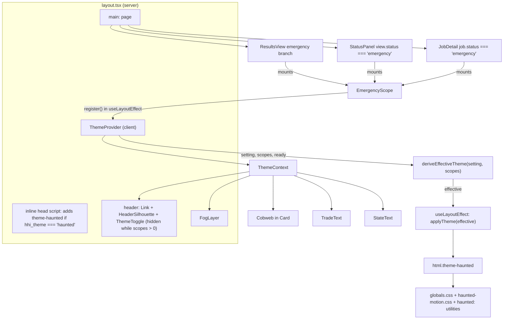

# Design Document: Haunted Mode

## Overview

Haunted mode turns the existing Haunted theme into a Halloween theme: near-black pages, deep purple cards, candle orange headings and primary buttons, small SVG art, ghost names for trades, haunted wording in loading and empty states, a slow flicker and fog drift, and the Creepster display font for headings only. Plain content, safety text and emergency pages stay plain. The switch is off by default, the theme plays no sound, adds no npm package, and stops all motion under `prefers-reduced-motion`.

The design extends what exists. It does not replace the `hhi_theme` setting, the `theme-haunted` root class or the `haunted:` Tailwind variant.

Five decisions shape everything else:

1. **One derived "effective theme".** The root class `theme-haunted` is a pure function of the stored setting and the number of mounted `EmergencyScope` components. Emergency pages render an `EmergencyScope`, which removes the class in the same render that shows the emergency, using `useLayoutEffect`. A result is only known to be an emergency after it loads in the browser, so the class cannot always be gone before the first paint. The safety guarantee therefore does not rest on the root class: the Emergency_Banner, the Emergency_Badge and the Pro emergency note carry no `haunted:` classes and one fixed high-contrast style, so they read the same in any frame. Every `haunted:` utility, the display font rule, the art and the motion are scoped to that class, so one switch turns all of them off.
2. **Palette tokens live once**, as `haunted.*` hex values in `tailwind.config.ts`. CSS reads them with Tailwind's `theme()` function. Components use token class names only.
3. **Decoration is separate from content.** Art components and ghost labels render nothing unless the effective theme is Haunted. Haunted lines sit next to the plain line and never replace it.
4. **Contrast is data.** A typed `Contrast_Registry` holds every colour pair. A property test recomputes every ratio, including pairs with fog or cobweb behind text.
5. **Motion is one CSS file** with two animations, scoped under `.theme-haunted`, switched off for reduced motion.

### Inspection findings that drive the design

| Finding | Consequence |
|---|---|
| `theme.ts` has `applyTheme`, `readStoredTheme`, `storeTheme`; `layout.tsx` runs an inline script that adds `theme-haunted` before paint. | Keep both. The script already satisfies "no Normal frame" for a stored `haunted`. The new provider must not remove the class before it has read storage. |
| `ThemeToggle` is a `button` with `aria-pressed` and `aria-label="Haunted theme"`. It owns its own state. | Replace with a `role="switch"` button that reads shared state from a provider. It renders nothing on an Emergency_Page (hidden, not disabled). |
| Haunted classes mix tokens (`haunted-bg`) with raw palette colours (`slate-900`, `purple-700`, `red-950`, `gray-800`) in `ui/styles.ts`, `ResultsView`, `IssueSummary`, `CostRange`, `JobBrief`, `StatusPanel`, `DataRetentionNotice`, `UploadProgress`, `UploadFlow`, `DropZone`, `JobListItem`, `PhotoGallery`, `SlotPicker`. | Replace every `haunted:` colour with a `haunted-*` token class (Req 3.4). |
| `tailwind.config.ts` has a `flicker` animation at 0.15 s, a `pulse-slow` animation, two `rgba()` box shadows and a `glow` token. | Remove `animation`, `keyframes`, both shadows and `glow` (Req 10.4). No file uses `animate-*`. |
| `DropZone.tsx` uses `transition-colors` and `UploadProgress.tsx` uses `transition-[width]`. | Remove both (Req 10.1, 10.3). These files are outside the scanned directories, so the scan test does not catch them today. |
| `EmergencyBanner` has `haunted:border-red-300 haunted:bg-red-900 haunted:text-red-50`. `UrgencyBadge` emergency has four `haunted:` classes. | Delete them. One fixed style (Req 11). |
| `ProEmergencyView` shows `PRO_EMERGENCY_NOTE` in `STATUS_BOX`, which carries `haunted:` classes. | Add a fixed `NOTE_BOX` recipe without `haunted:` classes (Req 11.9 covers the Pro note). |
| `ResultsView` already has one emergency branch. `StatusPanel` returns `null` when `view.status === 'emergency'` and calls `onEmergency`. `JobDetail` has one `job.status === 'emergency'` branch. | Each emergency branch mounts an `EmergencyScope`. Three places, one mechanism. |
| `sourceScan.test.ts` walks `src/components/pro`, `src/components/ui` (recursively), `src/app/pro` and six named files. It bans hex and `rgb()` strings, colour names as whole string literals, `style` colour properties, `animate-`, `transition` and `duration-` tokens, and requires names and `focus-visible:` on `button`, `a`, `input`, `textarea`. | New shared components go under `src/components/ui/haunted/`. The walk is recursive, so they are scanned with no change to the test (Req 16.3, 16.4). |
| Normal field borders use `gray-400`, which is 2.54:1 on white. | Change to `gray-500` (4.83:1). This is the one Normal colour change, accepted and named in Req 3.5. |
| The Home page has no empty-file-list line. | Add the plain line "No photos or video added yet." in both themes. Haunted adds "No spirits caught yet." (Req 7.2). |

## Architecture



### Emergency override sequence

```mermaid
sequenceDiagram
  participant U as Homeowner
  participant SP as StatusPanel
  participant RV as ResultsView
  participant ES as EmergencyScope
  participant TP as ThemeProvider
  participant D as html element
  Note over TP,D: setting = haunted, scopes = 0, class present
  U->>SP: sends reply
  SP->>SP: POST /reply returns 409 JOB_IS_EMERGENCY
  SP->>SP: applyView(emergency view) calls onEmergency
  SP->>RV: markEmergency() (same event batch)
  RV->>ES: render emergency branch, mount EmergencyScope
  ES->>TP: layout effect: register() so scopes = 1
  TP->>D: layout effect: applyTheme('normal') removes the class
  Note over D: all in one commit, before the browser paints
  Note over TP: setting stays haunted; hhi_theme untouched
```

### How the emergency override works

Two mechanisms work together. Only the first carries the safety guarantee.

1. **Fixed styles (the guarantee).** The Emergency_Banner, the Emergency_Badge and the Pro emergency note have no `haunted:` class and one fixed high-contrast style. Whatever the root class is, they paint the same colours (rows F-01 to F-05, both themes). A frame painted while `theme-haunted` is still on the root therefore still shows a readable warning.
2. **Class removal in the same render (the cleanup).** `EmergencyScope` calls `register()` in `useLayoutEffect`, not `useEffect`. React runs layout effects after the DOM update and before the browser paints, and a state update scheduled inside a layout effect is flushed synchronously before that paint. The provider then applies `applyTheme('normal')` in its own layout effect, in the same commit. Wherever the emergency is already known when the page renders (the Results_Page after a reply returns `JOB_IS_EMERGENCY`, a status poll that returns `emergency`, a client navigation to a loaded Pro emergency job), no frame shows the emergency content with the root class.

Where the result is only known after it loads in the browser (a direct load of `/inspect/[id]` or `/pro/jobs/[id]`), the root class can already be on from the inline head script. The page paints its loading state, then the first render that shows the emergency removes the class. A frame painted before that render is the loading state, not emergency content. If any frame did show emergency content with the class still on, only the page decoration would be Haunted; the banner, badge and note would keep their fixed style.

### First-render flash

- **Stored `haunted`, normal page:** the inline head script adds the class before paint. The provider starts with `setting = 'normal'` and `ready = false` so server and client markup match. It does not touch the class until `ready` is true. In its first layout effect it reads storage, sets `setting` and sets `ready = true` in one batch, then applies the class. The class never goes off in between.
- **Stored `haunted`, emergency page loaded directly:** the script adds the class, the page paints its loading state, then `EmergencyScope` removes the class in the commit that first renders the emergency view. The fixed styles cover any frame in between. This includes the cached-result path in `useInspection`, which sets state in a passive effect.
- **Leaving an emergency page** (for example "Start a new inspection"): `layout.tsx` persists across client navigations, so the provider keeps its state. `hhi_theme` was never changed, so `setting` is still `haunted`. When the emergency page unmounts, the `EmergencyScope` cleanup lowers `scopes` to 0, `effective` becomes `haunted`, and the class and the switch (in its on state) return in the same commit that renders the next page (Req 12.6, 13.5). A test covers this (Req 17.13).
- **Art pops in after hydration.** Art components render `null` until `ready`, so the server HTML has none. The palette and class are already correct on first paint, so only the art is late. This is the trade-off for guaranteeing zero art elements in Normal and on emergency pages.

## Components and Interfaces

### File plan

| Path | Status | Purpose |
|---|---|---|
| `src/lib/theme.ts` | unchanged | `Theme`, storage helpers, `applyTheme`. |
| `src/lib/haunted/effectiveTheme.ts` | new | `deriveEffectiveTheme(setting, scopes)`. Pure. |
| `src/lib/haunted/tradeMapper.ts` | new | `mapTrade`. Pure. |
| `src/lib/haunted/hauntedCopy.ts` | new | `HAUNTED_COPY`. Separate from `src/lib/jobs/copy.ts`. |
| `src/lib/haunted/contrast.ts` | new | `relativeLuminance`, `contrastRatio`, `blend`, `minimumFor`. Pure. |
| `src/lib/haunted/contrastRegistry.ts` | new | `CONTRAST_REGISTRY`, `checkRegistry`. Colours are token names, not hex. |
| `src/lib/haunted/palette.ts` | new | `resolveColour(ref)`. Reads values from `tailwind.config.ts` through `tailwindcss/resolveConfig`. Imported only by tests. |
| `src/components/ThemeProvider.tsx` | new (client) | State, storage, class application, context, `EmergencyScope` registration. |
| `src/components/ThemeToggle.tsx` | changed | The Haunted_Switch. Returns `null` on an Emergency_Page. |
| `src/components/ui/Card.tsx` | new | Wraps `CARD` or `STATUS_BOX`, adds `data-card` and one `Cobweb`. |
| `src/components/ui/haunted/` | new | `Cobweb`, `FogLayer`, `HeaderSilhouette`, `GhostIcon`, `ArtBoundary`, `TradeText`, `StateText`, `EmergencyScope`. Scanned by the existing test because `ui` is walked recursively. |
| `src/app/fonts.ts` | new | `next/font/local` call. |
| `src/assets/fonts/creepster/` | new | `Creepster-Regular.ttf` and `OFL.txt` from the Creepster download, in the same directory. |
| `src/app/haunted-motion.css` | new | The Motion_Stylesheet. |
| `src/app/globals.css` | changed | Palette variables from `theme()`, display-font rule. No literal hex under `.theme-haunted`. |
| `src/app/layout.tsx` | changed | Provider, fonts, art, motion import. |
| `tailwind.config.ts` | changed | New tokens, `fontFamily.display`, no `animation`, `keyframes` or box shadows. |
| `src/components/ui/styles.ts` | changed | Token-only `haunted:` classes. Adds `NOTE_BOX`, `PAGE_TITLE`. |

### Theme state and the derived effective theme

```ts
// src/lib/haunted/effectiveTheme.ts
export function deriveEffectiveTheme(setting: Theme, emergencyScopes: number): Theme {
  return emergencyScopes > 0 ? 'normal' : setting;
}
```

```ts
// src/components/ThemeProvider.tsx
export interface ThemeContextValue {
  setting: Theme;            // what the user chose; mirrors hhi_theme
  effective: Theme;          // what is on screen
  inEmergency: boolean;      // emergencyScopes > 0; the switch is hidden while true
  setSetting(next: Theme): void;
  registerEmergencyScope(): () => void;
}
```

Provider behaviour:

- State: `setting` (starts `'normal'`), `scopes` (starts `0`), `ready` (starts `false`).
- `useLayoutEffect` on mount: `setSetting(readStoredTheme())` and `setReady(true)`.
- `effective = ready ? deriveEffectiveTheme(setting, scopes) : 'normal'`. Art, ghost labels and haunted lines read `effective`.
- `useLayoutEffect(() => { if (ready) applyTheme(effective); }, [ready, effective])`. `applyTheme` is the existing function.
- `setSetting(next)` is a no-op while `scopes > 0` (a defensive guard, since the switch is not rendered then). Otherwise it sets state and calls `storeTheme(next)`. `hhi_theme` is written only by `setSetting`, so an emergency page never changes it. Storage failures are already swallowed, so the toggle still works for the current page view (Req 1.9, 2.5).
- `registerEmergencyScope()` adds one to `scopes` and returns a cleanup that subtracts one. A counter, not a boolean, so `ResultsView` and `StatusPanel` can both be mounted during the same emergency without one unmount lifting the override.
- Outside a provider, `useTheme()` returns `{ setting: 'normal', effective: 'normal', inEmergency: false, ... }` with no-op functions. Existing component tests that render without a provider keep passing and show no decoration.

```tsx
// src/components/ui/haunted/EmergencyScope.tsx
export function EmergencyScope(): null {
  const { registerEmergencyScope } = useTheme();
  useLayoutEffect(() => registerEmergencyScope(), [registerEmergencyScope]);
  return null;
}
```

Mount points:

| Place | Condition |
|---|---|
| `ResultsView` emergency branch | `result.urgency === 'emergency' \|\| result.isEmergency` (covers a loaded emergency and `markEmergency` after a poll or reply). |
| `StatusPanel` | `view?.status === 'emergency'` returns `<EmergencyScope />` instead of `null`. Covers the gap before `markEmergency` re-renders `ResultsView`. |
| `JobDetail` emergency branch | `job.status === 'emergency'`. |

The Pro job list is not an Emergency_Page, so it stays Haunted. Emergency rows show the fixed badge and no ghost label (Req 13.4).

### Haunted_Switch (`ThemeToggle.tsx`)

- `<button type="button" role="switch" aria-checked={setting === 'haunted'}>`. The native button gives Space and Enter activation, so each activation toggles once.
- Visible text "Haunted mode". A second span shows "On" or "Off" and is `aria-hidden`, so the accessible name is exactly "Haunted mode" and the state comes from `aria-checked`. A track-and-thumb shape moves left or right, so the state does not depend on colour (Req 1.7).
- While `inEmergency`: the component returns `null`. The switch is absent from the DOM, so it cannot be focused or activated, and nothing replaces it: no disabled control and no explanatory sentence (Req 12.5). The stored setting and `hhi_theme` are untouched. When the emergency page unmounts, the switch renders again with `aria-checked` matching the stored setting.
- Outside an emergency, focus stays on the switch after any toggle (Req 15.7).
- Size: `min-h-11 min-w-11`. Ring: `focus-visible:ring-2` with the Normal ring colour and `haunted:focus-visible:ring-haunted-accent haunted:focus-visible:ring-offset-haunted-bg`.
- The header container becomes `flex flex-wrap` so the silhouette and switch wrap at 320 px.

Switch colours (all tokens, no animation classes, so the thumb snaps). The switch is never shown on in the Normal theme, because it is hidden whenever the root class is removed by an emergency.

| State | Track | Thumb |
|---|---|---|
| Off, Normal | `bg-white border-gray-500` | `bg-gray-500`, left |
| Off, Haunted | `bg-haunted-field border-haunted-border` | `bg-haunted-muted`, left |
| On, Haunted | `bg-haunted-accent border-haunted-accent` | `bg-haunted-on-accent`, right |

### Haunted_Palette and tokens

All values are defined once, in `tailwind.config.ts` under `colors.haunted`. The old `glow` token and the `haunted-glow` and `haunted-card` box shadows are removed; `DropZone` stops using them.

| Token | Hex | Role |
|---|---|---|
| `haunted.bg` | `#0d0814` | Near-black page background; offset colour for focus rings |
| `haunted.surface` | `#2b1a48` | Deep purple card surface |
| `haunted.field` | `#1a0f2e` | Form fields, status box, badges, secondary buttons, switch track (Off) |
| `haunted.border` | `#8a63c9` | Field, button and switch borders; card borders; cobweb strokes |
| `haunted.text` | `#f1e9fb` | Body text |
| `haunted.muted` | `#cdbbe8` | Secondary text, placeholders |
| `haunted.accent` | `#ff9d2e` | Candle orange: headings, links, primary button background, focus ring |
| `haunted.accent-hover` | `#ffb454` | Primary button hover background |
| `haunted.on-accent` | `#1a1008` | Dark text on orange |
| `haunted.error` | `#ffb3a7` | Error text |
| `haunted.ok` | `#9fe3b0` | "Copied!" text, done progress, monitor badge border |
| `haunted.soon` | `#f2cf5b` | Soon badge border |
| `haunted.fog` | `#6a45a8` | Fog layer fill |

CSS reads the palette with `theme()`:

```css
.theme-haunted {
  --foreground: theme('colors.haunted.text');
  --background: theme('colors.haunted.bg');
  color-scheme: dark;
}
```

The old hex `#e9d5ff` and `#0f0a1a` in `globals.css` are deleted. The Normal `:root` values stay as they are. A test scans `src/` and fails on any hex, `rgb()` or `hsl()` in a Haunted context other than `tailwind.config.ts` (Req 3.2, 16.6).

### Recipe changes in `ui/styles.ts`

Normal classes stay as they are, except the field border, which changes from `gray-400` to `gray-500` (Req 3.5). Each `haunted:` partner becomes a token.

| Recipe | New Haunted classes |
|---|---|
| `CARD` (adds `relative isolate overflow-hidden`) | `haunted:border-haunted-border haunted:bg-haunted-surface haunted:text-haunted-text` |
| `HEADING` | `haunted:text-haunted-accent` |
| `BODY` | `haunted:text-haunted-text` |
| `MUTED` | `haunted:text-haunted-muted` |
| `PAGE_TITLE` (new, for every `h1`) | `text-2xl font-bold text-slate-900 haunted:text-haunted-accent` |
| `FIELD` | `haunted:border-haunted-border haunted:bg-haunted-field haunted:text-haunted-text haunted:placeholder:text-haunted-muted` plus the existing ring classes |
| `PRIMARY_BUTTON` | `haunted:border-haunted-accent haunted:bg-haunted-accent haunted:text-haunted-on-accent haunted:hover:bg-haunted-accent-hover haunted:focus-visible:ring-haunted-accent haunted:focus-visible:ring-offset-haunted-bg` |
| `SECONDARY_BUTTON` | `haunted:border-haunted-border haunted:bg-haunted-field haunted:text-haunted-text haunted:hover:bg-haunted-surface haunted:focus-visible:ring-haunted-accent haunted:focus-visible:ring-offset-haunted-bg` |
| `ERROR_TEXT` | `haunted:text-haunted-error` |
| `STATUS_BOX` (adds `relative isolate overflow-hidden`) | `haunted:border-haunted-border haunted:bg-haunted-field haunted:text-haunted-text` |
| `NOTE_BOX` (new, fixed) | `rounded-lg border border-slate-300 bg-slate-50 p-4 text-slate-900`, no `haunted:` class |

Other files stop carrying their own copies: `IssueSummary`, `CostRange`, `JobBrief`, `ResultsView` (`TEXT`, `LINK`), `DataRetentionNotice`, `UploadFlow`, `DropZone`, `UploadProgress` (bar colours `haunted:bg-haunted-accent`, `haunted:bg-haunted-ok`, `haunted:bg-haunted-error`), `ContextForm`, `SlotPicker` (`haunted:accent-haunted-accent`), `JobListItem` and `PhotoGallery` (ring colours) import the shared recipes or use the same tokens. Headings of cards use `HEADING`. Upload buttons that used `haunted:bg-haunted-glow haunted:text-white` use the `PRIMARY_BUTTON` Haunted classes.

A test fails on any `haunted:` token whose colour part is not `haunted-*` (Req 3.4).

The ban on `haunted:` tokens on emergency pages applies to the Fixed_Emergency_Elements only (banner, badge, Pro note). Other elements on an emergency page may keep their `haunted:` partner classes, which do nothing without the root class. Tests therefore scan those three elements, not the whole page. Removing `transition-*` from `DropZone` and `UploadProgress`, and swapping raw palette classes for tokens, must keep every Normal computed colour the same, except the field border.

### Cards and Cobwebs

`Card` is the only way to make a card:

```tsx
export interface CardProps extends HTMLAttributes<HTMLElement> {
  as?: 'section' | 'div' | 'article';
  tone?: 'card' | 'status';
}
// renders <Tag data-card className={recipe + className}><Cobweb />{children}</Tag>
```

`JobListItem` is a `Link` styled as a card. It carries `data-card` itself and renders `<Cobweb />` as a child, because a `Link` cannot be an `as` tag of a plain element type.

Elements converted to `Card` or given `data-card`:

| Page | Elements |
|---|---|
| Home | `DataRetentionNotice` section, `DropZone` drop panel, `UploadFlow` status or error box |
| Results | `IssueSummary` section, `CostRange` section, `JobBrief` box, `StatusPanel` (`tone="status"`) |
| Pro | `AccessCodeForm` (wrapped), `JobListItem`, `JobFacts` (3 sections), `JobHistory`, `PhotoGallery`, `ActionPanel`, `JobDetail` status sections (4), `ProEmergencyView` facts section |

The test for Req 5.2 counts `[data-haunted-art="cobweb"]` and `[data-card]` on each page fixture and requires equal numbers and one cobweb per card.

### Art components (`src/components/ui/haunted/`)

All art shares one wrapper contract: render `null` unless `effective === 'haunted'`; root has `aria-hidden="true"`, `pointer-events-none`, `data-haunted-art="<name>"`, no `tabIndex`, no `title`. Colours come from `currentColor` driven by a token text class on the root. No file contains a hex, `rgb()` or colour name. Each component is wrapped in `ArtBoundary`, a small error boundary that renders `null` on error, so a render failure never hides page content (Req 5.10).

| Component | Placement | Drawing | Colour source |
|---|---|---|---|
| `HeaderSilhouette` | In the header, between the site link and the switch group, in the flex flow so it cannot overlap text | House with a gable roof, a tower, a chimney and a crescent moon. One window group has class `hhi-flicker`. | `text-haunted-border` for the house, `text-haunted-muted` for the moon, `text-haunted-accent` for the window |
| `Cobweb` | `absolute right-0 top-0 -z-10 h-14 w-14 opacity-30`, inside the card's `isolate` stacking context, so it sits above the card background and below its content | Quarter web: three radial strokes and two arcs, `stroke="currentColor"`, `fill="none"` | `text-haunted-border` |
| `FogLayer` | `fixed inset-x-0 bottom-0 -z-10 h-[20vh] max-h-[25vh] overflow-hidden`, once, in `layout.tsx`; `body` gets `isolate` | An SVG twice the width of the viewport (`w-[200%]`) with two repeats of a wavy mist shape, class `hhi-fog-drift`, constant `opacity-30` | `text-haunted-fog` |
| `GhostIcon` | 16 px before the ghost label | Small ghost outline, `fill="currentColor"` | Inherits the chip text colour |

The fog is a constant `opacity-30` fill, so the worst case behind text is the page background blended with `haunted.fog` at 0.30. The cobweb is a constant `opacity-30` stroke, so the worst case is the card surface blended with `haunted.border` at 0.30. Both worst cases are registry rows (H-17 to H-24 for text, H-28 and H-32 for borders and buttons over the fog).

### Trade_Mapper (`src/lib/haunted/tradeMapper.ts`)

```ts
export type TradeCategory =
  | 'Plumbing' | 'Electrical' | 'Heating and cooling' | 'Moisture and mould' | 'Other';

export interface GhostTrade {
  category: TradeCategory;   // only selects the ghost name
  ghostName: string;         // Poltergeist | Wraith | Banshee | Ghoul | Restless spirit
  tradeDisplayText: string;  // trimmed trade text, first letter upper-cased
  label: string;             // `${ghostName} (${tradeDisplayText})`, e.g. "Poltergeist (Plumber)"
}

export function mapTrade(tradeText: string): GhostTrade | null;
```

- Pure. No I/O, time or randomness.
- Non-string input (a runtime guard for bad data) and blank input return `null`.
- `tradeDisplayText` is the trimmed input with its first character upper-cased and the rest unchanged. The first character is changed only when its upper-case form has the same lower-case form as the original (so "ß" and "ı" are left alone). That keeps the label a case-insensitive superset of the trimmed trade for every input. Examples: "plumber" gives "Poltergeist (Plumber)", "hvac technician" gives "Banshee (Hvac technician)", "chimney sweep" gives "Restless spirit (Chimney sweep)".
- Trim, then `toLowerCase()`. Rules run in this order and the first match wins: `plumb`; `electric`; `hvac`, `heating`, `cooling`, `furnace`, `boiler`, `air condition`; `mould`, `mold`, `damp`, `moisture`. No match gives `Other` and the ghost name "Restless spirit", so an unknown trade "chimney sweep" gives "Restless spirit (Chimney sweep)". The category only picks the ghost name; the label always carries the real trade.
- The rules are one frozen array of `{ category, ghostName, needles }`, so adding a trade means adding one row.

`TradeText` (in `ui/haunted/`) renders the real trade unchanged, then the ghost label only while Haunted:

```tsx
<span className={className}>{trade}</span>
{ghost && effective === 'haunted' ? (
  <span data-ghost className="...">
    <GhostIcon /> {ghost.label}
  </span>
) : null}
```

The real trade stays in its own element, so Plain_Content is character-identical in both themes (Req 8.1). The ghost label also contains the real trade ("Poltergeist (Plumber)"), so Req 6.8 and Req 6.12 hold on the label itself. Used in `IssueSummary` ("Who to call"), `JobFacts` ("Trade") and `JobListItem`. Emergency views never pass a trade, so no ghost label appears.

### Haunted_Copy and `StateText`

```ts
// src/lib/haunted/hauntedCopy.ts
export const HAUNTED_COPY = {
  inspecting: 'The inspector is walking the halls…',
  resultLoading: 'Summoning your result from the shadows…',
  statusChecking: 'Listening for whispers from the tradesperson…',
  jobLoading: 'Lighting a candle to find the job…',
  jobsLoading: 'Rattling the chains to fetch your jobs…',
  noFiles: 'No spirits caught yet.',
  noJobs: 'No restless spirits in the queue yet.',
} as const;
```

`StateText` keeps the plain line and adds the haunted line inside the same element:

```tsx
<Tag role={role} className={className}>
  <span>{plain}</span>
  {effective === 'haunted' ? <span className="block ...">{haunted}</span> : null}
</Tag>
```

| State | Plain line (unchanged) | Haunted key |
|---|---|---|
| Inspecting (`UploadFlow`) | Inspecting your home… | `inspecting` |
| Result loading (`ResultsView`) | Loading your result… | `resultLoading` |
| Status first load (`StatusPanel`) | Checking your job status… | `statusChecking` |
| Pro job loading (`JobDetail`) | Loading the job… | `jobLoading` |
| Pro list loading (`JobList`) | Loading jobs… | `jobsLoading` |
| Pro list empty (`JobList`) | No jobs yet. | `noJobs` |
| Home file list empty (`DropZone`) | No photos or video added yet. (new line, shown in both themes) | `noFiles` |

Loading states use `role="status"` and keep it in both themes (Req 7.4). The plain line stays in the DOM in both themes (Req 7.3). The `ghost` icon next to the empty state uses `GhostIcon`. Error text, urgency labels, cost labels, confidence and the upload notice never use `StateText`.

### Display font

- **Font:** Creepster, a horror display face from Google Fonts, licensed under the SIL Open Font License 1.1 (the file is in the `google/fonts` repository under `ofl/creepster`). It is used for headings only. The implementer downloads Creepster once and commits the files; the OFL.txt that comes with that download is the licence file.
- **Files:** `src/assets/fonts/creepster/Creepster-Regular.ttf` and `src/assets/fonts/creepster/OFL.txt` (the licence text with the copyright line, taken unchanged from the Creepster download and committed beside the font file, Req 9.2). No npm package is added (Req 9.3, 16.2).
- **Loading:**

```ts
// src/app/fonts.ts
import localFont from 'next/font/local';
export const displayFont = localFont({
  src: '../assets/fonts/creepster/Creepster-Regular.ttf',
  variable: '--font-display',
  display: 'swap',
  preload: false,
  fallback: ['system-ui', 'sans-serif'],
});
```

  `display: 'swap'` shows heading text in the fallback font at once (Req 9.9). `preload: false` stops Normal-theme visitors from downloading the file; the browser fetches it only when a Haunted heading needs it. Next.js bundles the file at build time, so there is no third-party request (Req 9.1). `layout.tsx` adds `displayFont.variable` to the `<html>` class list.
- **Where it applies:** one rule in `globals.css`, scoped under `.theme-haunted`:

```css
.theme-haunted h1,
.theme-haunted [data-card] h2,
.theme-haunted [data-card] h3 {
  font-family: var(--font-display), system-ui, sans-serif;
  font-weight: 400;
  text-transform: none;
  letter-spacing: normal;
}
.theme-haunted [data-card] h2 { font-size: 1.25rem; line-height: 1.75rem; }
```

  Body, labels, banners and every `p` stay in the system stack (Req 9.4, 9.5, 11.3). Normal headings have no matching rule, so they are unchanged (Req 9.6). Emergency pages have no `.theme-haunted`, so they never use the display font. If the file fails to load, the stack falls through to `system-ui` (Req 9.7). `tailwind.config.ts` also gets `fontFamily.display` with the same stack, for completeness.
- All headings are rendered at 4.5:1 or better, even the 24 px `h1`, so no heading depends on the large-text exception.

### Motion_Stylesheet (`src/app/haunted-motion.css`)

One file, imported once in `layout.tsx`. It holds the only `@keyframes` and `animation` declarations in `src/`.

```css
@keyframes hhi-flicker {
  0%, 100% { opacity: 1; }
  30%      { opacity: 0.9; }
  55%      { opacity: 0.96; }
  78%      { opacity: 0.86; }
}
@keyframes hhi-fog-drift {
  from { transform: translateX(0); }
  to   { transform: translateX(-50%); }
}
.theme-haunted .hhi-flicker   { animation: hhi-flicker 4s ease-in-out infinite; }
.theme-haunted .hhi-fog-drift { animation: hhi-fog-drift 90s linear infinite; }

@media (prefers-reduced-motion: reduce) {
  .theme-haunted .hhi-flicker,
  .theme-haunted .hhi-fog-drift { animation: none; opacity: 1; transform: none; }
}
```

- Flicker: values between 0.86 and 1.0, a spread of 0.14 (at most 0.15), one cycle per 4 s (at least 2 s, so at most 0.25 cycles per second).
- Fog drift: translation only, 90 s per cycle (at least 40 s), no opacity change. The fog SVG is twice the viewport width with a repeating shape, so `-50%` loops without a jump.
- `@keyframes` rules cannot be nested under a selector, so "scoped under `.theme-haunted`" means every `animation` declaration is. Keyframe names start with `hhi-`.
- Flicker applies only to art (the lit window). It never touches text, so it cannot change a contrast pair.
- The media query reacts live to the browser setting (Req 10.12). The existing global reduced-motion rule in `globals.css` stays.
- `tailwind.config.ts` loses `animation` (including `pulse-slow` and `flicker`) and `keyframes`. `transition-colors` in `DropZone` and `transition-[width]` in `UploadProgress` are removed. Emergency pages have no `.theme-haunted`, no art and no `hhi-*` classes, so they never animate.

### Source-scan compliance

The existing `sourceScan.test.ts` is not edited.

- **Where new code lives.** `Card.tsx` and everything in `ui/haunted/` are in `src/components/ui`, which the test walks recursively. They are scanned with the existing rules. `ThemeProvider.tsx` and `ThemeToggle.tsx` sit outside the scanned directories but follow the same rules.
- **Hex and colour functions.** Art uses `stroke="currentColor"` and `fill="currentColor"` plus token text classes. No `#` colour, no `rgb()`, no `hsl()`.
- **Colour-name literals.** The rule flags a string literal that equals a CSS colour name, such as `'Tan'`, `'Plum'` or `'Gold'`. Ghost names (`Poltergeist`, `Wraith`, `Banshee`, `Ghoul`, `Restless spirit`) and category names are not colour names, and the mapper is in `src/lib` anyway. The SVG attributes used are `none` and `currentColor`, which are not in the colour-name list.
- **`style` attributes.** None. Art positions with Tailwind classes, not `style={{ fill }}`.
- **Motion tokens.** Class names are `hhi-flicker` and `hhi-fog-drift`. No token starts with `animate-`, `transition` or `duration-`.
- **Names and rings.** The only native interactive element added is the switch, outside the scanned directories, and it has visible text and `focus-visible:` classes. `Card` adds none.
- **Extra safeguard.** A new test, `hauntedSourceScan.test.ts`, checks the rules that the existing scan does not cover: no `haunted:` token with a raw palette colour, no `animate-`, `transition` or `duration-` token anywhere in `src/**/*.tsx` (this catches `DropZone` and `UploadProgress`), no hex, `rgb()` or `hsl()` in `src` outside `tailwind.config.ts` for Haunted contexts, and no `audio`, `video`, `autoPlay` or `AudioContext`.

### Contrast_Registry

```ts
// src/lib/haunted/contrastRegistry.ts
export type PairRole = 'body' | 'large' | 'non-text';
export type ColourSpec =
  | string                                         // token path, e.g. 'haunted.text', 'slate.900'
  | { base: string; overlay: string; alpha: number }; // overlay blended on base

export interface ColourPair {
  id: string;                    // 'H-07'
  theme: Theme;                  // 'normal' | 'haunted'
  role: PairRole;
  usage: string;
  fg: ColourSpec;
  bg: ColourSpec;
}

export const CONTRAST_REGISTRY: readonly ColourPair[];
export function minimumFor(role: PairRole): 3 | 4.5;          // body 4.5; large and non-text 3
export function checkRegistry(): Array<{ pair: ColourPair; ratio: number; minimum: number }>; // failures
```

- Entries store token names. `palette.ts` resolves them to hex through `tailwindcss/resolveConfig` on `tailwind.config.ts`, so the hex values exist only in the config.
- `contrast.ts` implements the WCAG 2.x formula: sRGB channels linearised with the 0.04045 threshold, luminance `0.2126 R + 0.7152 G + 0.0722 B`, ratio `(L1 + 0.05) / (L2 + 0.05)`.
- Fixed emergency pairs (rows F-xx) are listed once per theme: the registry holds a `normal` and a `haunted` entry for each, as Req 11.5 asks, with the same colours.
- The failure message is `"<id> [<theme>/<role>] <usage>: ratio <x.xx> is below the minimum <m>"` (Req 4.7).
- A second test maps every colour utility in `src/**/*.tsx` that appears inside a `haunted:` variant (or in a Normal recipe) to a token and fails if that token is not used by any registry row (Req 4.2).
- Decorative borders (cards, badges) are not registry rows. WCAG asks for 3:1 only on boundaries that identify a control. Their ratios are given in the table notes for information.
- The switch is never disabled (it is hidden on an Emergency_Page), so no disabled contrast exemption is needed. The Normal switch is only ever seen in its Off state, so there is no "On, Normal" pair. `Button` keeps `disabled:opacity-60`, which WCAG exempts for inactive controls.

### Colour pair table

Ratios are WCAG 2.x, computed from the hex values with the formula above and rounded to two decimals. Text smaller than 24 px, or smaller than 18.66 px bold, needs 4.5:1. The design applies 4.5:1 to all text, including headings and the 20 px bold banner, so the 3:1 large-text allowance is not used. Non-text needs 3:1.

Blended backgrounds: fog worst case `haunted.bg` + `haunted.fog` at 0.30 = `#291a40`. Cobweb worst case `haunted.surface` + `haunted.border` at 0.30 = `#48306f`.

**Haunted theme, text and icons**

| ID | Foreground | Background | Ratio | Role | Min | Used for |
|---|---|---|---|---|---|---|
| H-01 | `haunted.text` `#f1e9fb` | `haunted.bg` `#0d0814` | 16.75 | body | 4.5 | Page text, header and footer text |
| H-02 | `haunted.text` `#f1e9fb` | `haunted.surface` `#2b1a48` | 13.24 | body | 4.5 | Card text |
| H-03 | `haunted.text` `#f1e9fb` | `haunted.field` `#1a0f2e` | 15.45 | body | 4.5 | Fields, status box, badges, secondary buttons |
| H-04 | `haunted.muted` `#cdbbe8` | `haunted.bg` `#0d0814` | 11.18 | body | 4.5 | Lead text, footer |
| H-05 | `haunted.muted` `#cdbbe8` | `haunted.surface` `#2b1a48` | 8.83 | body | 4.5 | Card hints |
| H-06 | `haunted.muted` `#cdbbe8` | `haunted.field` `#1a0f2e` | 10.31 | body | 4.5 | Placeholders, hints in fields |
| H-07 | `haunted.accent` `#ff9d2e` | `haunted.bg` `#0d0814` | 9.52 | body | 4.5 | Page title, site link, links |
| H-08 | `haunted.accent` `#ff9d2e` | `haunted.surface` `#2b1a48` | 7.53 | body | 4.5 | Card headings |
| H-09 | `haunted.accent` `#ff9d2e` | `haunted.field` `#1a0f2e` | 8.78 | body | 4.5 | Headings in the status box |
| H-10 | `haunted.on-accent` `#1a1008` | `haunted.accent` `#ff9d2e` | 9.02 | body | 4.5 | Primary button text |
| H-11 | `haunted.on-accent` `#1a1008` | `haunted.accent-hover` `#ffb454` | 10.62 | body | 4.5 | Primary button text on hover |
| H-12 | `haunted.error` `#ffb3a7` | `haunted.bg` `#0d0814` | 11.54 | body | 4.5 | Error text on page |
| H-13 | `haunted.error` `#ffb3a7` | `haunted.surface` `#2b1a48` | 9.12 | body | 4.5 | Error text in cards and the upload error box |
| H-14 | `haunted.error` `#ffb3a7` | `haunted.field` `#1a0f2e` | 10.64 | body | 4.5 | Error text in fields |
| H-15 | `haunted.ok` `#9fe3b0` | `haunted.bg` `#0d0814` | 13.27 | body | 4.5 | "Copied!" on page |
| H-16 | `haunted.ok` `#9fe3b0` | `haunted.surface` `#2b1a48` | 10.48 | body | 4.5 | "Copied!" in a card |

Creepster headings use the same colours as other Haunted text, so no new pair is needed. The h1 page title is H-07 (H-19 over the fog). Card headings are H-08, H-09 and H-23 (over a cobweb). All are above 4.5:1, so no heading relies on the 3:1 large-text allowance, even though Creepster glyphs are drawn lighter than a bold sans-serif. Emergency pages have no display font, so no heading pair is listed for them.

**Haunted theme, text over art (worst case)**

| ID | Foreground | Background | Ratio | Role | Min | Used for |
|---|---|---|---|---|---|---|
| H-17 | `haunted.text` | bg + fog 0.30 `#291a40` | 13.52 | body | 4.5 | Footer and page text over the fog |
| H-18 | `haunted.muted` | bg + fog 0.30 `#291a40` | 9.02 | body | 4.5 | Footer text over the fog |
| H-19 | `haunted.accent` | bg + fog 0.30 `#291a40` | 7.69 | body | 4.5 | Links over the fog |
| H-20 | `haunted.error` | bg + fog 0.30 `#291a40` | 9.31 | body | 4.5 | Errors over the fog |
| H-21 | `haunted.text` | surface + cobweb 0.30 `#48306f` | 9.23 | body | 4.5 | Card text over a cobweb |
| H-22 | `haunted.muted` | surface + cobweb 0.30 `#48306f` | 6.16 | body | 4.5 | Card hints over a cobweb |
| H-23 | `haunted.accent` | surface + cobweb 0.30 `#48306f` | 5.25 | body | 4.5 | Card headings over a cobweb |
| H-24 | `haunted.error` | surface + cobweb 0.30 `#48306f` | 6.36 | body | 4.5 | Errors over a cobweb |

**Haunted theme, non-text (borders, rings, switch, buttons, badges)**

| ID | Foreground | Background | Ratio | Role | Min | Used for |
|---|---|---|---|---|---|---|
| H-25 | `haunted.border` `#8a63c9` | `haunted.bg` `#0d0814` | 4.43 | non-text | 3 | Field and secondary button border on the page; switch track border |
| H-26 | `haunted.border` `#8a63c9` | `haunted.surface` `#2b1a48` | 3.50 | non-text | 3 | Field border inside a card |
| H-27 | `haunted.border` `#8a63c9` | `haunted.field` `#1a0f2e` | 4.09 | non-text | 3 | Border against its own field fill |
| H-28 | `haunted.border` `#8a63c9` | bg + fog 0.30 `#291a40` | 3.58 | non-text | 3 | Field border over the fog |
| H-29 | `haunted.accent` `#ff9d2e` | `haunted.bg` `#0d0814` | 9.52 | non-text | 3 | Primary button against the page; focus ring; switch track On |
| H-30 | `haunted.accent` `#ff9d2e` | `haunted.surface` `#2b1a48` | 7.53 | non-text | 3 | Primary button and focus ring inside a card |
| H-31 | `haunted.accent` `#ff9d2e` | `haunted.field` `#1a0f2e` | 8.78 | non-text | 3 | Focus ring on fields and badge border (urgent) |
| H-32 | `haunted.accent` `#ff9d2e` | bg + fog 0.30 `#291a40` | 7.69 | non-text | 3 | Primary button and focus ring over the fog |
| H-33 | `haunted.on-accent` `#1a1008` | `haunted.accent` `#ff9d2e` | 9.02 | non-text | 3 | Switch thumb, On |
| H-34 | `haunted.muted` `#cdbbe8` | `haunted.field` `#1a0f2e` | 10.31 | non-text | 3 | Switch thumb, Off |
| H-35 | `haunted.soon` `#f2cf5b` | `haunted.field` `#1a0f2e` | 12.03 | non-text | 3 | Soon badge border |
| H-36 | `haunted.ok` `#9fe3b0` | `haunted.field` `#1a0f2e` | 12.23 | non-text | 3 | Monitor badge border, done progress |

Notes: Haunted card borders use `haunted.border` on `haunted.bg` (4.43, the same as H-25) and are decorative. The badge border rows H-31, H-35 and H-36 are listed because they meet 3:1, not because a boundary must be visible. The ring offset colour is `haunted.bg`, so the ring touches `haunted.bg` on one side and the element on the other; both are covered by H-29 to H-32.

**Fixed emergency pairs (same in both themes)**

| ID | Foreground | Background | Ratio | Role | Min | Used for |
|---|---|---|---|---|---|---|
| F-01 | `white` `#ffffff` | `red.700` `#b91c1c` | 6.47 | body | 4.5 | Emergency banner text and icon |
| F-02 | `red.900` `#7f1d1d` | `white` `#ffffff` | 10.02 | non-text | 3 | Banner border against the page |
| F-03 | `red.900` `#7f1d1d` | `red.100` `#fee2e2` | 8.20 | body | 4.5 | Emergency badge text |
| F-04 | `red.600` `#dc2626` | `red.100` `#fee2e2` | 3.95 | non-text | 3 | Emergency badge border |
| F-05 | `slate.900` `#0f172a` | `slate.50` `#f8fafc` | 17.06 | body | 4.5 | Pro emergency note (`NOTE_BOX`) |

The registry holds F-01 to F-05 once with `theme: 'normal'` and once with `theme: 'haunted'`.

**Normal theme, text**

| ID | Foreground | Background | Ratio | Role | Min | Used for |
|---|---|---|---|---|---|---|
| N-01 | `gray.900` `#111827` | `white` `#ffffff` | 17.74 | body | 4.5 | Body text, site link |
| N-02 | `slate.900` `#0f172a` | `white` `#ffffff` | 17.85 | body | 4.5 | Card text |
| N-03 | `slate.600` `#475569` | `white` `#ffffff` | 7.58 | body | 4.5 | `HEADING` |
| N-04 | `slate.700` `#334155` | `white` `#ffffff` | 10.35 | body | 4.5 | `MUTED`, cost label |
| N-05 | `gray.700` `#374151` | `white` `#ffffff` | 10.31 | body | 4.5 | Home lead text |
| N-06 | `gray.600` `#4b5563` | `white` `#ffffff` | 7.56 | body | 4.5 | Footer, hints |
| N-07 | `brand.700` `#0369a1` | `white` `#ffffff` | 5.93 | body | 4.5 | Home page title |
| N-08 | `brand.800` `#075985` | `white` `#ffffff` | 7.56 | body | 4.5 | Drop zone label |
| N-09 | `brand.900` `#0c4a6e` | `white` `#ffffff` | 9.46 | body | 4.5 | Upload status line |
| N-10 | `red.800` `#991b1b` | `white` `#ffffff` | 8.31 | body | 4.5 | Error text |
| N-11 | `red.700` `#b91c1c` | `white` `#ffffff` | 6.47 | body | 4.5 | Field error text |
| N-12 | `green.800` `#166534` | `white` `#ffffff` | 7.13 | body | 4.5 | "Copied!" |
| N-13 | `slate.900` `#0f172a` | `slate.50` `#f8fafc` | 17.06 | body | 4.5 | Status box, retention notice |
| N-14 | `slate.700` `#334155` | `slate.50` `#f8fafc` | 9.90 | body | 4.5 | Muted text in status box |
| N-15 | `gray.900` `#111827` | `gray.50` `#f9fafb` | 16.98 | body | 4.5 | Job brief textarea |
| N-16 | `red.900` `#7f1d1d` | `red.50` `#fef2f2` | 9.16 | body | 4.5 | Upload error box |
| N-17 | `brand.800` `#075985` | `brand.50` `#f0f9ff` | 7.09 | body | 4.5 | Drop zone button hover |
| N-18 | `slate.900` `#0f172a` | `slate.100` `#f1f5f9` | 16.30 | body | 4.5 | Secondary button hover |
| N-19 | `white` `#ffffff` | `brand.700` `#0369a1` | 5.93 | body | 4.5 | Upload primary button |
| N-20 | `white` `#ffffff` | `brand.800` `#075985` | 7.56 | body | 4.5 | Upload primary button hover |
| N-21 | `white` `#ffffff` | `blue.700` `#1d4ed8` | 6.70 | body | 4.5 | `PRIMARY_BUTTON` |
| N-22 | `white` `#ffffff` | `blue.800` `#1e40af` | 8.72 | body | 4.5 | `PRIMARY_BUTTON` hover |
| N-23 | `orange.900` `#7c2d12` | `orange.100` `#ffedd5` | 8.18 | body | 4.5 | Urgent badge text |
| N-24 | `yellow.900` `#713f12` | `yellow.100` `#fef9c3` | 8.07 | body | 4.5 | Soon badge text |
| N-25 | `green.900` `#14532d` | `green.100` `#dcfce7` | 8.30 | body | 4.5 | Monitor badge text |

**Normal theme, non-text**

| ID | Foreground | Background | Ratio | Role | Min | Used for |
|---|---|---|---|---|---|---|
| N-26 | `gray.500` `#6b7280` | `white` `#ffffff` | 4.83 | non-text | 3 | Field border (changed from `gray-400`, the one Normal exception in Req 3.5); switch track Off; switch thumb Off |
| N-27 | `gray.500` `#6b7280` | `gray.50` `#f9fafb` | 4.63 | non-text | 3 | Textarea border on `gray-50` |
| N-28 | `slate.500` `#64748b` | `white` `#ffffff` | 4.76 | non-text | 3 | Secondary button border |
| N-29 | `blue.700` `#1d4ed8` | `white` `#ffffff` | 6.70 | non-text | 3 | Primary button against the page |
| N-30 | `blue.600` `#2563eb` | `white` `#ffffff` | 5.17 | non-text | 3 | Focus ring (`blue-600`) |
| N-31 | `brand.600` `#0284c7` | `white` `#ffffff` | 4.10 | non-text | 3 | Focus ring (`brand-600`) |
| N-32 | `brand.600` `#0284c7` | `slate.50` `#f8fafc` | 3.91 | non-text | 3 | Focus ring inside a status box |

Notes: the current Normal field border `gray-400` on white is 2.54, which is below 3. The border changes to `gray-500` (N-26), the exception named in Req 3.5. Normal card borders (`slate-300` on white is 1.48) and badge borders (`yellow-600` on `yellow-100` is 2.74) are decorative and are not registry rows.

### Existing tests to update

| Test | Change |
|---|---|
| `ThemeToggle.test.tsx` | Query `role="switch"` with name "Haunted mode", assert `aria-checked`, Space and Enter. Assert the switch is absent from the DOM while an `EmergencyScope` is mounted, and back (on) after it unmounts. Render inside `ThemeProvider`. |
| `UrgencyBadge.test.tsx` | Keep Normal hue checks. For urgent, soon, monitor assert `haunted:` tokens that contain `-haunted-`. For emergency assert no class token starts with `haunted:` (Req 16.5). |
| `EmergencyBanner` test | Assert no `haunted:` token on the root or any descendant. Also render it with `theme-haunted` on `document.documentElement` and assert the same fixed classes. |
| `theme.test.ts` | Keep. Add the round-trip property. |
| Component tests for `ResultsView`, `StatusPanel`, `JobDetail` | No change needed without a provider. Add Haunted cases that wrap in `ThemeProvider`. |

## Data Models

```ts
type Theme = 'normal' | 'haunted';             // unchanged, src/lib/theme.ts

// Storage: localStorage['hhi_theme'] is 'haunted' or 'normal'. Anything else reads as 'normal'.

interface ThemeState {                          // inside ThemeProvider
  setting: Theme;                               // mirrors hhi_theme
  scopes: number;                               // mounted EmergencyScope count, >= 0
  ready: boolean;                               // storage has been read
}

type TradeCategory = 'Plumbing' | 'Electrical' | 'Heating and cooling' | 'Moisture and mould' | 'Other';
interface GhostTrade { category: TradeCategory; ghostName: string; label: string; }

type PairRole = 'body' | 'large' | 'non-text';
interface ColourPair { id: string; theme: Theme; role: PairRole; usage: string; fg: ColourSpec; bg: ColourSpec; }
```

No server data, API route or DynamoDB record changes. Nothing new is stored beyond the existing `hhi_theme` key.

## Correctness Properties

*A property is a characteristic or behavior that should hold true across all valid executions of a system-essentially, a formal statement about what the system should do. Properties serve as the bridge between human-readable specifications and machine-verifiable correctness guarantees.*

Properties follow the prework analysis and its reflection step. Palette, art, font, motion and layout criteria are checked by example, scan and browser tests instead (see Testing Strategy).

### Property 1: Ghost label carries the real trade

*For any* non-blank string `t`, `mapTrade(t)` returns a label equal to `<ghostName> (<displayText>)`, where `ghostName` is the ghost name of the matched category and `displayText` is `t` trimmed with its first letter capitalised, so the label contains the trimmed `t` as a case-insensitive substring; *for any* blank string, `mapTrade` returns `null`.

**Validates: Requirements 6.1, 6.2, 6.3, 6.4, 6.5, 6.7, 6.12, 17.1**

### Property 2: Trade mapping is deterministic and case-insensitive

*For any* string `t`, two calls to `mapTrade(t)` return deeply equal results, and for any `t` the category and ghost name of `mapTrade(t.toUpperCase())` and `mapTrade(t.toLowerCase())` are equal to those of `mapTrade(t)`; *for any* generated text that contains the keyword of a named category and none of the keywords of an earlier category, the result has that category's ghost name; *for any* non-blank text that contains no keyword, the ghost name is "Restless spirit".

**Validates: Requirements 6.6, 6.11, 17.2**

### Property 3: The haunted trade chip keeps the real trade

*For any* non-blank trade text, rendering `TradeText` in the Haunted theme produces the trade text in its own element equal to the input, plus a ghost element whose text equals `mapTrade(text).label` and contains the trimmed trade text (case-insensitive); rendering it in the Normal theme produces exactly the input text and no ghost element.

**Validates: Requirements 6.8, 6.9, 8.1**

### Property 4: Haunted lines never replace the plain line

*For any* plain line and haunted line, a Haunted `StateText` render contains both strings inside one element, with the plain string in its own span unchanged; a Normal render contains the plain string and not the haunted string; and when `role="status"` is given, it is on that one element in both themes.

**Validates: Requirements 7.3, 7.4, 7.6, 8.1**

### Property 5: Effective theme follows the model

*For any* initial stored setting and *for any* sequence of operations from {toggle, mount an emergency scope, unmount an emergency scope, remount the page}, the root class is present exactly when the model value `scopes === 0 && setting === 'haunted'`; the Haunted_Switch is in the DOM exactly when `scopes === 0`, and when present its `aria-checked` equals `setting === 'haunted'`; the stored `hhi_theme` equals the setting after the last toggle (a toggle can only happen while the switch is present, so no toggle changes storage during an emergency); and after every scope is unmounted the class and the switch state match the setting again.

**Validates: Requirements 12.4, 12.5, 12.6, 13.3, 13.5, 17.13**

### Property 6: Emergency pages never render Haunted styling

*For any* emergency result or job (random issue text, answers, urgency `emergency` or `isEmergency` true, status `emergency`), *for any* stored setting in {normal, haunted}, and *for any* scenario in {direct load of the Results_Page, reply that returns `JOB_IS_EMERGENCY`, booking that returns `JOB_IS_EMERGENCY`, status poll that returns `emergency`, Pro job page}, the root element does not have `theme-haunted` once the emergency is shown, the page contains no `[data-haunted-art]` element, no `[data-ghost]` element, no `role="switch"` element, no `hhi-flicker` or `hhi-fog-drift` class, the Fixed_Emergency_Elements (banner, badge, Pro note) contain no class token that starts with `haunted:` (the rest of the page may still carry inert `haunted:` tokens, which do nothing without the root class), the Emergency_Message or Pro_Emergency_Note equals its constant character for character, and `hhi_theme` is unchanged.

**Validates: Requirements 6.13, 10.10, 11.1, 11.2, 11.8, 11.9, 12.1, 12.2, 12.8, 13.1, 13.2, 14.7, 17.3**

### Property 7: Every registered colour pair meets its minimum

*For any* entry in `CONTRAST_REGISTRY` (with overlay colours blended at their maximum alpha), the contrast ratio is at least `minimumFor(role)`: 4.5 for body text, 3 for large text and non-text components; and the registry contains the emergency banner and badge pairs for both themes.

**Validates: Requirements 3.7, 4.1, 4.3, 4.4, 4.5, 4.8, 9.8, 11.5, 17.4**

### Property 8: Contrast ratio is a well-formed measure

*For any* two colours `a` and `b`, `contrastRatio(a, b)` equals `contrastRatio(b, a)`, lies between 1 and 21 inclusive, and `contrastRatio(a, a)` equals 1.

**Validates: Requirements 4.3, 4.4, 4.7**

### Property 9: Theme setting round trip

*For any* theme value in {`haunted`, `normal`}, `storeTheme` followed by `readStoredTheme` returns the same value.

**Validates: Requirements 2.2, 2.6, 2.7, 17.5**

### Property 10: Only the exact value `haunted` turns the theme on

*For any* string `s` (including the empty string, other letter cases and strings longer than 32 characters) written under `hhi_theme`, `readStoredTheme()` returns `haunted` if and only if `s === 'haunted'`, and the inline head script adds `theme-haunted` if and only if `s === 'haunted'`.

**Validates: Requirements 2.1, 2.3, 2.4**

### Property 11: Plain content is identical in both themes

*For any* non-emergency result (random likely issue, trade, follow-up questions, DIY steps, costs, confidence, brief), the text of the plain elements (likely issue, trade element, questions, steps, cost amount and label, confidence, urgency label, brief, error messages) is identical in the Normal and Haunted renders; the Haunted render differs only by ghost chips, haunted state lines and aria-hidden art; and the list of heading levels and heading texts is identical.

**Validates: Requirements 8.1, 8.3, 8.4, 14.6, 15.4**

## Error Handling

| Situation | Behaviour |
|---|---|
| `localStorage` read throws (private mode, blocked) | `readStoredTheme` returns `normal`. The provider starts Normal. No message. |
| `localStorage` write throws or quota error | `storeTheme` swallows it. The switch still toggles for this page view. After a reload the page is Normal. No message. |
| Stored value is not exactly `haunted` | Treated as `normal`. The inline script uses the same strict comparison. |
| Provider missing in a test or story | `useTheme()` returns a Normal, no-op context. Nothing decorative renders. |
| `EmergencyScope` registered twice | Counter semantics. The class stays off until both unmount. The counter never goes below 0. |
| Emergency page shown while Haunted mode is on | The switch is not rendered (hidden, not disabled) and no replacement text is shown. `setSetting` also ignores calls while `scopes > 0`. `hhi_theme` is untouched, so the theme returns when the page is left. |
| Result is only known to be an emergency after it loads in the browser | The root class may still be on for the loading frame. `EmergencyScope` removes it in a layout effect in the render that shows the emergency. The banner, badge and Pro note have fixed styles and no `haunted:` classes, so they are readable in any frame. |
| Result becomes an emergency while Haunted mode is on and a form holds unsent text | `StatusPanel` hides the forms, `EmergencyScope` removes the class in the same commit. Stored job data is unchanged (existing behaviour). |
| Art component throws while rendering | `ArtBoundary` renders `null`. Text, buttons and fields stay. No error text. |
| Display font file fails to load | The CSS stack falls through to `system-ui, sans-serif` (the body font). Text stays visible because of `display: 'swap'`. Headings can wrap (`break-words` on headings) so a 390 px viewport does not scroll sideways. |
| `mapTrade` receives blank or non-string data | Returns `null`. `TradeText` renders the plain trade only. |
| A contrast pair falls below its minimum | The registry test fails with the pair id, theme, role, ratio and minimum. |
| Reduced-motion preference changes while a page is open | The media query applies at once. Nothing reloads. |
| Art fails to appear before hydration | Acceptable. Colours and class are already right on first paint. |

## Testing Strategy

### Approach

Unit tests cover examples, edge cases and wiring. Property tests cover the pure logic and the emergency guarantees. Palette, art, motion, font and layout checks use example tests, source scans and a short browser check, because "looks right" and "no overlap at 320 px" are not properties.

Property-based testing applies to: the trade mapper, the effective-theme model, the emergency rendering rules, the contrast maths and registry, the theme storage round trip and `StateText` or `TradeText` rendering. It does not apply to CSS values, SVG shapes, font files or layout, which get example, scan or browser checks.

### Property-based tests

- **Library:** `fast-check` (already in `devDependencies`) with Vitest. No library is written from scratch.
- **Iterations:** at least 100 per property (`numRuns: 100` or more). Failures print the shrunk counterexample and seed (fast-check's default report, with `verbose` enabled).
- **One test per property.** Each carries a comment in this form: `// Feature: haunted-mode, Property N: <text>`.

| Property | File | Generators |
|---|---|---|
| 1, 2 | `src/lib/haunted/tradeMapper.property.test.ts` | Strings with keyword, case and whitespace variation; whitespace-only strings; random Unicode |
| 3, 4 | `src/components/ui/haunted/haunted.property.test.tsx` | Random trade text; random plain and haunted lines (non-empty) rendered inside `ThemeProvider` |
| 5 | `src/components/ThemeProvider.property.test.tsx` | Arrays of operations with a pure model as the oracle |
| 6 | `src/components/results/emergencyHaunted.property.test.tsx` | Emergency results, jobs, stored setting, scenario; `fetch` mocked for 409 and poll cases |
| 7, 8 | `src/lib/haunted/contrastRegistry.property.test.ts` | `fc.constantFrom(...CONTRAST_REGISTRY)`; random `#rrggbb` pairs for Property 8 |
| 9, 10 | `src/lib/theme.property.test.ts` | `fc.constantFrom('haunted','normal')`; `fc.string()` plus case variants of `haunted` |
| 11 | `src/components/results/plainContent.property.test.tsx` | Random non-emergency results rendered in both themes |

### Example and scan tests

- **Switch:** role `switch`, name "Haunted mode", off on first load, keeps state after reload, Space and Enter toggle once each, focus stays on the switch, throwing storage, and absent from the DOM (not focusable, no replacement text) while an emergency page is shown (Req 1, 2.5, 12.5, 15.7, 17.7).
- **Fixed emergency styles under a Haunted root:** with `theme-haunted` set on `document.documentElement`, render `EmergencyBanner`, `UrgencyBadge` with urgency `emergency`, and the Pro emergency note (`ProEmergencyView`). For each, assert the fixed classes equal those rendered with the class absent, that no class token starts with `haunted:`, and that no `[data-haunted-art]` element is inside it (Req 11.10, 17.12).
- **Layout effect:** a source test asserts `EmergencyScope.tsx` imports and calls `useLayoutEffect` and does not use `useEffect`. A render test asserts that, after `render()` of an emergency view with `hhi_theme = haunted`, the root class is absent with no further timers or awaits (Req 12.1, 12.2, 13.2).
- **Leaving an emergency page:** with `hhi_theme = haunted`, render the Results_Page for an emergency, then click "Start a new inspection" (or unmount the emergency view). Assert `theme-haunted` is on the root again, `hhi_theme` is still `haunted`, and the switch is shown with `aria-checked="true"` (Req 12.6, 13.5, 17.13).
- **Copy and font names:** the upload-analysis state shows "Inspecting your home…" and "The inspector is walking the halls…"; the empty file list shows "No photos or video added yet." and, in Haunted, "No spirits caught yet."; the mapper gives "Poltergeist (Plumber)" and "Restless spirit (Chimney sweep)" and no label for blank text (Req 17.14, 17.15).
- **No sound, no packages:** no `audio`, `video`, `autoPlay` or `AudioContext` in `src`; `package.json` dependency fields equal the base commit; the font file and its `OFL.txt` are in one directory (Req 10.11, 16.2, 17.8, 17.16).
- **Motion:** parse `haunted-motion.css`. Exactly two keyframe names; every opacity in 0.85 to 1.0 with a spread of at most 0.15; every duration at least 2 s; fog at least 40 s and `transform` only; the reduced-motion block sets `animation: none`; every `animation` declaration begins with `.theme-haunted`; no `@keyframes` or `animation:` in any other file under `src`; `tailwind.config.ts` has no `animation` or `keyframes` (Req 10, 17.6).
- **Scans (`hauntedSourceScan.test.ts`):** no raw palette colour in `haunted:` variants; no `animate-`, `transition` or `duration-` in `src/**/*.tsx`; no hex, `rgb()` or `hsl()` in Haunted contexts outside `tailwind.config.ts`; no `audio`, `video`, `autoPlay` or `AudioContext` (Req 3.2, 3.4, 10.3, 10.11, 16.6, 17.8).
- **Cards and art:** cobweb count equals `[data-card]` count on Home, Results and Pro fixtures; one silhouette and one fog layer in Haunted; none in Normal; every art root has `aria-hidden="true"`, `pointer-events-none` and no `tabIndex`; `ArtBoundary` hides a throwing child without hiding siblings (Req 5).
- **Banner and badge:** no `haunted:` tokens on the banner or the emergency badge; banner keeps `role="alert"` and `aria-live="assertive"` after a toggle; urgent, soon and monitor badges carry `haunted:` tokens that contain `-haunted-` (Req 11, 16.5).
- **Font:** `layout.tsx` or `fonts.ts` uses `next/font/local` and never `next/font/google`; the font file and `OFL.txt` exist in the same directory; every display-font rule in `globals.css` starts with `.theme-haunted` and selects only `h1` and `[data-card] h2/h3`; `package.json` dependency fields equal the base commit (Req 9, 16.2).
- **Protected text:** exact-string tests for `EMERGENCY_MESSAGE`, `PRO_EMERGENCY_NOTE` and the exports of `src/lib/jobs/copy.ts`; the haunted copy module shares no string with `copy.ts` (Req 7.7, 16.1, 17.9).
- **Normal theme unchanged:** a snapshot of the non-`haunted:` colour classes of every recipe, with the field border as the one listed difference (Req 3.5).
- **Source scan:** `sourceScan.test.ts` runs unchanged and must pass (Req 16.3).
- **Registry coverage:** every colour token used in a `haunted:` class appears in at least one registry row (Req 4.2); a deliberately failing pair produces the message with id, theme, role, ratio and minimum (Req 4.7).

### Browser check (Playwright MCP, once before release)

At 390 px, 320 px and 1920 px, in Haunted mode: Home, a non-emergency result, an emergency result, `/pro`, `/pro/jobs/[id]`. Check against the reference screenshots (dark page, purple cards, orange headings, orange primary button with dark text), scroll width at most 390 px, no art over text, headings in the display font, emergency pages in Normal with no switch in the header, and no flash on a hard reload with `haunted` stored. With reduced motion on, nothing moves.

### Commands before every commit

`next lint`, `tsc --noEmit`, `vitest run`.
