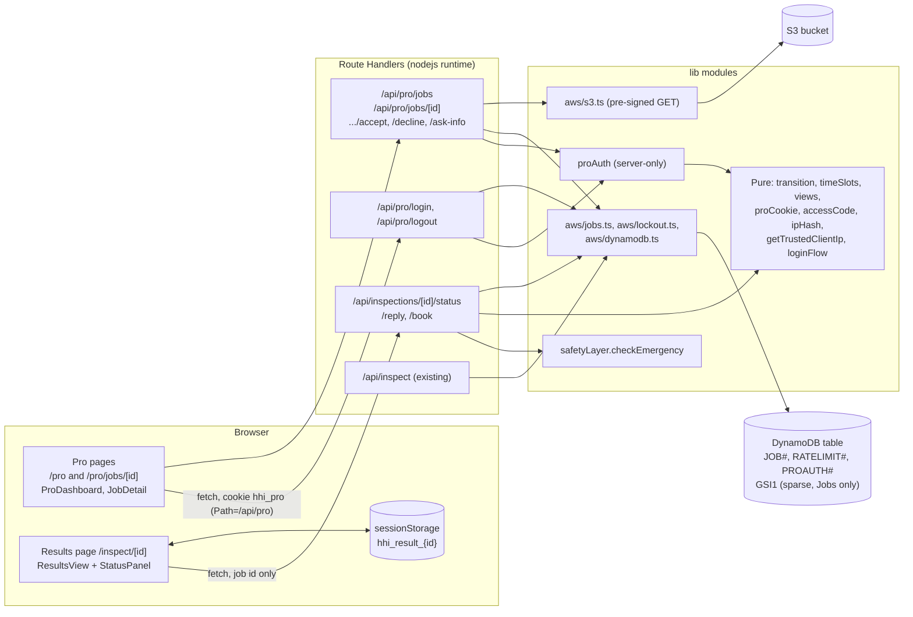
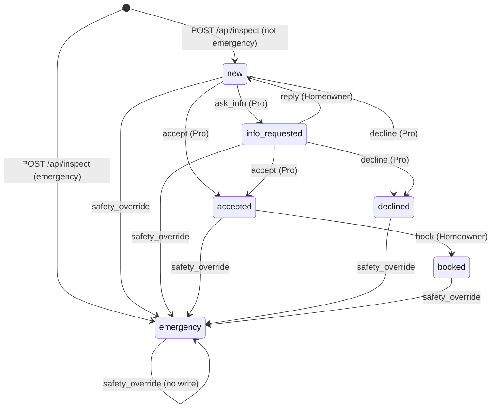

# Design Document — Pro Dashboard and Booking

## Overview

The pro-dashboard-and-booking feature adds a tradesperson side to Haunted House Inspector and a booking loop for the homeowner. A tradesperson opens `/pro`, enters the shared demo access code, and sees the newest 50 jobs. For each job the tradesperson reads the diagnosis, the homeowner's answers and the photos, then accepts the job (offering 1 to 3 time slots), declines it, or asks the homeowner one question. The homeowner follows the outcome on the existing `/inspect/[id]` page through a new Status_Panel: it shows the job status in plain words, lets the homeowner answer a question, and lets the homeowner pick one offered time slot to confirm a booking.

The design builds on the `intake-and-triage` code that exists today. It reuses the single DynamoDB table (`PK = SK = JOB#{id}`, items written flat with `...result`), the `ttl` attribute, the signed-cookie approach of `src/lib/rateLimiter.ts`, the Safety_Layer (`checkEmergency`), the results components and the Tailwind `haunted:` variant. It adds one DynamoDB global secondary index (`GSI1`), one new item type (`PROAUTH#<hash>`), eleven Route Handlers (plus one temporary diagnostic route that is deleted before launch), two pages, and a small set of pure modules. The steering file `product.md` was updated by the user: booking and tradesperson access are now in scope, so the design needs no steering exception.

The main design decisions are:

1. **Pure core, thin routes.** The status table, Time_Slot validation, cookie signing, access-code comparison, the lockout decision and the trusted-IP rule are pure functions (no AWS, no `server-only`). Route files only wire them together, because Next.js route files may export only HTTP method handlers. Anything that needs an injected clock or store (the login flow) lives in `src/lib/`.
2. **Every state change is one conditional `UpdateItem`.** The condition names the status the route read, so two racing writers produce exactly one winner (Requirement 6.9). The safety override is the single write whose condition is weaker ("exists and is not already emergency"), so it always wins (Requirement 6.13, 11.15).
3. **The Safety_Layer runs before any lookup on homeowner free text.** A reply that contains an Emergency_Trigger gets HTTP 200 with the Emergency_Message for any id, any Job state, any length up to the 4 KB body cap and any write failure (Requirement 9.3 to 9.7, 9.20, 9.22, 11.5). The UI never blocks a non-empty reply, so a long description of a danger always reaches the server.
4. **Emergency is irreversible on the server and on the client.** The server never writes a value that undoes the override (Requirement 11.3). The client never replaces a cached emergency copy with a fresh non-emergency copy (Requirement 11.7).
5. **One trusted-IP rule.** `getTrustedClientIp` reads one `x-forwarded-for` entry counted from the right, using one exported code constant `TRUSTED_PROXY_HOPS`. The default 1 is the conservative value until the temporary diagnostic route `GET /api/diag/ip` has been read on the live deployment. The rate-limiter change and the Pro login lockout are NOT deployed before the constant is set from that result (Requirements 18.11 to 18.17).
6. **No new infrastructure beyond one index and one IAM statement.** No new environment variable, no new npm dependency, no S3 or Bedrock change.

The feature spans six concerns:

1. **Pro access**: access code login, signed cookie, lockout, route guard (Requirements 1 to 3, 14, 18).
2. **Pro views**: job list and job detail (Requirements 4, 5).
3. **Status model**: transition table, conditional writes, concurrency (Requirement 6).
4. **Pro and homeowner actions**: accept, decline, ask-info, status, reply, book (Requirements 7 to 10).
5. **Emergency override**: server override and client non-downgrade (Requirement 11).
6. **Data, infrastructure and privacy**: data model, IAM, notice text, tests (Requirements 12, 13, 15 to 17).

---

## Architecture

### High-Level Data Flow



The new routes never import `@/lib/rateLimiter` or `@/lib/aws/bedrock`. A pro action, a status poll, a reply and a booking therefore cannot count toward the 15 inspections per day (Requirements 2.13, 7.17, 8.14, 9.14, 10.12), and `RATELIMIT#` items are never written by this feature.

### Status State Machine



### Request Pipelines

Every step stops at the first failure and returns its response. Steps are numbered so the route tests can assert the order (Requirements 3.3, 7.21, 9.3, 10.2).

**Pro login** `POST /api/pro/login` (Requirements 1, 2, 3.4, 3.5, 3.12):

1. Read `PRO_ACCESS_CODE` and `SESSION_SECRET`. If either is unset or empty: log one warning per missing variable (name only) and respond 503 `PRO_DISABLED`. Nothing is read or written.
2. Body size cap: `Content-Length` pre-check, then stream read with a 4,096-byte limit (413 `PAYLOAD_TOO_LARGE`).
3. JSON parse and Zod (`{ code: string 1..200 }`, no trim): 400 `INVALID_REQUEST`. Steps 2 and 3 never touch the Lockout_Counter (Requirement 1.8).
4. `getTrustedClientIp(headers)` then `hashClientIp(ip, secret)`.
5. `attemptLogin`: reserve one attempt (atomic conditional `UpdateItem`). Refused: 429 `TOO_MANY_ATTEMPTS` with `Retry-After`, even for a correct code. Store error: 500 `LOGIN_FAILED`.
6. Compare the code (SHA-256 digests with `timingSafeEqual`). Wrong: 401 `INVALID_CODE`, the attempt stays counted.
7. Correct: release the reserved attempt (a failure is logged and ignored, Requirement 2.15), sign the cookie, respond 200 with `Set-Cookie`.

**Pro read and action routes** (Requirements 3.1 to 3.3, 5, 7.21):

1. `requirePro(request, Date.now())`: cookie present, signature valid, payload valid, not expired. Fail: 401 `UNAUTHORIZED`. No body read, no id check, no AWS call.
2. (POST only) Body size cap 4,096 bytes: 413.
3. (POST only) JSON parse and Zod body validation: 400.
4. Job id is a UUID: otherwise 404 `NOT_FOUND`.
5. `getJob(id)`: strongly consistent `GetItem`. Missing, or no `status`: 404. Invalid stored data: 500 `RESULT_INVALID`. Read error: 500 `LOAD_FAILED` (detail) or `ACTION_FAILED` (actions).
6. (actions) `transition(status, action)`. Rejected: 409 `JOB_IS_EMERGENCY` (current status `emergency`) or `ILLEGAL_TRANSITION`. No write.
7. (actions) Conditional `UpdateItem`. Condition failed: one strongly consistent re-read, then 409 (same mapping). Re-read fails: 500 `ACTION_FAILED`. Other write error: 500 `ACTION_FAILED`.
8. (detail only) Build the view; for a non-emergency Job generate pre-signed GET URLs (900 s); for an emergency Job make no S3 call.

**Homeowner reply** `POST /api/inspections/[id]/reply` (Requirements 9.3 to 9.11, 11):

1. Body size cap 4,096 bytes: 413.
2. JSON parse and `text` is a string: otherwise 400.
3. **Safety_Layer** `checkEmergency` on the full untrimmed `text`. If it triggers: go to step E.
4. Id is a UUID: otherwise 404.
5. Trimmed `text` is 1 to 500 characters: otherwise 400 `INVALID_REQUEST`. For a trimmed text over 500 characters the message is exactly "Your reply is too long. Please shorten it to 500 characters or fewer."; for an empty trimmed text it is "Please write a reply before sending." (Requirement 9.12). This step is reached only when step 3 found no trigger, so a long danger text has already got its emergency answer.
6. `getJob(id)`: missing or no `status`: 404. Invalid: 500 `RESULT_INVALID`. Read error: 500 `ACTION_FAILED`.
7. `transition(status, 'reply')`: `emergency` gives 409 `JOB_IS_EMERGENCY` with the Emergency_Message; any status other than `info_requested` gives 409 `ILLEGAL_TRANSITION` with the current `status`.
8. `replyCount >= 5`: 429 `REPLY_LIMIT_REACHED`.
9. Conditional `UpdateItem` (`status = info_requested AND replyCount < 5`). Condition failed: re-read, 409 (or 429 if the Job is still `info_requested` with 5 replies). Other error: 500 `ACTION_FAILED`.

The 4,096-byte cap of step 1 is the only limit before the Safety_Layer. A body above the cap is answered 413 and its text cannot be checked (Requirement 9.22); the cap is far above 500 characters of ordinary text and comfortably holds a very long danger description. The UI does not compute byte sizes and does not block sending below the cap; on a 413 it shows "Please shorten your reply." and keeps the text.

Step E (emergency): if the id is a UUID, call `applySafetyOverride`. Any outcome, including a thrown error, is swallowed (name logged). Respond 200 `{ status: "emergency", message }`. Steps 4 to 9 never run for a triggering reply, so no limit or validation rule can block the emergency response, and no `GetItem` or `UpdateItem` is sent before step 3 (Requirement 9.5, Property 3).

**Homeowner book** `POST /api/inspections/[id]/book` (Requirement 10):

1. Body size cap 4,096 bytes: 413. 2. JSON parse and Zod `{ slot: iso datetime with Z }`: 400. 3. Id is a UUID: 404. 4. `getJob`: 404 / 500. 5. Status gate: `emergency` gives 409 `JOB_IS_EMERGENCY` with the Emergency_Message; not `accepted` gives 409 `ILLEGAL_TRANSITION`. 6. `slot` is exactly one entry of `offeredSlots`: otherwise 400 `SLOT_NOT_OFFERED`. 7. `slot` is later than server now: otherwise 409 `SLOT_EXPIRED`. The order of steps 6 and 7 is fixed by Requirement 10.4: `SLOT_NOT_OFFERED` is checked BEFORE `SLOT_EXPIRED`, so a slot that was never offered is never reported as expired. 8. Conditional `UpdateItem` (`status = accepted`): 200 on success; condition failed: re-read, 409.

**Homeowner status** `GET /api/inspections/[id]/status` (Requirement 8): id is a UUID (404), `getJob` (404 / 500), build the view with `toHomeownerStatusView`, 200. No rate limiter, no cookie set.

### Module Boundaries

| Layer | Location | Constraint |
|---|---|---|
| Pages (Server Components) | `src/app/pro/page.tsx`, `src/app/pro/jobs/[id]/page.tsx` | Export `metadata.robots` with `index: false`; render one Client Component; no data fetching |
| Client Components | `src/components/pro/`, `src/components/results/StatusPanel.tsx` and children, `src/components/ui/` | No AWS imports; call Route Handlers with `fetch`; no `dangerouslySetInnerHTML`; colour only through Tailwind token classes and `haunted:` variants |
| Custom hooks | `src/hooks/useStatusPolling.ts`, `useProJobs.ts`, `useProJob.ts`, `useInspection.ts` (changed) | Client-side only; own the fetch, abort and timer logic |
| Route Handlers | `src/app/api/pro/**`, `src/app/api/inspections/[id]/{status,reply,book}/route.ts` | Server-only; export only `runtime` and HTTP method functions; every response has `Cache-Control: no-store` |
| Route helpers | `src/lib/jobs/proAction.ts`, `src/lib/jobs/conflict.ts`, `src/lib/http/*` | Server-only helpers that run the shared pipeline steps |
| DynamoDB access (the Job_Store: exactly these three modules, as in the requirements Glossary) | `src/lib/aws/dynamodb.ts` (existing client plus `persistInspection`, changed), `src/lib/aws/jobs.ts` (job operations), `src/lib/aws/lockout.ts` (Lockout_Counter) | Server-only; the only modules that build DynamoDB commands; only `GetCommand`, `PutCommand`, `UpdateCommand`, `QueryCommand` |
| Pure modules | `src/lib/jobs/{transition,timeSlots,views,copy}.ts`, `src/lib/pro/{proCookie,accessCode,ipHash,loginFlow}.ts`, `src/lib/net/getTrustedClientIp.ts`, `src/lib/emergency/*`, `src/lib/validation/jobSchema.ts` | No AWS calls, no `server-only`, importable from tests and (for schemas and copy) from the browser |
| Types | `src/types/job.ts` | Shared types and the status and action constant lists |

---

## Components and Interfaces

### Module Layout (new and changed files)

Naming follows `structure.md`: `kebab-case` directories, `PascalCase` component files, `camelCase` everything else, named exports only in `lib` files.

#### New files

| Path | Exports | Notes |
|---|---|---|
| `src/types/job.ts` | `JOB_STATUSES`, `JobStatus`, `JOB_ACTIONS`, `JobAction`, `TimeSlot`, `InfoRequest`, `ReplyEntry`, `JobRecord`, `ProJobListItem`, `ProJobDetail`, `ProJobDetailActive`, `ProJobDetailEmergency`, `HomeownerStatusView`, `ApiErrorCode`, `ApiErrorBody` | Types plus the two `as const` lists (Requirement 12.12) |
| `src/lib/jobs/transition.ts` | `TRANSITION_TABLE`, `transition`, `isTerminalStatus`, `TransitionResult` | Pure (Requirement 6.2 to 6.4, 6.16) |
| `src/lib/jobs/timeSlots.ts` | `MAX_SLOTS`, `SLOT_HORIZON_MS`, `slotsSchema(nowMs)`, `canonicalizeSlots`, `SLOT_RULE_MESSAGES`, `isSlotOffered`, `isSlotExpired` | Pure; Zod 4 (Requirement 7.2, 7.3, 10.3, 10.4) |
| `src/lib/jobs/copy.ts` | `PRO_STATUS_LABEL`, `HOMEOWNER_STATUS_TEXT`, `STATUS_SAFETY_LINE`, `REPLY_RETENTION_NOTE`, `STATUS_REFRESH_FAILED`, `ERROR_MESSAGES` | Every user-facing sentence of this feature, so tests assert exact strings (Requirements 6.5, 8.3, 8.19, 14.14) |
| `src/lib/jobs/views.ts` | `toProListItem`, `toProDetail`, `toHomeownerStatusView`, `effectiveStatus` | Pure projections that fix the exact field sets (Requirements 4.5, 5.3, 5.10, 8.4, 8.5) |
| `src/lib/jobs/conflict.ts` | `conflictResponse(lookup, action)` | Server-only; maps a re-read to 409 `ILLEGAL_TRANSITION` / `JOB_IS_EMERGENCY` / 429 (Requirement 6.10) |
| `src/lib/jobs/proAction.ts` | `runProAction` | Server-only; the shared pipeline of the three pro action routes (Requirement 7.21) |
| `src/lib/validation/jobSchema.ts` | `jobIdSchema`, `storedJobSchema`, `proListItemSchema`, `loginBodySchema`, `declineBodySchema`, `askInfoBodySchema`, `replyBodySchema`, `bookBodySchema`, `homeownerStatusViewSchema`, `proJobDetailSchema`, `proJobsResponseSchema`, `actionResponseSchema`, `apiErrorSchema` | Zod 4; importable from browser and server. The accept body uses `slotsSchema` from `timeSlots.ts` |
| `src/lib/aws/jobs.ts` | `getJob`, `queryRecentJobs`, `applyTransition`, `applyReply`, `applyBooking`, `applySafetyOverride`, `JobLookup`, `WriteResult` | `server-only`; Job reads and conditional writes |
| `src/lib/aws/lockout.ts` | `dynamoLockoutStore`, `LockoutStore`, `ReserveResult`, `LOCKOUT_MAX`, `LOCKOUT_WINDOW_MS` | `server-only`; Lockout_Counter item operations |
| `src/lib/pro/proCookie.ts` | `PRO_COOKIE_NAME`, `PRO_COOKIE_PATH`, `PRO_COOKIE_MAX_AGE_SECONDS`, `signProCookie`, `verifyProCookie`, `ProCookiePayload` | Pure (Requirements 1.5, 1.6, 3.1, 14.2) |
| `src/lib/pro/accessCode.ts` | `digestsEqual`, `isAccessCodeValid` | Pure (Requirements 1.3, 14.1) |
| `src/lib/pro/ipHash.ts` | `hashClientIp` | Pure; keyed HMAC (Requirement 2.2) |
| `src/lib/pro/loginFlow.ts` | `attemptLogin`, `LoginOutcome`, `LoginDeps` | Pure given an injected store and clock (Requirements 2.3 to 2.12, Property 4) |
| `src/lib/pro/proAuth.ts` | `readProConfig`, `requirePro`, `buildLoginCookie`, `buildLogoutCookie` | `server-only`; config check, route guard, cookie attributes (Requirements 3, 14.3) |
| `src/lib/net/getTrustedClientIp.ts` | `TRUSTED_PROXY_HOPS`, `UNKNOWN_CLIENT_IP`, `getTrustedClientIp` | Pure; the only place that knows a header position; `TRUSTED_PROXY_HOPS` is a code constant, not an environment variable (Requirement 18.8) |
| `src/app/api/diag/ip/route.ts`, `route.test.ts` | `GET` | **TEMPORARY, already added by the user.** Reports `entryCount`, `labels`, `cloudfrontViewerAddressPresent`, `suggestedHops` and (only without the viewer header) `rawEntries`. Deleted by the task "Set TRUSTED_PROXY_HOPS and delete the diagnostic route" (Requirements 18.12 to 18.14) |
| `src/lib/http/readBodyWithLimit.ts` | `MAX_ACTION_BODY_BYTES`, `declaredLengthExceeds`, `readBodyWithLimit`, `readJsonBody` | Extracted from `POST /api/inspect` |
| `src/lib/http/responses.ts` | `noStoreJson`, `errorBody` | `Cache-Control: no-store` on every response |
| `src/lib/emergency/messages.ts` | `EMERGENCY_MESSAGE`, `PRO_EMERGENCY_NOTE` | Single source of the two exact texts |
| `src/lib/emergency/emergencyView.ts` | `isEmergencyResult`, `toEmergencyResult`, `emergencyResponseBody` | Pure; client and server |
| `src/lib/safety/replyCheck.ts` | `replyTriggersEmergency(text)` | `server-only`; wraps `checkEmergency` |
| `src/lib/utils/formatDateTime.ts` | `formatDateTime(iso, locale?)` | Pure; `Intl.DateTimeFormat` with `timeZoneName: 'short'` |
| `src/hooks/useStatusPolling.ts` | `useStatusPolling` | 30 s polling for the Status_Panel (Requirement 8.6 to 8.11) |
| `src/hooks/useProJobs.ts`, `src/hooks/useProJob.ts` | `useProJobs`, `useProJob` | Pro list and detail loading, 401 handling |
| `src/components/ui/styles.ts` | Tailwind class constants | Shared token and `haunted:` class strings |
| `src/components/ui/Button.tsx`, `TextAreaField.tsx`, `TextField.tsx`, `TimeText.tsx` | Components | Generic primitives |
| `src/components/results/StatusPanel.tsx`, `ReplyBox.tsx`, `SlotPicker.tsx` | Components | Homeowner side |
| `src/components/pro/ProDashboard.tsx`, `AccessCodeForm.tsx`, `JobList.tsx`, `JobListItem.tsx`, `JobDetail.tsx`, `JobFacts.tsx`, `JobHistory.tsx`, `PhotoGallery.tsx`, `ProEmergencyView.tsx`, `ActionPanel.tsx`, `AcceptForm.tsx`, `DeclineForm.tsx`, `AskInfoForm.tsx` | Components | Pro side |
| `src/app/pro/page.tsx`, `src/app/pro/jobs/[id]/page.tsx` | Default page exports and `metadata` | `noindex` (Requirement 3.11) |
| `src/app/api/pro/login/route.ts`, `logout/route.ts`, `jobs/route.ts`, `jobs/[id]/route.ts`, `jobs/[id]/accept/route.ts`, `decline/route.ts`, `ask-info/route.ts` | `POST` / `GET` | Pro_API |
| `src/app/api/inspections/[id]/status/route.ts`, `reply/route.ts`, `book/route.ts` | `GET` / `POST` | Homeowner_API |
| `src/test/fakeDynamoTable.ts`, `src/test/jobFixtures.ts` | Test helpers | See Testing Strategy |

#### Existing files that change

| File | Change | Requirement |
|---|---|---|
| `src/lib/aws/dynamodb.ts` | Export `getDocClient`, `requireTableName`, `jobKey`. `persistInspection` writes `status`, `statusUpdatedAt`, `GSI1PK`, `GSI1SK`, `replyCount`, `infoRequests`, `replies` in the same `PutItem`; `ttl` is computed as before | 6.7, 6.8, 12.4, 12.11 |
| `src/app/api/inspect/route.ts` | The local `readBodyWithLimit` is **refactored away**: the route imports `readBodyWithLimit` and `declaredLengthExceeds` from `src/lib/http/readBodyWithLimit.ts` with `MAX_BODY_BYTES = 16 * 1024`. Behaviour is identical; `route.bodyLimit.test.ts` is the regression guard. Step order is unchanged (principles 6.10 and 11.8 of `intake-and-triage` are kept) | 14.7 |
| `src/lib/rateLimiter.ts` | `ipVisitorId` calls `getTrustedClientIp(request.headers)`; still `ip:` + SHA-256 hex | 18.3, 18.4, 18.9 |
| `src/lib/inspectionLoader.ts` | `resolveFetchOutcome` and `loadInspection` apply the emergency non-downgrade rule | 11.7 |
| `src/lib/sessionResultCache.ts` | `cacheResult` refuses to overwrite a cached emergency entry with a non-emergency one | 11.7 |
| `src/hooks/useInspection.ts` | Returns `markEmergency()` | 11.6 |
| `src/components/results/ResultsView.tsx` | Mounts `<StatusPanel id onEmergency />` in the non-emergency branch; the emergency branch is unchanged (renders no panel) | 8, 11.8 |
| `src/components/results/EmergencyBanner.tsx` | Imports `EMERGENCY_MESSAGE` from `src/lib/emergency/messages.ts` and re-exports it, so existing imports keep working | 11.8 |
| `src/components/upload/DataRetentionNotice.tsx` | New text constant and list (see Privacy Notice Change) | 17 |
| `.env.example` | Comment text for `SESSION_SECRET` only (no new variable) | 13.10 |
| `intake-and-triage` spec text | Criterion 2.1, the wording of 11.3 and 11.4, and the notice tests 15.11 and 15.12 are updated by this feature's tasks | 17.3, 18.9 |

`amplify.yml` and `package.json` do not change: the build already copies `PRO_ACCESS_CODE` and `SESSION_SECRET` into `.env.production`, and no dependency is added (the source-scan test uses the `typescript` package that is already a dev dependency).

### Shared HTTP helpers (`src/lib/http/`)

```typescript
// readBodyWithLimit.ts (no server-only: pure over the Web Request API)
export const MAX_ACTION_BODY_BYTES = 4096;

/** True when a numeric Content-Length header already exceeds the limit. */
export function declaredLengthExceeds(request: Request, maxBytes: number): boolean;

/** Streams the body with a running byte count; returns null once the limit is exceeded. */
export function readBodyWithLimit(request: Request, maxBytes: number): Promise<string | null>;

export type JsonBodyResult =
  | { ok: true; value: unknown }
  | { ok: false; kind: 'too_large' | 'invalid_json' };

/** Pre-check, stream read, JSON.parse. A read error counts as invalid_json (as in the inspect route). */
export function readJsonBody(request: Request, maxBytes: number): Promise<JsonBodyResult>;

// responses.ts
export function noStoreJson(status: number, body: unknown, headers?: Record<string, string>): NextResponse;
export function errorBody(code: ApiErrorCode, message: string, extra?: Record<string, unknown>): ApiErrorBody;
```

`noStoreJson` always sets `Cache-Control: no-store` (Requirements 1.10, 3.9). The cookie headers for login and logout are added on the returned response by `proAuth.ts`.

### Transition function (`src/lib/jobs/transition.ts`)

```typescript
export type TransitionResult =
  | { ok: true; next: JobStatus; changed: boolean }       // changed=false only for emergency + safety_override
  | { ok: false; reason: 'ILLEGAL_TRANSITION' | 'JOB_IS_EMERGENCY' };

/** Keys are `${JobStatus}:${JobAction}`; 13 entries. */
export const TRANSITION_TABLE: Readonly<Record<string, JobStatus>> = {
  'new:ask_info': 'info_requested',
  'new:accept': 'accepted',
  'new:decline': 'declined',
  'info_requested:reply': 'new',
  'info_requested:accept': 'accepted',
  'info_requested:decline': 'declined',
  'accepted:book': 'booked',
  'new:safety_override': 'emergency',
  'info_requested:safety_override': 'emergency',
  'accepted:safety_override': 'emergency',
  'declined:safety_override': 'emergency',
  'booked:safety_override': 'emergency',
  'emergency:safety_override': 'emergency',
};

export function transition(current: JobStatus, action: JobAction): TransitionResult {
  const next = TRANSITION_TABLE[`${current}:${action}`];
  if (next === undefined) {
    return { ok: false, reason: current === 'emergency' ? 'JOB_IS_EMERGENCY' : 'ILLEGAL_TRANSITION' };
  }
  return { ok: true, next, changed: !(current === 'emergency' && next === 'emergency') };
}

export function isTerminalStatus(s: JobStatus): boolean {
  return s === 'declined' || s === 'booked' || s === 'emergency';
}
```

The function has no I/O, never throws, and returns a value for every one of the 36 pairs (Requirement 6.16). `emergency` is returned only for `safety_override` (Requirement 6.4). `TRANSITION_TABLE` uses a plain object lookup with fixed keys built from the closed unions, so no user string ever reaches the lookup (the route passes constants as the action, and `current` comes from `storedJobSchema`).

### Time slots (`src/lib/jobs/timeSlots.ts`)

```typescript
import { z } from 'zod';

export const MAX_SLOTS = 3;
export const SLOT_HORIZON_MS = 30 * 24 * 60 * 60 * 1000;
export type SlotRule = 'count' | 'format' | 'distinct' | 'past' | 'horizon';

export const SLOT_RULE_MESSAGES: Record<SlotRule, string> = {
  count: 'Offer between 1 and 3 times.',
  format: 'Each time must be a valid date and time.',
  distinct: 'Each time must be different.',
  past: 'Each time must be in the future.',
  horizon: 'Each time must be within the next 30 days.',
};

/** `nowMs` is injected so tests control time (Requirement 7.2). Issue messages are the SlotRule keys. */
export function slotsSchema(nowMs: number) {
  return z
    .array(z.iso.datetime({ message: 'format' }), { error: 'count' })
    .min(1, { message: 'count' })
    .max(MAX_SLOTS, { message: 'count' })
    .superRefine((slots, ctx) => {
      const t = slots.map((s) => Date.parse(s));
      if (t.some(Number.isNaN)) ctx.addIssue({ code: 'custom', message: 'format' });
      else if (new Set(t).size !== t.length) ctx.addIssue({ code: 'custom', message: 'distinct' });
      else if (t.some((x) => x <= nowMs)) ctx.addIssue({ code: 'custom', message: 'past' });
      else if (t.some((x) => x > nowMs + SLOT_HORIZON_MS)) ctx.addIssue({ code: 'custom', message: 'horizon' });
    })
    .transform(canonicalizeSlots);
}

/** Sorted ascending, each `new Date(s).toISOString()` (Requirement 7.3). */
export function canonicalizeSlots(slots: readonly string[]): string[];

export function isSlotOffered(offered: readonly string[], slot: string): boolean; // exact string equality (10.3)
export function isSlotExpired(slot: string, nowMs: number): boolean;              // Date.parse(slot) <= nowMs (10.4)
```

`z.iso.datetime()` accepts only a trailing `Z` by default, so an offset such as `+02:00` or a missing `Z` fails the `format` rule. A slot exactly 30 days after `nowMs` is valid; one millisecond later fails `horizon`. A slot equal to `nowMs` fails `past`. The route turns the first issue message into the 400 text from `SLOT_RULE_MESSAGES`.

### Pure views (`src/lib/jobs/views.ts`)

```typescript
/** Emergency wins: a Job whose stored urgency or isEmergency says emergency is treated as emergency even if `status` disagrees. */
export function effectiveStatus(job: Pick<JobRecord, 'status' | 'urgency' | 'isEmergency'>): JobStatus;

export function toProListItem(item: ProListStored): ProJobListItem;              // trade: null for emergency (4.7)
export function toProDetail(job: JobRecord, photos: string[]): ProJobDetail;      // two exact shapes (5.3, 5.10)
export function toHomeownerStatusView(job: JobRecord): HomeownerStatusView;       // 8.4, 8.5
```

`effectiveStatus` is an approved defence-in-depth safeguard (decision of the user; Requirement 6.19). `getJob` applies it once when it builds the `JobRecord`, so the status that routes and views see is already `emergency` for any Job that is emergency by `urgency` or `isEmergency`. Normal data never differs; the rule only matters if a Job is ever edited by hand or by a future bug. The conditional write of an action then fails (stored status differs), the re-read maps to `JOB_IS_EMERGENCY`, and the homeowner sees the emergency view. The safety override still works on such a Job because its condition is "status absent or not `emergency`".

### Emergency helpers (`src/lib/emergency/`)

```typescript
// messages.ts: the only definitions of these two strings
export const EMERGENCY_MESSAGE =
  'This may be dangerous. Get everyone to safety and call 911. For a gas smell, leave the home first, then call 911 or your gas utility from outside.';
export const PRO_EMERGENCY_NOTE = 'Emergency: the homeowner was told to call 911';

// emergencyView.ts
export function isEmergencyResult(r: Pick<InspectionResult, 'urgency' | 'isEmergency'>): boolean;

/** Client copy of a result after an emergency response (Requirement 11.6). Keeps id, createdAt, s3Keys, likelyIssue, trade, answers. */
export function toEmergencyResult(r: InspectionResult): InspectionResult; // urgency 'emergency', isEmergency true, costs 0, jobBrief '', diySteps []

export function emergencyResponseBody(): { status: 'emergency'; message: string };
```

`EmergencyBanner.tsx` keeps `export const EMERGENCY_MESSAGE` by re-export, so `ResultsView.test.tsx` and other imports of `./EmergencyBanner` are untouched. A unit test compares both constants with the exact literals in `requirements.md` so the wording cannot drift.

```typescript
// src/lib/safety/replyCheck.ts  (server-only)
import { checkEmergency } from '@/lib/safety/safetyLayer';

/** Evaluates a reply as one context answer on its own (Requirement 9.4). */
export function replyTriggersEmergency(text: string): boolean {
  return checkEmergency({ contextAnswers: { location: text, duration: '', recentChanges: '' } }).isEmergency;
}
```

`checkEmergency` already evaluates each answer individually and ignores empty strings, so the reply is tested exactly like a single context answer with the same trigger rules as criterion 6.2 of `intake-and-triage`. No Bedrock output is passed.

---

## Data Models

### Shared types (`src/types/job.ts`)

```typescript
import type { InspectionResult, UrgencyLevel, ContextAnswers } from '@/types/inspection';

export const JOB_STATUSES = ['new', 'info_requested', 'accepted', 'declined', 'booked', 'emergency'] as const;
export type JobStatus = (typeof JOB_STATUSES)[number];

export const JOB_ACTIONS = ['accept', 'decline', 'ask_info', 'reply', 'book', 'safety_override'] as const;
export type JobAction = (typeof JOB_ACTIONS)[number];

/** ISO 8601 UTC with a Z suffix, canonical form from Date.prototype.toISOString (e.g. 2026-03-05T20:00:00.000Z). */
export type TimeSlot = string;

export interface InfoRequest { question: string; askedAt: string }   // question 1..300 chars
export interface ReplyEntry { text: string; at: string }             // text 1..500 chars

/** A Job as the server uses it after storedJobSchema validation (no PK, SK, ttl, GSI1PK, GSI1SK). */
export interface JobRecord extends InspectionResult {
  status: JobStatus;                 // already passed through effectiveStatus()
  statusUpdatedAt: string;
  offeredSlots?: TimeSlot[];         // 1..3, ascending
  bookedSlot?: TimeSlot;
  bookedAt?: string;
  declineReason?: string;            // 1..200 chars
  infoRequests: InfoRequest[];       // 0..5
  replies: ReplyEntry[];             // 0..5
  replyCount: number;                // 0..5, equals replies.length
}

// ── Pro views ───────────────────────────────────────────────────────────────
export interface ProJobListItem {
  id: string;
  createdAt: string;
  urgency: UrgencyLevel;
  trade: string | null;              // null when emergency (Requirement 4.7)
  location: string;                  // answers.location
  status: JobStatus;
}

export interface ProJobDetailActive {
  id: string; createdAt: string; status: Exclude<JobStatus, 'emergency'>;
  urgency: Exclude<UrgencyLevel, 'emergency'>;
  likelyIssue: string; trade: string; confidence: number;
  costRangeLow: number; costRangeHigh: number; jobBrief: string;
  followUpQuestions: [string, string];
  answers: ContextAnswers;
  infoRequests: InfoRequest[]; replies: ReplyEntry[];
  offeredSlots?: TimeSlot[]; bookedSlot?: TimeSlot; declineReason?: string;
  photos: string[];                  // pre-signed GET URLs, 900 s, per request
}

export interface ProJobDetailEmergency {
  id: string; createdAt: string; status: 'emergency'; urgency: 'emergency';
  likelyIssue: string; answers: ContextAnswers;
  emergencyNote: string;             // PRO_EMERGENCY_NOTE
}
export type ProJobDetail = ProJobDetailActive | ProJobDetailEmergency;

// ── Homeowner view ──────────────────────────────────────────────────────────
export type HomeownerStatusView =
  | { status: 'new' }
  | { status: 'info_requested'; question: string }
  | { status: 'accepted'; offeredSlots: TimeSlot[] }
  | { status: 'declined'; reason?: string }
  | { status: 'booked'; bookedSlot: TimeSlot }
  | { status: 'emergency'; message: string };

export type ApiErrorCode =
  | 'INVALID_REQUEST' | 'PAYLOAD_TOO_LARGE' | 'UNAUTHORIZED' | 'INVALID_CODE' | 'TOO_MANY_ATTEMPTS'
  | 'PRO_DISABLED' | 'LOGIN_FAILED' | 'NOT_FOUND' | 'LOAD_FAILED' | 'RESULT_INVALID'
  | 'ILLEGAL_TRANSITION' | 'JOB_IS_EMERGENCY' | 'REPLY_LIMIT_REACHED'
  | 'SLOT_NOT_OFFERED' | 'SLOT_EXPIRED' | 'ACTION_FAILED';

export interface ApiErrorBody { error: ApiErrorCode; message: string; status?: JobStatus }
```

The existing `InspectionResult` type and `GET /api/inspections/[id]` are unchanged. `getInspection` still returns the whole stored item minus `PK`, `SK` and `ttl`, so it now also carries the new attributes; the route re-serialises `inspectionResultSchema.parse` output, and Zod 4 `z.object` strips unknown keys, so none of them (`status`, `replies`, `GSI1PK` and the rest) can leak through the old route. A regression test asserts that the response keys equal the `InspectionResult` keys for an item that has every new attribute.

### Zod schemas (`src/lib/validation/jobSchema.ts`, Zod 4.6.7)

```typescript
import { z } from 'zod';
import { JOB_STATUSES } from '@/types/job';

export const jobIdSchema = z.uuid();                         // Zod 4 top-level form of the existing z.string().uuid()
const isoUtc = z.iso.datetime();                              // Zod 4: trailing Z only, as inspectionSchema.ts already uses
const urgencySchema = z.enum(['emergency', 'urgent', 'soon', 'monitor']);

// ── request bodies (unknown fields are ignored: Requirement 7.20) ───────────
export const loginBodySchema = z.object({ code: z.string().min(1).max(200) });          // no trim (1.2)
export const declineBodySchema = z.object({
  reason: z.string().transform((s) => s.trim()).pipe(z.string().max(200)).optional(),   // 7.5, 7.6
});
export const askInfoBodySchema = z.object({
  question: z.string().transform((s) => s.trim()).pipe(z.string().min(1).max(300)),     // 7.7, 7.8
});
export const replyBodySchema = z.object({ text: z.string() });  // length rules run AFTER the Safety_Layer (9.3 step 5)
export const bookBodySchema = z.object({ slot: isoUtc });
// accept body: z.object({ slots: slotsSchema(nowMs) })  (built per request with the injected now)

// ── stored Job (GetItem result, PK/SK/ttl/GSI1* are stripped by Zod) ────────
export const storedJobSchema = z
  .object({
    id: z.string().min(1),
    createdAt: isoUtc,
    s3Keys: z.array(z.string()),
    likelyIssue: z.string().max(500),
    trade: z.string().max(100),
    urgency: urgencySchema,
    confidence: z.number().min(0).max(1),
    costRangeLow: z.number().min(0).max(999999),
    costRangeHigh: z.number().min(0).max(999999),
    jobBrief: z.string().max(1000),
    followUpQuestions: z.tuple([z.string().max(200), z.string().max(200)]),
    diySteps: z.array(z.string()),
    isEmergency: z.boolean(),
    answers: z.object({
      location: z.string().max(500),
      duration: z.string().max(500).default(''),
      recentChanges: z.string().max(500).default(''),
    }),
    status: z.enum(JOB_STATUSES),
    statusUpdatedAt: isoUtc,
    offeredSlots: z.array(isoUtc).min(1).max(3).optional(),
    bookedSlot: isoUtc.optional(),
    bookedAt: isoUtc.optional(),
    declineReason: z.string().min(1).max(200).optional(),
    infoRequests: z.array(z.object({ question: z.string().min(1).max(300), askedAt: isoUtc })).max(5).default([]),
    replies: z.array(z.object({ text: z.string().min(1).max(500), at: isoUtc })).max(5).default([]),
    replyCount: z.number().int().min(0).max(5).default(0),
  })
  .superRefine((j, ctx) => {
    if (j.status === 'emergency') return;     // an emergency Job must stay readable whatever else is wrong
    if (j.replyCount !== j.replies.length) ctx.addIssue({ code: 'custom', path: ['replyCount'], message: 'replyCount' });
    if (j.status === 'info_requested' && j.infoRequests.length === 0) ctx.addIssue({ code: 'custom', path: ['infoRequests'], message: 'question' });
    if (j.status === 'accepted' && !j.offeredSlots) ctx.addIssue({ code: 'custom', path: ['offeredSlots'], message: 'slots' });
    if (j.status === 'booked' && !j.bookedSlot) ctx.addIssue({ code: 'custom', path: ['bookedSlot'], message: 'slot' });
  });

// ── GSI1 list item (projection: id, createdAt, urgency, isEmergency, trade, status, answers) ──
export const proListItemSchema = z.object({
  id: z.string().min(1),
  createdAt: isoUtc,
  urgency: urgencySchema,
  isEmergency: z.boolean(),
  trade: z.string().max(100),
  status: z.enum(JOB_STATUSES),
  answers: z.object({ location: z.string().max(500) }),
});

// ── response schemas used by the browser (Requirement 8.11, 5.17) ───────────
export const homeownerStatusViewSchema = z.discriminatedUnion('status', [
  z.object({ status: z.literal('new') }),
  z.object({ status: z.literal('info_requested'), question: z.string() }),
  z.object({ status: z.literal('accepted'), offeredSlots: z.array(isoUtc).min(1).max(3) }),
  z.object({ status: z.literal('declined'), reason: z.string().optional() }),
  z.object({ status: z.literal('booked'), bookedSlot: isoUtc }),
  z.object({ status: z.literal('emergency'), message: z.string() }),
]);
export const actionResponseSchema = z.object({ status: z.enum(JOB_STATUSES) });
export const apiErrorSchema = z.object({ error: z.string(), message: z.string(), status: z.enum(JOB_STATUSES).optional() });
```

Notes on the schemas:

- A Job item with no `status` never reaches `storedJobSchema`. `getJob` checks the raw item first and returns `{ kind: 'legacy' }`, so a pre-feature Job never fails with `RESULT_INVALID` for the missing new attributes (Requirement 12.14, 6.14).
- A stored `status` that is not one of the six values fails the parse and returns `{ kind: 'invalid' }`, which the routes map to 500 `RESULT_INVALID` with no item data (Requirements 6.15, 12.10).
- `infoRequests`, `replies` and `replyCount` default to `[]`, `[]` and `0` so a Job that got `status` through the override on a legacy item still parses.
- `declineBodySchema`: an absent, empty or whitespace `reason` parses to `undefined` or `''`; `applyTransition` stores `declineReason` only when the trimmed value is non-empty. A `reason` longer than 200 characters after trimming fails with 400.

### DynamoDB single-table design

Table name: `process.env.DYNAMODB_TABLE_NAME`. Keys: `PK` (S, HASH), `SK` (S, RANGE). TTL attribute: `ttl`. One new index: `GSI1`.

#### Job item (`PK = SK = JOB#{id}`)

Existing attributes are unchanged (flat, written with `...result`). New attributes are in bold.

| Attribute | DynamoDB type | Notes |
|---|---|---|
| `PK`, `SK` | S | `JOB#{id}` |
| `id`, `createdAt` | S | UUID; ISO 8601 UTC |
| `s3Keys` | L of S | |
| `likelyIssue`, `trade`, `jobBrief` | S | `jobBrief` is `''` for emergencies |
| `urgency` | S | `emergency`, `urgent`, `soon`, `monitor` |
| `confidence`, `costRangeLow`, `costRangeHigh` | N | cost is 0 for emergencies |
| `followUpQuestions` | L of S | exactly 2 |
| `diySteps` | L of S | `[]` for emergencies and for gas, electrical, HVAC, furnace |
| `isEmergency` | BOOL | |
| `answers` | M | `{ location, duration, recentChanges }` all S |
| `ttl` | N | epoch seconds, `createdAt + 30 days`; **never written by this feature after creation** |
| **`status`** | S | one of the six values |
| **`statusUpdatedAt`** | S | `toISOString()` of the last status change; equals `createdAt` at creation |
| **`GSI1PK`** | S | constant `JOBS`; only on Job items |
| **`GSI1SK`** | S | equals `createdAt` |
| **`offeredSlots`** | L of S | 1 to 3, ascending, canonical; set by `accept`; removed by the override |
| **`bookedSlot`**, **`bookedAt`** | S | set by `book`; both removed by the override |
| **`declineReason`** | S | only when a non-empty trimmed reason was sent |
| **`infoRequests`** | L of M | `{ question: S, askedAt: S }`, 0 to 5 |
| **`replies`** | L of M | `{ text: S, at: S }`, 0 to 5 |
| **`replyCount`** | N | 0 to 5, equals `size(replies)` |

#### Lockout_Counter item (`PK = SK = PROAUTH#<ipHash>`)

| Attribute | Type | Notes |
|---|---|---|
| `PK`, `SK` | S | `PROAUTH#` + 64 hex characters (HMAC-SHA256 of the trusted IP, see Pro Auth Design) |
| `count` | N | integer 0 to 5 |
| `windowStart` | N | epoch milliseconds of the window start |
| `ttl` | N | `floor((windowStart + 900000) / 1000)`; cleanup only, never used for decisions |

The item has no `GSI1PK`, `GSI1SK` or `status`. `RATELIMIT#` items are not touched either, so `GSI1` holds Job items only (Requirements 12.2, 12.3).

#### GSI1 (the Job_Index)

| Setting | Value |
|---|---|
| Index name | `GSI1` |
| Attribute definitions | `GSI1PK` (S), `GSI1SK` (S) |
| Key schema | `GSI1PK` HASH, `GSI1SK` RANGE |
| Projection | `INCLUDE` with `id`, `createdAt`, `urgency`, `isEmergency`, `trade`, `status`, `answers` |
| Capacity | Same mode as the table (on-demand: nothing to set; provisioned: copy the table's read and write units) |
| Sparse behaviour | Only items that have both `GSI1PK` and `GSI1SK` are indexed. `RATELIMIT#`, `PROAUTH#` and pre-feature Jobs have neither, so they are absent. DynamoDB also projects the table keys `PK` and `SK` automatically |

This is the single definition behind Requirement 12.5 and 13.7. All `GSI1` reads are eventually consistent (DynamoDB does not allow `ConsistentRead` on a global secondary index), which the UI accepts (Requirement 4.15).

### Create a Job (`persistInspection`, Requirements 6.7, 6.8, 12.4, 12.11)

The function keeps its signature, its never-throws contract and the `ttl` formula. Only the `Item` grows:

```typescript
const emergency = result.isEmergency || result.urgency === 'emergency';
await getDocClient().send(new PutCommand({
  TableName: tableName,
  Item: {
    PK: jobKey(result.id),
    SK: jobKey(result.id),
    ttl: baseSeconds + TTL_SECONDS,            // unchanged: createdAt + 30 days
    ...result,                                  // InspectionResult has none of the keys below
    status: emergency ? 'emergency' : 'new',    // same PutItem (6.7, 6.8)
    statusUpdatedAt: result.createdAt,
    GSI1PK: 'JOBS',
    GSI1SK: result.createdAt,
    replyCount: 0,
    infoRequests: [],
    replies: [],
    // offeredSlots, bookedSlot, bookedAt, declineReason: absent (11.16)
  },
}));
```

The emergency result built by `applyOverrides` already has cost 0, `jobBrief` `''` and `diySteps` `[]` (Requirement 11.16). `POST /api/inspect` still returns the plain `InspectionResult`; `status` is not added to that response, so the existing inspect tests and the Session_Cache schema are unaffected. The Status_Panel learns the status from `GET .../status`.

### Reads

**`getJob(id)`** returns a `JobLookup`:

```typescript
export type JobLookup =
  | { kind: 'missing' }                       // no item
  | { kind: 'legacy' }                        // item without a `status` attribute (pre-feature Job)
  | { kind: 'invalid' }                       // item fails storedJobSchema (includes an unknown status value)
  | { kind: 'found'; job: JobRecord };

// GetCommand { Key: { PK: JOB#id, SK: JOB#id }, ConsistentRead: true }
// 1. no Item                         -> missing
// 2. Item.status === undefined       -> legacy
// 3. storedJobSchema.safeParse(Item) -> invalid | found
// 4. found: job.status = effectiveStatus(job)    (emergency wins)
```

It throws on a DynamoDB error; callers log only `error.name` and map to 500.

**`queryRecentJobs(nowMs)`** (Requirements 4.1 to 4.3, 4.9, 4.10, 4.17):

```typescript
await getDocClient().send(new QueryCommand({
  TableName: tableName,
  IndexName: 'GSI1',
  KeyConditionExpression: 'GSI1PK = :pk AND GSI1SK > :since',
  ExpressionAttributeValues: {
    ':pk': 'JOBS',
    ':since': new Date(nowMs - 30 * 24 * 60 * 60 * 1000).toISOString(),   // lower bound, 30 days
  },
  ScanIndexForward: false,    // newest first
  Limit: 50,                  // no ExclusiveStartKey: one page only
}));
```

Every returned item goes through `proListItemSchema`. An item that fails is dropped and one static line is logged (`console.error('Job list item failed validation')`). `LastEvaluatedKey` is ignored. `createdAt` strings are fixed-width UTC (`toISOString`), so string order equals time order, and `GSI1SK > :since` uses the same boundary as the item `ttl`, so an item past its 30 days is never listed even if DynamoDB has not yet removed it.

### Writes

All writes use `UpdateCommand` on `Key: { PK: JOB#id, SK: JOB#id }` through `getDocClient()`. `status` and `ttl` are DynamoDB reserved words, so expressions use `#status`. **No job write mentions `ttl`**, and a unit test asserts that none of the expression strings contain it (Requirements 12.11, 16.9).

```typescript
export type WriteResult = { ok: true } | { ok: false; reason: 'CONDITION_FAILED' };
// ConditionalCheckFailedException  -> { ok: false, reason: 'CONDITION_FAILED' }
// every other error                -> rethrown (the caller logs error.name and returns 500 ACTION_FAILED)
```

**Status transition: accept, decline, ask-info** (`applyTransition(id, expected, next, patch, nowIso)`; Requirements 6.9, 6.12, 6.18, 7.1, 7.3, 7.5, 7.7):

```typescript
// shared
ConditionExpression: 'attribute_exists(PK) AND #status = :expected',   // :expected is the status the route read
ExpressionAttributeNames: { '#status': 'status' },
// accept
UpdateExpression: 'SET #status = :next, statusUpdatedAt = :now, offeredSlots = :slots',
// decline (declineReason only when the trimmed reason is non-empty)
UpdateExpression: 'SET #status = :next, statusUpdatedAt = :now[, declineReason = :reason]',
// ask-info
UpdateExpression:
  'SET #status = :next, statusUpdatedAt = :now, infoRequests = list_append(if_not_exists(infoRequests, :empty), :q)',
// :q = [{ question, askedAt: now }], :empty = []
```

For `accept` and `decline` of an `info_requested` Job, `:expected` is `info_requested` (Requirement 6.9). `infoRequests`, `replies` and `replyCount` are not in those expressions, so the unanswered question stays in the history (Requirement 6.18). The 5-reply cap for `ask-info` (Requirement 7.9) is checked from the loaded Job (`replyCount >= 5` gives 409 `REPLY_LIMIT_REACHED` before the write). It is deliberately not repeated in the condition: `replyCount` only changes together with a status change out of `info_requested` (a reply) or into `emergency`, and `ask-info` already requires `status = new`, so the status condition covers every race.

**Reply** (`applyReply(id, text, nowIso)`; Requirements 9.8, 12.13):

```typescript
UpdateExpression:
  'SET #status = :new, statusUpdatedAt = :now, replies = list_append(if_not_exists(replies, :empty), :r), replyCount = replyCount + :one',
ConditionExpression: 'attribute_exists(PK) AND #status = :infoRequested AND replyCount < :five',
// :r = [{ text: trimmedText, at: now }], :five = 5, :one = 1
```

`replies` and `replyCount` change in the same item write, so they cannot drift apart. `ask-info` is only allowed at `replyCount < 5` and each ask needs a reply before the next, so `info_requested` with `replyCount >= 5` cannot arise from normal use. The route still handles it (429 `REPLY_LIMIT_REACHED`).

**Booking** (`applyBooking(id, slot, nowIso)`; Requirement 10.5):

```typescript
UpdateExpression: 'SET #status = :booked, statusUpdatedAt = :now, bookedSlot = :slot, bookedAt = :now',
ConditionExpression: 'attribute_exists(PK) AND #status = :accepted',
// offeredSlots and ttl are not mentioned, so both stay unchanged
```

**Safety override** (`applySafetyOverride(id, replyText, nowIso)`; Requirements 6.13, 11.1 to 11.5, 12.13). Two attempts, no pre-read:

```typescript
// Attempt A: the full override, appending the triggering reply.
UpdateExpression:
  'SET #status = :emergency, statusUpdatedAt = :now, urgency = :emergency, isEmergency = :true, ' +
  'costRangeLow = :zero, costRangeHigh = :zero, jobBrief = :emptyStr, diySteps = :emptyList, ' +
  'replies = list_append(if_not_exists(replies, :emptyList), :r) ' +
  'ADD replyCount :one ' +
  'REMOVE offeredSlots, bookedSlot, bookedAt',
ConditionExpression:
  'attribute_exists(PK) AND (attribute_not_exists(#status) OR #status <> :emergency) ' +
  'AND (attribute_not_exists(replyCount) OR replyCount < :five)',
// :r = [{ text: replyText.trim().slice(0, 500), at: now }]

// Attempt B (only if A fails its condition): the same override without the reply and without ADD replyCount.
UpdateExpression:
  'SET #status = :emergency, statusUpdatedAt = :now, urgency = :emergency, isEmergency = :true, ' +
  'costRangeLow = :zero, costRangeHigh = :zero, jobBrief = :emptyStr, diySteps = :emptyList ' +
  'REMOVE offeredSlots, bookedSlot, bookedAt',
ConditionExpression: 'attribute_exists(PK) AND (attribute_not_exists(#status) OR #status <> :emergency)',
// B fails its condition -> the Job is missing or already an Emergency_Job -> outcome 'skipped', no further write.
```

Why two attempts: Requirement 11.1 appends the reply and adds 1 to `replyCount`, but Requirement 12.1 caps `replies` at 5 and 12.13 forbids a longer list, and Requirement 9.5 says a Job with 5 replies must not block an emergency. Attempt A is used while a slot is free; when `replyCount` is already 5, attempt A fails its condition and attempt B performs the override without storing the reply. Both attempts are single atomic writes, and the order of an A-then-B retry is safe because B has the weaker condition. The reply text is stored trimmed and cut to 500 characters so that the stored item always satisfies `storedJobSchema` (the request body can be up to 4 KB, and a long danger text over 500 characters is accepted by the route, Requirement 9.22). The two-write behaviour is a confirmed decision (Design notes, item 1): the emergency override is always written first, and the reply text is stored only if a slot is free.

The override removes `offeredSlots`, `bookedSlot` and `bookedAt` (Requirement 11.1, decision of the user) and leaves `declineReason`, `infoRequests` and `ttl` as they are. The Pro view and the homeowner view for an Emergency_Job return fixed field sets that exclude all of them (Requirements 5.10, 8.5, 11.13).

Outcomes: `'applied' | 'skipped'`. Any thrown error propagates to the route, which swallows it (Requirement 11.5).

**Lockout_Counter** (`dynamoLockoutStore`; Requirements 2.3, 2.4, 2.8, 2.10, 2.12). `nowMs` is a parameter of every call:

```typescript
// Step 1: reserve in the current window (also creates the item and also admits when the item is absent)
UpdateExpression: 'ADD #count :one SET windowStart = if_not_exists(windowStart, :now), #ttl = if_not_exists(#ttl, :ttl)',
ConditionExpression: 'attribute_not_exists(windowStart) OR (windowStart > :cutoff AND #count < :max)',
ExpressionAttributeNames: { '#count': 'count', '#ttl': 'ttl' },
ExpressionAttributeValues: { ':one': 1, ':now': nowMs, ':ttl': Math.floor((nowMs + 900000) / 1000),
                             ':cutoff': nowMs - 900000, ':max': 5 },
ReturnValues: 'ALL_NEW',

// Step 2: start a new window, only if the stored window has really ended (compare-and-set on windowStart)
UpdateExpression: 'SET #count = :one, windowStart = :now, #ttl = :ttl',
ConditionExpression: 'windowStart <= :cutoff',

// Release after a correct code (Requirement 2.4): never below 0, never into a newer window
UpdateExpression: 'SET #count = #count - :one',
ConditionExpression: 'attribute_exists(PK) AND #count > :zero AND windowStart = :ws',
```

Reserve algorithm (at most three writes and two reads):

```typescript
async function reserve(ipHash: string, nowMs: number): Promise<ReserveResult> {
  for (let attempt = 0; attempt < 3; attempt++) {
    if (await step1()) return { allowed: true, windowStart, count };               // incl. first ever attempt
    const item = await getItem(ConsistentRead);                                    // step 1 failed on its condition
    if (item && item.windowStart > nowMs - WINDOW) {                               // window still open => count is 5
      return { allowed: false, retryAfterSeconds: clamp(ceil((item.windowStart + WINDOW - nowMs) / 1000), 1, 900) };
    }
    if (await step2()) return { allowed: true, windowStart: nowMs, count: 1 };     // window had ended: new window
    // step 2 lost a race (another request already reset the window): loop and try step 1 again
  }
  throw new Error('LockoutContention');                                            // caller fails closed: 500 LOGIN_FAILED
}
```

Why this is safe: step 1 is the only path that increments, and its condition checks both the window and the limit, so concurrent requests can never push `count` above 5 (Requirement 2.3). Step 2 resets only when `windowStart <= :cutoff` still holds at write time, so of two requests that both see an expired window exactly one resets it, and the other falls back to step 1 against the new window. A request whose item vanished through `ttl` between steps passes step 1 on the next loop (`attribute_not_exists(windowStart)`). Every error other than `ConditionalCheckFailedException` propagates and the login fails closed (Requirement 2.12). `ReturnValuesOnConditionCheckFailure` is not used: the document client's handling of the returned item was not verified, and the extra consistent `GetItem` is already allowed by IAM.

---

## Route Handlers

All handlers set `export const runtime = 'nodejs'`, start with `import 'server-only'`, use the Next.js 15 form `context: { params: Promise<{ id: string }> }`, and return through `noStoreJson`, so every response (including 4xx and 5xx) carries `Cache-Control: no-store` (Requirements 1.10, 2.16, 3.9, 8.14, 9.18, 10.12).

### API table

| Method and path | Auth | Request (Zod) | Success | Errors |
|---|---|---|---|---|
| `POST /api/pro/login` | none; Lockout_Counter | `{ code }` (`loginBodySchema`), 4 KB | 200 `{ ok: true }` + `Set-Cookie: hhi_pro` | 503 `PRO_DISABLED`; 413 `PAYLOAD_TOO_LARGE`; 400 `INVALID_REQUEST`; 429 `TOO_MANY_ATTEMPTS` + `Retry-After`; 401 `INVALID_CODE`; 500 `LOGIN_FAILED` |
| `POST /api/pro/logout` | none | body ignored | 200 `{ ok: true }` + expiring `Set-Cookie` | none (always 200) |
| `GET /api/pro/jobs` | `hhi_pro` | none; query and cursor ignored | 200 `{ jobs: ProJobListItem[] }` | 401 `UNAUTHORIZED`; 500 `LOAD_FAILED` |
| `GET /api/pro/jobs/[id]` | `hhi_pro` | `id` UUID | 200 `ProJobDetail` | 401; 404 `NOT_FOUND`; 500 `LOAD_FAILED` / `RESULT_INVALID` |
| `POST /api/pro/jobs/[id]/accept` | `hhi_pro` | `{ slots: string[1..3] }` | 200 `{ status: 'accepted' }` | 401; 413; 400 `INVALID_REQUEST` (message names the rule); 404; 409 `ILLEGAL_TRANSITION` / `JOB_IS_EMERGENCY`; 500 `ACTION_FAILED` / `RESULT_INVALID` |
| `POST /api/pro/jobs/[id]/decline` | `hhi_pro` | `{ reason? }` | 200 `{ status: 'declined' }` | as accept (400 for reason over 200) |
| `POST /api/pro/jobs/[id]/ask-info` | `hhi_pro` | `{ question }` | 200 `{ status: 'info_requested' }` | as accept, plus 409 `REPLY_LIMIT_REACHED` |
| `GET /api/inspections/[id]/status` | job id | `id` UUID | 200 `HomeownerStatusView` | 404 `NOT_FOUND`; 500 `LOAD_FAILED` / `RESULT_INVALID` |
| `POST /api/inspections/[id]/reply` | job id | `{ text }` | 200 `{ status: 'new' }`; 200 `{ status: 'emergency', message }` | 413; 400; 404; 409 `ILLEGAL_TRANSITION` / `JOB_IS_EMERGENCY` (+ message); 429 `REPLY_LIMIT_REACHED`; 500 `ACTION_FAILED` / `RESULT_INVALID` |
| `POST /api/inspections/[id]/book` | job id | `{ slot }` | 200 `{ status: 'booked', bookedSlot }` | 413; 400 `INVALID_REQUEST` / `SLOT_NOT_OFFERED`; 404; 409 `ILLEGAL_TRANSITION` / `JOB_IS_EMERGENCY` (+ message) / `SLOT_EXPIRED`; 500 `ACTION_FAILED` / `RESULT_INVALID` |

Error bodies have the shape `{ error, message, status? }`. `status` is added to 409 bodies (Requirements 6.10, 6.11). Messages (all in `ERROR_MESSAGES`, plain language, no secrets or free text):

| Code | Message |
|---|---|
| `UNAUTHORIZED` | "Access is needed, or your session has ended." |
| `INVALID_CODE` | "That code isn't right." |
| `TOO_MANY_ATTEMPTS` | "Too many attempts. Please wait a few minutes and try again." |
| `PRO_DISABLED` | "Tradesperson access isn't available right now." |
| `LOGIN_FAILED` | "Login failed. Please try again later." |
| `INVALID_REQUEST` | "We couldn't read that request." (accept: the `SLOT_RULE_MESSAGES` text; reply with a trimmed text over 500 characters and no trigger: "Your reply is too long. Please shorten it to 500 characters or fewer."; reply with an empty trimmed text: "Please write a reply before sending.") |
| `PAYLOAD_TOO_LARGE` | "That request is too large." (the reply Status_Panel shows "Please shorten your reply." for a reply 413) |
| `NOT_FOUND` | "We couldn't find that job." (same for an unknown id and a non-UUID, Requirement 14.15) |
| `LOAD_FAILED` | "We couldn't load the jobs. Please try again." (list) / "We couldn't load this job. Please try again." (detail) / "We couldn't load this status. Please try again." (status) |
| `RESULT_INVALID` | "This job could not be loaded." |
| `ILLEGAL_TRANSITION` | "This job has changed. Refresh to see its latest status." |
| `JOB_IS_EMERGENCY` | Pro routes: `PRO_EMERGENCY_NOTE`. Homeowner routes: `EMERGENCY_MESSAGE` |
| `REPLY_LIMIT_REACHED` | "This job has reached the limit of 5 replies." |
| `SLOT_NOT_OFFERED` | "That time isn't one of the times offered." |
| `SLOT_EXPIRED` | "That time has passed. Please pick another." |
| `ACTION_FAILED` | "Something went wrong. Please try again." |

### `src/lib/jobs/proAction.ts` (the shared pipeline of accept, decline and ask-info)

```typescript
export async function runProAction<B>(args: {
  request: NextRequest;
  params: Promise<{ id: string }>;
  action: 'accept' | 'decline' | 'ask_info';
  parseBody: (raw: unknown, nowMs: number) => { ok: true; value: B } | { ok: false; message: string };
  buildPatch: (body: B) => TransitionPatch;
  precheck?: (job: JobRecord) => NextResponse | null;   // ask-info: REPLY_LIMIT_REACHED
}): Promise<NextResponse> {
  const nowMs = Date.now();
  const auth = requirePro(args.request, nowMs);                        // 1. cookie first (3.3)
  if (!auth.ok) return auth.response;
  const body = await readJsonBody(args.request, MAX_ACTION_BODY_BYTES); // 2. size + JSON
  if (!body.ok) return body.kind === 'too_large' ? payloadTooLarge() : invalidRequest();
  if (typeof body.value !== 'object' || body.value === null || Array.isArray(body.value)) return invalidRequest(); // 7.20
  const parsed = args.parseBody(body.value, nowMs);                    // 3. Zod
  if (!parsed.ok) return invalidRequest(parsed.message);
  const id = (await args.params).id;                                   // 4. id
  if (!jobIdSchema.safeParse(id).success) return notFound();
  let lookup: JobLookup;
  try { lookup = await getJob(id); } catch (e) { return actionFailed(e); }   // 5. load
  if (lookup.kind === 'missing' || lookup.kind === 'legacy') return notFound();
  if (lookup.kind === 'invalid') return resultInvalid();
  const job = lookup.job;
  const t = transition(job.status, args.action === 'ask_info' ? 'ask_info' : args.action);   // 6. status
  if (!t.ok) return conflictFor(t.reason, job.status);                 // 409 JOB_IS_EMERGENCY | ILLEGAL_TRANSITION, no write
  const early = args.precheck?.(job);
  if (early) return early;
  try {                                                                // 7. conditional write
    const w = await applyTransition(id, job.status, t.next, args.buildPatch(parsed.value), new Date(nowMs).toISOString());
    if (w.ok) return noStoreJson(200, { status: t.next });
    return await conflictResponse(id, 'pro');                          // one strongly consistent re-read (6.10)
  } catch (e) { return actionFailed(e); }
}
```

`conflictResponse` re-reads once and maps: `emergency` gives 409 `JOB_IS_EMERGENCY`; any other status gives 409 `ILLEGAL_TRANSITION` with the current `status`; a Job that is now missing or invalid gives 404 / 500; a re-read error gives 500 `ACTION_FAILED`. It never retries the write (Requirement 6.10). `precheck` for ask-info returns 409 `REPLY_LIMIT_REACHED` when `job.replyCount >= 5` (Requirement 7.9). In `ILLEGAL_TRANSITION` and `JOB_IS_EMERGENCY` bodies for pro routes, `offeredSlots`, `bookedSlot` and free text are never included (Requirement 7.11).

### `POST /api/pro/login` (`src/app/api/pro/login/route.ts`)

```typescript
export async function POST(request: NextRequest): Promise<NextResponse> {
  const config = readProConfig();                          // warns once per missing variable, name only (3.8)
  if (!config.ok) return noStoreJson(503, errorBody('PRO_DISABLED', ERROR_MESSAGES.PRO_DISABLED));       // 3.4, 3.5, 3.12
  const body = await readJsonBody(request, MAX_ACTION_BODY_BYTES);
  if (!body.ok) return body.kind === 'too_large' ? payloadTooLarge() : invalidRequest();                 // 1.8: not counted
  const parsed = loginBodySchema.safeParse(body.value);
  if (!parsed.success) return invalidRequest();                                                          // 1.8: not counted
  const ipHash = hashClientIp(getTrustedClientIp(request.headers), config.secret);
  const outcome = await attemptLogin(parsed.data.code, ipHash, {
    accessCode: config.accessCode, secret: config.secret, nowMs: Date.now(), store: dynamoLockoutStore,
  });
  switch (outcome.kind) {
    case 'locked':  return noStoreJson(429, errorBody('TOO_MANY_ATTEMPTS', ...), { 'Retry-After': String(outcome.retryAfterSeconds) });
    case 'failed':  return noStoreJson(500, errorBody('LOGIN_FAILED', ...));
    case 'invalid_code': return noStoreJson(401, errorBody('INVALID_CODE', ...));
    case 'ok': { const res = noStoreJson(200, { ok: true }); res.cookies.set(buildLoginCookie(outcome.cookieValue)); return res; }
  }
}
```

### `POST /api/pro/logout`

No configuration check, no cookie check, no body read. It builds `noStoreJson(200, { ok: true })` and sets `hhi_pro` with value `''`, `Max-Age=0`, `Path=/api/pro`, `HttpOnly`, `Secure`, `SameSite=Strict` (Requirements 1.11, 1.12, 14.3). A test asserts the serialised `Set-Cookie` header contains `Max-Age=0`.

### `GET /api/pro/jobs` and `GET /api/pro/jobs/[id]`

The list route runs `requirePro`, `queryRecentJobs(Date.now())`, maps each item through `toProListItem`, and responds `{ jobs }`. A thrown error gives 500 `LOAD_FAILED` with the list message and logs `error.name`.

The detail route runs `requirePro`, validates the id (404), `getJob` (404 / 500), then:

```typescript
if (job.status === 'emergency') return noStoreJson(200, toProDetail(job, []));      // no S3 call at all (5.10)
const settled = await Promise.allSettled(job.s3Keys.map((k) => getDownloadPresignedUrl(k, 900)));
const photos = settled.flatMap((r) => (r.status === 'fulfilled' ? [r.value] : []));  // omit a failed photo (5.9), keep order (5.8)
return noStoreJson(200, toProDetail(job, photos));
```

The URLs are never stored, cached or logged; a failed signing logs only the error name once per request (Requirements 5.8, 5.9, 14.12). `toProDetail` returns exactly the field set of Requirement 5.3 for a non-emergency Job (including `offeredSlots`, `bookedSlot` and `declineReason` only when stored) and exactly `id`, `createdAt`, `status`, `urgency`, `likelyIssue`, `answers`, `emergencyNote` for an Emergency_Job. `diySteps`, `s3Keys`, `isEmergency`, `ttl`, `GSI1PK`, `GSI1SK`, `replyCount`, `statusUpdatedAt` and `bookedAt` are never copied.

### `POST /api/pro/jobs/[id]/{accept,decline,ask-info}`

Each route file is three lines: it calls `runProAction` with its own `parseBody` and `buildPatch`:

| Route | `parseBody` | `buildPatch` | `precheck` |
|---|---|---|---|
| accept | `z.object({ slots: slotsSchema(nowMs) })`; the first issue message selects the `SLOT_RULE_MESSAGES` text | `{ action: 'accept', slots }` (already sorted and canonical) | none |
| decline | `declineBodySchema` | `{ action: 'decline', reason: trimmed || undefined }` | none |
| ask-info | `askInfoBodySchema` | `{ action: 'ask_info', question }` | `replyCount >= 5` gives 409 `REPLY_LIMIT_REACHED` |

The Safety_Layer is not imported by these routes: tradesperson free text and slot values are never scanned (Requirements 7.14, 11.11, Property 5).

### `GET /api/inspections/[id]/status`

```typescript
const id = (await context.params).id;
if (!jobIdSchema.safeParse(id).success) return notFound();
let lookup; try { lookup = await getJob(id); } catch (e) { return loadFailed(e); }
if (lookup.kind === 'missing' || lookup.kind === 'legacy') return notFound();
if (lookup.kind === 'invalid') return resultInvalid();
return noStoreJson(200, toHomeownerStatusView(lookup.job));
```

`toHomeownerStatusView` returns `{ status }` for `new`; plus `question` (the **latest** `infoRequests` entry) for `info_requested`; `offeredSlots` for `accepted`; `reason` only when stored for `declined`; `bookedSlot` for `booked`; and exactly `{ status: 'emergency', message: EMERGENCY_MESSAGE }` for `emergency`. The route does not set `hhi_session` and does not import the rate limiter (Requirement 8.14).

### `POST /api/inspections/[id]/reply`

```typescript
export async function POST(request: NextRequest, context: Ctx): Promise<NextResponse> {
  // 1. size, 2. JSON + text is a string (nothing else before the Safety_Layer)
  const body = await readJsonBody(request, MAX_ACTION_BODY_BYTES);
  if (!body.ok) return body.kind === 'too_large' ? payloadTooLarge() : invalidRequest();
  const parsed = replyBodySchema.safeParse(body.value);
  if (!parsed.success) return invalidRequest();
  const { text } = parsed.data;

  // 3. Safety_Layer on the full untrimmed text, before any id, length, limit or status check (9.3, 9.5)
  if (replyTriggersEmergency(text)) {
    const id = (await context.params).id;
    if (jobIdSchema.safeParse(id).success) {
      try { await applySafetyOverride(id, text, new Date().toISOString()); }
      catch (e) { console.error('Safety override failed', errorName(e)); }          // 11.5: never changes the response
    }
    return noStoreJson(200, emergencyResponseBody());                                // 9.6: any id, any state
  }
  // 4. id  5. trimmed length  6. load  7. status  8. reply limit  9. conditional write  -> see Request Pipelines
}
```

The `await context.params` is the first asynchronous call after the Safety_Layer evaluation. The first DynamoDB call happens inside `applySafetyOverride`, so the mocked client sees no `GetCommand` or `UpdateCommand` before the check has run (Property 3). A triggering reply ends in `emergency` for a `booked` or `declined` Job as well, because the override condition accepts any status except `emergency` (Requirements 11.2, 11.12).

### `POST /api/inspections/[id]/book`

```typescript
// steps 1-4 as in the pipeline above, then:
if (job.status === 'emergency') return noStoreJson(409, { ...errorBody('JOB_IS_EMERGENCY', EMERGENCY_MESSAGE), ...emergencyResponseBody() });  // 10.7: no slots in the body
if (job.status !== 'accepted') return conflict409('ILLEGAL_TRANSITION', job.status);                                                              // 10.6
if (!isSlotOffered(job.offeredSlots ?? [], slot)) return noStoreJson(400, errorBody('SLOT_NOT_OFFERED', ...));                                    // 10.3
if (isSlotExpired(slot, nowMs)) return noStoreJson(409, errorBody('SLOT_EXPIRED', ...));                                                          // 10.4: Job stays accepted
const w = await applyBooking(id, slot, nowIso);
if (w.ok) return noStoreJson(200, { status: 'booked', bookedSlot: slot });                                                                        // 10.8
return await conflictResponse(id, 'homeowner');   // re-read: emergency -> JOB_IS_EMERGENCY + message, else ILLEGAL_TRANSITION
```

The status check runs before the slot checks so that a Job that is not `accepted` never reveals or compares `offeredSlots`, and an Emergency_Job never returns a slot (Requirements 10.7, 11.13). A body for the emergency 409 contains `error`, `message` (the Emergency_Message), `status: 'emergency'` and nothing else.

---

## Pro Auth Design

### Configuration and fail-closed order (`src/lib/pro/proAuth.ts`, Requirements 3.4 to 3.8, 3.12)

```typescript
export type ProConfig = { ok: true; accessCode: string; secret: string } | { ok: false };

/** Reads both variables on every call. Logs one warning per missing/empty variable (name only, never a value). */
export function readProConfig(): ProConfig {
  const accessCode = process.env.PRO_ACCESS_CODE ?? '';
  const secret = process.env.SESSION_SECRET ?? '';
  if (accessCode.length === 0) console.warn('PRO_ACCESS_CODE is not set; tradesperson access is disabled.');
  if (secret.length === 0) console.warn('SESSION_SECRET is not set; tradesperson access is disabled.');
  return accessCode.length > 0 && secret.length > 0 ? { ok: true, accessCode, secret } : { ok: false };
}
```

- **Login**: `readProConfig()` is the first statement. If it is not `ok`, the route returns 503 `PRO_DISABLED` before it reads the body and before any DynamoDB call, so an unconfigured App writes nothing (Requirement 3.12).
- **All other Pro routes**: `requirePro` calls `readProConfig()` (so both warnings are logged per request, Requirement 3.8) and uses only `secret`. With an empty secret `verifyProCookie` returns `null` for every input, including a cookie signed with an empty key, and the route answers 401 `UNAUTHORIZED` (Requirements 3.5, 3.7).
- **Empty code**: `loginBodySchema` rejects an empty `code` (400), and `isAccessCodeValid` returns `false` whenever the configured code is empty, so an empty configured code can never match an empty submitted code.

### Cookie format and verification (`src/lib/pro/proCookie.ts`, Requirements 1.5, 1.6, 3.1, 14.2, 14.3)

```typescript
export const PRO_COOKIE_NAME = 'hhi_pro';
export const PRO_COOKIE_PATH = '/api/pro';
export const PRO_COOKIE_MAX_AGE_SECONDS = 12 * 60 * 60;
const PURPOSE = 'pro:';                                    // domain separation from hhi_session
const payloadSchema = z.object({ role: z.literal('pro'), exp: z.number().finite() });
export type ProCookiePayload = z.infer<typeof payloadSchema>;

function mac(payloadPart: string, secret: string): Buffer {
  return createHmac('sha256', secret).update(PURPOSE + payloadPart).digest();
}

/** Value = base64url(payload) + '.' + base64url(HMAC-SHA256(secret, 'pro:' + base64url(payload))). */
export function signProCookie(payload: ProCookiePayload, secret: string): string {
  const payloadPart = Buffer.from(JSON.stringify(payload), 'utf8').toString('base64url');
  return `${payloadPart}.${mac(payloadPart, secret).toString('base64url')}`;
}
export function issueProCookie(secret: string, nowMs: number): string {
  return signProCookie({ role: 'pro', exp: nowMs + PRO_COOKIE_MAX_AGE_SECONDS * 1000 }, secret);
}

/** Returns the payload only when (a) present, (b) signature valid, (c) payload valid, (d) exp > nowMs. Never throws. */
export function verifyProCookie(token: string | undefined, secret: string, nowMs: number): ProCookiePayload | null {
  if (!token || !secret) return null;                                            // (a); an empty key never verifies
  const parts = token.split('.');
  if (parts.length !== 2) return null;
  const [payloadPart, signaturePart] = parts;
  const provided = Buffer.from(signaturePart, 'base64url');
  if (provided.toString('base64url') !== signaturePart) return null;             // reject non-canonical base64url
  if (!safeEqualBuffers(provided, mac(payloadPart, secret))) return null;        // (b) constant time
  let parsed: ProCookiePayload;
  try {
    const result = payloadSchema.safeParse(JSON.parse(Buffer.from(payloadPart, 'base64url').toString('utf8')));
    if (!result.success) return null;                                            // (c)
    parsed = result.data;
  } catch { return null; }
  return parsed.exp > nowMs ? parsed : null;                                     // (d) strictly later
}
```

- The HMAC input is `'pro:' + payloadPart`, whereas `hhi_session` tokens sign `payloadPart` alone and carry a different payload shape. A valid `hhi_session` token fails the Pro signature check, and a valid Pro cookie fails the `hhi_session` check (it is signed over a different string). The role literal is a second barrier (Requirement 14.2).
- The re-encoding check is an approved safeguard (Requirement 3.14; test in Requirement 16.21 b). It closes a subtle gap. Node's base64url decoder ignores invalid characters and ignores the unused trailing bits of the last character, so several different signature strings decode to the same 32 bytes. Without the check, changing the final character of a valid cookie could still verify, which would break the "every single-character change fails" round-trip property (Requirement 16.11). With the check, only the one canonical string is accepted.
- `safeEqualBuffers(a, b)` returns `false` for different lengths and otherwise `timingSafeEqual(a, b)`; it never throws (Requirement 14.1).
- A cookie is accepted only from the cookie named `hhi_pro`. A request with a valid `hhi_session` and no valid Pro cookie gets 401 (Requirement 3.13).

Cookie attributes are set through the Next.js cookie API on the response:

```typescript
export function buildLoginCookie(value: string) {
  return { name: PRO_COOKIE_NAME, value, httpOnly: true, secure: true, sameSite: 'strict' as const,
           path: PRO_COOKIE_PATH, maxAge: PRO_COOKIE_MAX_AGE_SECONDS };           // 1.5, 14.3
}
export function buildLogoutCookie() {
  return { name: PRO_COOKIE_NAME, value: '', httpOnly: true, secure: true, sameSite: 'strict' as const,
           path: PRO_COOKIE_PATH, maxAge: 0 };                                     // 1.11
}
```

### Access code comparison (`src/lib/pro/accessCode.ts`, Requirements 1.3, 14.1)

```typescript
export function safeEqualBuffers(a: Buffer, b: Buffer): boolean {
  return a.length === b.length && timingSafeEqual(a, b);
}
/** Both inputs are hashed first, so the compared buffers are always 32 bytes and there is no length-dependent early exit. */
export function digestsEqual(a: string, b: string): boolean {
  return safeEqualBuffers(createHash('sha256').update(a, 'utf8').digest(), createHash('sha256').update(b, 'utf8').digest());
}
export function isAccessCodeValid(submitted: string, expected: string): boolean {
  return expected.length > 0 && digestsEqual(submitted, expected);
}
```

### Hashed_IP (`src/lib/pro/ipHash.ts`, Requirements 2.2, 14.6)

```typescript
export function hashClientIp(trustedIp: string, secret: string): string {
  return createHmac('sha256', secret).update('proauth-ip:' + trustedIp).digest('hex');   // 64 hex chars
}
```

Why a keyed HMAC and not a plain SHA-256: the IPv4 space has only about four billion values, so a plain hash stored in DynamoDB (or read from a backup or a log) could be reversed by trying every address. With `SESSION_SECRET` as the key, a leaked `PROAUTH#` item cannot be linked back to an address without the secret. The prefix `proauth-ip:` separates this use of the key from the cookie MACs. The raw IP is never stored, logged or returned. (The existing rate limiter keeps its unkeyed `ip:` + SHA-256 id; only its input changes. This is listed in the risks.)

### Login flow with an injected store and clock (`src/lib/pro/loginFlow.ts`, Requirements 2.3 to 2.12, 2.15)

```typescript
export type ReserveResult =
  | { allowed: true; windowStart: number }
  | { allowed: false; retryAfterSeconds: number };                  // integer 1..900

export interface LockoutStore {
  reserve(ipHash: string, nowMs: number): Promise<ReserveResult>;   // may throw: caller fails closed
  release(ipHash: string, windowStart: number): Promise<void>;      // may throw: caller ignores
}
export interface LoginDeps { accessCode: string; secret: string; nowMs: number; store: LockoutStore }
export type LoginOutcome =
  | { kind: 'ok'; cookieValue: string }
  | { kind: 'invalid_code' }
  | { kind: 'locked'; retryAfterSeconds: number }
  | { kind: 'failed' };

export async function attemptLogin(code: string, ipHash: string, deps: LoginDeps): Promise<LoginOutcome> {
  let reserved: ReserveResult;
  try { reserved = await deps.store.reserve(ipHash, deps.nowMs); }                 // 2.3: reserve BEFORE comparing
  catch (e) { console.error('Lockout counter error', errorName(e)); return { kind: 'failed' }; }   // 2.12: fail closed
  if (!reserved.allowed) return { kind: 'locked', retryAfterSeconds: reserved.retryAfterSeconds }; // 2.5: even for a correct code
  if (!isAccessCodeValid(code, deps.accessCode)) return { kind: 'invalid_code' };  // attempt stays counted (2.1, 2.6)
  try { await deps.store.release(ipHash, reserved.windowStart); }                  // 2.4
  catch (e) { console.error('Lockout release error', errorName(e)); }             // 2.15: login still succeeds
  return { kind: 'ok', cookieValue: issueProCookie(deps.secret, deps.nowMs) };
}
```

The counter therefore holds wrong attempts plus attempts that are in flight. Five wrong codes give `count = 5`, and the sixth request (right or wrong) is refused at the reserve step until the window ends (Requirements 2.5, 2.6). A correct code with four wrong attempts on record reserves to 5, passes the comparison, releases back to 4 and is accepted (Requirement 2.7). Each Hashed_IP has its own item, so counters are independent (Requirement 2.9). The window is fixed: it starts at the first attempt after the previous window ended and resets by the compare-and-set in `reserve` (Requirement 2.8). `nowMs` is a parameter everywhere (Requirement 2.11); the route passes `Date.now()`, and Property 4 passes a controlled clock.

If the lockout is bypassed through the trusted-IP rule (for example because `Trusted_Proxy_Hops` is too large), an attacker could rotate fake addresses. That is why the Pro login is not deployed before `TRUSTED_PROXY_HOPS` has been set from the diagnostic route (Requirement 18.15).

### Route guard (`requirePro`, Requirements 3.1 to 3.3, 3.13)

```typescript
export type ProGuard = { ok: true } | { ok: false; response: NextResponse };

export function requirePro(request: NextRequest, nowMs: number): ProGuard {
  readProConfig();                                                  // logs one warning per missing variable (3.8); the result is not needed here
  const token = request.cookies.get(PRO_COOKIE_NAME)?.value;
  const secret = process.env.SESSION_SECRET ?? '';                  // empty secret => verifyProCookie returns null => 401 (3.5)
  return verifyProCookie(token, secret, nowMs) ? { ok: true } : { ok: false, response: unauthorized() };
}
```

`unauthorized()` is `noStoreJson(401, errorBody('UNAUTHORIZED', ...))`. The guard is synchronous, runs before `request.json()`/`readJsonBody`, before `await params`, before any DynamoDB or S3 call, so a request without a valid cookie can never produce 400, 404 or 413 (Requirement 3.3). The tests (Requirement 16.6) send absent, malformed, tampered, wrong-secret and expired cookies to every protected route and assert 401 with zero DynamoDB and S3 calls.

### How `/pro` decides to show the form

The cookie is `HttpOnly`, so scripts cannot read it, and its `Path` is `/api/pro`, so the browser sends it only to URLs that start with `/api/pro`. It is **not** sent with the page request for `/pro`, so a Server Component or middleware cannot tell whether the visitor is logged in. The page therefore does not try. `/pro` always renders the Client Component `ProDashboard`, which calls `GET /api/pro/jobs` on mount. HTTP 401 means "show the form" (no message on the first load, Requirement 1.1 and decision 19); HTTP 200 means "show the list". The same applies to `/pro/jobs/[id]`, which calls `GET /api/pro/jobs/[id]`.

### Cookie lifetime and revocation (Requirement 14.13)

The cookie is stateless: a validly signed, unexpired cookie is accepted from any browser for 12 hours, and nothing on the server can revoke one cookie. Logout only clears the cookie in the browser that sends the request. Changing `PRO_ACCESS_CODE` does not invalidate cookies that were already issued. Rotating `SESSION_SECRET` invalidates all Pro cookies at once (it also invalidates every `hhi_session` cookie; the rate limiter falls back to the IP id until a new cookie is issued). This is documented under risks.

---

## Trusted Client IP Design (Requirement 18)

### Research and evidence

The question is which `x-forwarded-for` entry, or which header, the CDN in front of the Next.js server adds and the App can trust. The sources below were read for this design. Content was rephrased for compliance with licensing restrictions.

| # | Source | What it establishes | Strength |
|---|---|---|---|
| 1 | [CloudFront: request and response behavior for custom origins](https://docs.aws.amazon.com/AmazonCloudFront/latest/DeveloperGuide/RequestAndResponseBehaviorCustomOrigin.html) | When the viewer request already has `X-Forwarded-For`, CloudFront takes the viewer address from the TCP connection and **appends** it to the end of the header. When there is none, CloudFront creates the header with that address. The doc also says components behind CloudFront (load balancers, API Gateway, reverse proxies, firewalls) may append the CloudFront edge address after it, and that the header may be modified by any node on the path | AWS documentation. Confirms: a client can put anything on the left; the entry CloudFront appends is not at the left; extra hops shift it left from the end |
| 2 | [CloudFront: add CloudFront request headers](https://docs.aws.amazon.com/AmazonCloudFront/latest/DeveloperGuide/using-cloudfront-headers.html) | `CloudFront-Viewer-Address` holds `ip:port` of the viewer. It is only forwarded when an **origin request policy** adds it (not through a cache policy) | AWS documentation. Amplify manages its distribution, so the App cannot choose the policy |
| 3 | [Next.js 15 upgrade guide](https://nextjs.org/docs/app/guides/upgrading/version-15) and the [Arcjet review of the 15 changes](https://github.com/arcjet/arcjet-js/issues/1904) | `NextRequest.ip` and `NextRequest.geo` were removed in Next.js 15 because the values come from the host. The App uses `^15.1.0`, so it must read headers itself | Vendor documentation plus a third-party summary |
| 4 | [Amplify Hosting: deploy a Next.js SSR app](https://docs.aws.amazon.com/amplify/latest/userguide/deploy-nextjs-app.html) | Amplify runs SSR apps on its managed compute service behind CloudFront. The page I could read does **not** document how `x-forwarded-for` or `cloudfront-viewer-address` reach the app | AWS documentation, silent on this point |
| 5 | [Observation: all request headers in an Amplify Hosting SSR handler (SvelteKit, May 2026)](https://www.ytyng.com/en/blog/aws-amplify-hosting-request-headers) | In a live Amplify SSR deployment the handler saw `cloudfront-viewer-address` (`ip:port`) and an `x-forwarded-for` with **two** entries: the viewer address and a second address in a CloudFront-owned range | Third party, one observation, no spoofed prefix tested |
| 6 | [aws-amplify/amplify-hosting issue 2340](https://github.com/aws-amplify/amplify-hosting/issues/2340) | Describes Amplify's design (2021) as an internal CloudFront for DNS and certificates that forwards to another CloudFront for the branch. Two CloudFront layers would explain observation 5 | Third party, older architecture |
| 7 | [Article: X-Forwarded-For vs CloudFront-Viewer-Address](https://dev.to/gabrielm92/your-llm-spend-cap-is-bypassable-x-forwarded-for-vs-cloudfront-viewer-address-and-why-you-also-324e) | Shows the left-most entry is attacker-chosen behind CloudFront. Claims CloudFront overwrites a viewer-supplied `CloudFront-Viewer-Address` when the policy adds it | Third party; the overwrite claim is **not** confirmed by the AWS page I read |

**What is confirmed**: CloudFront appends the viewer address on the right of whatever the client sent, so the left-most entry cannot be trusted, and any component that appends after CloudFront moves the viewer address one position left of the end for each extra hop.

**What is not confirmed**: how many entries Amplify's own pipeline appends after the viewer address for this App on its domain. The only direct observation (source 5) shows two entries, which suggests one extra hop and a viewer address at the second-to-last position. That is one third-party observation on one deployment, with no spoofed prefix. It is not enough to hard-code the second-to-last position: if the real chain has one hop and the code skips two, a client-supplied leading entry would be selected, which is a full bypass of the lockout and the daily limit.

### Candidates evaluated (Requirement 18.1)

| Candidate | Spoof-safe? | Verdict |
|---|---|---|
| First (left-most) entry | No: the client writes it | Rejected (this is today's `ipVisitorId`) |
| Last entry (`Trusted_Proxy_Hops = 1`) | Yes: nothing a client sends can come after an appended entry | **Chosen default.** If Amplify appends a further CloudFront address, the last entry is that shared edge address: not spoofable, but many viewers share one bucket (stricter, never weaker) |
| Second-to-last entry (`Trusted_Proxy_Hops = 2`) | Only if the chain really appends exactly one address after the viewer address | Plausible from sources 5 and 6; adopt only if the diagnostic route reports `suggestedHops` 2 |
| `cloudfront-viewer-address` header | Only if CloudFront overwrites a client-supplied value and Amplify's policy forwards it | Present in the observation, but overwrite behaviour is unverified for Amplify. **Decision: not adopted** (kept as a possible later change; it would change Requirement 18). The diagnostic route uses it only as a label |
| `x-amz-cf-id` | n/a | A request id, not an address. Useful only to confirm that a request came through CloudFront |
| `request.ip` | n/a | Removed in Next.js 15 |

### Chosen rule

**Use the entry at position `length - Trusted_Proxy_Hops` of the comma-separated `x-forwarded-for` value (counted from the right), with `TRUSTED_PROXY_HOPS = 1` (a code constant) until the diagnostic route has reported the real value. The entry must be a valid IPv4 or IPv6 address, otherwise the result is the constant `unknown`.**

`Trusted_Proxy_Hops` means: the number of right-most entries added by infrastructure the App trusts, counting the CloudFront entry that carries the viewer address. The viewer address is the first of those entries from the left, hence index `length - hops`.

Verification status: **the position of the viewer address behind Amplify is NOT verified from documentation. The default 1 is the conservative choice, and the diagnostic route below reports the real value. The rate-limiter change and the Pro login lockout are not deployed before the constant is set from that result (Requirements 18.11, 18.15).**

**Decision (user): keep `x-forwarded-for` for now; `cloudfront-viewer-address` is NOT adopted.** The diagnostic route reads `cloudfront-viewer-address` only to label which `x-forwarded-for` entry is the real viewer; the App code never uses that header to identify a client.

### Algorithm (`src/lib/net/getTrustedClientIp.ts`)

```typescript
import { isIP } from 'node:net';                // pure syntax check, no I/O

/**
 * Number of right-most x-forwarded-for entries added by trusted infrastructure. The ONLY place that knows a header position (18.8).
 * A code constant, not an environment variable: change it only from the diagnostic route result (18.13), in a commit.
 * 1 is the conservative default until then.
 */
export const TRUSTED_PROXY_HOPS = 1;
export const UNKNOWN_CLIENT_IP = 'unknown';

type HeaderReader = { get(name: string): string | null };

export function getTrustedClientIp(headers: HeaderReader, hops: number = TRUSTED_PROXY_HOPS): string {
  if (!Number.isInteger(hops) || hops < 1) return UNKNOWN_CLIENT_IP;
  const raw = headers.get('x-forwarded-for');                 // duplicate header lines are joined with ", " by the Headers class
  if (raw === null || raw.trim() === '') return UNKNOWN_CLIENT_IP;
  const entries = raw.split(',').map((e) => e.trim());
  const index = entries.length - hops;
  if (index < 0) return UNKNOWN_CLIENT_IP;                    // fewer entries than trusted hops: nothing is trusted
  const candidate = entries[index];
  return isIP(candidate) !== 0 ? candidate.toLowerCase() : UNKNOWN_CLIENT_IP;   // IPv4 or IPv6 literal only
}
```

- The function reads only `x-forwarded-for`. No other header can influence the result (Requirement 18.4).
- Entries before `index` are never read, so any client-supplied prefix (valid IPs, empty entries, whitespace, text) gives the same result as the trusted entry alone (Requirement 18.5, Property 6).
- `isIP` accepts dotted IPv4 and any RFC 4291 IPv6 text, and rejects ports, brackets, zone ids and text; a value with a port (`1.2.3.4:80`) is `unknown`.
- Absent header, an empty header, fewer entries than `hops`, or an invalid trusted entry all give `unknown`. All such requests share one bucket, which is stricter, never weaker (Requirement 18.6).
- **Local development**: `next dev` adds no `x-forwarded-for`, so the result is `unknown` and all local requests share one bucket (Requirement 18.7). No override variable is added, because Requirement 13.10 allows no new environment variable. Consequence for developers: five wrong codes on `/pro` lock the local Pro login for 15 minutes; the `PROAUTH#<hash>` item can be deleted in the DynamoDB console (a manual admin action, not an app feature) or the window can be waited out. Tests set the header explicitly.
- The function takes `hops` as a second optional argument only so tests can exercise other values. Production code never passes it.

### Rate limiter change (`src/lib/rateLimiter.ts`, Requirements 18.3, 18.4, 18.9)

```typescript
import { getTrustedClientIp } from '@/lib/net/getTrustedClientIp';

function ipVisitorId(request: NextRequest): string {
  const ip = getTrustedClientIp(request.headers);
  return `ip:${createHash('sha256').update(ip).digest('hex')}`;      // same id format as before
}
```

Everything else in `rateLimiter.ts` is unchanged, including cookie-first identification and the fail-open behaviour. Test updates:

- `rateLimiter.test.ts`: replace "uses the first x-forwarded-for entry" with "uses the trusted entry and ignores the entries before it": header `198.51.100.1, 10.0.0.1, 10.0.0.2` now yields the id of `10.0.0.2` (last entry, hops 1). Add: an invalid last entry gives `ipId('unknown')`.
- All other tests send a single `x-forwarded-for` value, so the id is unchanged. `rateLimiter.property.test.ts` uses one address per call and needs no change.
- New integration tests from Requirement 16.19: six login attempts with different spoofed leading entries and the same trusted entry end in 429 on the sixth; sixteen `POST /api/inspect` requests without a session cookie under the same conditions end in the rate-limit response on the sixteenth.

### Diagnostic procedure for `TRUSTED_PROXY_HOPS` (Requirements 18.2, 18.11 to 18.17)

The user has already added a temporary route, `src/app/api/diag/ip/route.ts` (`GET`, opened in a browser, no token, `Cache-Control: no-store`, logs nothing, calls no AWS service), and its test `route.test.ts`. It replaces the earlier nine-step manual check. Response fields:

| Field | Meaning |
|---|---|
| `entryCount` | Number of entries in `x-forwarded-for` |
| `labels` | One `you` or `other` per entry. An entry is `you` when it equals the address in `cloudfront-viewer-address` (port removed, IPv6 normalised) |
| `cloudfrontViewerAddressPresent` | Whether the `cloudfront-viewer-address` header reached the App |
| `suggestedHops` | `entryCount` minus the zero-based position of the right-most `you` entry, or `null` when no entry is `you`. This is the value for `TRUSTED_PROXY_HOPS` |
| `rawEntries` | The raw entries, returned ONLY when `cloudfront-viewer-address` is missing, so the user can read them by hand. No raw address is returned in any other case |

Run it on the real public domain (a custom domain can add or remove a CloudFront layer compared with the default `*.amplifyapp.com` address):

1. Deploy the branch that contains the diagnostic route.
2. Open `https://<domain>/api/diag/ip` in a browser and read `suggestedHops`.
3. Optionally repeat with a spoofed header: `curl.exe -s -H "x-forwarded-for: 6.6.6.6" https://<domain>/api/diag/ip`. `suggestedHops` must not change, and the spoofed entry must be labelled `other`. If it changes, stop and report: the header rule needs a redesign.
4. If `suggestedHops` is `null` or differs between requests, read `rawEntries`; do not guess, and report the result.
5. Set the constant: `export const TRUSTED_PROXY_HOPS = <suggestedHops>` in `src/lib/net/getTrustedClientIp.ts` and update the example in `getTrustedClientIp.test.ts`. **Decision: a code constant, not an environment variable.** A change needs a commit and a deployment, so it cannot be changed by accident in the Amplify console, and no environment variable is added (Requirement 13.10). The function keeps its optional second argument `hops` for tests only.
6. Delete `src/app/api/diag/ip/route.ts` and `route.test.ts`, redeploy, and confirm `GET /api/diag/ip` returns 404 (Requirement 18.14). The task is named "Set TRUSTED_PROXY_HOPS and delete the diagnostic route".

**Deployment gating (a task-ordering rule, Requirements 18.15, 18.16).** The `ipVisitorId` change in `rateLimiter.ts` (to `getTrustedClientIp`) and the Pro login with its Lockout_Counter must NOT be deployed before `TRUSTED_PROXY_HOPS` has been set from the diagnostic result. A value that is too high lets a client choose its own address and bypass the limit; a value that is too low merges unrelated visitors into one bucket. The default 1 stays the conservative value in code, tests and local development until the diagnostic result is known, but a deployment that carries the dependent changes is not allowed with the unverified default. Task order: (1) deploy the diagnostic route alone, (2) read the result and set the constant, (3) deploy the dependent changes, (4) delete the diagnostic route before launch or any public use. The diagnostic route is never merged for public use: it must be gone before launch.

Because the route returns no raw address when the viewer header is present, its output is safe to paste in a message. After the constant is set, an end-to-end check is still advised: six wrong codes to `POST /api/pro/login` with different spoofed `x-forwarded-for` prefixes must end in 429 on the sixth, and a login from a second network must not be locked; then delete the `PROAUTH#` items created in the DynamoDB console.

---

## Safety Design

### Principles carried over from `intake-and-triage` and how this feature preserves them

| Principle (intake-and-triage) | How it is preserved |
|---|---|
| 6.10 and 11.8: the Safety_Layer check on user text runs before the rate limiter and before Bedrock, and emergency requests are never blocked or counted | `POST /api/inspect` keeps its step order (the only edit is the extracted body reader). The new routes do not import `@/lib/rateLimiter` or `@/lib/aws/bedrock` at all. Route tests mock both modules with a factory that throws if it is imported, so any accidental import fails the test |
| Emergency guidance is exact fixed text, never AI or user text | `EMERGENCY_MESSAGE` and `PRO_EMERGENCY_NOTE` are single constants in `src/lib/emergency/messages.ts`. Pro free text and Time_Slot values are never passed to `checkEmergency` and never appear in an emergency body (Requirement 11.11) |
| Safety rules run in code and override | The reply route calls `checkEmergency` before any other check; the DynamoDB override sets `urgency`, `isEmergency`, cost, `jobBrief` and `diySteps` itself |
| No DIY steps for gas or electrical, none in an emergency | The Pro detail view never includes `diySteps`; the override writes `diySteps = []` |
| Cost always labelled "rough range, not a quote" | The Pro detail reuses `CostRange`, which always renders the label |
| Confidence shown, never presented as certain | The Pro detail shows `formatConfidence` with "AI confidence in this diagnosis"; the Status_Panel adds no new claim |

### Reply safety pipeline (Requirements 9.3 to 9.7, 11.1 to 11.5)

The order of steps is fixed in Request Pipelines. The guarantees, each tested:

1. A body over 4,096 bytes, a body that is not JSON, or a body whose `text` is not a string is rejected before the Safety_Layer (the only checks before it, Requirement 14.7). A text that does not fit in the body cap cannot be checked; 4,096 bytes is far above 500 characters and comfortably holds a very long danger description (Requirement 9.22).
2. `replyTriggersEmergency(text)` receives the full untrimmed text, whatever its length up to the cap, because the UI keeps "Send reply" enabled for any non-empty text. Length (500), emptiness, the id, the Job lookup, the Job_Status check and the 5-reply limit all come after it.
3. When it triggers, the response is HTTP 200 `{ status: 'emergency', message: EMERGENCY_MESSAGE }` for: an unknown id, an id that is not a UUID, a Job without `status`, a Job in any of the six statuses, a Job with 5 replies, and a failed or thrown DynamoDB write. The write is attempted only for a valid UUID, is never retried and its errors are swallowed after logging `error.name`.
4. The write is `applySafetyOverride` (two atomic attempts, see Data Models). Afterwards the Job is `emergency` with `offeredSlots`, `bookedSlot` and `bookedAt` removed, `urgency` `emergency`, `isEmergency` true, cost 0, `jobBrief` `''` and `diySteps` `[]`.
5. A race between a Pro action and the override ends in `emergency` in both orders: the action's condition (`status = <read status>`) fails once the Job is `emergency`, the re-read maps to 409 `JOB_IS_EMERGENCY`; and if the action wins first, the override's weaker condition still applies and overwrites the result (Requirement 11.15).
6. After the override nothing in this feature can undo it: every other write requires `status` to equal a non-emergency value (`new`, `info_requested` or `accepted`), the override's own condition refuses to run again, and no code path writes `urgency`, `isEmergency`, cost, `jobBrief`, `diySteps`, `offeredSlots`, `bookedSlot` or `bookedAt` except the creation `PutItem`, the accept expression (which needs `status` in `new` or `info_requested`) and the override. Property 2 drives random action sequences through the real handlers to check this (Requirement 11.3).

### The homeowner's emergency view (Requirements 11.6 to 11.8)

When the Status_Panel learns that the Job is an emergency (an emergency response from reply, a 409 `JOB_IS_EMERGENCY` from reply or book, or a status view with `status: 'emergency'`), it calls its `onEmergency` prop once. `useInspection` provides `markEmergency`:

```typescript
// src/hooks/useInspection.ts (addition)
const resultRef = useRef<InspectionResult | null>(null);        // mirrors state.result
const markEmergency = useCallback(() => {
  const current = resultRef.current;
  if (!current) return;
  const emergency = toEmergencyResult(current);                  // urgency 'emergency', isEmergency true, costs 0, jobBrief '', diySteps []
  cacheResult(emergency);                                        // Session_Cache write rule (11.6), even if the server write failed
  setState((prev) => (prev.forId === current.id ? { ...prev, result: emergency } : prev));   // same render pass
}, []);
// returned as part of UseInspectionReturn: { result, loading, error, notFound, markEmergency }
```

`ResultsView` already switches on `result.urgency === 'emergency' || result.isEmergency`, so the next render shows `EmergencyBanner`, the badge and the issue title, and does not render `StatusPanel` (the panel is mounted only in the non-emergency branch). Its unmount aborts any request and clears the timer.

**Non-downgrade rule** (Requirement 11.7). A cached emergency entry is never replaced by a non-emergency copy, in two places:

```typescript
// src/lib/inspectionLoader.ts
export function resolveFetchOutcome(cached: InspectionResult | null, outcome: FetchOutcome): LoadState {
  if (cached && isEmergencyResult(cached)) {
    // A fresh copy that is not an emergency (stale read, or the server write failed) must not hide the banner.
    if (outcome.kind === 'ok' && isEmergencyResult(outcome.result)) return { result: outcome.result, error: null, notFound: false };
    return { result: cached, error: null, notFound: false };
  }
  /* existing logic unchanged */
}

export async function loadInspection(params: LoadParams): Promise<LoadState & { fresh: InspectionResult | null }> {
  const outcome = await fetchInspection(params);
  const state = resolveFetchOutcome(params.cached, outcome);
  // `fresh` (the copy that useInspection writes to the cache) is set only when it is the copy that is shown.
  return { ...state, fresh: outcome.kind === 'ok' && state.result === outcome.result ? outcome.result : null };
}

// src/lib/sessionResultCache.ts
export function cacheResult(result: InspectionResult): void {
  if (typeof window === 'undefined') return;
  try {
    if (!isEmergencyResult(result)) {
      const existing = readCachedResult(result.id);
      if (existing && isEmergencyResult(existing)) return;       // defence in depth (11.7)
    }
    window.sessionStorage.setItem(resultCacheKey(result.id), JSON.stringify(result));
  } catch { /* ignore */ }
}
```

Both are pure or `sessionStorage`-only and are covered by the tests of Requirement 16.12. A cached non-emergency copy that meets a fresh emergency copy is still replaced (an upgrade), exactly as today.

### What the Pro_User sees for an Emergency_Job (Requirements 5.10, 5.11, 11.9, 11.10, 11.14)

| Where | Content |
|---|---|
| `GET /api/pro/jobs` | `trade: null`; urgency badge, location, time and status label only; no action |
| `GET /api/pro/jobs/[id]` | exactly `id`, `createdAt`, `status: 'emergency'`, `urgency: 'emergency'`, `likelyIssue`, `answers`, `emergencyNote` (= `PRO_EMERGENCY_NOTE`); no S3 call, so no photo URL |
| `POST .../accept`, `/decline`, `/ask-info` | 409 `JOB_IS_EMERGENCY`, `message` = `PRO_EMERGENCY_NOTE`, `status: 'emergency'`; no `offeredSlots`, `bookedSlot` or Pro text |
| Job_Detail page | `ProEmergencyView`: the note, the likely issue and the answers as read-only Plain_Text; no controls, no trade, no photos, no cost, no brief |

### What the homeowner sees for an Emergency_Job

| Where | Content |
|---|---|
| `GET /api/inspections/[id]/status` | `{ status: 'emergency', message: EMERGENCY_MESSAGE }` only |
| `POST .../reply` (no trigger) and `POST .../book` | 409 `JOB_IS_EMERGENCY` with `{ error, message: EMERGENCY_MESSAGE, status: 'emergency' }` |
| `POST .../reply` (trigger) | 200 `{ status: 'emergency', message }` |
| Results page | `EmergencyBanner` with the exact message, badge, issue title; **no** StatusPanel content, no status request, no reply box, no slots, no booking confirmation, no standing notice about replies |

---

## UI Design

### Pages (`src/app/pro/`)

```tsx
// src/app/pro/page.tsx  (Server Component, no data fetching)
export const metadata: Metadata = { title: 'Tradesperson dashboard', robots: { index: false, follow: false } };
export default function ProPage() { return <ProDashboard />; }

// src/app/pro/jobs/[id]/page.tsx
export const metadata: Metadata = { title: 'Job details', robots: { index: false, follow: false } };
export default async function ProJobPage({ params }: { params: Promise<{ id: string }> }) {
  const { id } = await params;
  return <JobDetail id={id} />;
}
```

`metadata.robots` renders `<meta name="robots" content="noindex, nofollow">` on the page in every client state (form, list, detail, disabled message), because it belongs to the page and not to a component (Requirement 3.11). The root layout already provides `<main id="main-content">`, so the Pro components render `<div>` and `<section>` roots and never a second `<main>`.

### Component tree

```
/inspect/[id]   ResultsView (changed)
  └ StatusPanel {id, onEmergency}        mounted only in the non-emergency branch
      ├ useStatusPolling(id)
      ├ status text            <p role="status" tabIndex=-1>
      ├ ReplyBox               status info_requested
      ├ SlotPicker             status accepted
      ├ booking confirmation   status booked  (<p role="status"><time/></p>)
      ├ decline reason, Status_Safety_Line, "Start a new inspection" link
      ├ "Your unsent reply" read-only block (after a 409 ILLEGAL_TRANSITION)
      └ Refresh Button         statuses new, info_requested, accepted

/pro            ProDashboard
  ├ AccessCodeForm {onSuccess, notice?}
  ├ disabled message (PRO_DISABLED)
  └ JobList {jobs, refreshing, error, onRefresh}  ─ JobListItem {job}   + Log out Button

/pro/jobs/[id]  JobDetail {id}
  ├ AccessCodeForm (on 401)         ├ ProEmergencyView (status emergency)
  └ active job: UrgencyBadge, status label (role=status), JobFacts, CostRange, JobBrief,
                PhotoGallery, JobHistory, ActionPanel ─ AcceptForm / DeclineForm / AskInfoForm
```

Reused as they are: `UrgencyBadge`, `CostRange`, `JobBrief`, `formatConfidence`, `formatCurrency`. `IssueSummary` is **not** reused for the Pro_User because it renders `diySteps` and homeowner-facing headings; `JobFacts` renders only the allowed fields (Requirement 5.12).

### Props and states

```typescript
// StatusPanel (client)
interface StatusPanelProps { id: string; onEmergency: () => void }

// ProDashboard state machine: 'checking' | 'form' | 'disabled' | 'list'
//   checking -> GET /api/pro/jobs: 200 -> list | 401 -> form (no message on the first load, decision 19)
//   form     -> POST /api/pro/login: 200 -> checking (reload list without a page reload, 1.9) | 503 -> disabled
//   list     -> any later 401 -> form with notice "Your session has ended. Please enter the access code again." (3.10)

interface AccessCodeFormProps { onSuccess: () => void; notice?: string; onDisabled: () => void }
interface JobListProps { jobs: ProJobListItem[]; refreshing: boolean; error: string | null; onRefresh: () => void }
interface JobDetailProps { id: string }
interface ActionPanelProps {
  jobId: string; status: JobStatus; pending: boolean;
  onPendingChange: (p: boolean) => void;
  onDone: (next: JobStatus) => void;                       // success: announce, reload detail
  onConflict: (message: string) => void;                   // 409: show message, reload detail
  onUnauthorized: () => void;                              // 401: form + session-ended notice
}
interface TimeTextProps { iso: string }                      // <time dateTime={iso}>{formatDateTime(iso)}</time>
```

`hadSession` (a ref set after the first successful Pro response in the page lifetime) decides whether a 401 shows the plain form (first load) or the form with the "session ended" notice (any later 401), implementing decision 19 for both pages.

Hooks: `useProJobs()` returns `{ phase: 'loading' | 'ready' | 'unauthorized', jobs, error, refreshing, refresh }`; it keeps the previous list on a failed refresh (Requirement 4.14), disables the button while a request runs (4.13), never refreshes on a timer, and aborts on unmount. `useProJob(id)` returns `{ phase: 'loading' | 'ready' | 'unauthorized' | 'notFound' | 'error', job, error, reload }`.

### Pro job list (Requirements 4.6, 4.8, 4.12 to 4.16)

- Loading: `<p role="status">Loading jobs…</p>`. Empty: `<p>No jobs yet.</p>`. Error: `<p role="alert">We couldn't load the jobs. Please try again.</p>` above the kept list, with the "Refresh" button enabled.
- Each item is a `<li>` containing one `next/link` to `/pro/jobs/[id]` whose accessible text is built from the visible children: `UrgencyBadge`, trade (omitted for emergencies), location, `<time dateTime={createdAt}>` with the zone name, and the status label. Location is Plain_Text with `break-words`.
- The eventual consistency of `GSI1` is shown as nothing extra: the status in the list may lag a few seconds, and the detail page always reads strongly consistent data (Requirement 4.15).

### Pro job detail (Requirements 5, 7.18, 7.19)

Order of sections for a non-emergency Job: "Back to jobs" link, heading, `UrgencyBadge`, status label (`<p role="status" tabIndex={-1}>`), likely issue, trade, confidence ("AI confidence in this diagnosis: ~75%"), `CostRange`, `JobBrief`, the three answers ("Where in the home", "How long", "Anything else"; empty or whitespace shows "Not answered"), the follow-up questions, `PhotoGallery`, `JobHistory`, then the status-specific block, then `ActionPanel`.

- `PhotoGallery` renders each URL as `<a href target="_blank" rel="noopener noreferrer"></a>`. A plain `` is used on purpose, with a one-line ESLint exception for `@next/next/no-img-element`: the URLs expire after 15 minutes, and they must not pass through the Next.js image optimiser, which would fetch and cache them. With no photos the section is omitted.
- Status-specific block: `info_requested` shows the latest question under "You asked" with its time; `accepted` shows the offered slots ascending; `booked` shows the booked slot; `declined` shows `declineReason` when present. Offered slots are not shown in `booked` or `declined` even though the API returns them (Requirement 5.14).
- `JobHistory` merges `infoRequests` ("You asked") and `replies` ("Homeowner replied") ascending by time (ties: the question first), each with `<time>` and Plain_Text.
- Errors: 404 shows "We couldn't find this job." with a link to `/pro`; 500 shows the server message with `role="alert"` and a "Try again" button that calls `reload` (Requirement 5.18). 401 shows `AccessCodeForm`, then reloads the detail after a successful login.
- `ProEmergencyView` renders the note, likely issue and the answers; it contains no button, no `ActionPanel`, no photo and no cost.

### Pro action forms (Requirements 7.18, 7.19, 14.9, 15.6)

| Form | Fields | Submit | Notes |
|---|---|---|---|
| `AcceptForm` | Three `<input type="datetime-local">` labelled "First time you can start" (required), "Second time", "Third time" | "Accept job" | A hint under the fields names the browser's zone ("Times are in your time zone: EST"). Each filled value is sent as `new Date(value).toISOString()`; empty fields are skipped. The server validates count, format, distinct, past and horizon and returns the rule message (Requirement 7.4) |
| `DeclineForm` | `<textarea>` "Reason (optional)", limit 200 | "Decline job" | Live count "n / 200", linked by `aria-describedby`; over the limit shows an error and disables the button |
| `AskInfoForm` | `<textarea>` "Your question for the homeowner", limit 300 | "Send question" | Shown only in `new` |

`ActionPanel` owns one `pending` flag. While it is set, every control in all three forms is disabled (Requirement 7.19). On success `onDone(status)` makes `JobDetail` set the announcement (`PRO_STATUS_LABEL[status]` in the `role="status"` element), move focus to it with `focus({ preventScroll: true })` and reload the detail. On failure the server message appears in an element with `role="alert"` and the typed text and chosen slots stay in the fields. A 409 also calls `onConflict` so the detail reloads and the forms match the real status.

### Status_Panel states (Requirements 8, 9, 10, 11.8, 14.14)

`StatusPanel` calls `useStatusPolling(id, { onEmergency })` and renders from its `view`. The status text is always one element with `role="status"` that is replaced as a whole when the view changes (Requirement 8.18).

| State | Status text (`role="status"`) | Additional content | Controls |
|---|---|---|---|
| First load pending | "Checking your job status…" | none | none |
| `new` | "Waiting for a tradesperson to look at your job" | none | Refresh |
| `info_requested` | "A tradesperson has a question for you" | Question as Plain_Text under "The tradesperson asks"; `ReplyBox` with a labelled textarea "Your reply", live count "n / 500", the note "Your replies are deleted after 30 days, like your photos." The count reads "120/500"; over 500 it reads for example "612/500, too long" (visible text, not colour alone) and the visible message "Your reply is too long. Please shorten it to 500 characters or fewer." appears; both are linked to the textarea with `aria-describedby`. The textarea has no `maxlength` and the text is never cut | "Send reply" (disabled ONLY while the trimmed text is empty or while sending; enabled for any non-empty text whatever its length, so a long danger text reaches the server Safety_Layer, Requirement 9.20), Refresh |
| `accepted` | "A tradesperson can take your job. Pick a time that suits you." | `SlotPicker`: `<fieldset>` with `<legend>Pick a time</legend>`, one native radio per slot (ascending, `<time>` with zone name) | "Confirm this time" (disabled until a slot is selected and while booking), Refresh |
| `declined` | "This tradesperson can't take your job right now" | Reason as Plain_Text only when present; the Status_Safety_Line | link "Start a new inspection" |
| `booked` | "Your booking is confirmed" | `<p role="status">Your appointment: <time dateTime=…>…</time></p>`; the Status_Safety_Line below it | none (no edit, no cancel) |
| `emergency` | none: the component renders nothing | none | none; `onEmergency()` is called once |
| 404 from status | none: renders nothing, no message, no retry | none | none |
| Failed refresh (any state with a last view) | the last view stays | `<p role="alert">We couldn't update the status. We'll try again.</p>` until a request succeeds | as for the last view |
| Failed first load | none | the same alert | Refresh |
| After 409 `ILLEGAL_TRANSITION` from reply or book | the current view after an immediate status request | `<p role="status">This job has changed. Here is the latest.</p>`; for a reply, the typed text in a read-only labelled block "Your unsent reply" (Plain_Text, `whitespace-pre-wrap`) | per the new view |

The Status_Safety_Line is `STATUS_SAFETY_LINE` from `copy.ts`: "If something changes, start a new inspection. If you smell gas, see sparks or hear a CO alarm, leave the home and call 911." It renders only in `declined` and `booked`, in a `<p>` as Plain_Text, never in another status and never for an emergency (Requirement 8.19). `ResultsView` keeps its own "This is a likely diagnosis, not a certain one." notice for `booked`; the "Start a new inspection" link in `declined` duplicates the page's bottom link, which is acceptable (the link name is the same, the target is `/`).

Reply and booking requests (made by `ReplyBox` and `SlotPicker` through handlers in `StatusPanel`, with an `AbortController` aborted on unmount):

| Response | Panel behaviour |
|---|---|
| reply 200 `{status:'new'}` | `applyView({status:'new'})` replaces the reply box with the `new` text; focus moves to the status element (Requirement 9.13) |
| reply or book 200 `{status:'emergency'}`, or 409 `JOB_IS_EMERGENCY` | `onEmergency()` (Requirements 9.6, 10.15) |
| book 200 `{status:'booked', bookedSlot}` | `applyView(booked)`, polling stops, focus moves to the confirmation (10.8) |
| 409 `ILLEGAL_TRANSITION` | `refreshNow()` (aborts any in-flight status request first and ignores its late result, an approved safeguard, Requirement 8.20); message and unsent reply block as in the table (9.21, 10.15) |
| book 409 `SLOT_EXPIRED` | alert "That time has passed. Please pick another."; slots whose start is now past are removed from the list; the others stay (10.4) |
| reply 400 `INVALID_REQUEST` for text over 500 characters with no trigger | `role="alert"` with the server message "Your reply is too long. Please shorten it to 500 characters or fewer."; the text stays in the box; controls re-enabled (9.12, 9.20) |
| reply 413 `PAYLOAD_TOO_LARGE` | `role="alert"` "Please shorten your reply."; the text stays in the box; controls re-enabled (9.22) |
| 429 `REPLY_LIMIT_REACHED`, other 400, 500, network error | `role="alert"` with the server message or "Something went wrong. Please try again."; controls re-enabled; typed text and selection kept (9.20, 10.13) |

### Polling hook (`src/hooks/useStatusPolling.ts`, Requirements 8.6 to 8.11, 8.16, 8.18)

```typescript
export const STATUS_POLL_INTERVAL_MS = 30_000;
const ACTIVE = new Set<JobStatus>(['new', 'info_requested', 'accepted']);

export interface UseStatusPollingReturn {
  view: HomeownerStatusView | null;      // last known good view; null before the first success
  loaded: boolean;                       // false until the first response of any kind
  updateFailed: boolean;                 // last request failed (view is kept)
  refreshing: boolean;                   // a request is in flight
  stopped: boolean;                      // declined, booked, emergency or 404: no more requests
  gone: boolean;                         // 404: render nothing
  refresh(): void;                       // the Refresh button: ignored while a request is in flight (8.8)
  refreshNow(): void;                    // aborts any request and polls at once (after a 409); approved safeguard, Requirement 8.20
  applyView(view: HomeownerStatusView): void;   // reply 200 or booking 200: replaces the view and re-evaluates stopping
}
```

Behaviour, all inside one effect keyed by `id`:

1. **One request at a time.** `inFlight` holds the current `AbortController`. `poll()` returns immediately if one exists (the manual button) except when called through `refreshNow()`, which aborts it first.
2. **Interval measured from completion.** There is no `setInterval`. After each request finishes (success or failure) and the hook is not stopped, a single `setTimeout(poll, 30_000)` is scheduled, but only when `document.visibilityState === 'visible'`.
3. **Visibility.** A `visibilitychange` listener clears the timer when the tab becomes hidden (no request is started while hidden; one already in flight may finish and does not reschedule). When the tab becomes visible and the hook is neither stopped nor in flight, it polls at once (well within 1 second) and the 30 s cycle resumes after that request.
4. **Stop rules.** A view with status `declined`, `booked` or `emergency`, or an HTTP 404, sets `stopped`, clears the timer and removes the Refresh button. `emergency` also calls `onEmergency` exactly once (guarded by a ref). 404 sets `gone` (render nothing, no message, Requirement 8.16).
5. **Validation.** The response goes through `homeownerStatusViewSchema.safeParse`. A network error, a non-2xx status other than 404, a body that is not JSON, or a shape failure sets `updateFailed` and keeps `view`. The next success clears it (Requirement 8.11).
6. **One state update per response.** The new `view`, `updateFailed: false` and `refreshing: false` are set together, so no text from the old status stays visible (Requirement 8.18).
7. **Unmount.** The cleanup clears the timer, aborts the in-flight request, removes the listener and sets an `alive` ref to false; no state is set after an abort (Requirement 8.10).
8. **Emergency short cut.** When the page already knows the Job is an emergency, `ResultsView` does not mount `StatusPanel`, so the hook never runs and no request is sent (Requirement 8.12).

Tests use Vitest fake timers with `vi.advanceTimersByTimeAsync`, a stubbed `fetch`, and `Object.defineProperty(document, 'visibilityState', …)` plus a dispatched `visibilitychange` event.

### Time formatting (`src/lib/utils/formatDateTime.ts`)

```typescript
export function formatDateTime(iso: string, locale?: string | string[]): string {
  return new Intl.DateTimeFormat(locale, {
    weekday: 'short', year: 'numeric', month: 'short', day: 'numeric',
    hour: 'numeric', minute: '2-digit', timeZoneName: 'short',
  }).format(new Date(iso));                                    // e.g. "Thu, Mar 5, 2026, 3:00 PM EST"
}
```

It runs in the browser only (all times are rendered after a client fetch), so there is no server and client time zone mismatch. `TimeText` renders `<time dateTime={iso}>{formatDateTime(iso)}</time>` with the UTC value in `dateTime` (Requirements 4.6, 5.16, 10.1, 10.8). Tests pass a fixed locale and `process.env.TZ` to keep output stable.

### Plain text

All homeowner and tradesperson free text (location and other answers, likely issue, brief, question, reply, reason, history) is placed in React text nodes. React escapes it. Multi-line text uses `whitespace-pre-wrap break-words`. There is no `dangerouslySetInnerHTML`, no Markdown and no auto-linking (Requirement 14.9). The source-scan test enforces the first rule.

### Theming (Requirement 15)

Colour comes only from Tailwind classes. Each class that sets background, text, border or ring colour in the Normal theme has a `haunted:` partner. The components never read or write the theme (no `document.documentElement.classList`, `localStorage` or `matchMedia`). Shared recipes live in `src/components/ui/styles.ts` and copy pairs that already exist in the code base, so their contrast has already been reviewed:

| Constant | Normal classes | `haunted:` classes | Copied from |
|---|---|---|---|
| `CARD` | `rounded-lg border border-slate-300 bg-white p-4 text-slate-900` | `haunted:border-slate-600 haunted:bg-slate-900 haunted:text-slate-100` | `CostRange` |
| `HEADING` | `text-sm font-semibold uppercase tracking-wide text-slate-600` | `haunted:text-slate-300` | `IssueSummary` |
| `BODY` / `MUTED` | `text-base text-slate-900` / `text-sm text-slate-700` | `haunted:text-slate-100` / `haunted:text-slate-300` | `IssueSummary`, `ResultsView` |
| `FIELD` | `border border-gray-400 bg-white text-gray-900 focus:outline-none focus-visible:ring-2 focus-visible:ring-brand-600 focus-visible:ring-offset-2` | `haunted:border-haunted-border haunted:bg-haunted-surface haunted:text-haunted-text haunted:focus-visible:ring-haunted-accent haunted:focus-visible:ring-offset-haunted-bg` | `ContextForm` |
| `PRIMARY_BUTTON` | `border border-blue-800 bg-blue-700 text-white hover:bg-blue-800 focus:outline-none focus-visible:ring-2 focus-visible:ring-blue-600 focus-visible:ring-offset-2` | `haunted:border-purple-300 haunted:bg-purple-700 haunted:hover:bg-purple-600 haunted:focus-visible:ring-purple-300` | `ResultsView` link |
| `SECONDARY_BUTTON` | `border border-slate-500 bg-white text-slate-900 hover:bg-slate-100 focus:outline-none focus-visible:ring-2 focus-visible:ring-blue-600 focus-visible:ring-offset-2` | `haunted:border-slate-400 haunted:bg-slate-900 haunted:text-slate-100 haunted:hover:bg-slate-800 haunted:focus-visible:ring-purple-300` | new pair, checked by hand |
| `ERROR_TEXT` | `text-red-800` | `haunted:text-red-300` | `ResultsView` |
| `STATUS_BOX` | `rounded-lg border border-slate-300 bg-slate-50 p-4 text-slate-900` | `haunted:border-slate-600 haunted:bg-slate-800 haunted:text-slate-100` | new pair, checked by hand |

No class named `animate-*`, `transition*`, `duration-*` or `motion-*` and no scripted scrolling is used (Requirement 15.10); `focus()` calls pass `{ preventScroll: true }`. Text and controls are identical in both themes; only the `haunted:` classes differ (Requirement 15.11). Contrast is a design rule checked by hand: every new pair is at least 4.5:1 for normal text and 3:1 for large text, input borders and focus rings, and the checks are on the manual list in the Testing Strategy.

### Accessibility details (Requirement 15)

- Every field has a visible `<label htmlFor>` and an `id`; each live count and each field error is referenced by `aria-describedby` on its field (`<id>-count`, `<id>-error`).
- Slots use native `<input type="radio">` with one shared `name` inside `<fieldset>` and `<legend>`, so arrow keys move the selection and Tab enters and leaves the group as one stop.
- Errors use `role="alert"`. Status changes use `role="status"`. The `EmergencyBanner` keeps its own assertive alert.
- Focus: wrong access code keeps focus in the code field (Requirement 1.7); after a successful reply, booking or Pro action the element that held focus disappears, so focus moves to the new `role="status"` element (`tabIndex={-1}`); on error focus stays on the control that was used. All controls show `focus-visible:` rings, and no `tabindex` greater than 0 is used.
- State is always text: status labels, urgency text and errors never rely on colour, icon or position. Decorative symbols carry `aria-hidden="true"`.
- Order in the DOM equals the visual order; the "Back to jobs" link comes first on the detail page.
- Every cost shown has "rough range, not a quote" next to it (the `CostRange` component renders it).
- Copy is written for an 8th-grade reading level and checked by hand; the strings live in `copy.ts`.

### Source-scan test (Requirement 15.1, 16.13)

One test file, `src/components/sourceScan.test.ts`, reads these files with `fs` and the `typescript` compiler API (`ts.createSourceFile`, a JSX-aware walk): every `.ts` and `.tsx` file under `src/components/pro/`, `src/components/ui/` and `src/app/pro/`, the new files `StatusPanel.tsx`, `ReplyBox.tsx` and `SlotPicker.tsx` in `src/components/results/`, and the changed files `ResultsView.tsx`, `EmergencyBanner.tsx` and `DataRetentionNotice.tsx`; test files are excluded. It fails on:

- a hex colour (`#abc`, `#aabbcc`, `#aabbccdd`), or `rgb(`, `rgba(`, `hsl(`, `hsla(` anywhere in string, template or JSX text;
- an arbitrary colour class (`bg-[#…]`, `text-[rgb(…)]`, `border-[color:…]` and the same for other colour utilities);
- a CSS colour name used as a bare string literal (for example `'red'`) or as a value inside a `style` object; Tailwind class tokens such as `text-white` or `bg-red-800` are not flagged, because the rule applies to whole literals and `style` values;
- a `style` attribute that sets `color`, `background`, `backgroundColor`, `borderColor`, `fill`, `stroke` or `outlineColor`;
- `dangerouslySetInnerHTML`;
- a `button`, `a`, `input` or `textarea` element without an accessible name (non-empty text or expression child, `aria-label`, `aria-labelledby`, or for fields an `id` that has a matching `htmlFor` label in the same file) or whose `className` (resolved through top-level string constants and template literals in the same file) lacks `focus-visible:`;
- a class token starting with `animate-`, `transition` or `duration-` (Requirement 15.10).

The same walk could also check that every colour token has a `haunted:` partner, but that is left to review: a class-pair check is too brittle to automate.

---

## IAM and Infrastructure

### IAM policy for the Amplify compute role (Requirement 13)

Placeholders: `<ACCOUNT_ID>` (AWS account id), `<TABLE_NAME>` (value of `DYNAMODB_TABLE_NAME`), `<BUCKET>` (value of `S3_BUCKET_NAME`), `<BEDROCK_MODEL_ARNS>` (the ARNs for `BEDROCK_MODEL_ID`; for a `us.` inference profile, the profile ARN `arn:aws:bedrock:us-east-2:<ACCOUNT_ID>:inference-profile/<INFERENCE_PROFILE_ID>` plus the foundation-model ARNs for each region the profile routes to). The region `us-east-2` is fixed.

```json
{
  "Version": "2012-10-17",
  "Statement": [
    {
      "Sid": "JobsTableItemAccess",
      "Effect": "Allow",
      "Action": ["dynamodb:GetItem", "dynamodb:PutItem", "dynamodb:UpdateItem"],
      "Resource": "arn:aws:dynamodb:us-east-2:<ACCOUNT_ID>:table/<TABLE_NAME>"
    },
    {
      "Sid": "JobsIndexQuery",
      "Effect": "Allow",
      "Action": "dynamodb:Query",
      "Resource": "arn:aws:dynamodb:us-east-2:<ACCOUNT_ID>:table/<TABLE_NAME>/index/GSI1"
    },
    {
      "Sid": "PhotoObjects",
      "Effect": "Allow",
      "Action": ["s3:GetObject", "s3:PutObject"],
      "Resource": "arn:aws:s3:::<BUCKET>/*"
    },
    {
      "Sid": "BedrockInvoke",
      "Effect": "Allow",
      "Action": "bedrock:InvokeModel",
      "Resource": ["<BEDROCK_MODEL_ARNS>"]
    }
  ]
}
```

**Only `JobsIndexQuery` is new.** The other three statements already exist and are shown so the whole policy can be compared at once. The new uses of existing actions are: `UpdateItem` for status changes, replies, bookings, the override and the Lockout_Counter; `GetItem` for strongly consistent Job reads and the lockout read; `GetObject` for the Pro photo URLs (signed with the same role). No `Scan`, `DeleteItem`, `BatchWriteItem`, `BatchGetItem`, `TransactWriteItems`, `ConditionCheckItem`, wildcard action, `s3:ListBucket` or `s3:DeleteObject` is needed, and `dynamodb:Query` is granted on the index ARN only. `PutItem` serves job creation and the existing rate-limit window start; the Lockout_Counter uses only `UpdateItem` and `GetItem`. Conditional expressions need no extra action, and `ttl` removal needs no IAM action.

The policy is attached to the Amplify app's **compute role** (Amplify console, App settings, IAM roles). Locally, the AWS CLI profile needs the same permissions on the same resources.

### Create `GSI1` on the existing table (Requirement 12.8)

The App never creates or changes the table or the index. Do this once, before deploying code that queries `GSI1`.

1. Check the capacity mode: `aws dynamodb describe-table --region us-east-2 --table-name <TABLE_NAME> --query "Table.BillingModeSummary.BillingMode"`. `PAY_PER_REQUEST` means on demand. `PROVISIONED`, or no value at all (older provisioned tables may return none), means provisioned, and then you must also give the index read and write units.
2. Save the following as `gsi1.json`. For a provisioned table add `"ProvisionedThroughput": { "ReadCapacityUnits": <same as table>, "WriteCapacityUnits": <same as table> }` inside `Create`.

```json
[
  {
    "Create": {
      "IndexName": "GSI1",
      "KeySchema": [
        { "AttributeName": "GSI1PK", "KeyType": "HASH" },
        { "AttributeName": "GSI1SK", "KeyType": "RANGE" }
      ],
      "Projection": {
        "ProjectionType": "INCLUDE",
        "NonKeyAttributes": ["id", "createdAt", "urgency", "isEmergency", "trade", "status", "answers"]
      }
    }
  }
]
```

3. Create it (PowerShell friendly, JSON from a file):
   `aws dynamodb update-table --region us-east-2 --table-name <TABLE_NAME> --attribute-definitions AttributeName=GSI1PK,AttributeType=S AttributeName=GSI1SK,AttributeType=S --global-secondary-index-updates file://gsi1.json`
4. Wait until the index is ready (a few minutes for a small table):
   `aws dynamodb describe-table --region us-east-2 --table-name <TABLE_NAME> --query "Table.GlobalSecondaryIndexes[?IndexName=='GSI1'].[IndexStatus,Backfilling]"`
   The status must be `ACTIVE` and `Backfilling` must not be `true`.
5. Console route instead: DynamoDB, Tables, your table, Indexes, Create index. Partition key `GSI1PK` (String), sort key `GSI1SK` (String), index name `GSI1`, attribute projections "Include specific attributes" with the seven names above.
6. Add the `JobsIndexQuery` statement to the compute role, then deploy.
7. Smoke test: create one inspection, then open `/pro` after login. The new job must appear within a few seconds. Jobs created before the index existed never appear (Requirements 4.11, 12.9).

The table's TTL attribute `ttl` is unchanged; `PROAUTH#` items use the same attribute for cleanup.

### Environment variables (Requirement 13.10)

| Variable | Change |
|---|---|
| `PRO_ACCESS_CODE` | Already in `.env.example`, `amplify.yml` and `tech.md`. Now **required** for Pro login; unset or empty gives 503 `PRO_DISABLED` |
| `SESSION_SECRET` | Already present. Now **required** for Pro login and for the lockout hash; unset or empty gives 503 on login and 401 elsewhere. Use a random value of 32 or more characters |
| Others | None added |

`amplify.yml` already copies both variables into `.env.production`, so it does not change. `.env.example` keeps its two keys; only the comment above `SESSION_SECRET` changes, because it still says that an unset secret only degrades rate limiting to IP-only: it should also say that the tradesperson dashboard is disabled without it. Use a long random access code (at least 12 random characters): the lockout allows 5 guesses per 15 minutes per address, and a short code is still guessable from many addresses.

---

## Privacy Notice Change (Requirement 17)

`src/components/upload/DataRetentionNotice.tsx` exports the new text as a named constant and renders it as the first list item, replacing the first two bullets (the "only people who have your result link" bullet and the "deleted after 30 days" bullet). The third bullet (video frames) stays.

```tsx
export const DATA_SHARING_NOTICE_TEXT =
  'Your photos and answers are stored privately and shared only with tradespeople using this app, so they can look at your job. Everything is deleted after 30 days.';

<ul className="list-disc space-y-1 pl-5">
  <li>{DATA_SHARING_NOTICE_TEXT}</li>
  <li>If you choose a video, we never upload the video itself. We only send a few still pictures taken from it.</li>
</ul>
```

Unchanged: the component API (`onVisible`), the 90% `IntersectionObserver` gate, the heading, the classes, and the submit gating of criteria 2.3 to 2.5 of `intake-and-triage` (Requirement 17.4). The 30-day retention stays (Requirement 17.5).

Tests (`DataRetentionNotice.test.tsx`): keep the existing observer tests; add "renders exactly `DATA_SHARING_NOTICE_TEXT`" (compared with the literal in Requirement 17.1), "does not contain `Only people who have your result link`" or any "only you" claim, and keep "mentions 30 days" and the no-jargon check (the new text has none of `S3`, `bucket`, `AWS`, `encrypted at rest`). The reading-level check of the sentence is by hand when the text is written.

Spec text edits made by this feature's tasks: criterion 2.1 of `intake-and-triage/requirements.md` ("accessible only to the User"), the `DataRetentionNotice` section of `intake-and-triage/design.md`, and its tests 15.11 and 15.12. The standing line on the results page ("Anyone with this page's link can view it. Your photos are deleted after 30 days.") makes no exclusive claim and is left as it is.

---

## Correctness Properties

*A property is a characteristic or behavior that should hold true across all valid executions of a system, essentially, a formal statement about what the system should do. Properties serve as the bridge between human-readable specifications and machine-verifiable correctness guarantees.*

Properties 1 to 6 are the properties P1 to P6 that Requirement 16 names. Properties 7 to 14 are the extra properties this design adds. UI rendering, copy, headers, cookie attributes, IAM and index settings are not universal properties; they are covered by example tests, the single source-scan test and the manual list (see Testing Strategy). Each property runs in one fast-check test with at least 100 runs.

### Property 1: Transition table exactness

*For any* Job_Status and any Job_Action, `transition` succeeds exactly when the pair is one of the 13 pairs of the Requirement 6 table (`new` with `ask_info`, `accept`, `decline`; `info_requested` with `reply`, `accept`, `decline`; `accepted` with `book`; and `safety_override` from every one of the six statuses), and returns a rejection for every other pair, including `info_requested` with `ask_info`. *For any* Terminal_Status, every action other than `safety_override` is rejected. `emergency` is returned only for `safety_override`. *For any* sequence of 0 to 20 actions that starts at `emergency`, applying `transition` (taking `next` on success and staying put on rejection) ends at `emergency`. The function never throws and returns the same output for the same input.

**Validates: Requirements 6.2, 6.3, 6.4, 6.16, 6.17, 16.2**

*Generator sketch*: `fc.constantFrom(...JOB_STATUSES)` and `fc.constantFrom(...JOB_ACTIONS)` for pairs; `fc.array(fc.constantFrom(...JOB_ACTIONS), { maxLength: 20 })` for sequences. The test holds its own literal list of the 13 pairs and does not import `TRANSITION_TABLE`, so a typo in the table is caught.

### Property 2: Emergency stays emergency, through every handler and every view

*For any* Emergency_Job (created as an emergency, or overridden from each of the other five statuses) and *for any* sequence of 1 to 20 operations drawn from `accept` (with valid slots), `decline` (any text), `ask-info` (any text), `reply` (text without an Emergency_Trigger), `book` (any slot), the homeowner status read and the Pro detail read, run through the real Route Handlers over the in-memory conditional-write model: the stored `status` stays `emergency` and the stored fields do not change; every write operation returns HTTP 409 `JOB_IS_EMERGENCY` (Pro routes with the Pro_Emergency_Note, homeowner routes with the Emergency_Message); the status route returns exactly `{ status, message }`; no response body contains `offeredSlots`, `bookedSlot` or `bookedAt`. *For any* view or result that marks the Job as an emergency, `StatusPanel` renders no status text, no question, no reply box, no time slots, no radio control, no booking confirmation and no "Refresh" button, and sends no status request.

**Validates: Requirements 6.3, 7.11, 8.5, 8.12, 9.11, 10.7, 11.3, 11.8, 11.9, 11.13, 16.3**

*Generator sketch*: `fc.array(fc.oneof(...operation arbitraries), { minLength: 1, maxLength: 20 })` with `operation` as a tagged record (`kind`, plus text from `fc.string()` and slots from `fc.array(fc.date().map(d => d.toISOString()))`); the initial Job from `fc.constantFrom('created', 'new', 'info_requested', 'accepted', 'declined', 'booked')` followed by an override for the last five.

### Property 3: Any triggering reply ends in emergency, whatever the state

*For any* of the four trigger phrases (`GAS_SMELL`, `ELECTRICAL_FIRE`, `WATER_ELECTRICAL`, `CO_ALARM`) inserted at a random position in arbitrary surrounding text, with a total body of up to the 4,096-byte cap (so replies of more than 500 characters are included), *for any* previous Job_Status of the six, *for any* `replyCount` from 0 to 5, and *for any* target (an existing Job, a UUID with no Job, a Job without `status`, an id that is not a UUID), with the DynamoDB write either succeeding or throwing, `POST /api/inspections/[id]/reply` responds HTTP 200 with `{ status: 'emergency', message: EMERGENCY_MESSAGE }`. No `GetCommand` or `UpdateCommand` is sent before the Safety_Layer has evaluated the text. *When* the Job exists and the write succeeds, the Job ends with `status` `emergency`, `urgency` `emergency`, `isEmergency` true, cost 0, `jobBrief` `''`, `diySteps` `[]`, no `offeredSlots`, no `bookedSlot` and no `bookedAt`, and `replyCount` equals `replies.length` and is at most 5.

**Validates: Requirements 6.13, 9.3, 9.4, 9.5, 9.6, 9.7, 11.1, 11.2, 11.4, 11.5, 11.12, 16.4**

*Generator sketch*: `fc.record({ code: fc.constantFrom(...), before: fc.string({ maxLength: 1900 }), after: fc.string({ maxLength: 1900 }), status: ..., replyCount: fc.integer({ min: 0, max: 5 }), target: fc.constantFrom('existing', 'unknownUuid', 'legacy', 'notUuid'), writeFails: fc.boolean() })`. The text is `before + ' ' + phrase[code] + ' ' + after`, filtered (`fc.pre`) so the serialised JSON body is at most 4,096 bytes; a dedicated example case in `reply.safety.property.test.ts` uses a text of about 4,000 bytes and one of 600 characters. Phrases are fixed strings known to trigger (`'there is a gas smell'`, `'sparks coming from the outlet'`, `'water on the electrical panel'`, `'the CO alarm is going off'`); the separating spaces keep whole-word matching intact. The test spies on `checkEmergency` and on the fake table's call log to assert order.

### Property 4: Lockout counter

*For any* sequence of 1 to 30 login attempts (correct or wrong code) from 1 to 3 Hashed_IPs inside one 15-minute window, with an injected clock: a correct code arriving while that Hashed_IP has at most 4 wrong attempts on record is accepted; once 5 wrong attempts are on record, every later attempt from that Hashed_IP (including a correct code) is refused with `locked` and a `retryAfterSeconds` from 1 to 900 until the window ends; the counter of one Hashed_IP never affects another; `count` never exceeds 5; and when the clock reaches `windowStart + 900000` or later, the next attempt starts a new window with the counter at 0 before it reserves. A store error makes `attemptLogin` return `failed` and no cookie.

**Validates: Requirements 2.1, 2.3, 2.4, 2.5, 2.6, 2.7, 2.8, 2.9, 2.11, 2.12, 16.5**

*Generator sketch*: `fc.array(fc.record({ ip: fc.integer({ min: 0, max: 2 }), correct: fc.boolean(), dt: fc.integer({ min: 0, max: 20000 }) }), { minLength: 1, maxLength: 30 })` (the clock only moves forward inside the window), plus a second generated tail that jumps the clock by 900000 or more. The test runs twice: against a pure in-memory `LockoutStore` that states the policy, and against the real `dynamoLockoutStore` over `fakeDynamoTable`, which proves the actual `UpdateExpression` and `ConditionExpression` strings implement the same policy (including two concurrent `reserve` calls that must not push `count` above 5).

### Property 5: Tradesperson text and slots never trigger an emergency

*For any* decline `reason`, ask-info `question` and Time_Slot values, including strings that contain Emergency_Trigger phrases, the Pro action routes never move the Job to `emergency`, never call the Safety_Layer, and the homeowner status view never contains the tradesperson text as, or inside, the Emergency_Message.

**Validates: Requirements 7.14, 11.11, 16.16**

*Generator sketch*: `fc.string()` mixed with the four trigger phrases through `fc.oneof`; the safety module is mocked with a spy that must stay uncalled; the final stored status must equal the expected non-emergency status.

### Property 6: Trusted client IP ignores client-supplied entries

*For any* client-supplied `x-forwarded-for` prefix of 0 to 5 entries (valid IPs, empty entries, whitespace, non-IP text) placed before the same trusted entry (the viewer address appended by CloudFront, followed by `Trusted_Proxy_Hops - 1` further trusted entries), `getTrustedClientIp`, the Hashed_IP of the Pro_Auth and the rate limiter visitor id return the same value as for the trusted entry alone. *For any* absent header, header with fewer entries than `Trusted_Proxy_Hops`, or invalid trusted entry, the result is the constant `unknown`. No header other than `x-forwarded-for` changes the result.

**Validates: Requirements 2.2, 18.3, 18.4, 18.5, 18.6, 16.18**

*Generator sketch*: `fc.array(fc.oneof(fc.ipV4(), fc.ipV6(), fc.constant(''), fc.constant('  '), fc.string()), { maxLength: 5 })` for the prefix; `fc.oneof(fc.ipV4(), fc.ipV6())` for the trusted entry; the header is `[...prefix, trusted].join(', ')` for hops 1 and `[...prefix, viewer, edge].join(', ')` for hops 2; extra random headers (`cloudfront-viewer-address`, `x-real-ip`) must not matter. An integration test sends six login attempts and sixteen inspection requests with rotating spoofed prefixes and checks the sixth and sixteenth are blocked (Requirement 16.19).

### Property 7: Pro cookie round trip and tamper resistance

*For any* payload `{ role: 'pro', exp }` and any secret, signing and then verifying with the same secret at a time earlier than `exp` returns an equivalent payload. *For any* single-character change of the signed value, any different secret, any `exp` at or before the verification time, and any token that is not two dot-separated parts, verification returns `null` and never throws. A token produced by the `hhi_session` signer is rejected.

**Validates: Requirements 1.6, 3.1, 14.2, 16.11**

*Generator sketch*: `fc.record({ exp: fc.integer({ min: 1, max: 4e12 }) })`, `fc.string({ minLength: 1 })` for secrets, `fc.nat(token.length - 1)` for the mutated index and `fc.char()` filtered to differ from the original character.

### Property 8: Access code comparison matches equality and never throws

*For any* submitted string and any configured string, `isAccessCodeValid(submitted, expected)` is true exactly when `expected` is non-empty and `submitted === expected`; `digestsEqual` and `safeEqualBuffers` return a boolean for inputs of different lengths without throwing.

**Validates: Requirements 1.3, 3.7, 14.1**

*Generator sketch*: `fc.string()` pairs, plus pairs built as `[s, s]` and `[s, s + 'x']`, `fc.uint8Array()` pairs for `safeEqualBuffers`.

### Property 9: Time_Slot validation

*For any* list of strings and any injected `nowMs`, `slotsSchema(nowMs)` succeeds exactly when the list has 1 to 3 entries, each is an ISO 8601 UTC date-time with a `Z` suffix that parses to a valid instant, the instants are pairwise distinct, each is later than `nowMs` and none is later than `nowMs` plus 30 days. On success the output is sorted ascending and each entry equals `new Date(entry).toISOString()`, and canonicalizing the output again changes nothing. `isSlotOffered` is true exactly when the string equals an entry of the stored list, and `isSlotExpired` is true exactly when the instant is not later than `nowMs`.

**Validates: Requirements 7.2, 7.3, 7.4, 10.3, 10.4, 16.10**

*Generator sketch*: instants as `fc.integer({ min: nowMs - 2 * DAY, max: nowMs + 40 * DAY })` mapped to `toISOString()`, with arbitrary-string and offset-suffixed mutations; explicit boundary values `nowMs`, `nowMs + 1`, `nowMs + HORIZON`, `nowMs + HORIZON + 1`.

### Property 10: Views expose exactly the allowed fields

*For any* valid stored Job, `toProListItem` returns exactly `id`, `createdAt`, `urgency`, `trade`, `location` and `status` and `trade` is `null` when the Job is an emergency; `toProDetail` for a non-emergency Job returns only the Requirement 5.3 fields (`offeredSlots`, `bookedSlot` and `declineReason` only when stored) and never `diySteps`, `s3Keys`, `isEmergency`, `ttl`, `GSI1PK`, `GSI1SK`, `replyCount`, `statusUpdatedAt` or `bookedAt`; for an Emergency_Job it returns exactly `id`, `createdAt`, `status`, `urgency`, `likelyIssue`, `answers` and `emergencyNote`; `toHomeownerStatusView` returns `status` plus only the field set of the matching status, exactly `{ status, message }` for an emergency, and its output always passes `homeownerStatusViewSchema`.

**Validates: Requirements 4.5, 4.7, 5.3, 5.4, 5.10, 8.4, 8.5, 11.13, 11.14, 14.11, 16.15**

*Generator sketch*: an `arbitraryJobRecord` that builds each status consistently (an `accepted` Job has `offeredSlots`, a `booked` Job a `bookedSlot`, an `info_requested` Job at least one `infoRequests` entry, `replyCount` equal to `replies.length`), plus stray extra keys (`diySteps`, `s3Keys`, `GSI1PK`, `ttl`) whose absence from the output is asserted.

### Property 11: Racing actions have exactly one winner

*For any* pair of operations (`accept`, `decline`, `ask-info`, `reply`, `book`, safety override) that both read the same non-emergency Job before either writes, and are then released together, over the in-memory conditional-write model running the real expressions: if neither is the override and both expect the same status, exactly one returns HTTP 200 and the other returns HTTP 409 with `ILLEGAL_TRANSITION` and the status the winner produced; if one is the override, the final status is `emergency` in both orders and a Pro or booking operation that lost responds HTTP 409 `JOB_IS_EMERGENCY` (or completed first and was then overridden); no loser retries a write, and the final stored state equals the state produced by applying the winner alone.

**Validates: Requirements 6.9, 6.10, 6.11, 9.10, 10.6, 10.7, 11.15, 16.9, 16.20**

*Generator sketch*: `fc.tuple(operation, operation)` with `fc.constantFrom` over the operation kinds and a starting status that makes the pair relevant (for example `info_requested` for reply versus accept, `accepted` for two bookings); the fake table's `hold('UpdateCommand')` gate lets both handlers finish their reads first.

### Property 12: Reply bookkeeping stays consistent

*For any* sequence of up to 30 operations (`ask-info`, `reply` without a trigger, `accept`, `decline`, a triggering `reply`) applied to a Job created as `new`, after every step: `replyCount` equals `replies.length` and is at most 5; `infoRequests.length` is at most 5; `ttl` is unchanged; `statusUpdatedAt` changes exactly when `status` changes; `ask-info` is refused with 409 `REPLY_LIMIT_REACHED` when `replyCount` is 5; and a non-triggering `reply` is never stored beyond the fifth.

**Validates: Requirements 6.12, 6.18, 7.9, 9.8, 9.9, 11.1, 12.1, 12.11, 12.13**

*Generator sketch*: `fc.array(fc.constantFrom('ask', 'reply', 'accept', 'decline', 'triggerReply'), { maxLength: 30 })` with `fc.string({ minLength: 1, maxLength: 200 })` texts filtered to avoid triggers except for `triggerReply`.

### Property 13: A created Job carries the right status and index attributes

*For any* `InspectionResult` (emergency or not), the item that `persistInspection` writes has `status` `emergency` exactly when `urgency` is `emergency` or `isEmergency` is true and `new` otherwise; `statusUpdatedAt` and `GSI1SK` equal `createdAt`; `GSI1PK` equals `JOBS`; `replyCount` is 0; `infoRequests` and `replies` are empty lists; `offeredSlots`, `bookedSlot`, `bookedAt` and `declineReason` are absent; `ttl` equals the epoch seconds of `createdAt` plus 30 days; and every field of the result is preserved.

**Validates: Requirements 6.7, 6.8, 11.16, 12.4, 12.11**

*Generator sketch*: the existing `InspectionResult` arbitrary (see `inspectionResult.property.test.ts`) with `fc.boolean()` for the emergency shape; the DynamoDB document client is mocked and the `PutCommand` input is inspected.

### Property 14: A cached emergency is never downgraded

*For any* result id with a cached emergency entry, *for any* fetch outcome (a fresh copy with any non-emergency urgency, not found, invalid, failed), `resolveFetchOutcome` returns the cached emergency result (or a fetched emergency copy), `loadInspection` does not return a non-emergency `fresh` copy, and `cacheResult` of a non-emergency copy leaves the cached emergency entry unchanged. *For any* result, after `markEmergency` the cache holds an entry with `urgency` `emergency`, `isEmergency` true, cost 0, `jobBrief` `''` and `diySteps` `[]`, whether or not the server write succeeded.

**Validates: Requirements 11.6, 11.7, 16.12**

*Generator sketch*: `fc.record` over `InspectionResult` with `fc.constantFrom('urgent', 'soon', 'monitor')` for the fresh copy; `sessionStorage` provided by jsdom.

---

## Error Handling

### Server errors

| Situation | Response | Logged (name only) | Requirement |
|---|---|---|---|
| Pro cookie absent, malformed, tampered, expired, wrong secret, or `SESSION_SECRET` empty | 401 `UNAUTHORIZED`, no data, no AWS call | one warning per missing config variable | 3.2, 3.3, 3.5, 3.8 |
| Login: `PRO_ACCESS_CODE` or `SESSION_SECRET` empty | 503 `PRO_DISABLED`, nothing written | warning per missing variable | 3.4, 3.5, 3.12 |
| Login: bad JSON, not an object, `code` empty or over 200 | 400 `INVALID_REQUEST`, attempt not counted | none | 1.8 |
| Any POST: body over 4,096 bytes | 413 `PAYLOAD_TOO_LARGE` | none | 7.13, 14.7 |
| Login: wrong code | 401 `INVALID_CODE`, no cookie, attempt stays counted | none | 1.7 |
| Login: lockout reached | 429 `TOO_MANY_ATTEMPTS` with `Retry-After`, even for the right code | none | 2.5, 2.6 |
| Login: counter read/update error, or `LockoutContention` | 500 `LOGIN_FAILED`, no cookie | `error.name` | 2.12 |
| Login: release fails after a right code | 200 and cookie as normal | `error.name` | 2.15 |
| Invalid UUID or unknown Job, any new route | 404 `NOT_FOUND`, same body for both | none | 14.15, 5.2, 7.12 |
| Job without `status` | 404 `NOT_FOUND`, no write | none | 6.14 |
| Stored Job fails validation or has an unknown status | 500 `RESULT_INVALID`, no item data | `error.name` or the static text of the failing path | 6.15, 12.10 |
| Read error on list, detail, status | 500 `LOAD_FAILED` | `error.name` | 4.14, 5.15, 8.17 |
| Read or write error on an action | 500 `ACTION_FAILED`, Job unchanged | `error.name` | 6.10, 7.16, 9.19, 10.13 |
| Transition rejected | 409 `ILLEGAL_TRANSITION` or `JOB_IS_EMERGENCY`, current `status`, no write | none | 6.11 |
| Conditional write failed | one strongly consistent re-read, then 409 (same mapping); no retry; re-read error 500 `ACTION_FAILED` | `error.name` on error | 6.10 |
| `ask-info` with 5 replies | 409 `REPLY_LIMIT_REACHED` | none | 7.9 |
| Reply with 5 replies | 429 `REPLY_LIMIT_REACHED` | none | 9.9 |
| Slot invalid / not offered / passed | 400 `INVALID_REQUEST` with rule text / 400 `SLOT_NOT_OFFERED` / 409 `SLOT_EXPIRED` | none | 7.4, 10.3, 10.4 |
| One photo URL cannot be signed | 200 without that photo | `error.name` | 5.9 |
| List item fails validation | item omitted | one static line | 4.17 |
| Triggering reply, any id or write result | 200 emergency | `error.name` if the write threw | 9.6, 11.5 |

### Client errors

| Situation | UI behaviour | Requirement |
|---|---|---|
| Login network error or non-JSON | Form stays, typed code kept, "We couldn't reach the server. Please try again." (`role="alert"`) | 1.13 |
| Login 401 / 429 / 503 | Message in `role="alert"`, focus in the code field / message from the response, form editable / disabled message replaces the form | 1.7, 2.14, 3.6 |
| 401 from a later Pro call | Discard data, show the form with "Your session has ended. Please enter the access code again." | 3.10 |
| Status request fails | Keep the last status, show "We couldn't update the status. We'll try again." until a success | 8.11 |
| Status 404 | Panel renders nothing, no message, no retry | 8.15, 8.16 |
| Reply or book fails (not conflict) | `role="alert"` message, controls re-enabled, text and selection kept | 9.20, 10.13 |
| Reply or book 409 `ILLEGAL_TRANSITION` | Immediate status request, "This job has changed. Here is the latest.", "Your unsent reply" block | 9.21, 10.15 |
| Any `JOB_IS_EMERGENCY` or emergency response | `onEmergency`, Results page shows the emergency view | 9.21, 10.15, 11.6 |
| Session storage unavailable | `cacheResult` and `readCachedResult` swallow the error; the emergency view still renders from state | 11.6 |

### Logging rules (Requirements 14.4, 14.5)

New routes log `error.name` (or a static string) and nothing else. They never log the submitted code, the cookie, `SESSION_SECRET`, `PRO_ACCESS_CODE`, any IP address or Hashed_IP, reply text, question text, decline reason, a pre-signed URL, or a Job id. Warnings about missing configuration name the variable and never its value. Tests spy on `console.error` and `console.warn` and assert that none of these values appear in the logged arguments. One existing line, `console.error('Failed to persist inspection', error)` in `persistInspection`, logs the whole error object; it is outside the requirement (which covers new routes) and is noted under risks.

---

## Testing Strategy

### Approach

- Vitest and fast-check (`fc.assert(..., { numRuns: 100 })` or more) for properties; example-based Vitest tests for UI, headers and discrete cases; the AWS client modules are mocked with `vi.mock`, no MSW and no real AWS call (Requirement 16.1).
- Route tests start with `// @vitest-environment node` and `vi.mock('server-only', () => ({}))` (the alias in `vitest.config.ts` already stubs it); component and hook tests use `// @vitest-environment jsdom` as the existing component tests do.
- Every property test has a comment `// Feature: pro-dashboard-and-booking, Property N: <title>` and a `**Validates: Requirements …**` line, and is one `it` with one `fc.assert`.
- `next lint`, `tsc --noEmit` and `vitest --run` must all pass before each commit (Requirement 16.14); the existing `intake-and-triage` tests must still pass, with the updates listed below.

### Test helpers (new, in `src/test/`)

| File | Purpose |
|---|---|
| `fakeDynamoTable.ts` | An in-memory model of the table behind `DynamoDBDocumentClient.from(...).send`, installed with the same `vi.mock('@aws-sdk/lib-dynamodb', …)` pattern as `src/app/api/inspections/[id]/route.test.ts`. It implements `GetCommand`, `PutCommand`, `UpdateCommand` and `QueryCommand` (`GSI1` only: sparse filter on `GSI1PK`, key condition `GSI1PK = :pk AND GSI1SK > :since`, `ScanIndexForward`, `Limit`, and the INCLUDE projection). Update and condition expressions are interpreted from a deliberately small grammar: `SET` with literals, `#alias`, `if_not_exists`, `list_append`, `+` and `-`; `ADD` for numbers; `REMOVE`; conditions with `attribute_exists`, `attribute_not_exists`, `= <> < <= > >=`, `AND`, `OR` and parentheses. A throw on any unsupported token keeps the fake honest. It throws a real `ConditionalCheckFailedException` when a condition is false and applies each command atomically. **It fails the test on any other command class** (`ScanCommand`, `DeleteCommand`, `BatchWriteCommand`, `BatchGetCommand`, `TransactWriteCommand`), which is the shared guard of Requirement 16.7. It rejects a DynamoDB reserved word (`status`, `count`, `ttl`, …) used without a `#` alias, and records every command in `fake.calls`. `fake.hold('UpdateCommand')` pauses updates so two handlers can both finish their reads (race tests). It has its own unit tests |
| `jobFixtures.ts` | `makeJobItem(status, overrides)` builds a stored item for each status in a consistent shape; `arbitraryJobRecord` and `arbitraryInspectionResult` for fast-check |
| `proRouteHarness.ts` | `makeRequest(path, { method, body, cookie, headers })` building a `NextRequest`; `validProCookie(now)`; `withEnv({ PRO_ACCESS_CODE, SESSION_SECRET, DYNAMODB_TABLE_NAME, S3_BUCKET_NAME })`; `expectNoStore(response)`; console spies |
| `inMemoryLockoutStore.ts` | A pure `LockoutStore` that states the lockout policy for the model run of Property 4 |

Route tests that must prove an import never happens use a throwing factory, for example `vi.mock('@/lib/rateLimiter', () => { throw new Error('rate limiter must not be imported'); })` and the same for `@/lib/aws/bedrock`. The fake table also asserts that no item whose `PK` starts with `RATELIMIT#` is ever written by these routes.

The fake is an interpreter of the expressions the code actually sends, which is why the property tests can find a wrong `ConditionExpression`. Its limit is that it only knows the grammar listed above; the real service is checked by the manual smoke test.

### Unit and integration tests by file

| File | Cases |
|---|---|
| `src/lib/jobs/transition.property.test.ts` | Property 1 |
| `src/lib/jobs/timeSlots.test.ts` and `timeSlots.property.test.ts` | 0, 1, 3 and 4 slots; duplicates; past; exactly `now`; exactly `now + 30 d` and `+ 1 ms`; missing `Z`; offset suffix; invalid date; sorted canonical output; Property 9 |
| `src/lib/jobs/views.test.ts`, `views.property.test.ts` | Examples for each status; Property 10; **`effectiveStatus` safeguard (Requirement 6.19, 16.21 a)**: an emergency-by-urgency Job and an emergency-by-`isEmergency` Job with any other `status` become `emergency`, and a consistent Job is unchanged |
| `src/lib/pro/proCookie.test.ts`, `proCookie.property.test.ts` | Expiry at `exp - 1`, `exp`, `exp + 1`; tampered payload and signature; wrong secret; empty secret; malformed value; two-part check; **canonical base64url safeguard (Requirement 3.14, 16.21 b)**: a signature with a changed last character, with extra characters, or with a non-canonical encoding of the same 32 bytes is rejected; `pro:` prefix; an `hhi_session` token is rejected and a Pro cookie is rejected by `verifySessionToken`; Property 7 |
| `src/lib/pro/accessCode.test.ts`, `accessCode.property.test.ts` | Equal, unequal, different length, empty configured code; Property 8 |
| `src/lib/pro/loginFlow.property.test.ts` | Property 4 (model store and real store) |
| `src/lib/pro/proAuth.test.ts` | `readProConfig` warnings name only the variable; cookie attributes; `requirePro` with empty secret |
| `src/app/api/diag/ip/route.test.ts` (already present, TEMPORARY) | `entryCount`, `labels`, `suggestedHops`, `rawEntries` only without the viewer header, `no-store`; deleted with the route (Requirements 16.22, 18.14) |
| `src/lib/net/getTrustedClientIp.test.ts`, `.property.test.ts` | Single entry; three entries with hops 1 and 2; port suffix; IPv6; empty; absent; fewer entries than hops; Property 6 |
| `src/lib/http/readBodyWithLimit.test.ts` | 4096 and 4097 bytes; `Content-Length` pre-check; streaming abort; invalid UTF-8; read error |
| `src/lib/aws/dynamodb.persist.test.ts` | Property 13; `ttl` unchanged; failure returns false |
| `src/lib/aws/jobs.test.ts` | Each write's exact `ConditionExpression`; `statusUpdatedAt` set; no expression mentions `ttl`; the override's condition requires only existence and not-emergency; two-attempt override (both attempts `REMOVE offeredSlots, bookedSlot, bookedAt`; the stored reply is trimmed and cut to 500 characters); `getJob` applies `effectiveStatus`; `queryRecentJobs` sends one `QueryCommand` with `IndexName` `GSI1`, `GSI1PK = :pk AND GSI1SK > :since`, `ScanIndexForward` false, `Limit` 50 and the lower bound from the injected time; invalid items omitted; `getJob` uses `ConsistentRead` and returns `missing`, `legacy`, `invalid`, `found` |
| `src/lib/aws/lockout.test.ts` | Step 1, 2 and release expressions; expired window; vanished item; lost race; contention; non-conditional errors rethrown |
| `src/lib/emergency/*.test.ts` | The two constants equal the literals of the requirements; `toEmergencyResult`; Properties 14 helpers |
| `src/lib/inspectionLoader.test.ts`, `src/lib/sessionResultCache.test.ts` (updated) | Property 14; existing cases still pass |
| `src/app/api/pro/login/route.test.ts` | 200 and cookie attributes; 401 `INVALID_CODE`; 429 with `Retry-After`; 503 for unset and for empty `PRO_ACCESS_CODE` and `SESSION_SECRET` with nothing written; 400 and 413 not counted; 500 `LOGIN_FAILED` on counter errors; failed release still 200; `no-store` on every status; spoofed-prefix test (sixth attempt 429) |
| `src/app/api/pro/logout/route.test.ts` | 200 with and without a cookie; `Max-Age=0` and attributes |
| `src/app/api/pro/jobs/route.test.ts` | 200 list; empty list; field set; `trade` null for emergency; one `QueryCommand` and no `Scan`; list-query failure 500; 401 matrix with zero AWS calls |
| `src/app/api/pro/jobs/[id]/route.test.ts` | Detail field sets for active and emergency Jobs; photos signed per request with 900 s; one failed URL omitted; no S3 call for emergency; 404 for non-UUID, unknown and legacy; 500 `RESULT_INVALID`; 401 matrix |
| `.../accept/route.test.ts`, `decline`, `ask-info` | Success from `new` (and from `info_requested` for accept and decline); validation 400 per rule; 404; 409 `ILLEGAL_TRANSITION` (including ask-info from `info_requested`); 409 `JOB_IS_EMERGENCY`; 409 `REPLY_LIMIT_REACHED`; 413; 500; the check order (a 401 never gives 400/404/413); condition failure sends one re-read and no second write; log output free of secrets and free text |
| `src/app/api/inspections/[id]/status/route.test.ts` | One view per status; emergency body; 404 for non-UUID, unknown, legacy; 500s; no cookie set; no rate limiter |
| `.../reply/route.test.ts` | Success; 400 (non-string; empty with "Please write a reply before sending."); over-limit with no trigger (501 and 600 characters): 400 `INVALID_REQUEST` with "Your reply is too long. Please shorten it to 500 characters or fewer." and no write; over-limit with a trigger (600 characters and about 4,000 bytes): 200 emergency and the override applied; 404; 413 (a trigger inside a body over 4,096 bytes is not checked); 409 for `accepted`, `declined`, `booked`, `emergency`; 429 at 5; a triggering reply still 200 for `accepted` and `declined`; conditional write expression; log hygiene |
| `.../book/route.test.ts` | Success; `SLOT_NOT_OFFERED`; `SLOT_EXPIRED` at `now` and `now - 1` for an offered slot; a slot that is both not offered and in the past gives `SLOT_NOT_OFFERED` (check order, Requirement 10.4); 409 for non-`accepted`; emergency 409 with message and no slots; race with a second booking; 413; 400; 404; 500 |
| `src/app/api/inspect/route.*.test.ts` (existing) | Unchanged except where the rate limiter id is observed; `route.bodyLimit.test.ts` is the regression guard for the extracted reader |
| `src/app/api/inspections/[id]/route.test.ts` (existing) | Add: an item carrying every new attribute is returned with exactly the `InspectionResult` keys |
| `src/app/api/emergencyIrreversible.property.test.ts`, `reply.safety.property.test.ts`, `proText.property.test.ts`, `race.property.test.ts`, `replyBookkeeping.property.test.ts` | Properties 2, 3, 5, 11, 12 (the route-level halves) |
| `src/hooks/useStatusPolling.test.tsx` | Fake timers: first request on mount, 30 s measured from completion, no request while hidden, immediate request on visible, stop on `declined`, `booked`, `emergency` and 404, single in-flight, abort on unmount with no state update, last status kept after failure and message cleared on success; **`refreshNow` safeguard (Requirement 8.20, 16.21 c)**: a request in flight when `refreshNow()` is called is aborted, its late result is ignored, and the view shows the immediate request's result |
| `src/components/results/StatusPanel.test.tsx`, `StatusPanel.emergency.property.test.tsx` | Every state of the table; reply flow; the "Send reply" button stays enabled for a 612-character text and disabled for empty and whitespace-only text; the counter shows "612/500, too long" and the over-limit message, both linked by `aria-describedby`; a 400 too-long answer shows the server message in `role="alert"` and keeps the text; a 413 shows "Please shorten your reply." and keeps the text; booking flow; 409 handling; exact copy strings including the Status_Safety_Line and the retention note; the UI half of Property 2 |
| `src/components/pro/*.test.tsx` | `AccessCodeForm` (focus, messages, 503), `ProDashboard` (first-load 401, list, empty, error keeps list, refresh disabled while loading, session-ended notice), `JobDetail` (fields, "Not answered", emergency view without controls, 404, 500 with retry, history order, forms with live counts and `aria-describedby`, disabled while pending, text kept on failure), `PhotoGallery`, `TimeText` |
| `src/components/upload/DataRetentionNotice.test.tsx` (updated) | Exact new text; no "only people who have your result link"; existing observer tests |
| `src/components/results/ResultsView.test.tsx` (updated) | `StatusPanel` mounted for non-emergency, absent for emergency; `markEmergency` provided by the hook mock |
| `src/lib/rateLimiter.test.ts` (updated) | The "first x-forwarded-for entry" test becomes "trusted entry"; invalid last entry gives the `unknown` id; spoof prefix does not change the id |
| `src/components/sourceScan.test.ts` | The single source-scan test of Requirement 16.13 (see UI Design) |

### Manual verification list

These cannot be proved by automated tests and must be done before the feature is relied on.

1. **Diagnostic route on the live domain** (Trusted Client IP Design, diagnostic procedure, steps 1 to 6): read `suggestedHops`, set `TRUSTED_PROXY_HOPS`, delete the route. The rate-limiter change and the Pro login are **not deployed** before this is done (Requirement 18.15).
2. **GSI1 created and `ACTIVE`**, compute role updated, smoke test that a new job appears in the Pro list.
3. **End-to-end on Amplify**: login, list, detail with photos, accept, homeowner picks a slot, booked; decline; ask-info and reply; an emergency reply. Check CloudWatch logs for names only (no codes, cookies, IPs, texts, URLs).
4. **Contrast by hand** for every new colour pair in both themes (4.5:1 for normal text, 3:1 for large text and for borders and focus rings), with a browser contrast tool.
5. **Plain-language read** of every Homeowner-facing string in `copy.ts` and the new privacy sentence (8th-grade level).
6. **Keyboard-only pass**: `/pro` form and list, detail forms, the radio group (arrow keys), the Status_Panel buttons; visible focus rings; no keyboard trap.
7. **Screen reader pass** (NVDA or VoiceOver): `role="status"` announcements on status changes, `role="alert"` errors, the fieldset legend, the assertive emergency banner. This does not replace an expert accessibility review.
8. **Haunted theme visual pass** of every new screen.
9. **Time zones**: check zone names and `<time>` values from two browser zones.
10. **Real browser cookie behaviour**: the `hhi_pro` cookie is not sent to the `/pro` page request, is sent to `/api/pro/*`, is `Secure` on the production domain and is cleared by logout.
11. **Two-tab race**: reply in one tab while the tradesperson accepts in another; one wins, the other sees "This job has changed. Here is the latest."
12. **DynamoDB TTL** is enabled on `ttl` (existing), and `PROAUTH#` items disappear after their window.

---

## Risks and Open Design Decisions

| # | Topic | Position |
|---|---|---|
| 1 | Hot partition | `GSI1PK = JOBS` puts all index traffic on one partition. Accepted for the demo (up to 5,000 jobs in 30 days, Requirement 12.7); to be revisited before production, for example by sharding the key by day |
| 2 | Eventual consistency of `GSI1` | A new job or a status change can take a moment to appear or update in the list. The detail page reads with `ConsistentRead`; the UI states nothing extra (Requirement 4.15) |
| 3 | Cookie not revocable | A signed Pro cookie works for 12 hours from any browser; logout clears only the sender's copy. Rotating `SESSION_SECRET` invalidates every Pro cookie (and every `hhi_session` cookie). Changing `PRO_ACCESS_CODE` alone does not (Requirement 14.13) |
| 4 | Trusted IP position unverified | `Trusted_Proxy_Hops = 1` is the safe default. If Amplify appends one more address, the lockout and IP fallback key on a shared CloudFront address: not spoofable, but unrelated visitors can lock each other out for 15 minutes and new visitors share one daily bucket. If the constant is set too high, a client can choose its own address. Hence the deployment gating: the dependent changes wait until `TRUSTED_PROXY_HOPS` is set from the diagnostic route (Requirement 18.15), and the route is deleted before launch (Requirement 18.14) |
| 5 | Lockout as a denial of service | An attacker with the same trusted address as a tradesperson can lock that address out for 15 minutes with five wrong codes. Accepted for the demo; a stronger design would add per-code throttling or CAPTCHA |
| 6 | Guessing across many addresses | The lockout is per address. Use a random access code of 12 or more characters |
| 7 | A reply that loses a race with `accept` | The homeowner's reply gets 409 and sees the new status with their unsent text kept; the tradesperson may have decided without the answer. Accepted by Requirement 6.9; the Pro_User sees the question and any later reply in the history |
| 8 | A Pro action that loses a race with a reply | The Pro_User gets 409 and the detail reloads; they act again on the `new` Job |
| 9 | Job id is the only homeowner credential | Anyone with the link can reply, book and read the status. Accepted by the spec; shared links expose the booking. Not changed |
| 10 | Client-supplied `s3Keys` | `POST /api/inspect` accepts any non-traversal key, so a job could list another job's photo keys, which the Pro_User would then see. The Pro_User already sees every job, so the exposure is unchanged; no code change in this feature |
| 11 | Unkeyed IP hash in the rate limiter | `ipVisitorId` still stores `ip:` + plain SHA-256 of the address. Only its input changed (Requirement 18). Moving it to a keyed hash is a separate change |
| 12 | Existing full-error log | `persistInspection` logs the whole error object. A one-line follow-up (`error.name`) is suggested but not part of this feature |
| 13 | Fake DynamoDB interpreter | The test fake understands only the expression grammar this code uses. A new expression feature needs the fake extended; the manual smoke test covers the real service |
| 14 | Next.js route exports | Route files may export only handlers and route config, which is why the login flow, pipelines and views live under `src/lib/` |

---

## Requirements Traceability

| Requirement | Design sections |
|---|---|
| 1 Pro Access Code Login | Request Pipelines (Pro login); Pro Auth Design (cookie, access code, route handlers); Route Handlers (login, logout); UI Design (ProDashboard, AccessCodeForm); Properties 7, 8 |
| 2 Access Code Lockout | Data Models (Lockout_Counter, expressions); Pro Auth Design (Hashed_IP, login flow); Trusted Client IP Design; Property 4, 6 |
| 3 Pro Route Protection | Request Pipelines (Pro read and action routes); Pro Auth Design (configuration, `requirePro`, canonical base64url check, criterion 3.14); Module Layout; UI Design (pages, noindex); Property 7 |
| 4 Job List | Data Models (GSI1, `queryRecentJobs`); Route Handlers (`GET /api/pro/jobs`); UI Design (job list); Property 10 |
| 5 Job Detail | Data Models (`getJob`, schemas); Route Handlers (detail); Safety Design (Pro views); UI Design (detail); Property 10 |
| 6 Status Model and Transitions | Architecture (state machine); Components (transition function, pure views and `effectiveStatus`, criterion 6.19); Data Models (expressions); Route Handlers (`runProAction`, conflicts); Properties 1, 11, 12, 13 |
| 7 Tradesperson Actions | Route Handlers (accept, decline, ask-info, `runProAction`); Components (time slots); UI Design (action forms); Properties 5, 9 |
| 8 Homeowner Status View and Refresh | Route Handlers (status); UI Design (Status_Panel, polling hook, `refreshNow`, criterion 8.20); Safety Design; Property 10, 2 |
| 9 Homeowner Reply | Request Pipelines (reply, body cap, long danger text); Route Handlers (reply); Safety Design; UI Design (ReplyBox, Status_Panel states table); Properties 3, 12 |
| 10 Slot Pick and Booking | Request Pipelines (book, check order `SLOT_NOT_OFFERED` before `SLOT_EXPIRED`); Route Handlers (book); Data Models (booking write); UI Design (SlotPicker); Properties 9, 11 |
| 11 Emergency Override | Data Models (override expressions); Safety Design (all); Components (emergency helpers); Properties 2, 3, 14 |
| 12 Data Model Changes | Data Models (types, schemas, items, GSI1, create, reads, writes); IAM and Infrastructure; Property 13 |
| 13 IAM Permissions | IAM and Infrastructure |
| 14 Security and Privacy | Pro Auth Design; Route Handlers; Error Handling (logging rules); UI Design (plain text); Safety Design |
| 15 Theming and Accessibility | UI Design (theming, accessibility, source scan); Testing Strategy (manual list) |
| 16 Testing | Testing Strategy (helpers, file table, manual list); Correctness Properties |
| 17 Privacy Notice Update | Privacy Notice Change |
| 18 Trusted Client IP | Trusted Client IP Design (evidence, rule, algorithm, rate limiter change, diagnostic procedure and deployment gating); Module Layout (diagnostic route); Testing Strategy (diagnostic test, manual list item 1); Property 6 |

---

## Design notes / requirement gaps

Decisions taken by the user after reviewing this design are recorded here. Items 1 to 12 are resolved; the requirements were updated to match. Items 13 to 17 are new points found while applying them, for the user to note.

### Resolved decisions

1. **Reply count overflow in the safety override (Requirements 11.1, 12.1, 12.13, 9.5): RESOLVED, confirmed as designed.** Two atomic writes. The emergency override is always written first; the triggering reply text is stored only if a reply slot is free (`replyCount < 5`), trimmed and cut to 500 characters. Requirement 11.1 now says so.
2. **Danger text longer than 500 characters (Requirements 9.1, 9.12, 9.20, 9.22): RESOLVED.** The "Send reply" button stays enabled for any non-empty trimmed text, whatever its length. The counter shows "612/500, too long" with the message "Your reply is too long. Please shorten it to 500 characters or fewer." linked by `aria-describedby`. The server runs the Safety_Layer first on the full untrimmed text, with the 4 KB body cap as the only earlier limit: a body over the cap is rejected 413 and cannot be checked; the UI does not block sending below the cap (the cap comfortably holds a very long danger description) and shows "Please shorten your reply." on a 413. Without a trigger, a text over 500 characters gets 400 `INVALID_REQUEST` with the shorten message; the text stays and the controls are re-enabled. An empty or whitespace-only text keeps the button disabled.
3. **Trusted proxy hops and `cloudfront-viewer-address` (Requirement 18): RESOLVED as a decision, not adopted.** `x-forwarded-for` stays the source. The temporary diagnostic route reports the right value for the code constant `TRUSTED_PROXY_HOPS`.
4. **Job_Store split (Glossary): RESOLVED.** `Job_Store` names exactly `dynamodb.ts`, `jobs.ts` and `lockout.ts` under `src/lib/aws/`.
5. **Cost format (Requirement 5.5): RESOLVED.** The `CostRange` output is used unchanged (`CA$1,200 – CA$2,400`, one amount when low equals high); the example in 5.5 was changed.
6. **Unreachable branch (Requirement 9.9): RESOLVED.** Kept as a defensive check and marked "defensive" in the requirement; tested with a hand-built item.
7. **Order of slot checks (Requirement 10.4): RESOLVED.** `SLOT_NOT_OFFERED` is checked before `SLOT_EXPIRED`; stated in the requirement and in the book pipeline.
8. **Field name of the emergency note (Requirement 5.10): RESOLVED.** `emergencyNote` is the name, stated in the Glossary and in 5.10.
9. **`bookedAt` after an override (Requirements 11.1, 11.3, 12.1): RESOLVED.** The override also removes `bookedAt` (both attempts); the field sets, properties P2, P3 and P10 and the tests were updated.
10. **Extra safeguards: APPROVED.** `effectiveStatus` (Requirement 6.19; tests in `views.test.ts` and `jobs.test.ts`), the canonical base64url check of the cookie signature (Requirement 3.14; tests in `proCookie.test.ts` and Property 7), and `refreshNow()` aborting an in-flight status request after a 409 (Requirement 8.20; test in `useStatusPolling.test.tsx`). Requirement 16.21 requires the three tests.
11. **Temporary IP diagnostic route (Requirement 18.12 to 18.17): RESOLVED.** The nine-step manual check was replaced by the diagnostic procedure. `TRUSTED_PROXY_HOPS` is a code constant (no environment variable). The rate-limiter change and the Pro login lockout are not deployed before the constant is set; the route and its test are deleted in the task "Set TRUSTED_PROXY_HOPS and delete the diagnostic route" before launch.
12. **Steering (Introduction): RESOLVED.** `product.md` was updated by the user (booking and Pro access in scope; the "if signed in" line removed). The old note that it was out of date was removed.

### New points

13. **Texts over the body cap are not checked.** A reply whose JSON body is over 4,096 bytes is rejected with 413 before the Safety_Layer (Requirement 9.22). This was accepted in decision 2; it is listed so the tasks keep the UI message "Please shorten your reply." and the 413 test.
14. **Warning shown while Send stays enabled.** At over 500 characters the page says the reply is too long but the button still works, because a danger text must reach the server. The wording of the over-limit message is therefore a plain request, not a block. Review the copy when the strings are written.
15. **New error messages.** The 400 for an empty reply ("Please write a reply before sending.") and for a too-long reply need two entries in `ERROR_MESSAGES`; the generic `INVALID_REQUEST` text ("We couldn't read that request.") is used for other 400s.
16. **Diagnostic route is public while it exists.** It has no token (the user's decision). It returns no raw address when `cloudfront-viewer-address` is present, but returns the raw entries when it is missing. Deploy it from a branch for a short time and delete it before launch; it must not reach `main` if `main` auto-deploys to the public domain. `suggestedHops` is `null` when the viewer header is absent, and then the raw entries must be read by hand.
17. **Gating is a task-ordering rule only.** Nothing in code stops the dependent changes from being deployed with the default 1. The tasks must order the diagnostic deployment and the constant before the rate-limiter change and the Pro login (Requirement 18.15).
