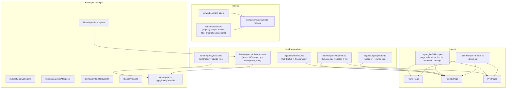

# Design Document

## Overview

This feature re-skins the existing App to match the eight Screen_Mockups, without changing the AWS calls, the safety rules, or any route's business logic except the one addition in Requirement 18 (the Emergency_Rule and Emergency_Source). It is a styling, layout and small-interaction pass over components and hooks that already exist, plus:

- A new typed Theme_Tokens surface (`src/components/ui/styles.ts`, extended, and a small new `src/lib/theme/tokens.ts` constants module) that both themes read from.
- A self-hosted Inter font, following the existing Creepster pattern in `src/app/fonts.ts`.
- Three new small, pure, presentation-only modules: a Job_Tracker view mapper, an Urgency_Meter step mapper, and the Emergency_Reasons_File — each a pure function with no AWS calls, each unit- and property-tested without rendering.
- A thin Emergency_Rule_Wrapper in `src/lib/emergency/` that supplies the Emergency_Rule code for a text, and one Emergency_Source tag per call site. The Emergency_Rule and Emergency_Source are saved at the three places a job becomes an emergency (`inspect` pre-check, `inspect` post-check, and the `reply`/`chat` override through `applySafetyOverride`). The routes keep deciding with `replyTriggersEmergency` and the existing checks.
- A guided-intake change (Requirement 16) that swaps two `ChipGroup`s for two native `<select>`s in `StepTwo.tsx`, with no change to `intakeReducer.ts`, `answerMapper.ts`, or `stepValidation.ts`'s contracts — only `StepTwo.tsx` and the `guided-intake` documents change.
- A Desktop_Layout (Requirement 17) added beside each existing Phone_Layout, using Tailwind breakpoint classes (`lg:`, which is 1024 px in the default Tailwind scale) rather than new component trees, so the same JSX renders both layouts.

No new npm package, no new AWS call, no new page route. Safety code (`src/lib/safety/`, `EMERGENCY_MESSAGE`, `src/components/sourceScan.test.ts`) is not edited.

### Why this is not a Correctness-Properties-free feature

Most of this feature is UI rendering, which the workflow's PBT guidance says to test with examples and snapshots, not properties. However, five small areas are pure, input-varying functions newly introduced or newly load-bearing for safety/consistency, so they get property tests: the Job_Tracker status→view mapping, the Urgency_Meter current-step mapping, the Filter_Chip count function, the dropdown/chip answer-string equivalence (a regression property on existing code), the Live_Summary/Review_Text text equivalence, and the Requirement 18 properties (wrapper agrees with `replyTriggersEmergency`, rule→source mapping, no-homeowner-text, immutability once emergency, rule→sentence mapping). These are listed in Correctness Properties below.

## Architecture



### Layering rules kept from the existing codebase

- AWS calls stay inside `src/lib/aws/*`; no component or new pure module calls AWS directly.
- Route handlers stay the only bridge from the browser to AWS (per the `structure` steering doc); this feature adds no new route handler, it only adds two optional stored fields (`emergencyRule`, `emergencySource`) written by the existing write paths (`persistInspection`, `applySafetyOverride`).
- `src/lib/safety/safetyLayer.ts` and `src/lib/safety/replyCheck.ts` are unchanged; the new `lib/emergency/ruleWrapper.ts` only reads `SafetyCheckResult.triggeredCondition` (already returned today), and `lib/emergency/source.ts` is a type. Neither changes what counts as an emergency.

## Components and Interfaces

### Theme tokens

`src/components/ui/styles.ts` gains new exported recipes, read by components through classes (so `sourceScan.test.ts` keeps passing):

- `PAGE_BG`, `CARD_14` (14 px radius), `MUTED_TEXT`, `ACCENT_TEXT`, `ACCENT_BUTTON`, `ACCENT_BUTTON_HOVER` — map to the five-colour Normal_Palette of Requirement 1, criterion 1, added to `tailwind.config.ts` under a new `theme.extend.colors.normal` key (`page`, `card`, `card-border`, `text`, `muted`, `accent`, `accent-hover`, `emergency`) alongside the existing `brand`/`urgency`/`haunted` keys. Existing `slate-*`/`blue-*` utility classes used today are replaced by these named tokens where the mockups specify the Normal_Palette; `haunted.*` tokens are untouched.
- `URGENCY_METER_COLORS` and `FILTER_CHIP_COLORS` — small `Record`s keyed by `UrgencyLevel` / chip id, holding the exact hex-backed Tailwind classes from Requirement 7, criterion 4 and Requirement 9. These replace the ad hoc `URGENCY_CLASSES` map in `UrgencyBadge.tsx` (extended, not replaced wholesale, to avoid an unrelated rewrite) and add the matching Filter_Chip classes.
- `CARD_14` and `CARD` keep both the Haunted and Normal arms, per the existing pattern (`haunted:` variant classes beside Normal classes on the same string), so the `haunted:` pairing convention in `styles.ts` is preserved for every new recipe.

### Fonts

`src/app/fonts.ts` gains:

```ts
export const bodyFont = localFont({
  src: '../assets/fonts/inter/Inter-Variable.ttf',
  weight: '400 700',
  style: 'normal',
  variable: '--font-body',
  display: 'swap',
  fallback: ['system-ui', 'sans-serif'],
});
```

The user supplies one variable font file, `Inter-Variable.ttf`, and `OFL.txt` in `src/assets/fonts/inter/`. That one file covers the weights 400, 500, 600 and 700, so no static weight files are used or added. `tailwind.config.ts`'s `fontFamily.sans` becomes `["var(--font-body)", "system-ui", "sans-serif"]`; `layout.tsx`'s `<html className>` gains `bodyFont.variable` beside `displayFont.variable`; `globals.css`'s `body { font-family: ... }` switches to `var(--font-body, system-ui, sans-serif)`. No `<link>` to Google Fonts is added anywhere (the mockups' Google Fonts `<link>` is the one deliberate difference already named in the Assumptions).

### Site header and footer (Requirement 2)

`layout.tsx`'s inline header/footer JSX is extracted into two components so the Pro "PRO" tag and "Log out" slot can be passed in without duplicating markup:

- `src/components/ui/SiteHeader.tsx` — props: `{ tag?: 'PRO'; onLogout?: () => void }`. Renders the title, the Haunted_Art band (Requirement 11.1, delegated to the existing `HeaderSilhouette`), the optional "PRO" tag, the optional "Log out" button, and `<ThemeToggle />` (which already hides itself via `inEmergency`, so no header-level emergency branching is needed — this keeps the existing `ThemeToggle`/`EmergencyScope` contract unchanged, satisfying Requirement 2 criterion 2 for free).
- `src/components/ui/SiteFooter.tsx` — static footer with the existing text and the new `Weekly_Reset_Link`.
- The root `layout.tsx` renders the single `<SiteHeader />` and `<SiteFooter />` on every route. There is no second header and no route-segment layout for `/pro`.
- The header learns about Pro pages through one small client context, `src/components/pro/ProChromeContext.tsx`. `ProDashboard.tsx` and `JobDetail.tsx` register `{ tag: 'PRO', loggedIn, onLogout }` into this context, and `SiteHeader` reads it to show the "PRO" tag and, only when `loggedIn` is true, the "Log out" button. The body-level "Log out" button in `ProDashboard.tsx` is removed (Requirement 2, criterion 4). The `/pro` access code form registers the tag with `loggedIn: false`, so it shows "PRO" and no "Log out".
- The registration mirrors the existing `EmergencyScope` / `ThemeProvider.registerEmergencyScope` pattern: the Pro page registers on mount and clears on unmount, so other routes see no tag. The context has no AWS calls. It forwards the existing log-out callback and a `loggedIn` boolean that the existing Pro hooks already compute.

### Job Tracker (Requirement 6)

- `src/lib/jobs/trackerView.ts` (new, pure, no AWS): `export type TrackerView = { kind: 'steps'; steps: readonly TrackerStepState[]; currentIndex: number } | { kind: 'end'; reason?: string }` and `export function trackerViewFromStatus(status: Exclude<JobStatus, 'emergency'>, declineReason?: string): TrackerView`. The four step labels are a module constant `TRACKER_STEPS = ['Result', 'Tradesperson reviewing', 'Pick a time', 'Booked'] as const`.
- `src/components/results/JobTracker.tsx` (new) — renders `TrackerView` plus the existing `role="status"` text (reusing `HOMEOWNER_STATUS_TEXT` from `lib/jobs/copy.ts`), "Updates every 30 seconds.", and a Refresh button. It takes the same `polling: UseStatusPollingReturn` prop shape `StatusPanelBody` already takes, so `ResultsView.tsx`'s `NormalResult` swaps `StatusPanelBody`'s status-text block for `JobTracker` while keeping `StatusPanelBody`'s booking-render delegation (`hideBooking` stays `true` there; `JobTracker` itself never renders booking controls, keeping single-responsibility).
- Emergency check: `JobTracker` is only ever mounted from `NormalResult`, which is only ever mounted when `isEmergency` is false (see `ResultsView.tsx`'s existing branch), so "no Job_Tracker and no status request on an Emergency_Page" (Requirement 6.10) holds by the same structural guarantee that already keeps `useStatusPolling` out of the emergency branch today — no new conditional is needed.

### Urgency Meter (Requirement 7)

- `src/lib/jobs/urgencyMeter.ts` (new, pure): `export const URGENCY_METER_STEPS = ['monitor', 'soon', 'urgent', 'emergency'] as const satisfies readonly UrgencyLevel[]` and `export function currentMeterIndex(urgency: Exclude<UrgencyLevel, 'emergency'>): number` (trivial lookup, but centralised so the property test in Correctness Properties has one function to call).
- `src/components/results/UrgencyMeter.tsx` (new) — renders the four steps with the existing `UrgencyBadge` for the current one, `aria-current="step"` on the current `<li>`, and a non-colour mark (a check glyph, reusing the existing `URGENCY_ICON` pattern in `UrgencyBadge.tsx`) on every step, not just the current one, so colour is never the only signal.
- `UrgencyMeter` is rendered by `NormalResult` only (never in the `isEmergency` branch of `ResultsView.tsx`), satisfying "no meter on an Emergency_Page" the same structural way as the Job_Tracker.

### Emergency Reason (Requirement 18)

- `src/lib/emergency/reasons.ts` (new, next to `messages.ts`, not under `src/lib/safety/`):

  ```ts
  import type { EmergencyConditionCode } from '@/lib/safety/safetyLayer';

  export const EMERGENCY_REASON_SENTENCES: Record<EmergencyConditionCode, string> = {
    GAS_SMELL: 'This may be a gas leak.',
    ELECTRICAL_FIRE: 'This may be an electrical fire risk.',
    WATER_ELECTRICAL: 'Water near electricity can cause shocks or a fire.',
    CO_ALARM: 'A carbon monoxide alarm means the air may be unsafe to breathe.',
  };

  /** Total: unknown or absent codes (older jobs, or a job saved before this feature) get no sentence. */
  export function emergencyReasonSentence(code: string | undefined): string | undefined {
    return code !== undefined && code in EMERGENCY_REASON_SENTENCES
      ? EMERGENCY_REASON_SENTENCES[code as EmergencyConditionCode]
      : undefined;
  }
  ```

  This file imports only a type from `safetyLayer.ts` (erased at compile time), so it adds no runtime coupling and does not change `src/lib/safety/`.

- `src/lib/emergency/ruleWrapper.ts` (new, Emergency_Rule_Wrapper, outside `src/lib/safety/`): `export function emergencyRuleFor(text: string): { isEmergency: boolean; rule?: EmergencyConditionCode }`. It calls the unchanged `checkEmergency` with the same single-answer input that `replyTriggersEmergency` uses (`{ location: text, duration: '', recentChanges: '' }`) and returns `isEmergency` and `triggeredCondition` as `rule`. It decides nothing itself. `src/lib/safety/replyCheck.ts` is not changed, and the routes keep calling `replyTriggersEmergency` to decide whether a text is an emergency. The wrapper is called only after that decision is true, to get the rule code. For the inspect route, the rule comes from the `SafetyCheckResult` that the route already holds, so the wrapper is used only for reply and chat text.

- `src/lib/emergency/source.ts` (new): `export type EmergencySource = 'precheck' | 'postcheck' | 'override';`, a type only. Call sites pass the literal directly (`'precheck'` in `inspect/route.ts`'s pre-Bedrock branch, `'postcheck'` in its post-Bedrock branch, `'override'` in the reply and chat override). A booking request carries no Homeowner text and never creates an emergency, so it never sets a source.

- **Data model additions** (see Data Models below): `JobRecord` gains optional `emergencyRule?: EmergencyConditionCode` and `emergencySource?: EmergencySource`. `InspectionResult` gains the same two optional fields so the inspect-response and GET-by-id response can carry them. `HomeownerStatusView`'s `emergency` variant gains an optional `reasonSentence?: string` (pre-computed server-side via `emergencyReasonSentence`, never the raw code, so the client never needs the mapping table — keeping `EMERGENCY_REASON_SENTENCES` a server-only concern is not required by the requirements, but sending the already-resolved sentence is simpler and avoids shipping the mapping to the client twice; the Pro `ProJobDetailEmergency` gains the same `reasonSentence?: string`).

- **Write paths** (no new route, three existing call sites gain one field write each):
  1. `src/app/api/inspect/route.ts`: both `applyOverrides` calls already receive `preCheck`/`postCheck` (a `SafetyCheckResult`). `finish()` is extended to also persist `emergencyRule: safetyResult.triggeredCondition` and `emergencySource: 'precheck' | 'postcheck'` (chosen by which branch called `finish`) when `safetyResult.isEmergency` is true. `applyOverrides` itself is not changed (it stays a pure merge function); the two new fields are added to the `OverrideContext`/`InspectionResult` object assembled right after it, in the route, mirroring how `id`/`createdAt`/`s3Keys` are already assembled there rather than inside `applyOverrides`.
  2. `src/lib/aws/jobs.ts`'s `applySafetyOverride(id, replyText, nowIso)` gains a fourth parameter, `rule: EmergencyConditionCode`, threaded from its two callers (`reply/route.ts`, `chatRoute.ts`). Each caller keeps deciding with `replyTriggersEmergency(text)` (unchanged, still boolean). When it returns true, the caller calls `emergencyRuleFor(text)` from the Emergency_Rule_Wrapper to get the code and passes it on. `applySafetyOverride`'s `OVERRIDE_SET` expression gains `emergencyRule = :rule, emergencySource = :override`. The `book` route does not call `applySafetyOverride` with new data: it only returns the existing emergency (HTTP 409) and writes nothing.
  3. `persistInspection` (dynamodb.ts) already spreads `...result`, so once `InspectionResult` carries the two optional fields from step 1, they are persisted with no change to `persistInspection` itself.
  4. Route order (Requirement 18.6): the new fields do not change the step order of `POST /api/inspect`. The pre-check stays before the rate limiter and before Bedrock. The fields are only added to the object that the route already assembles when it persists. `route.emergencyOverLimit.test.ts` and the existing route-order tests stay unchanged and must keep passing.
  5. Immutability (Requirement 18.8): all three write paths already use a `ConditionExpression` that fails once `status = 'emergency'` (`OVERRIDE_NOT_EMERGENCY` in `jobs.ts`; the `inspect` route only ever runs on a brand-new, not-yet-persisted job, so it cannot double-write). No new condition logic is needed — the existing conditional-write guard that already protects `status`/`urgency`/`isEmergency` is extended to cover the same attributes it already covers, since `emergencyRule`/`emergencySource` are written in the exact same `UpdateExpression` string that is already gated by `OVERRIDE_NOT_EMERGENCY`.

- **Read/display paths**:
  - `toHomeownerStatusView` (views.ts) and `toProEmergencyDetail`/`toProDetail` (views.ts) gain the one extra field, computed with `emergencyReasonSentence(job.emergencyRule)`.
  - `ResultsView.tsx`'s `isEmergency` branch and `StatusPanelBody`'s `view?.status === 'emergency'` branch both already have a `view`/`result` object in scope; each gains one line rendering the sentence (a new small `EmergencyReasonLine.tsx` component: a `<p>` with the fixed `NOTE_BOX`-sibling style described in Requirement 18.9 — no `haunted:` class, same pattern as the existing `NOTE_BOX` recipe that already documents "no haunted: class" for the Pro emergency note).
  - `ProEmergencyView.tsx` gains the same `EmergencyReasonLine` directly under `PRO_EMERGENCY_NOTE`.
  - Requirement 18.15 ("shown with the response that returns it, not after a reload") is satisfied because every place that already returns an emergency result in its HTTP response (`inspect` POST, `reply` POST, `chat` POST/GET, `book` POST's 409 for an existing emergency, `status` GET) is extended to include the same new optional field on the same response body it already returns, and every client-side consumer of those responses (`toEmergencyResult` in `emergencyView.ts`, `viewFromChat`, `applyView`/`applyLive`) is extended to carry the field through unchanged, following the existing pattern where those functions already forward `likelyIssue`/`trade`/etc. verbatim.

### Guided Intake dropdowns (Requirement 16)

- All guided intake components live in `src/components/intake/`. `StepTwo.tsx`'s two `ChipGroup`s for Location and Duration are replaced with two `<select>` elements, each wrapped in a small new `src/components/intake/SelectField.tsx` (mirroring the existing `FreeTextField.tsx` for a label+control+error pattern), reusing `LOCATION_OPTIONS`/`DURATION_OPTIONS` from `lib/intake/options.ts` unchanged, and dispatching the same `setLocation`/`setDuration` actions `intakeReducer.ts` already defines. No reducer, answer-mapper, or validation change: `IntakeChoices.location`/`.duration` keep the same `LocationOption | null` / `DurationOption | null` types, so `mapAnswers`, `exactPlaceLimit`, `validateStep`, and every existing test of those pure functions is untouched (Requirement 16.8 holds structurally, not just by a new test — see Property 5).
- The Sample_Button handler in `GuidedIntake.tsx` already dispatches `applySample` with `location`/`duration` values from `SAMPLE_MANIFEST`; this is unchanged, satisfying Requirement 16.5.
- The guided-intake spec's own `requirements.md`/`design.md`/`tasks.md` are updated in the tasks phase of *this* feature (named in Requirement 16.12) to describe the two `<select>`s in place of the two chip groups; this design does not restate guided-intake's full document, only the touch points above.

### Desktop Layout (Requirement 17)

- `src/lib/layout/sections.ts` (new, pure, no rendering): exports a `LayoutDefinition` type and three constants — `HOME_LAYOUT`, `RESULTS_LAYOUT`, `PRO_JOB_LAYOUT` — each `{ phone: readonly SectionId[]; desktop: { left: readonly SectionId[]; right: readonly SectionId[] } }`, where `SectionId` is a string-literal union naming each section (`'urgency-meter' | 'issue-title' | 'who-to-call' | ...`). These constants are the Layout_Definition the requirements name; they are data, not components, so Requirement 15.9's tests read the constant directly rather than inspecting rendered DOM order, which is both simpler and exactly what "testable without rendering" calls for elsewhere in this design (the same style already used for `trackerViewFromStatus`).
- One DOM order serves both layouts (Requirement 17.12, 17.13). The DOM lists the left column first, then the right column. The Phone_Layout shows that same order in one column. At `lg:` (1024 px) the two columns sit side by side with a CSS grid. No CSS `order` or grid-area reordering is used, so the keyboard Tab order follows the visual reading order in both layouts. The `desktop.left` list followed by the `desktop.right` list always equals the `phone` list.
- The components render their sections by mapping over the Layout_Definition constants, so the constant is the single source of truth for section order. `RESULTS_LAYOUT` is:
  - `phone`: `back-link`, `urgency-meter`, `issue-title`, `likely-diagnosis-line`, `who-to-call`, `likely-cost`, `job-brief`, `questions`, `safe-things`, `chat`, `job-tracker`, `booking`, `notice-copy-link`, `help`.
  - `desktop.left`: `urgency-meter`, `issue-title`, `likely-diagnosis-line`, `who-to-call`, `likely-cost`, `job-brief`, `questions`, `safe-things`, `chat`.
  - `desktop.right`: `job-tracker`, `booking`, `notice-copy-link`.
  - Above the two columns on desktop: `back-link`. Below both columns, full width: `help`.
  - Concatenated in order, `back-link` + left + right + `help` equals `phone`.
- `HOME_LAYOUT` and `PRO_JOB_LAYOUT` follow the same rule. On the Home_Page the left column holds the current Step and the right column holds the Inspection_Panel. On the Pro_Job_Page the left column holds job brief with questions, photos, homeowner's answers and chat; the right column holds trade, likely cost, AI confidence and the Respond_Panel. In both, the phone list equals left then right (with `help` last on the Pro_Job_Page), and the DOM follows that order.
- Sticky behaviour (Requirement 17.9): the Inspection_Panel and the Results and Pro-job desktop right columns use a `STICKY_PANEL` class in `styles.ts` that applies `position: sticky; top: <header height>` only inside a min-height media query. `tailwind.config.ts` defines a custom screen, `tall: { raw: '(min-height: 900px) and (min-width: 1024px)' }` (the exact height is the tallest panel plus the header, set when the tasks phase measures it), and the class is `tall:sticky tall:top-<n>`. In a shorter window the panel is a normal block that scrolls with the page, the whole panel is shown, and no `overflow-y-auto`, `max-height` or inner scroll box is used. The final checkpoint checks this in a short window.

## Data Models

```ts
// src/lib/emergency/source.ts
export type EmergencySource = 'precheck' | 'postcheck' | 'override';

// src/types/inspection.ts (additions)
export interface InspectionResult {
  // ...existing fields unchanged...
  emergencyRule?: EmergencyConditionCode;   // only set when isEmergency is true
  emergencySource?: EmergencySource;        // only set when isEmergency is true
}

// src/types/job.ts (additions)
export interface JobRecord extends InspectionResult {
  // ...existing fields unchanged... (emergencyRule/emergencySource inherited from InspectionResult)
}

export type HomeownerStatusView =
  | { status: 'new' }
  | { status: 'info_requested'; question: string }
  | { status: 'accepted'; offeredSlots: TimeSlot[] }
  | { status: 'declined'; reason?: string }
  | { status: 'booked'; bookedSlot: TimeSlot }
  | { status: 'emergency'; message: string; reasonSentence?: string }; // + reasonSentence

export interface ProJobDetailEmergency {
  id: string; createdAt: string; status: 'emergency'; urgency: 'emergency';
  likelyIssue: string; answers: ContextAnswers;
  emergencyNote: string;
  reasonSentence?: string; // +
}

// src/lib/jobs/trackerView.ts
export const TRACKER_STEPS = ['Result', 'Tradesperson reviewing', 'Pick a time', 'Booked'] as const;
export interface TrackerStepState { label: (typeof TRACKER_STEPS)[number]; state: 'done' | 'current' | 'upcoming' }
export type TrackerView =
  | { kind: 'steps'; steps: readonly TrackerStepState[]; currentIndex: number }
  | { kind: 'end'; reason?: string };

// src/lib/jobs/urgencyMeter.ts
export const URGENCY_METER_STEPS = ['monitor', 'soon', 'urgent', 'emergency'] as const;

// src/lib/layout/sections.ts
export type SectionId = string; // concrete literal union enumerated per page, see Components section
export interface LayoutDefinition {
  phone: readonly SectionId[];
  desktop: { left: readonly SectionId[]; right: readonly SectionId[] };
}
```

### Response/stored-shape changes (Requirement 18.16 inventory)

Every shape below gains exactly the two fields shown, both optional, both absent unless the job is an emergency (rule/source) or the view is the emergency view (reasonSentence). No existing field is renamed, removed, or retyped.

| Shape | File | New field(s) |
|---|---|---|
| `InspectionResult` (stored job, inspect response, GET-by-id response) | `types/inspection.ts`, `lib/validation/inspectionSchema.ts` (`inspectionResultSchema`), `lib/validation/jobSchema.ts` (`storedJobSchema`) | `emergencyRule?`, `emergencySource?` |
| `JobRecord` (DynamoDB item shape) | `types/job.ts` | inherited from `InspectionResult` |
| `HomeownerStatusView` emergency variant (status GET, reply POST 200, chat POST/GET emergency body) | `types/job.ts`, `lib/validation/jobSchema.ts` (`homeownerStatusViewSchema`), `types/chat.ts` (`ChatEmergencyResponse`) | `reasonSentence?` |
| `ProJobDetailEmergency` (pro job GET, pro chat emergency body) | `types/job.ts`, `lib/validation/jobSchema.ts` (`proDetailEmergencySchema`) | `reasonSentence?` |
| `ApiErrorBody` 409 `JOB_IS_EMERGENCY` body (book/reply/chat/pro-action conflict responses) | `types/job.ts`, `lib/jobs/conflict.ts`, `lib/jobs/proAction.ts` | `reasonSentence?` (same optional field, added to `errorBody(...)`'s status-carrying variant). The `book` route only reads the stored rule of an existing emergency to fill this field. It never sets or changes `emergencyRule` or `emergencySource`. |

Existing tests that fix these shapes exactly (e.g. snapshot-style `toStrictEqual`/`toEqual` assertions on a full response body, rather than `toMatchObject`) are the ones the tasks phase must update on purpose, one by one, named in the task that touches them; tests using `toMatchObject` or field-by-field assertions need no change since the new fields are additive and optional. `emergencyIrreversible.property.test.ts` is explicitly named in Requirement 18.16 to keep passing: it asserts the existing immutable fields (`status`, `urgency`, `isEmergency`, costs, etc.) never change after an override; it does not assert the full object shape, so adding two new fields written at the same time as the existing ones does not change what it tests, and its own property (first-write-wins) extends naturally to the two new fields without modifying the test.

## Correctness Properties

*A property is a characteristic or behavior that should hold true across all valid executions of a system — essentially, a formal statement about what the system should do. Properties serve as the bridge between human-readable specifications and machine-verifiable correctness guarantees.*

### Property 1: Job_Tracker maps every non-emergency status to exactly one view

For all `Job_Status` values other than `emergency`, and for all optional decline reasons, `trackerViewFromStatus` returns exactly one `TrackerView` (either a `steps` view with exactly one step marked `'current'` and every earlier step marked `'done'`, or an `end` view for `declined`), and the view is a pure function of its inputs (calling it twice with the same inputs returns deep-equal results).

**Validates: Requirements 6.3, 6.4, 6.5, 6.6, 6.11**

### Property 2: Urgency_Meter marks exactly one current step matching the label

For all `Urgency` values of `Monitor`, `Soon` and `Urgent`, `currentMeterIndex` returns an index into `URGENCY_METER_STEPS` whose label equals the input urgency, and no other index is treated as current by the rendering logic that consumes it.

**Validates: Requirements 7.3, 7.7**

### Property 3: Filter_Chip counts always match their filtered result

For all arrays of `ProJobListItem` (of any length, with statuses drawn from the six `JobStatus` values), for every `Filter_Chip` other than "All", the number shown in that chip equals the number of items in the array whose `status` equals the chip's status; the "All" chip's count equals the array's length; and filtering the array by a chip's predicate yields exactly that many items.

**Validates: Requirements 9.4, 9.14**

### Property 4: Live_Summary text equals the Step 3 Review_Text for the same state

For all `IntakeChoices` and their corresponding `ContextAnswers` (as produced by `mapAnswers`), the text the Live_Summary renders for the safety answers, location, duration and "anything else" equals the text `ReviewList` renders for the same `choices`/`answers`, field for field.

**Validates: Requirements 17.4, 17.5**

### Property 5: Dropdown answer strings equal chip answer strings (regression)

For all `IntakeChoices` values reachable through the Step 2 dropdowns, `mapAnswers(choices)` is unchanged from (deep-equal to) the `ContextAnswers` `mapAnswers` would have produced for the same `choices` before this feature, because `mapAnswers`, `intakeReducer`, and the `IntakeChoices` type are not modified by the dropdown swap — only `StepTwo.tsx`'s rendering changes. The existing `answerMapper` property tests are re-run unmodified as the executable form of this property.

**Validates: Requirements 16.8**

### Property 6: Emergency_Rule and Emergency_Source are a total, consistent pair

For all `SafetyCheckResult` values with `isEmergency: true` and for each of the three call sites (`precheck`, `postcheck`, `override`), the job saved after that call site carries `emergencyRule` equal to the result's `triggeredCondition` and `emergencySource` equal to that call site's fixed literal; for all `SafetyCheckResult` values with `isEmergency: false`, no job write sets either field.

**Validates: Requirements 18.1, 18.2**

### Property 7: No homeowner text reaches the stored emergency attributes

For all strings a homeowner could submit (as `location`, `duration`, `recentChanges`, a reply, or a chat message) that trigger an emergency under `checkEmergency`, the job record saved as a result contains neither the submitted string nor any non-empty substring of it in `emergencyRule`, `emergencySource`, or any other attribute that did not already exist before this feature (the existing `replies`/`infoRequests` text-storing fields are exempted, since Requirement 18.3 is about the *new* attributes only).

**Validates: Requirements 18.7, 18.13**

### Property 8: Once emergency, the saved rule and source never change

For all jobs already saved with `emergencyRule` and `emergencySource` set, and for all further attempts to trigger an emergency on that job (any call site, any trigger text), the job's `emergencyRule` and `emergencySource` after the attempt equal their values before the attempt, and no write occurs (mirroring the existing `OVERRIDE_NOT_EMERGENCY` guard's effect on `status`/`urgency`/`isEmergency`).

**Validates: Requirements 18.8**

### Property 9: The reason-sentence mapping is total and exact

For all values of `emergencyRule` (each of the four `EmergencyConditionCode`s, `undefined`, and any string that is not one of the four codes), `emergencyReasonSentence` returns the exact fixed sentence for a known code, and returns `undefined` for `undefined` or an unrecognised code — never throwing, never returning text derived from anything other than the fixed map.

**Validates: Requirements 18.9, 18.10, 18.14**

### Property 10: The Emergency_Rule_Wrapper agrees with replyTriggersEmergency (required)

For all strings `text`, `emergencyRuleFor(text).isEmergency` equals `replyTriggersEmergency(text)`, and when `isEmergency` is true, `rule` is one of the four Emergency_Rule codes, and when it is false, `rule` is `undefined`.

**Validates: Requirements 18.4, 18.5**

## Error Handling

- **Font load failure / missing files at build time**: `next/font/local` fails the build if a referenced file is missing, which is the desired behaviour here (the build constraint already states the user adds the files before the fonts task is finished); no runtime fallback branch is needed beyond the existing `fallback: ['system-ui', 'sans-serif']` option, which next/font already applies while the font is loading or if it 404s at the CDN layer (not applicable here since the font is bundled, not fetched).
- **`applySafetyOverride`'s new parameter arriving as an unrecognised code**: cannot happen in practice because `triggeredCondition` is only ever produced by `checkEmergency`'s own `detect()` function, which returns one of the four literal codes or `undefined`; the call sites only invoke the override path when `isEmergency` is `true`, which Zod's `EmergencyConditionCode`-shaped union (if added to `jobSchema.ts`'s `storedJobSchema`) would reject on read if it were ever wrong, failing safely into the existing `RESULT_INVALID`/`LOAD_FAILED` error paths already in place for any malformed stored job — no new error path is introduced, the existing "job fails Zod validation → 500 with a generic message" path extends to cover this.
– **A pre-feature job with no `emergencyRule`/`emergencySource`**: both fields are optional and the mapping function (`emergencyReasonSentence`) is total over `undefined`, so old jobs render exactly as before (no sentence), satisfying Requirement 18.14 without a migration or a special-cased error branch.
- **Desktop/Phone layout CSS failing to load (e.g. Tailwind purge misses a class)**: out of scope for runtime error handling — caught at build/lint time by `next lint`/`tsc --noEmit`, and at review time by the Requirement 15.13 browser checkpoint, consistent with how the rest of the App treats styling as a build-time concern rather than a runtime error case.
- **Copy_Link_Button clipboard failure**: `navigator.clipboard.writeText` rejecting (unsupported browser, permission denied, non-HTTPS context) is caught and falls back to the `Copy_Fallback_Box`, following the exact existing pattern already implemented for "Copy job brief" (`JobBrief.tsx`'s existing fallback box), reused rather than reinvented.
- **Sticky_Panel in a short window**: handled by CSS alone. The sticky rule applies only inside the min-height media query, so in a shorter window the panel is a normal block that scrolls with the page and is shown whole, with no inner scroll box. There is no JS error state (Requirement 17.9).

## Testing Strategy

**Unit tests** (examples, edge cases, integration points — one or a few concrete cases each):

- Header/footer: title and switch render on a non-emergency page; switch absent and title present on an Emergency_Page; "PRO" tag on `/pro` and `/pro/jobs/[id]`; "Log out" shown only when `ProChrome` reports a logged-in session, and not duplicated in the page body; footer text and `Weekly_Reset_Link` with `rel="noopener noreferrer"` on every page type, including an Emergency_Page; one `main` element and a working skip link.
- Home page: heading/subheading text; photo card heading and count text for 0/1/5 photos and for a video (the count *formula* itself is simple enough that a half-dozen examples give full confidence without a property, since the domain is `{0, 1, 2, 3, 4, 5 photos} ∪ {1 video}`, a fixed enumerable set); drag/drop area text in both the empty and non-empty states; Remove/Clear selection behaviour keeping `choices` unchanged (an example per action, backed by Property-adjacent reasoning but asserted concretely since the reducer already has its own tests); Step 3 notice card text and button sizing; no horizontal scroll at 320–1920 px (a Playwright/browser checkpoint item per Requirement 15.13, not a unit test).
- Results page: section order for the Phone_Layout (reads `RESULTS_LAYOUT.phone` and asserts the rendered DOM order matches it, one test); confidence card layout; cost card text/size; Copy_Link_Button success text with fake timers (`vi.useFakeTimers()`), the 2-second minimum, and the fallback box on a mocked rejected `writeText`; notice text exact match; emergency page renders none of Copy_Link_Button/Notice/Tracker/Meter/Chat/Help (one test asserting all five are absent, since it is a single boolean branch).
- Emergency page: exact section order and content inside `main`; Emergency_Banner's fixed classes and absence of any `haunted:` class (grepping the rendered class list, following the existing `sourceScan.test.ts` style); Normal_Theme forced even when Haunted is on (reuses the existing `EmergencyScope` test pattern).
- Job Tracker: one example per `Job_Status` (`new`, `info_requested`, `accepted`, `booked`, `declined`) asserting the rendered current step and the `Tracker_End_State` text; status text, "Updates every 30 seconds.", and Refresh button presence; no tracker and no status request mounted on an Emergency_Page (asserted by checking `useStatusPolling`/`fetch` is never called, reusing the existing mock-fetch test harness).
- Urgency Meter: the four labels present; text label always visible (one assertion per urgency, four total, cheaper and clearer than a property here); no meter on an Emergency_Page.
- Booking section: heading/legend text when `accepted`; Booking_Card structure, `dateTime` attribute, 2 px border plus visible mark on selection; Confirm button disabled/enabled; booked confirmation text; placement after Chat_Panel; absence of booking UI for `new`/`info_requested`/`declined`/`emergency`.
- Pro job list: heading/subtext/Refresh; existing refresh/loading/empty/error behaviour (already covered, kept); Filter_Chip rendering, `aria-pressed`, no-match text, selection kept after Refresh (interaction examples; the count *correctness* is the property, see below); desktop table columns and header background; emergency row "—" trade, background, no action, and the note text; phone card parity with table rows.
- Pro job page: top section content and `Status_Pill` text; section order (Phone_Layout, one DOM-order test reading `PRO_JOB_LAYOUT.phone`); desktop two-column placement and Sticky_Panel; Photos section heading, grid, and expiry text; cost/confidence text format; Respond_Panel heading, control order, decline/accept behaviour (already covered by existing `pro-dashboard-and-booking` tests, kept); emergency Pro view content and the absence of Chat/Respond/Photos/cost/trade/Help/Sticky_Panel.
- Haunted mode: header art height per page type and `aria-hidden`; Cobweb presence; Ghost_Icon + "No spirits caught yet." in the empty photo box; Ghost_Trade_Label content (reuses existing `tradeMapper`/`TradeText` tests); Fog_Layer presence and `pointer-events: none`; plain wording for urgency/cost/status/error/safety texts; no Haunted_Art/Ghost_Trade_Label/Haunted wording on an Emergency_Page; same section order and text as Normal_Theme on each of the three main pages (one parity test per page, asserting the rendered text content — not styling — is identical between themes).
- Accessibility: touch target size (`getBoundingClientRect().height >= 44`) for the header switch, Copy_Link_Button, Filter_Chips, Location_Select/Duration_Select, Booking_Cards, Refresh buttons; visible focus indicator contrast (reuses the existing `contrastRegistry`/`contrast.ts` machinery, extended with new rows, not new logic); the new Contrast_Registry rows pass through the *existing* property test unmodified (Requirement 14.2's property already exists in `haunted-mode`; this feature does not duplicate it, it adds rows that the existing test iterates over).
- Step 2 dropdowns: labels, options and order match `LOCATION_OPTIONS`/`DURATION_OPTIONS`; empty-first-option text; required marking when `location === 'Other'`; Sample_Button sets both selects; validation error, `aria-invalid`, `aria-describedby`, and focus move on empty submission; error clears on selection; 44 px height and keyboard behaviour of a native `<select>` (mostly implied by using a real `<select>`, asserted once).
- Emergency Reason: one test per `EmergencyConditionCode` asserting the saved rule, saved source, and shown sentence; one test for a job with no saved rule showing no sentence; one test per `EmergencySource` (`precheck`, `postcheck`, `override`) asserting the right literal is stored at the right call site; one test asserting the sentence element carries no `haunted:`-prefixed class.
- Layout_Definition: one test per page (Home, Results, Pro job) and per layout (Phone, Desktop) asserting the exported constant's section order matches Requirement 4.1/10.3/10.4's prose order, and that the rendered DOM order follows the constant (so the constant cannot silently drift from the requirement or from the rendering).

**Property tests** (fast-check, ≥100 iterations each, tagged with the design property they implement):

- `src/lib/jobs/trackerView.property.test.ts` — **Feature: screens-polish, Property 1: Job_Tracker maps every non-emergency status to exactly one view**. Generator: `fc.constantFrom('new','info_requested','accepted','declined','booked')` crossed with `fc.option(fc.string())` for the decline reason.
- `src/lib/jobs/urgencyMeter.property.test.ts` — **Feature: screens-polish, Property 2: Urgency_Meter marks exactly one current step matching the label**. Generator: `fc.constantFrom('monitor','soon','urgent')`.
- `src/components/pro/filterChipCounts.property.test.ts` — **Feature: screens-polish, Property 3: Filter_Chip counts always match their filtered result**. Generator: `fc.array(fc.record({ status: fc.constantFrom(...JOB_STATUSES), ... }))` using the existing `jobFixtures.ts` builder for the non-status fields.
- `src/components/intake/liveSummary.property.test.ts` — **Feature: screens-polish, Property 4: Live_Summary text equals the Step 3 Review_Text for the same state**. Generator: the existing `lib/intake/testArbitraries.ts` `IntakeChoices` arbitrary (reused, not duplicated).
- `src/lib/intake/answerMapper.test.ts` (existing file, unmodified) — **Property 5** is this file re-run as-is; the design note above documents why no new test file is needed.
- `src/app/api/inspect/emergencySourceMapping.property.test.ts` and a chat/reply-side counterpart — **Feature: screens-polish, Property 6: Emergency_Rule and Emergency_Source are a total, consistent pair**. Generator: `fc.record` over context-answer strings drawn from the existing trigger-phrase fixtures already used by `replyCheck.test.ts`/`safetyLayer.test.ts`, crossed with the three call sites (mocking persistence to a `fakeDynamoTable.ts`, already in `src/test/`).
- `src/lib/emergency/noTextLeak.property.test.ts` — **Feature: screens-polish, Property 7: No homeowner text reaches the stored emergency attributes**. Generator: `fc.string()` filtered or mapped to include one of the existing trigger phrases (reusing the trigger-phrase corpus from `replyCheck.test.ts`) plus random padding, asserting the saved `emergencyRule`/`emergencySource` values never contain the padding or the trigger phrase as a substring (they are always one of the four fixed codes/sources, which the test also checks is never equal to or containing the input).
- `src/lib/aws/jobs.emergencyImmutable.property.test.ts` (extends the existing `emergencyIrreversible.property.test.ts` fixture style rather than duplicating its harness) — **Feature: screens-polish, Property 8: Once emergency, the saved rule and source never change**. Generator: an already-emergency `JobRecord` fixture crossed with a second arbitrary trigger attempt.
- `src/lib/emergency/ruleWrapper.property.test.ts` — **Feature: screens-polish, Property 10: The Emergency_Rule_Wrapper agrees with replyTriggersEmergency**. Required. Generator: `fc.string()` mixed with `fc.oneof` of the existing trigger-phrase corpus embedded in random padding, so both emergency and non-emergency texts are covered. `replyCheck.ts` is imported as is, with no change.
- `src/lib/emergency/reasons.property.test.ts` — **Feature: screens-polish, Property 9: The reason-sentence mapping is total and exact**. Generator: `fc.oneof(fc.constantFrom('GAS_SMELL','ELECTRICAL_FIRE','WATER_ELECTRICAL','CO_ALARM'), fc.constant(undefined), fc.string())`.

All property tests use the project's existing `fast-check` dependency and Vitest integration (no new package), configured for at least 100 runs (fast-check's default is already 100; tests that need more coverage for a small discrete domain — Properties 1, 2, 5, 9 — set `{ numRuns: 100 }` explicitly for consistency even though the input domain itself is small, per the workflow's minimum-iteration rule).

**Final checkpoint** (Requirements 15.13 and 15.14, recorded in `BUILD_LOG.md`):

- Playwright MCP on localhost: the Home_Page and the `/pro` access code screen at 390 px and 1280 px, in the Normal_Theme and the Haunted_Theme, plus a check of the Sticky_Panel rule in a window shorter than the panel (the panel scrolls with the page, is shown whole, and has no inner scroll box).
- The owner checks the Results_Page, the booking section and the Pro_Job_Page by hand on the live site. These need a real job and the Pro access code, so the checkpoint lists them and notes that in `BUILD_LOG.md`.
